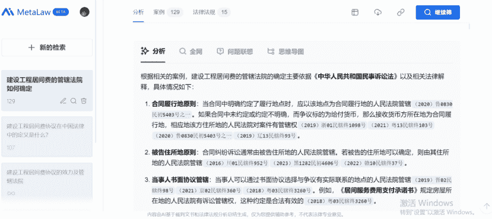
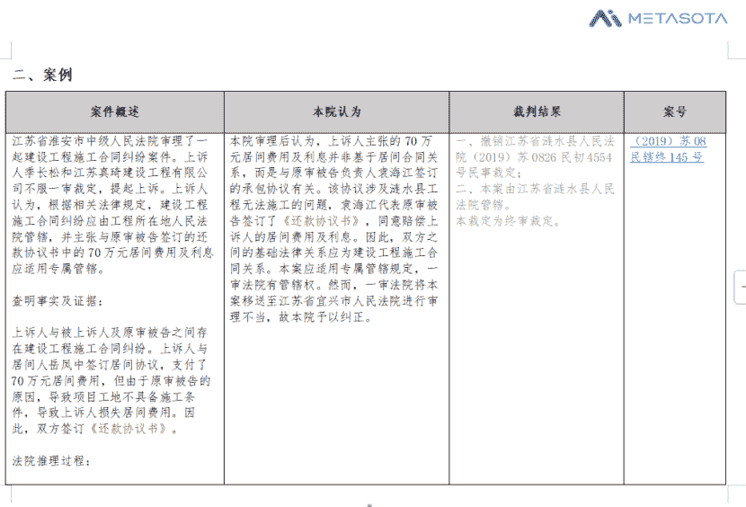
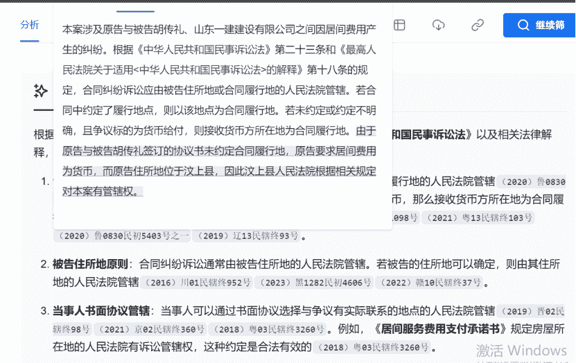
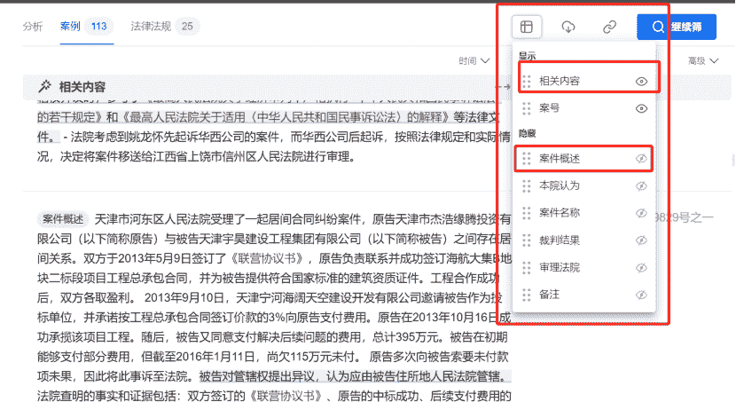
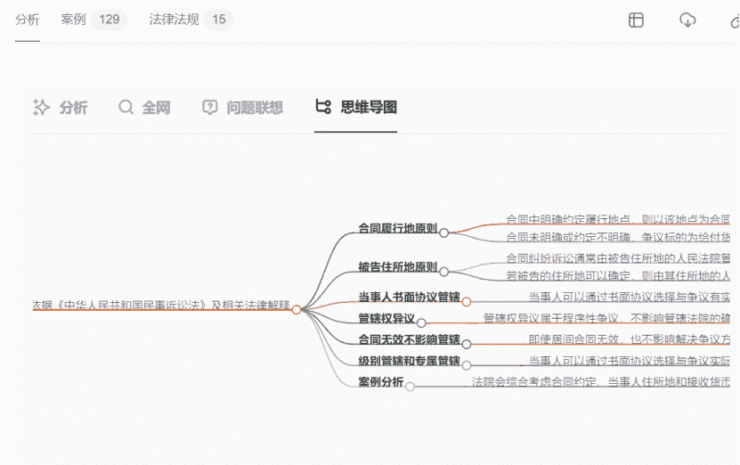

# 【MetaLaw】类案检索

> 来源：[https://docs.feishu.cn/docx/ZSJ2dfyndoBjVjxCs4ucKGoRnBe](https://docs.feishu.cn/docx/ZSJ2dfyndoBjVjxCs4ucKGoRnBe)

---

> 本文来自「学法少女」👸号，作者陈艾琳。作者陆续测评了上海律协“2024 年度最受上海律师欢迎的法律科技产品大赛”的多个获奖作品，与读者们分享真实的使用感受，拥抱科技，解放双手。

**名称：**MetaLaw

**主要功能：**类案检索

**细分板块：**类案分析报告、案例全文链接、相关法律法规、问题联想、思维导图

**适合人群：**律师、法官、社会大众

**生成速度：**快

**优势：**

**1.直接生成案例检索报告**，报告可以下载，如下图。

也可以直接在线浏览文字报告的分析结论，鼠标定位到相关的案号上，可以直接链接到相关案例的“法院认为”部分，相关案例的原文可以直接在该网站浏览，不用链接到其他网站。

另外，类案分析的相关判决，可以自行选择某些部分直接展示出来还是隐藏起来。

**2.问题联想与思维导图。**问题联想是根据用户检索的问题自动联想到其他相关问题，并且对其他问题也直接给出了分析报告和辅助案例，这个可以帮助检索的人更具全面了解自己的问题是否全面、正确。思维导图部分很不错，直接抛出观点和依据，也有一部分拓展。个人觉得，这两个功能加在一起，不光是能够快速得出检索结论，还能辅助律师写专业文章。

**劣势：**

部分二审案件撤销了一审判决，但是案例检索报告中引用的还是一审判决的裁判说理部分，可能会引起误导，需要自己看看引用的一审判决是否存在二审改判的情况。

**使用感受：**这个类案检索做的还是不错的，已经能够帮助律师节省很多时间，很快且准确的作出检索报告，但还是不能完全替代律师自行检索。

**是否推荐使用：**推荐使用