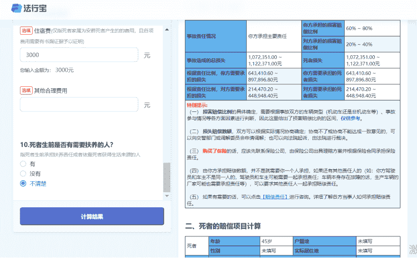
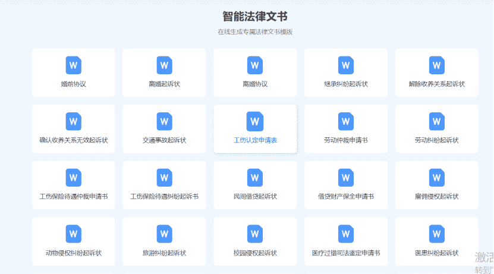
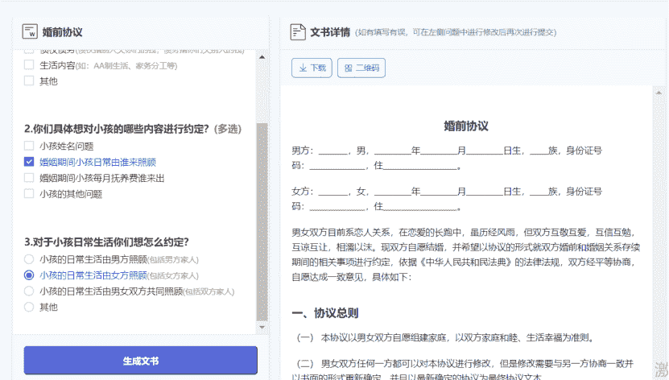

# 【法行宝】

> 来源：[https://docs.feishu.cn/docx/M2hQdHbrCoh3UOxSnCxc5CfRnNe](https://docs.feishu.cn/docx/M2hQdHbrCoh3UOxSnCxc5CfRnNe)

---

> 本文来自「学法少女」公众号，作者陈艾琳。作者陆续测评了上海律协“2024 年度最受上海律师欢迎的法律科技产品大赛”的多个获奖作品，与读者们分享真实的使用感受，拥抱科技，解放双手。

**名称：**法行宝

**主要功能&细分板块：**在线法律意见书、专业法律计算器、智能法律文书

**适合人群：**律师、法律工作者、一般社会大众

**生成速度：**快

**优势：**

**1.在线法律意见书板块。**随机点进去，可以按照提示在选项中填写符合自己情况的内容，很像程序语言，最后输出法律意见书，法律意见书末尾甚至还可以下载起诉状、答辩状、相关协议的模板，最后再附上相关的法律法规和相似案例，功能非常强大。

**2. 专业法律计算器模块。**细分领域很多，涵盖了诉讼费、工伤赔偿、交通事故赔偿、税费计算等，但是现在很多微信小程序也能实现法律费用计算的功能。测试了一下交通事故各项费用的功能，同样是按照选择题进行选项的，不用自己做文字描述，以表格和文字形式呈现，对各项费用做了说明，还有风险提示，非常清晰明了，最后也附上了相关法律规定和案例，部分式样如下。

**3. 智能法律文书模块。**多为常见纠纷的起诉状模板和常见的合同模板，同样是以选择题方式输入自己的需求，最后生成模板，可以直接下载。

总体而言，减少了当事人自己文字描述问题的不方便和不准确，相当于在线定制专属自己的法律文书，感觉开发者同时具有程序员思维和法律思维，三个模块使用下来，已经能解决日常大部分的法律问题，代替律师很多的工作，功能强大。

**劣势：**这款产品的主要集中在常见法律问题，比较复杂商事纠纷的处理功能开发略显不足。

**是否推荐使用：**推荐使用。

笔者认为：法行宝的使用体验不错。