# 【AlphaGPT】

> 来源：[https://docs.feishu.cn/docx/Bq9PdJ110oe6hGxMz8sckVOAnyc](https://docs.feishu.cn/docx/Bq9PdJ110oe6hGxMz8sckVOAnyc)

---

> 本文来自「学法少女」👸号，作者陈艾琳。作者陆续测评了上海律协“2024 年度最受上海律师欢迎的法律科技产品大赛”的多个获奖作品，与读者们分享真实的使用感受，拥抱科技，解放双手。

**名称：**AlphaGPT

**主要功能：**法律咨询、法律研究、类案检索、合同起草、合同审查、文书起草、法律意见、卷宗阅读

**适合人群：**律师、法律从业人员

**生成速度：**快

**优势：**Alpha作为法律工作者常用的工具，深耕法律科技多年，一直以来功能都很强大，这次推出的AlphaGPT有其自身强大的数据支撑，开发的功能相当齐全，因为这款产品的功能很多，与其他产品共性的东西就不必多说了，挑出特色的部分简单介绍一下。

**1.法律咨询：**同样也是分析报告形式呈现，依据法条+法规+参考案例+全网数据作出的报告，报告分析会直接链接数据来源，比较全面。

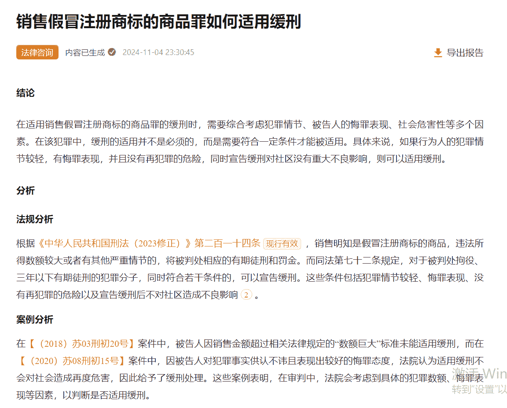

**2.法律研究：**可以直接链接到知乎、百家号、腾讯新闻、👸号等等一系列文章页面；

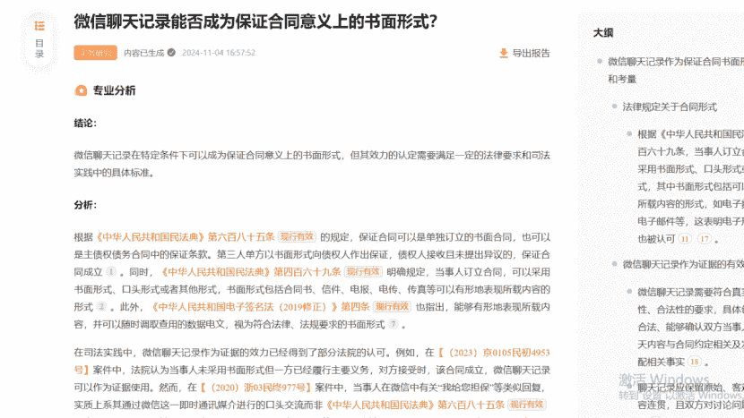

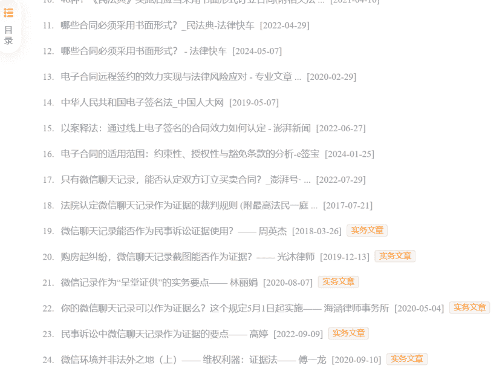

**3.类案检索：**这个功能和Alpha本身检索界面很相似，特色还是按照地域、审级划分，这是与其他类案检索不同的地方。检索界面很清晰，案例也可以直接在当页点击浏览，关键部分以其他颜色突出出来。

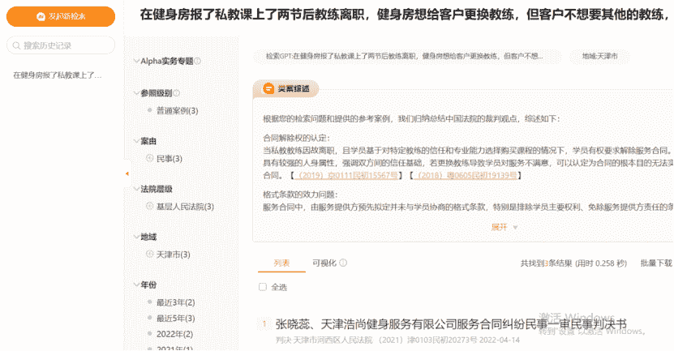

**4.合同起草：**按照页面要求输入内容，会直接出来合同目录，最后生产合同，再结合用户实际需求，支持在线编辑，最终导出合同。

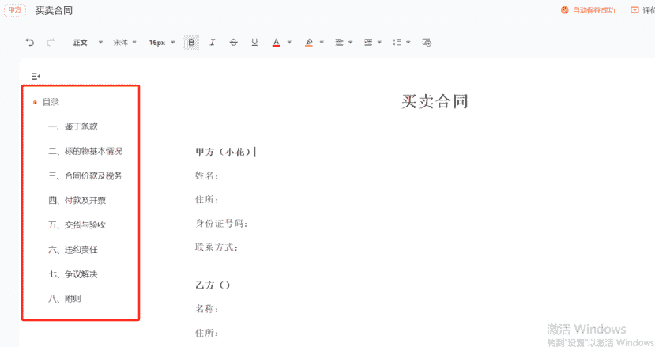

**5.合同审查：**支持上一个功能中的模板，直接引用到合同审查模块中进行审查。

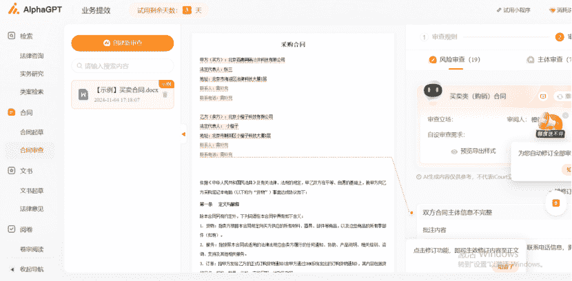

**6.文书起草：**简单输入了几个要素，写出来的律师函的要素都有，如果对问题描述足够详细，写出来的律师函应该不用修改太多。

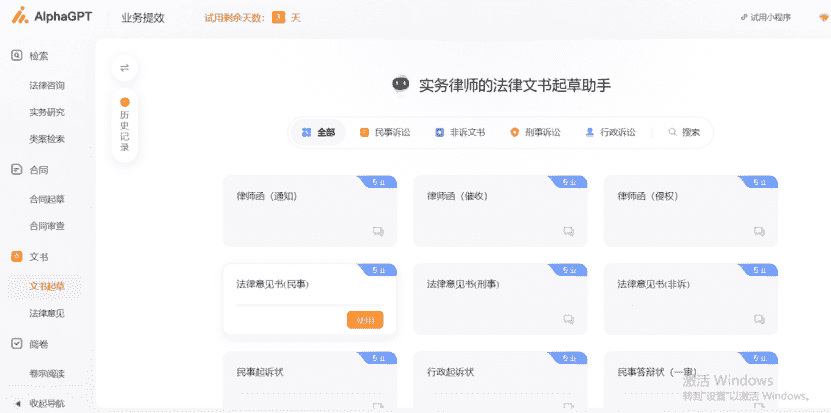

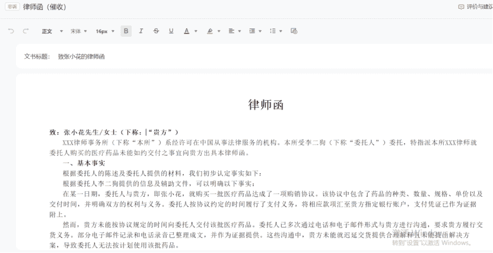

**7.法律意见：**输入案情后，系统会自动对案情进行扩充，并分成多条呈现，不符合实际情况的，用户可以删除，系统再归纳争议焦点，最后用户确认无误后生成报告。

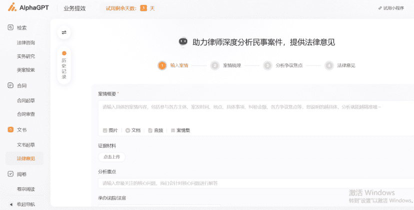

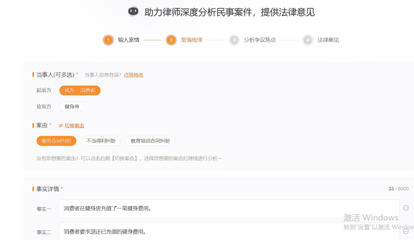

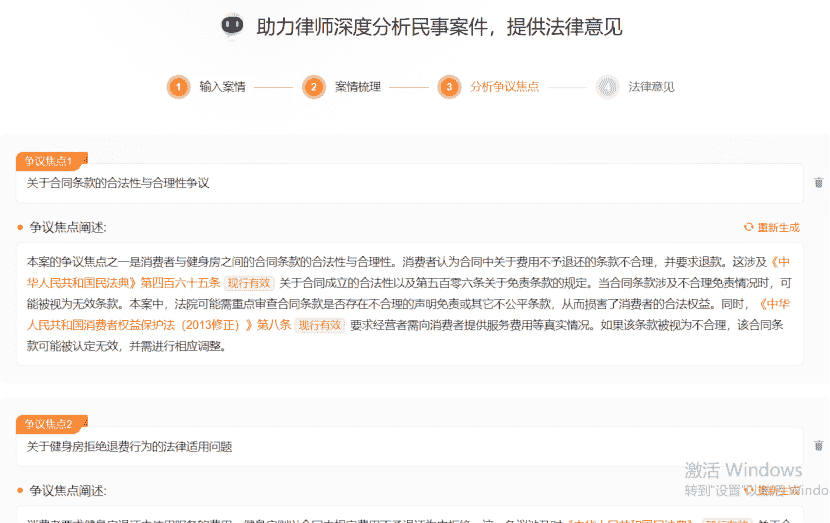

**8.卷宗阅读：**试图发了一张合同的图片进行分析，基本能识别出图片文字的内容，但是试用仅一次，继续使用需要付费。

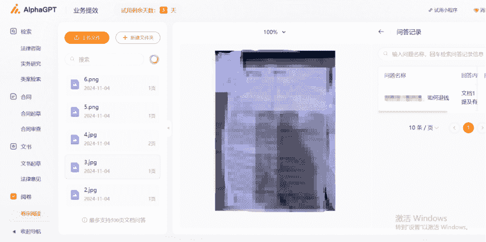

**劣势：**几乎没有毛病，可能会比较贵吧。

**是否推荐使用：**很推荐

笔者横向对比了 MetaLaw 和 AlphaGPT，认为：MetaLaw 的问题联想与思维导图感觉突破了类案检索功能的局限性，对发散性思考问题很有帮助，AlphaGPT 功能很全面，完全可以期待以后会是一个很不错的产品。