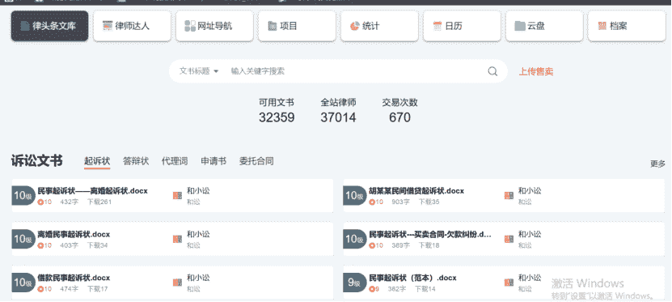
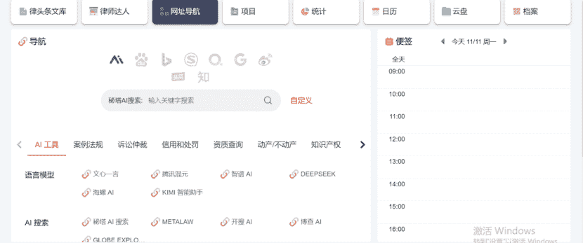

# 【和讼】

> 来源：[https://docs.feishu.cn/docx/ABTwdlR8Vo3ODgxig6scBjsbnlf](https://docs.feishu.cn/docx/ABTwdlR8Vo3ODgxig6scBjsbnlf)

---

> 本文来自「学法少女」👸号，作者陈艾琳。作者陆续测评了上海律协“2024 年度最受上海律师欢迎的法律科技产品大赛”的多个获奖作品，与读者们分享真实的使用感受，拥抱科技，解放双手。

**主要功能：**文书模板获取、律师个人曝光、网址导航、项目规划、日程、律师档案管理、资料统计

**适合人群：**律师

**优势：**笔者个人喜欢这款产品中的“网址导航”功能，像网页中的书签一样便捷，避免重新打开新网页的麻烦，节省筛选广告的时间。

**使用感受：**这款产品像是将网盘、思维导图、无讼的案件合作、日历等功能整合到一个软件中来，功能较多，这一点因人而异，可以是优点也可以是缺点。就我个人而言有些繁琐，要去学习并熟练使用需要花的时间太多。

**是否推荐使用：**笔者日常的文件管理、时间管理做得还可以，这款工具对我而言有点复杂，感兴趣的朋友可以尝试尝试。