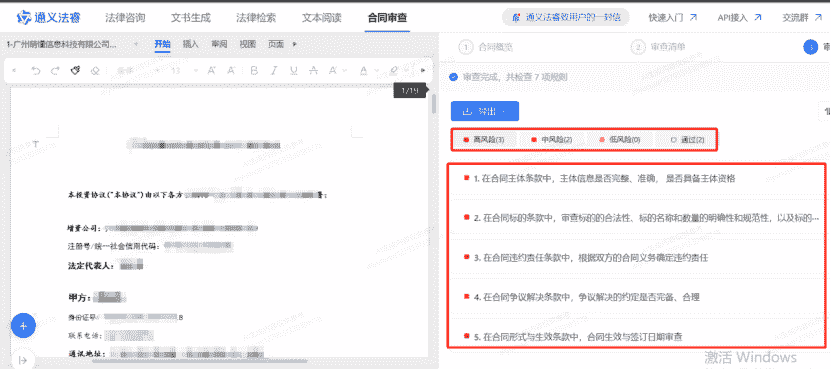

# 【通义法睿】

> 来源：[https://docs.feishu.cn/docx/VsxLdsDH9otCWgxy5awcyeNanZd](https://docs.feishu.cn/docx/VsxLdsDH9otCWgxy5awcyeNanZd)

---

> 本文来自「学法少女」公众号，作者陈艾琳。作者陆续测评了上海律协“2024 年度最受上海律师欢迎的法律科技产品大赛”的多个获奖作品，与读者们分享真实的使用感受，拥抱科技，解放双手。

**主要功能：**法律咨询、文书生成、法律检索、文本阅读、合同审查

**适合人群：**社会大众、法律从业人员

**生成速度：**快，但合同审查部分较慢

**优势：**

1.涵盖了目前市面上法律科技产品的常规功能，例如输入问题后，会直接给出对应的法律规定和案例，法律检索同样也涵盖了法律分析和案例。笔者就同一个问题通过一般的案例检索工具和通义法睿进行对比，通义法睿比人工关键词检索更加准确。

2.文本阅读功能有点出乎笔者意料，笔者上传一份微信聊天记录，文本阅读功能能够整理出双方之间的交易往来明细，虽然不算特别准确，但能快速知道上传材料的大致内容。相比AlphaGPT的每上传一次需要花一次钱，通义法睿相当不错。

3.合同审查的速度稍稍有点慢，先简要生成审查规则，再根据审查规则生成详细的审查报告，还有风险等级划定。针对相关条款，系统给出“建议的合同条款”，如果同意系统的建议，可以直接进行条款替换。笔者进行实测，虽然有些机械，但可以通过系统得出的风险点，结合律师自身的专业素养，查缺补漏，防止人工审查有所遗漏，节约时间。

**劣势：**文书生成部分仅限于拟定起诉状和答辩状两种文书，笔者随便举例帮忙撰写一份文书，引用的法条仍是《合同法》而非《民法典》。

**是否推荐使用：**推荐使用