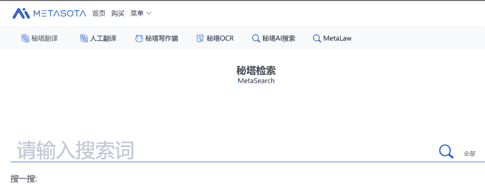
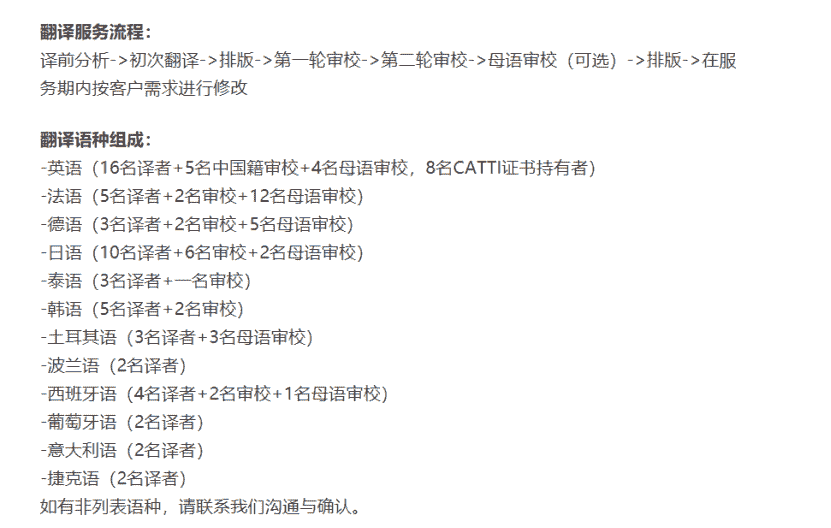
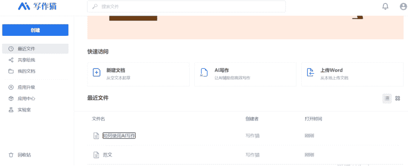
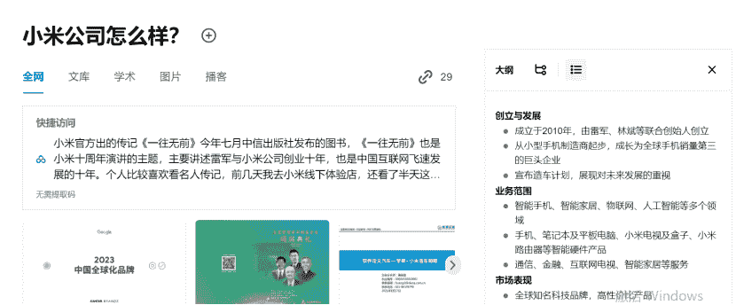
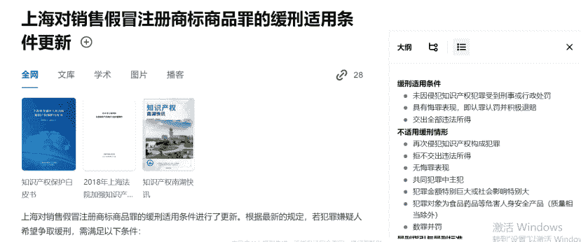

# 【秘塔翻译】

> 来源：[https://docs.feishu.cn/docx/ATyudBt9LoQb6KxGaYvcwgLYnOh](https://docs.feishu.cn/docx/ATyudBt9LoQb6KxGaYvcwgLYnOh)

---

> 本文来自「学法少女」👸号，作者陈艾琳。作者陆续测评了上海律协“2024 年度最受上海律师欢迎的法律科技产品大赛”的多个获奖作品，与读者们分享真实的使用感受，拥抱科技，解放双手。

**主要功能：**秘塔翻译、人工翻译、秘塔写作猫、秘塔OCR、秘塔AI搜索、MetaLaw

**适合人群：**主做涉外业务的法律工作人员

**生成速度：**一般

**优势：**“秘塔翻译”部分可以直接上传word、Excel、PDF文档，支持中英翻译，有历史项目管理功能，但是需要花钱，笔者测试一份579字的文档需要花29元才能翻译出来。“人工翻译”需要联系助手对接人工，不仅限于中文，还没尝试过，费用可能不低。

“秘塔写作猫”其实就是AI写作，和其他AI写作工具差不多。“秘塔OCR”应该就是把PDF文档识别为可以编辑的文档，因为反复上传文件失败，所以没法测试效果如何。

“秘塔AI搜索”不限于法律搜索，可以全网搜索。

但是针对法律问题给出的答案不如专门做法律搜索产品给出的答案准确，可能秘塔AI翻译和MetaLaw是一个公司出品，MetaLaw可以做到更精准的法律检索，无需秘塔AI翻译在功能上重复。

**劣势：**智能翻译需要花钱，不如上一款产品智爱。不知道是产品还未开发完毕还是其他原因，秘塔OCR还不能使用，但是即使能够使用，好像也有点鸡肋，不如直接用WPS转化来得直接。

**使用感受：**参与使用程度感不深，体验一般。

**是否推荐使用：**可以试试

今天两款产品与以往产品不同的是，都有法律翻译功能，智爱的“法律研究”板块体验感还不错。