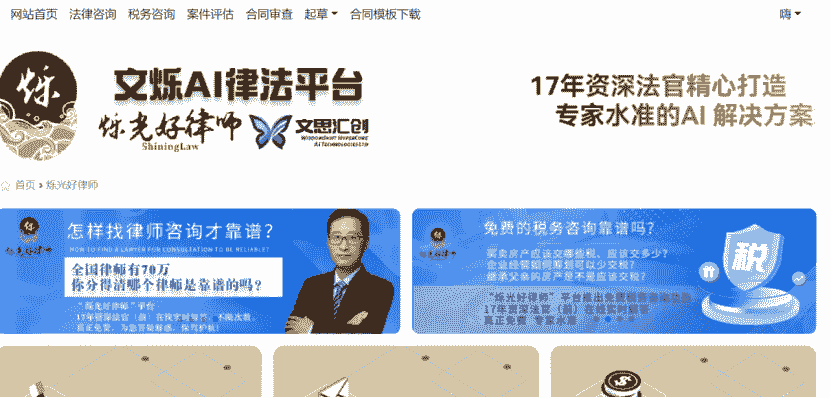
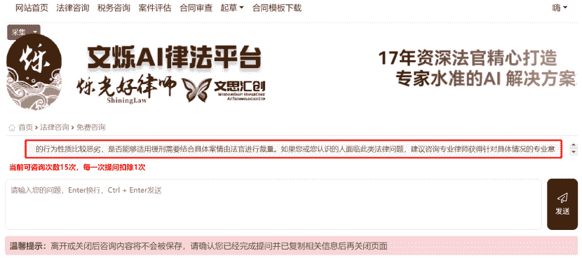
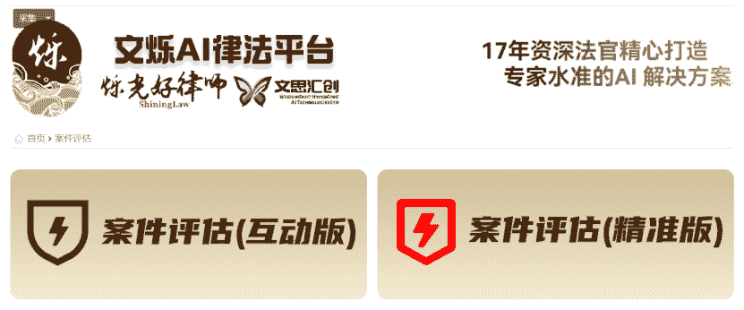
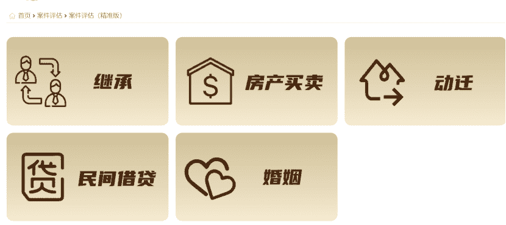

# 【烁光好律师】

> 来源：[https://docs.feishu.cn/docx/CTsIdaVrDo1oCixwcq5cTYWhnxc](https://docs.feishu.cn/docx/CTsIdaVrDo1oCixwcq5cTYWhnxc)

---

> 本文来自「学法少女」👸号，作者陈艾琳。作者陆续测评了上海律协“2024 年度最受上海律师欢迎的法律科技产品大赛”的多个获奖作品，与读者们分享真实的使用感受，拥抱科技，解放双手。

**主要功能：**法律咨询、税务咨询、案件评估、合同审查、起草协议、合同模板下载

**使用体验：**可能因为网页得设计有点老派，没那么有科技感，推销和广告风格比较突出，整个页面给笔者一种不是很想测评的感觉。法律咨询和税务咨询界面，且不说结果如果，测了半天都没发现答案在哪里，后来才看到下图的夹缝中，比较影响阅读，给出的答案非常粗略，甚至🛰️👸号的AI回答都更详细一些。

案件评估模块主要集中的纠纷是继承、民间借贷、婚姻、房产买卖和动迁，案件评估需要根据系统提示做问题勾选并上传证据材料，勾选这一功能和法行宝比较像，但是明显法行宝做得更细更深。

“合同审查”和“合同模板下载”两个板块应该比不过法天使。

总而言之，整个产品像是律所为了招揽客户设计的网页，吸引客户点击进入，简要咨询后如有委托意愿再进一步与律所沟通。

**是否推荐使用：**笔者体验一般