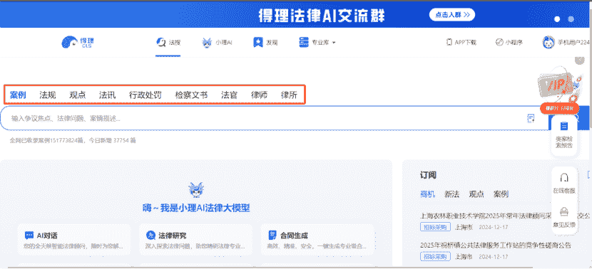
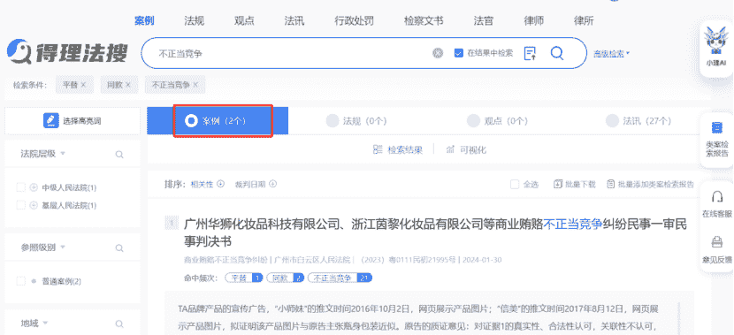
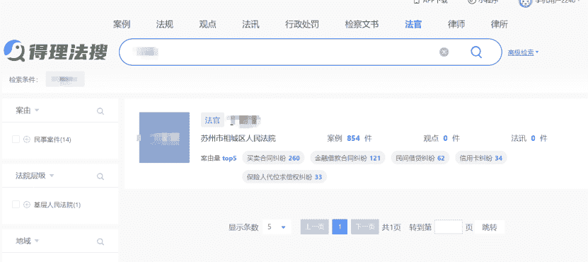
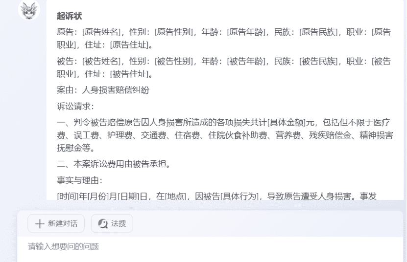
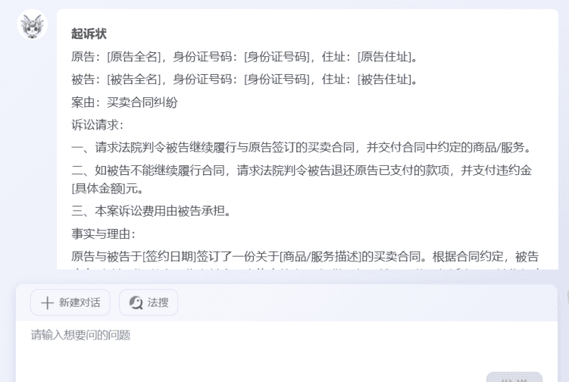
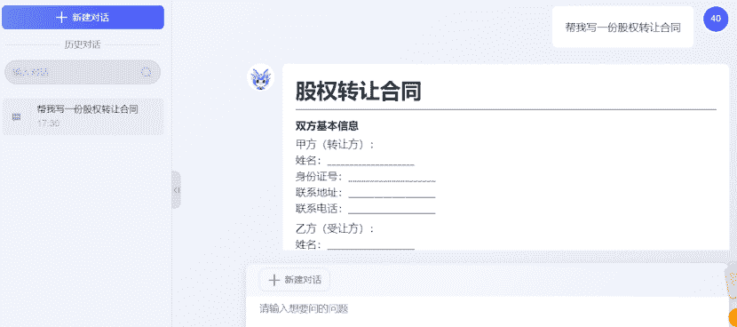
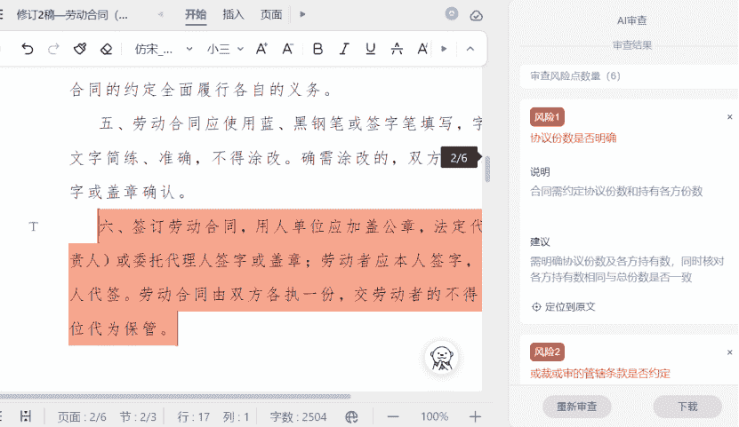
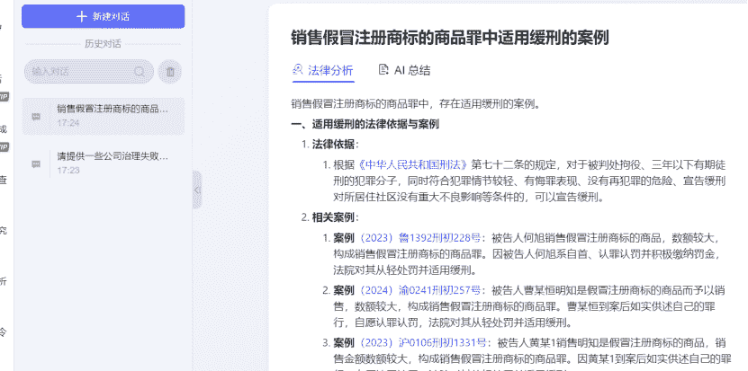

# 【得理法搜】

> 来源：[https://docs.feishu.cn/docx/E2ITdc2mjohkZVxqHCpcUSWCnig](https://docs.feishu.cn/docx/E2ITdc2mjohkZVxqHCpcUSWCnig)

---

> 本文来自「学法少女」公众号，作者陈艾琳。作者陆续测评了上海律协“2024 年度最受上海律师欢迎的法律科技产品大赛”的多个获奖作品，与读者们分享真实的使用感受，拥抱科技，解放双手。

**主要功能：**找案例、法规、观点、法讯、行政处罚、检察文书、法官、律师、律所

**1.案例查找：**最近在研究商标侵权和不正当竞争纠纷的案例，检索的案例比较多，但是检索结果不是很满意，所以想对比一下各个产品的差异。今天同时使用“平替”“同款”“不正当竞争”为关键词，在聚法案例和得理法搜中检索，最后聚法案例检索出3个案例，得理法搜检索出2个。因为已经深入研究过三个案例，得理法搜中缺少的1个案例正好是最贴合需求的，有点小遗憾，造成这种差异的原因可能是数据库不同吧。

**特色板块**包含行政处罚、检察文书、法官、律师、律所这几个板块是相较其他产品所没有的，其中笔者个人青睐行政处罚和检察文书部分。

**2. 行政处罚**，高级检索功能中，输入关键词、年份、地域、处罚文书号等可做精确检索。

**3.检察文书**，笔者曾经做危险驾驶罪的案件，需要检索某地区酒精含量符合不起诉条件的情况，当时一般的案例检索工具无法实现，要重新转到12309中国检察网去检索，但是在得理法搜上就可以直接实现。

行政处罚和检察文书两部分，可以算作是一般案例检索中细化出来单独列明的功能，是更为便利使用者的特色功能。

**4.法官、律师、律所。**这三个功能其实在很多案例检索工具中已经实现，只是呈现的方式不同。得理法搜将法官审理案件的类型做了排序，从高到低，点击数字可以直接链接到具体案例。

找律师和律所这两个功能，笔者以自己和其他同事所在律所做了检索，不是非常准确，具体包括所做案件的不准确，主要原因可能是裁判文书更新减少，另外还包括基本信息的不准确，如律师人数、办公地址、在册律师名单等。

## **小理 AI 法律大模型**

因为得理法搜界面还有“**小理AI法律大模型**”，这里面又包含了AI对话、合同生成、合同审查、法律研究、文本分析、工具指令、问律师等多个功能，感觉像是一个新的工具，所以单独再测试一下几个功能。

**1.AI对话，**分别以“帮我写一份买卖合同纠纷的起诉状”和“帮我写一份人身损害赔偿纠纷的起诉状”为对话，最终呈现如下。因为两个都是相对比较简单的案件，所以最终的模板也基本能满足日常所用。人身损害赔偿纠纷的数字，如果结合法行宝的计算功能，熟练运用的情况下，应该能很快写完一份完整的起诉状。

**2.合同生成，**以“帮我写一份股权转让合同”为对话，最终呈现报告形式如下，基本的要素还是具备的。

**3.合同审查，**以一份“劳动合同”上传进行审查，得出的审查结论不太涉及协议的实质内容，主要是合同份数、管辖条款、主体信息、合同期限、金额书写规范等方面，可能是提交测试的合同模板比较简单。

**4.法律研究，**以“销售假冒注册商标的商品罪适用缓刑的案例”为对话，最终检索的报告呈现如下，笔者个人比较喜欢这个检索报告的界面，有颜色进行区分，章节之间用不同字体、不同大小、不同颜色进行区分，最后也会把相关的案例全文直接放入检索界面，点击可以查看案例原文。

**5.文本分析，**支持doc\docx\txt\pdf格式的文档，文档大小不超过20MB，不支持图片。笔者用自己做的一个案例分析报告，属于文本表格形式，约2200字，最终“文本分析”得出一个约400字的结论，结论还是准确的，很忙的时候用这个功能能解燃眉之急。

**适用感受：**整体感觉还可以，个人比较喜欢行政处罚和检察文书两个板块。

**是否推荐适用：**推荐

目前测评了十几款产品，几乎都是为了测评而测评，因为没有很深入去了解检索问题本身和检索结论，所以最终得出的测评结论并不准确。可能有些功能其实不错但是因为没有深入而觉得一般，相反有些功能一般，但因为界面设计优美而觉得产品不错。总之只能算是给大家介绍一下产品的基本功能吧，选择何种产品，使用感受都因人而异。

最后感谢得理科技运营负责人给我开通SVIP进行体验，写了这么多期，很多人看到文章后添加我微信，还拉我进入法律人工智能的讨论社群，大家都是很优秀的人，一起探讨法律科技的发展，这种特殊的社交模式好像给我写这些文字找到了某种意义，勉励自己继续写下去。