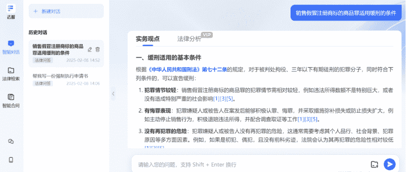
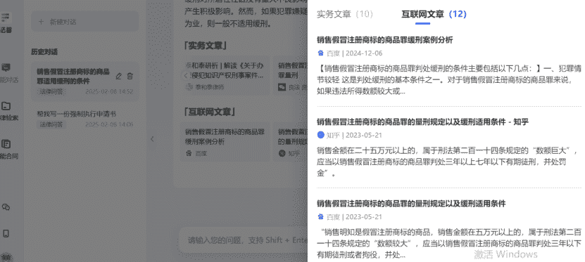
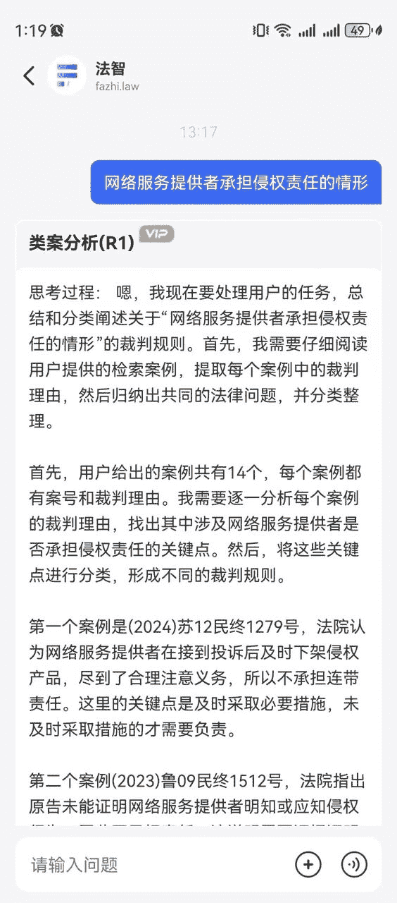
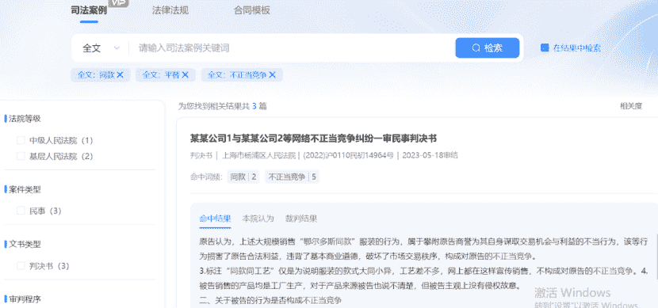
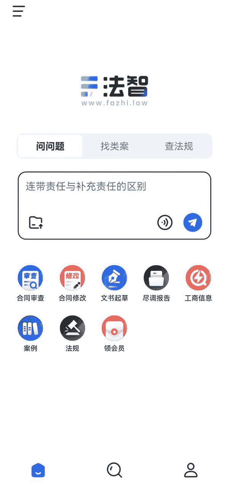
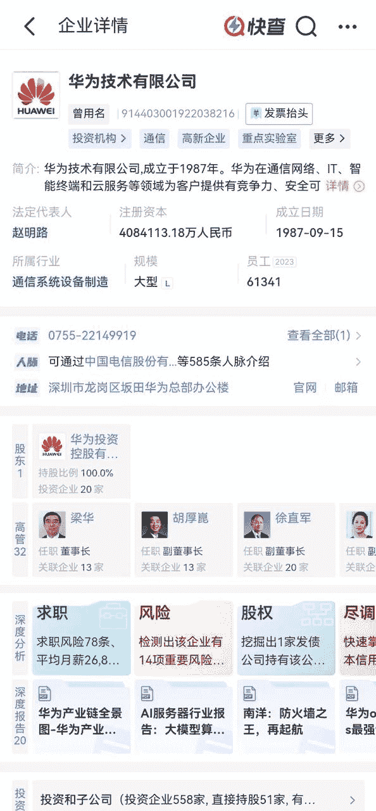
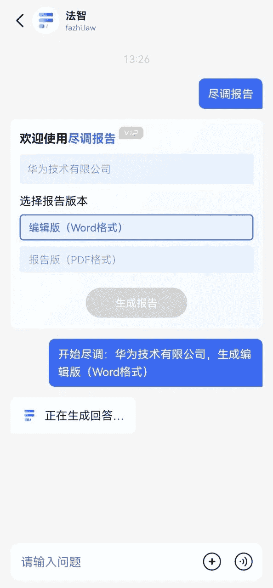

# 【法智】

> 来源：[https://docs.feishu.cn/docx/JsFadBKXDoXLKGxXjpacqYrXnVY](https://docs.feishu.cn/docx/JsFadBKXDoXLKGxXjpacqYrXnVY)

---

> 本文来自「学法少女」👸号，作者陈艾琳。作者陆续测评了上海律协“2024 年度最受上海律师欢迎的法律科技产品大赛”的多个获奖作品，与读者们分享真实的使用感受，拥抱科技，解放双手。

**基本介绍：**法智不是上海律协2024年法律科技产品大赛参赛作品之一，但专注于法律科技产品开发，所以尝试使用看看**，也给读者分享使用体验。据产品经理介绍，法智是同花顺**旗下的一款产品，有同花顺账号的话，可以直接登录使用，无需注册新账号。（笔者在文末放置了会员领取链接，读者可以免费领取三个月的VIP，赶紧冲，本文非广，自愿领取）

**主要功能：**智能对话、法律检索、智能合同。

**1.智能对话**

笔者同样使用“销售假冒注册商标的商品罪适用缓刑的条件”进行提问，给出的答案包括法律条文、实务文章，并且结论来源标明了出处，点击出处可以链接到网页、👸号文章、官方网站、知乎等平台，但是好像没有判决原文以及类案作为支撑，不过手机端的“找类案”功能可以提供类案分析。

（手机端“找类案”功能）

**2.法律检索**

同样笔者用“同款”“平替”“不正当竞争”作为关键词，查找到三个案例，检索出的案例、数量都与聚法案例一致。通过几次用同样的关键词在不同的产品中测评，发现结果基本相同，不知道是不是现在案例检索功能技术已经日趋成熟，各大公司都已经掌握了其中的要义。

**3.智能合同**

笔者以一份《广告代理服务合同》上传进行审查，给出的修改建议相较于其他产品来说是更丰富的，也更接近于实质性审查（并非仅仅审查违约条款），此处笔者仅列举风险提示部分的标题给读者参考一下，如：甲方异议期限过短、甲方自动放弃推广合作的条件不明确、免责条款过于宽泛、甲方责任过重、甲方承担全部法律责任、甲方需对乙方提供充分免责担保、乙方有权立刻停止所有投放并不承担任何法律责任、送达方式过于宽泛、仲裁地点不利于甲方等。

据悉，法智的重点开发领域包括合同审查与起草，笔者体验了一下，确实与其他产品不一致，日常合同审查任务较多的朋友可以试试看。

**手机端主要功能：****问问题、找类案、查**法规，另外还有合同审查、合同修改、文书起草、尽调报告、工商信息、案例、法规。

相对于网页端，手机端的功能更加丰富，笔**者主要介绍网页端没**有的功能，比较特色的是尽调报告、工商信息。

**工商信息查询**相当于企查查，将企业信息导出，就相当于对企业做的尽调报告，尽调报告中企业的基本信息已经具备，用户再结合实际情况以及不公开的数据，就可以生成一份比较完整的尽调报告。笔者对两项功能的初步使用体验还是不错的，甚至可以不用单独下载一个查询企业基本信息的APP了。

**适用感受：**界面简洁，检索不卡顿，手机端功能多样，满足日常法律检索和查询企业信息需求，总体使用体验不错。

**是否推荐适用：**推荐。

另外，最近DeepSeek很火，近期法智的法律分析和类案检索已经接入DeepSeek了，读者要是正在使用法智或DeepSeek，可以一起使用体验看看效果如何。