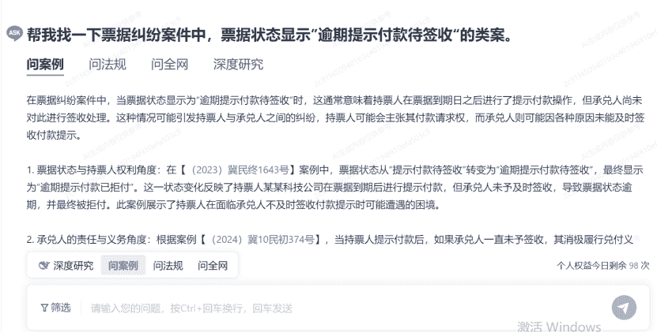
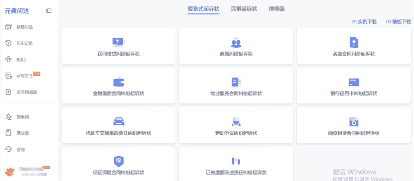

# 【元典问达】

> 来源：[https://docs.feishu.cn/docx/D0Qad53HqoWkPLxF053c15cynie](https://docs.feishu.cn/docx/D0Qad53HqoWkPLxF053c15cynie)

---

> 本文来自「学法少女」公众号，作者陈艾琳。作者陆续测评了上海律协“2024 年度最受上海律师欢迎的法律科技产品大赛”的多个获奖作品，与读者们分享真实的使用感受，拥抱科技，解放双手。

最近写了太多关于法律科技产品的文章，好多做开发的产品经理联系我测评自家产品，快要写不过来啦。不过好像也反映了一个问题，现在人工智能开发在各行各业都处于激烈竞争状态，唯恐落后。

看到澎湃新闻的消息，“多地将引入DeepSeek辅助领导干部决策”，要求各级领导干部积极主动拥抱新技术，运用人工智能辅助决策、分析解决问题，提高工作质量和效力。

所以各位读者们，开发者在努力开发中，使用者们也需要积极运用起来啊。

今天测评的产品是：**元典问达**

**主要功能：**接入DeepSeek深入问答、问案例、问法规、问全网、知识+、AI写文书、多文档阅读

其实上述前三种功能在目前测评的大多数产品中都已经具备，笔者认为如果基于数据库来源的相似性，可能未来这些产品的这几项功能都将逐渐趋于同质化，对于用户而言可能无所谓使用哪款产品，用户仍应当具备对生成结论进一步分析的能力。

**1.问案例**

用“帮我找一下票据纠纷案件中，票据状态显示‘逾期提示付款待签收’的类案”进行提问，最终元典问达给出的结论如下，相比用关键词检索，这样的检索结论效率确实更高，用户如果不信任给出的答案，可以直接链接去看案例原文，基于自身专业知识做准确分析。

**2.知识+**

老实说，这个功能有点鸡肋，虽然给出的示例问题对应的解答非常全面、专业，但法律问题包罗万象，用户能一下从这里找到答案的可能性微乎其微，当作扩充知识的阅读还可以，所以这个功能叫“知识+”估计也是这个原因了。

**3. AI写文书**

可以帮助写要素式起诉状、常规起诉状和律师函，要素式起诉状模板一共了包含了11种常见案件的模板，常规起诉状则不拘泥于要素式的模式，简要描述案情即可生成，这些功能辅助办理案件还是很不错的。

记得以前做银行信用卡的批量案件，用“邮件合并功能”一次性写几十份起诉状的效率也不错，但前提是所有的数据都得是电子版的才行。现在如果需要批量生成要素式起诉状，用“邮件合并功能”应该也能实现，近期公众号也有不少律师分享经验。

**4.多文档阅读**这个功能类似于给长篇大论的文章写一个梗概，让人很快知道某个文件的主要内容，但支持的文档格式有限，包括doc、docx、txt，笔者之前测评的某款产品可以支持图片和PDF。

**5.元典智库**

这个界面包含的内容比较多，有案例研判、法律法规、合同范本、法官分析、企业分析、律师分析、律师计算。

内容涵盖范围比较广，但主页面中没有体现“元典智库”，笔者也忘记是点击哪里进入的。“法官分析”中可以看法官庭审视频，“企业分析”类似企查查、天眼查，“律师分析”约等于对某个律师的背景调查，“法律计算”是对诉讼中各项费用的计算。

**使用感受：**答案生成的速度不是很快，如果一个问题没有回答结束，点击另一界面再进行提问好像就不可以同时进行。功能很多，没有太深度使用，不确定同类功能和其他产品的主要区别在哪。

**是否推荐使用：**可以试试看，另外元典问达还有微信小程序，搜索“元典问达”即可。

测评了这么多产品，总体感觉如果是产品与产品之间的功能、性能差别不是很大的话，用户其实不太会基于产品品牌的力量作出选择，可能完全是谁先推出，谁的知名度高，先下载了谁，先熟悉了谁，就会持续使用某款产品。