# 【慧多宝】

> 来源：[https://docs.feishu.cn/docx/L8bxdxFtio2OYFxCA02cCq7vnz1](https://docs.feishu.cn/docx/L8bxdxFtio2OYFxCA02cCq7vnz1)

---

> 本文来自「学法少女」👸号，作者陈艾琳。作者陆续测评了上海律协“2024 年度最受上海律师欢迎的法律科技产品大赛”的多个获奖作品，与读者们分享真实的使用感受，拥抱科技，解放双手。

昨天发布了元典问达的文章后，又有几个法律科技产品开发经理联系我使用他们的产品，也经读者启发，让我尝试用同一个问题在不同产品中测试看看他们的回答如何。

另外元典问达产品经理告诉我遗漏了他们一个比较重要的深度接入DeepSeek进行推理的功能，那今天正好对同一个问题在不同产品中对比看看有何优势所在。

首先还是对测评的产品做一下基本介绍，第二部分再进行对比测试。

**慧多宝、慧卷卷**

**产品链接：**hjj.jurisai.cn

**官方👸号：**慧多宝智能

**主要功能：**法律问答、文书起草、合同审核、文本纠错、翻译、阅读分析、案例研究、文件库

**1. 法律问答**

这是目前测试的产品几乎都具备的功能，将在第二部分与元典问达进行对比介绍。

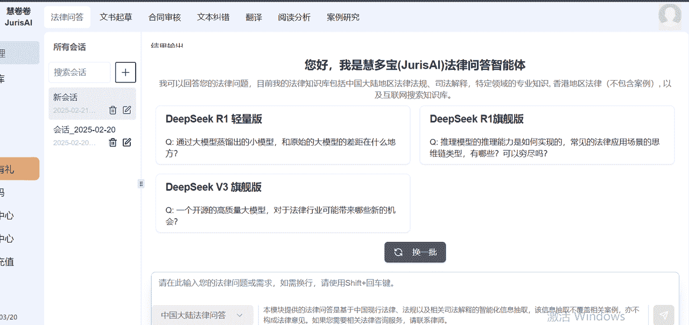

**2. 文书起草**

与其他产品不同，慧多宝支持文字输入、上传文档、语音输入。

我尝试用一份起诉状，让慧多宝帮忙写一份财产保全申请书，慧多宝帮我将“原告”替换为“申请人”，被告替换为“被申请人”，申请事项也做了改变，但事实与理由是复制了起诉状的内容。

这样生成理论上没有问题，对于不具备法律知识的人来说也没问题，但如果是针对律师这样的专门群体，其实打开软件再上传再生成，最后下载后自己修改调整，花费的时间可能比自己写一份保全申请的时间还多。

不过我测试的只是一个简单的文书，慧多宝的文书样式还是比较丰富的，如下图。

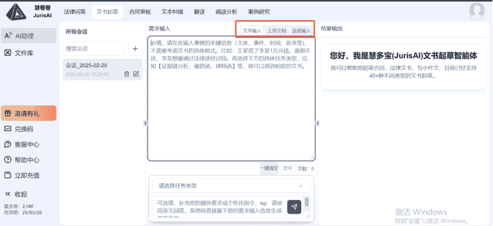

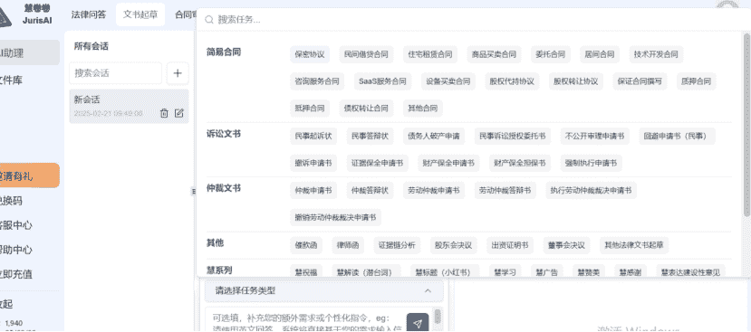

**3. 合同审核**

合同审核部分支持的合同类型丰富，可以选择修订立场，如甲方或乙方，特色功能是可以将合同翻译为很多种语言，也可以直接下载修订版的合同，和word文档“修订”后版本一致。

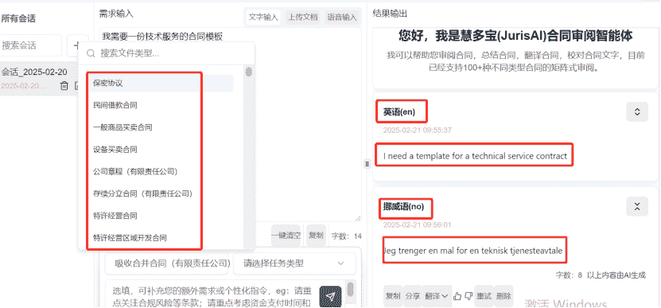

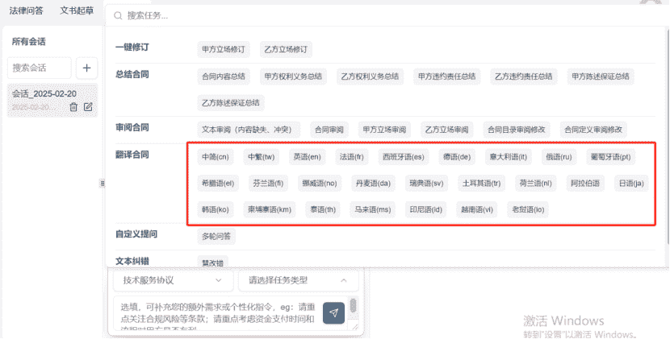

**4. 翻译**

翻译部分也支持很多种语言，笔者在网上找了一段文字翻译为英文，感觉效果挺不错，尤其是法律翻译。

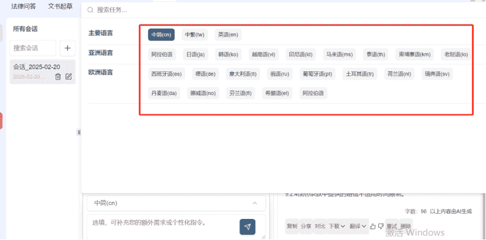

**5. 阅读分析**

这部分功能的逻辑方式是，用户先自己对上传的文档类型做一个判断，如文件是法律法规司法解释或诉讼文件，或会议纪要等，再选择下一步是需要对文本进行摘要总结，还是对文件进行分析、清洗等。后一步骤的功能取决于前一步骤文本的类型而不同。

老实说，本来没打算仔细看“阅读分析”功能的，但详细看后居然有种眼前一亮的感觉。

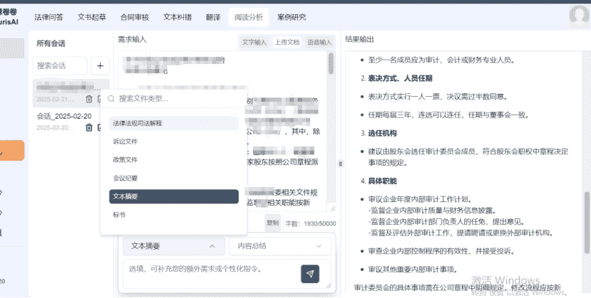

**6.案例研究**

我尝试简要将当事人咨询我的问题在里面输入，能给出部分的法律依据，但可能因为信息比较简单，给出的答案不算满意，如果再把信息描述得完整，得出的结论会更加具体。后又尝试将某个生效判决上传，结果输出显示的是对案件关键信息的提取。

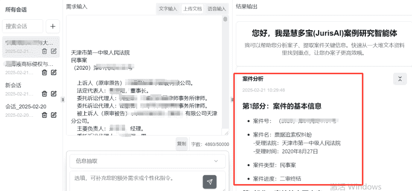

**7. 文件库**

在做完上述所有的测试后，发现刚刚上传的所有文档都在“文件库”中有显示，这个功能类似于一个仓库，把之前用过的文件都在这里备份了，还可以将PDF或者其他格式文件转为文字，方便用户复制。同时还有AI标记脱敏信息、手动脱敏功能。

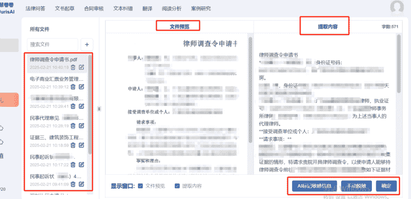

**产品对比**

慧多宝的第一个功能是法律问答，我用同样的问题，即“帮我设计一下，国企准备撤销监事会，设置审计委员要如何设置才科学？包括审计委员会的人数、任期、表决、职能等等”，在慧多宝和元典问达中做了对比测试。

**慧多宝**给出的答案共1210字，内容较为简单，答案比较确定。但答案后面也提供了联想问题，多进行几轮提问答案就会越来越详细准确。当然法律问答部分还可以选择问题对应的领域，具体到如公司法、婚姻法、诉讼法等等。因为领域逐渐细分，意味着回答的答案就越准确。

另外慧多宝也接入了DeepSeek，更为特色的慧多宝还可以引用香港的法律。总体来看，慧多宝的翻译和目前香港的法律和港股上市规则等，以及可能后期会引用的其他国家的法律，很贴近当下法律出海的热点需求，值得期待。

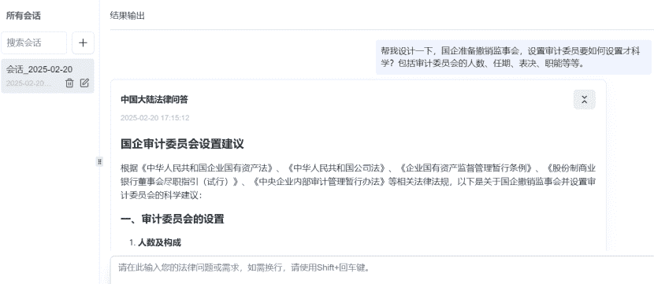

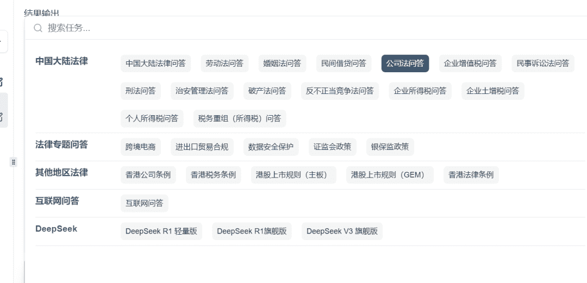

**元典问达**第一次给出的答案相对详细，同时给出答案的推理过程，还配有具体的法条作为支撑，法条是否仍生效也有标记，最后联想的问题个人感觉会更准确一些。

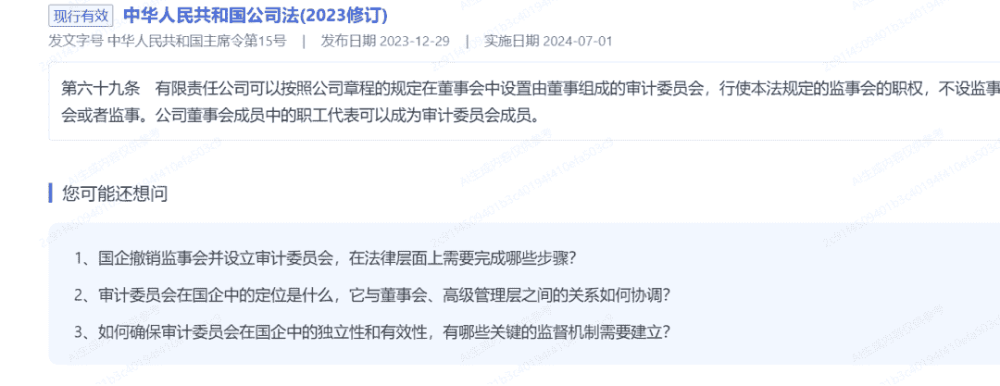

单纯就法律问答这个功能的话，元典问达更胜一筹。

但是，为了测试AI到底靠不靠谱，这次提出的问题不是随便提的，而是就这个问题做过深入研究的，所以其实对两个产品给出的答案都不是很满意。

这个结论还是印证了昨天文章中提到的想法，应该要把法律AI当成是强有力的辅助工具，但作为运用法律帮助他人解决问题的专业人士，不仅需要具备熟练使用AI的能力，更需要具备对AI生成结论正确与否的鉴别能力。

**使用感受：**生成速度很快，很考虑用户的使用感受，非常贴心的为用户设计了很多细节，感受到开发者非常用心的在做产品。

**是否推荐使用：**推荐，感兴趣的读者可扫描文末下方二维码添加我🛰️领取会员福利，更多功能等待用户继续探索。