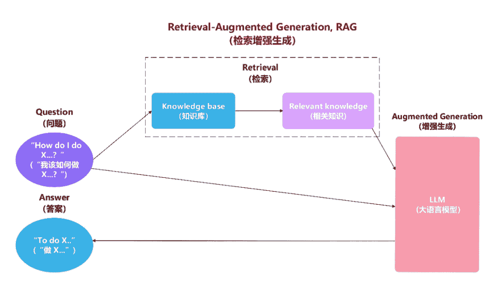
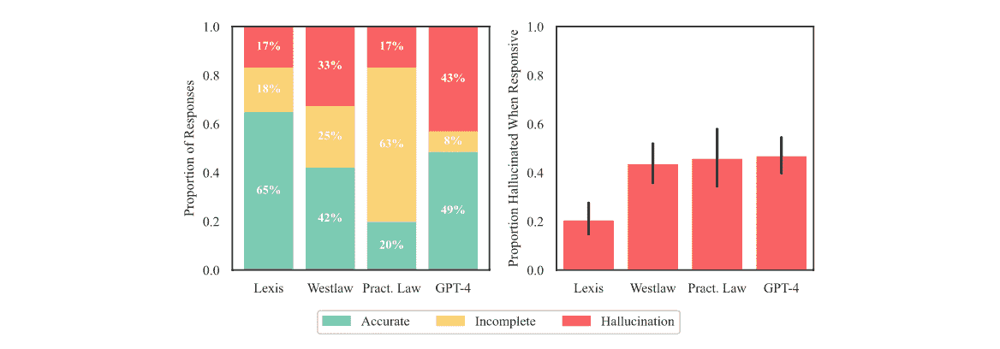
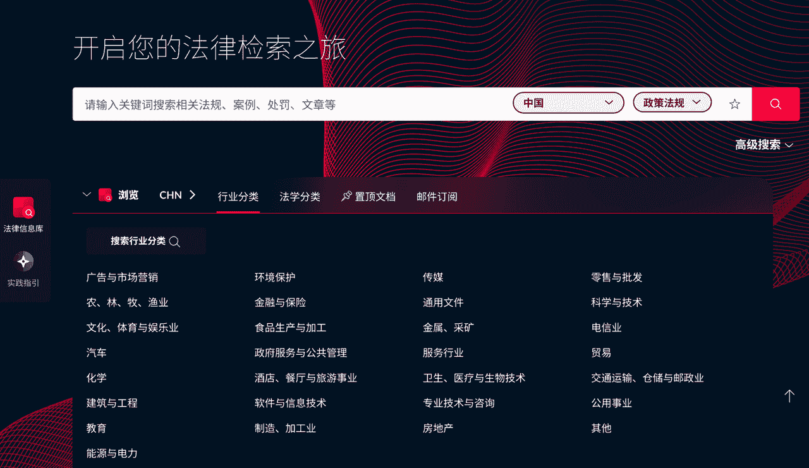
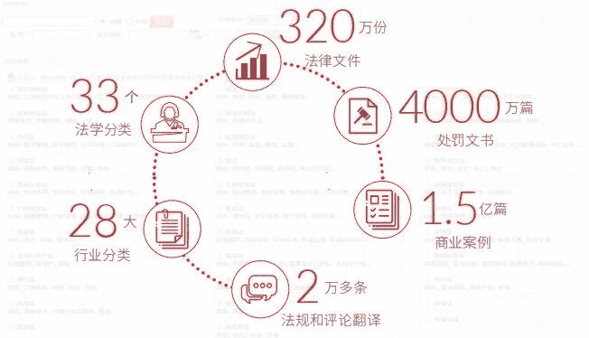
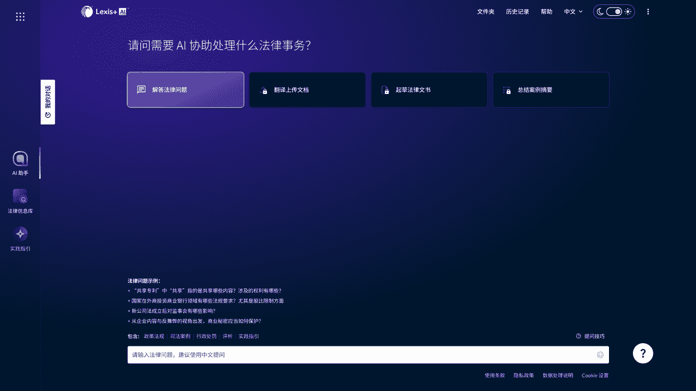
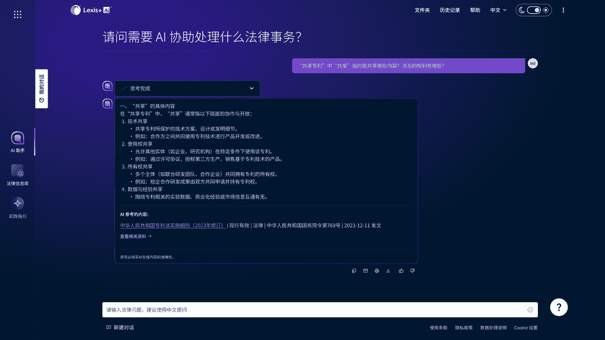

# 【甄选】律商联讯 - 律商+™

> 来源：[https://docs.feishu.cn/docx/K976dBMAFokpnhxoV9fcmr5Invx](https://docs.feishu.cn/docx/K976dBMAFokpnhxoV9fcmr5Invx)

---

在全球化与数字化浪潮的冲击下，法律行业正面临着前所未有的挑战：法规更新频繁、跨境业务激增、信息检索效率低下、非可计费工时损耗严重……法律从业者需要花费大量时间和精力开展法律研究与分析，这不仅耗费了宝贵的人力成本，也影响了工作效率和服务质量，传统的工作模式已经难以满足法律服务对工作效率与精准度的双重需求。

在此背景下，AI 成为破局的关键。

通过自然语言处理、机器学习等先进技术，AI 已能够快速地处理和分析海量法律数据，帮助律师更加高效地检索信息、总结案例要点、起草法律文件，显著提升工作效率和准确性。

2023 年以来，全世界范围内诞生了无数 AI 驱动的法律科技产品。据何者社区统计，2023-2025 年，全球已有超过 200 家法律科技公司获得了新一轮融资，增速持续加快，而且大部分公司都集成了 AI 技术。

在国内，同样也诞生了很多法律 AI 产品，但这些产品该达到怎么样的效果才能真正帮助到法律行业的用户呢？其实无外乎两个价值点：

1.  **降本增收：AI 能否帮我赚钱？**

1.  解决问题：AI 能否确保输出的准确性？

很明显，这两个价值点是相辅相成的。

其中，降本增收是最终目标，而解决问题则是工具能够产生经济价值的前提。对于法律 AI 工具来说，选择特定场景提供 AI 能力，并且确保 AI 输出的准确性，是 AI 可以解决问题的前提，而只有 AI 能够解决问题，才能进一步评估其投资回报，衡量 AI 的经济价值。

那么，一个好的法律 AI 工具是如何帮助用户解决问题，进而提效、降本、增收的呢？

让我们以终为始地思考这个问题。

# 思考一下：法律 AI 工具如何帮助用户赚钱？

当下，与采用工具降本增效相比，国内的法律从业者更关心的通常是怎么“赚钱”。

以**「律师行业」**举例，目前中国律师人数已经超过 75 万，而根据司法部的规划，2030 年这个数字即将达到 100 万 —— 按照目前律师人数的增速，这个目标很可能提前达成。

在律师人数（即“供给”）快速增加，国内法律服务需求 —— 尤其是相对高客单的法律服务需求没有明显增长的情况下，律师行业“僧多粥少”、竞争加剧，已是必然。

因此，以前律师出名的老三件：讲课、出书、上电视，已经不够用了，现在越来越多的律师开始拥抱自媒体，写文章、拍短视频、做直播等等，整个行业“卷”的趋势日益明显。

在这种情况下，有些律师的思维还没跟上，会认为，与采用工具降本相比，直接获取更多的案源，才是律师行业最急迫的事情。

其实，只要跳出存量竞争的视野，就能看到，法律科技工具虽不能直接帮助律师提高创收，但好的法律科技工具，可以有效提高法律人的工作效率，从而降低相应的成本（如初级律师或律师助理的人力成本）。

**同时，科技还可以推动行业结构化转型，有助于律师行业的商业模式从传统**的按小时计费，向更符合客户需求的多种混合收费模式转变，拥抱高质量发展的时代红利。

这一趋势在**「企业法务」**群体中也日趋明显。

法务在企业里通常属于“成本部门”，因为法务一般不直接带来创收，而随着市场经济下行，很多企业的法务岗位和外聘律师的预算，都被下调或冻结，企业法务需要以更低的成本完成更多的工作，投资法律科技是必然 —— 科技可以提高效率、降低成本，降低成本就是在给企业省钱，省钱=被动赚钱，这笔账很好算。

**也**就是说，投资法律科技已经不再是“重要而不紧急的事”，关键是如何有效衡量投资技术的“投入产出比（ROI）”。

对于这个问题，近日全球知名法律研究服务商 LexisNexis 发布了一份名为《Lexis+ AI 对大型律所的总经济影响》的研究报告，对使用 Lexis+ AI 的一家大型律所进行调研，分析 AI 对律师工作流程和业务的影响。注：Lexis+ AI 是一个用于法律起草、研究和洞察的集成式 AI 工具。

这份报告调研的对象是一家在北美运营的全球化律所，年收入为 15 亿美元，拥有 950 名律师和 15 名研究人员（如图书管理员和律师助理等）。通过量化 Lexis+ AI 如何增强法律工作、加速律所的增长潜力以及推动客户价值实现，可以看到 AI 不再是律所的成本中心，而是会推动律所和律师创收的增长。

报告显示，该律所采购了 Lexis+ AI 后：

+   **律师的生产力提高了：**以前合伙人和高级律师每周仍然需要在法律文件起草或法律分析等工作上例行投入时间，尤其是检查工作中的细节，而现在，这些常规、重复的任务可以通过AI 简化并提高工作质量，这样每周节省的时间高达 2.5 个小时，从而腾出精力去做更高价值的工作，带来了价值 180 万美元的利润;  初级律师每年挽回了高达 35% 原本被视为损失的非计费工时，带来了价值 620 万美元的利润；而研究人员每年在研究工作上节省了 225 个小时，带来了超过 39.9 万美元的价值。

+   **律师的工作质量提升了：**在很多情况下，Lexis+ AI 可以帮助律师发现原本可能会被忽略的洞察或判例，这直接提升了律师工作的质量和准确性。

+   **客户满意度也提高了：**借助 Lexis+ AI，律师的产出质量更高，周转时间更快，这最终提高了客户满意度。

以上改变，最终显著提高了这家律所及律师的盈利能力：该律所在使用 Lexis+ AI 的 3 年内实现了 3000 万美元的收入增长，共带来了 344% 的投资回报。其中，权益合伙人的人均利润增长了 1.5%，第三年律所获得了 570 万美元的额外总利润，每位律师的总利润则在第三年提升了 4%。因此，该律所对 Lexis+ AI 的投资在 6 个月内就收回了成本。

**可以看出，AI 不仅仅可以给初级法律从业者带来即时的赋能，对于高级法律领导者**，以及整个组织来说，长期价值更大。AI 正在成为法律从业者创收增长的一大驱动力。

# 法律 AI 产品解决问题，核心指标是 AI 输出的“准确性”

**法律 AI **产品要想带来降本增效、创收增长的价值，前提是产品「真的好用」。

例如，当下全球市场瞬息变化、法律环境不断演进，尤其是越来越多的企业选择出海，涉外多国法规动态跟踪、跨语言文献以及深度合规管理的需求不断增加，法律从业者亟需以更高的精准度和效率来应对法律检索挑战。

然而，生成式 AI 技术存在固有的“幻觉”（Hallucination，即 AI 会编造虚假内容），而且大语言模型（Large Language Model，LLM）使用庞大且复杂、基于概率的算法，来预测并生成最佳的回复，但它训练数据具有局限性，数据质量参差不齐，对时间概念模糊。 AI 缺乏对于事实的判断，无法应用逻辑或是外部验证机制来考虑其输出是否符合事实。

因此，在法律工作中应用 AI 技术的风险不容忽视。据何者社区统计，截至目前全球范围内已经发生超过 150 起，因使用 AI 编造的虚假引文而面临警告或高额罚款案例，其中一半被处罚的当事人是律师。

**那么，法律 AI 如何准确理解用户真实意**图，搜索到最相关的内容，并避免幻觉出现？

针对这个问题，每家法律 AI 厂商都在想办法降低 AI 的幻觉，Dentons、Bird & Bird 等大型律所也在积极投资和参与 AI 基准测试。

其中，检索增强生成/RAG 技术（Retrieval-Augmented Generation），可以使大模型在回答用户问题时参考指定的数据库，基于特定领域和/或更新的信息进行回复。目前，很多 AI 产品都在利用 RAG 改善幻觉问题。

## RAG+引文链接：从数据源头保障可信度

**全**球领先的信息和分析服务商 LexisNexis（律商联讯）旗下的 Lexis+ AI 以海量高质量的法律大数据集为基础（来自 180 多个国家和地区的，超过 2.93 亿份卷宗、1.59 亿专利文件、425 万份审判书等海量法律数据），并利用检索增强生成（RAG）技术提高 AI 输出的准确度，而且提供引文链接，这样可以大幅降低 AI 的幻觉率 —— 斯坦福大学发布的名为《无幻觉？评估领先的 AI 法律研究工具的可靠性》的论文显示，在几大主流的 AI 及法律研究工具中，Lexis+ AI 在生成内容时出现“幻觉”的概率是最低的。

除此之外，律商联讯还聘请了 2000 多名技术专家、数据科学家和主题专家负责开发、微调和验证 AI 产品。针对性的 AI 调优加上人类专家参与开发和改进过程，Lexis+ AI 可提供更高质量、更具权威性和可信赖的输出。

LexiNexis 庞大的法律数据库

**近**日，律商联讯还依托先进的全球技术架构和深度的本地化开发，针对中国法律市场构建了新一代的法律研究平台「律商+™」。

**「律商+™」**支持**对话式解答法律问题**、**翻译文档**、**起草法律文书**、**总结案例摘要****等任务，**无论是公司、律所，还是政府和高校，律商+™ 都可以帮助法律从业者轻松获取权威法律信息、自动执行日常工作。

**扫码申请产品体验**

👇👇👇

**扫码加入用户交流群**

👇👇👇

6 月 19 日，律商联讯还将于北京举办“法律人工智能论坛”，汇聚行业领袖、法律专家、技术研发者及企业决策者，共同探讨 AI 技术在法律框架下的合规路径与创新边界。

此次活动致力于为行业提供前瞻性洞见与务实解决方案，助力企业在技术浪潮中规避风险、把握机遇，并推动人工智能与法律合规的协同发展。诚邀您的参与！

> 阅读原文：[报名倒计时！论坛剧透+嘉宾视频+精](https://mp.weixin.qq.com/s?__biz=Mzg2NjY4NjY1NQ==&mid=2247501884&idx=1&sn=36b403328a76e9cb29316e4596210085&scene=21#wechat_redirect)彩议程，一篇看懂律商联讯法律人工智能论坛

---

原文：[告别“996”式法律工作，这款全球法律人瞩目的法律 AI 产品](https://mp.weixin.qq.com/s/iniB21m0_H-TF_09wObraA)如何用精准算法释放 300% 执业效能？