# 【甄选】秘塔 AI 搜索 - 专题库

> 来源：[https://docs.feishu.cn/docx/CqZKdAMoeoWBfOxyIV7cv5o9noe](https://docs.feishu.cn/docx/CqZKdAMoeoWBfOxyIV7cv5o9noe)

---

1.  公司：**秘塔**

1.  产品矩阵：

+   秘塔 AI 搜索：https://metaso.cn

+   秘塔写作猫：https://xiezuocat.com/#/

+   秘塔翻译：https://fanyi.metaso.cn/#/

+   MetaLaw（类案检索）：https://meta.law

随[着 AI 技](https://mp.weixin.qq.com/mp/appmsgalbum?__biz=MzUzOTcwMTE5OQ==&action=getalbum&album_id=3527497267156107272#wechat_redirect)术[浪潮](https://mp.weixin.qq.com/mp/appmsgalbum?__biz=MzUzOTcwMTE5OQ==&action=getalbum&album_id=3521007419251507205#wechat_redirect)席卷各[行各业，越来越多的律所和律](https://mp.weixin.qq.com/s?__biz=MzUzOTcwMTE5OQ==&mid=2247488789&idx=1&sn=cbe7c41732361616b383e2141bf2e33a&chksm=fac52fb5cdb2a6a3382ef0661150c79c458dc5d8571118f9f988ef75e32339f12d9ec380d0cf&token=865870229&lang=zh_CN&scene=21#wechat_redirect)师[朋友，希望了解如](https://mp.weixin.qq.com/s?__biz=MzUzOTcwMTE5OQ==&mid=2247488730&idx=1&sn=4bb2cd2422d18786c98c627ce5864b5a&chksm=fac52e7acdb2a76c92d9c7aa5f02669e5dc1cdd9e0662887aaac72758df8bf20f4660b6e88ad&token=865870229&lang=zh_CN&scene=21#wechat_redirect)何拥抱 AI。2023 年以来，我们通过组建法律科技社区、智库，组织法律 AI 共创培训和比赛、参访 AI 大厂等活动，和一部分法律人先 AI 起来了。

前段时间，腾讯的 AI 智能体平台「元器」上线了一个新功能：支持授权使用公众号文章作为训练智能体的语料，打造专属 AI 助手，律师可以用于提高工作效率、拓展案源等。

> 了解更多：腾讯元器+公众号：每家律所，每个律师，都可以拥有自己的 AI

然而，一般智能体的原理还是 AI 智能问答，也就是先理解用户问题，然后生成答案。

虽然很多智能体平台也支持构建知识库，用户上传自己的文件和文章等，通过 RAG（检索增强）限定 AI 在知识库的范围内查找答案。但是，用于训练大模型的数据太多太杂，相比之下用户自己的知识库数据量太少，即便构建了知识库，AI 的输出也不是每次都很准确，还需要针对性地做很多工程优化。例如，前段时间我把一本书上传到知识库中，让 AI 基于这个书稿的内容回答问题，但答案仍然会出错，不会完全来源于书稿。

因此，对于要求高严谨性的领域，比如法律，一般的智能体并不能达到预期的效果。同时，即便是专业级的法律 AI 工具，也并不一定在所有领域都表现出良好的性能。例如，这些法律 AI 工具不一定具备某些领域的数据，比如律师/法务审查特定领域合同的审查清单，那么 AI 自然也不能独立完成这一领域的合同审查，仍然需要律师主导。

也就是说，对于像法律这样的严肃领域，AI 搜索的效率和准确性，二者同样重要。

**在 AI 搜索领域，「秘塔」是个扛****把子选手**，尤其是在学术研究领域好评颇高。最近，秘塔上线了一个新功能：在秘塔首页的左侧边栏，新增了一个「专题」入口。

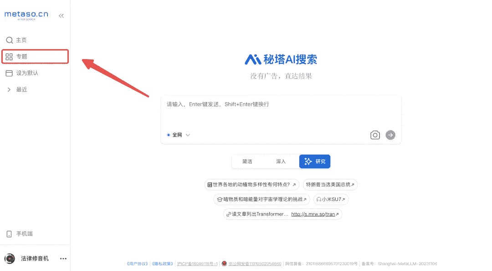

这个「专题」功能，类似于我们常见的「知识库」。

在专题页面，支持上传 PDF、Word、PPT 等文件，还可以粘贴在线网页。上传之后，AI 会对内容进行解析，然后你在这个专题里搜索的时候，秘塔 AI 就能把这些上传的内容，作为信息来源了。

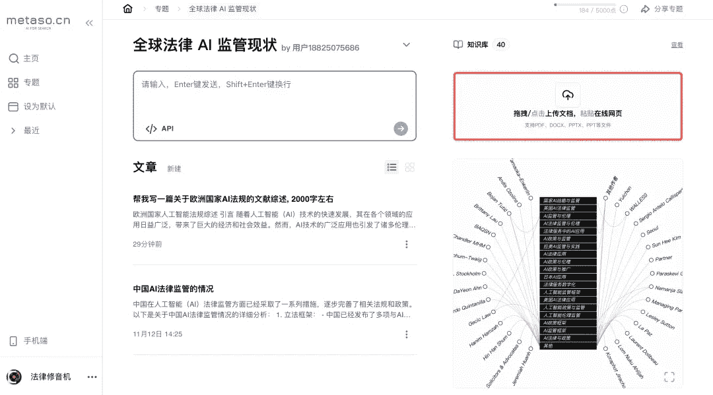

是不是看起来和一般的 AI 知识库差不多？

别急，让我们看看这玩意能干啥。

举个例子来说：

前段时间，法律修音机发布了 160 份法律 AI / 科技相关的研究报告，内容非常多，想快速了解其中的某个问题，就需要借助 AI 的能力。例如，随着 AI 技术不断发展，世界各国相继针对 AI 在法律行业应用发布了相应的监管规定 —— 目前我们收集了 30 多个国家的数据。现在，我想知道世界各国具体是怎么规定的，于是我就把法律科技研报库中，这 30 多个国家的 AI 监管规定，在秘塔 AI 中创建一个专题，然后上传到知识库里。

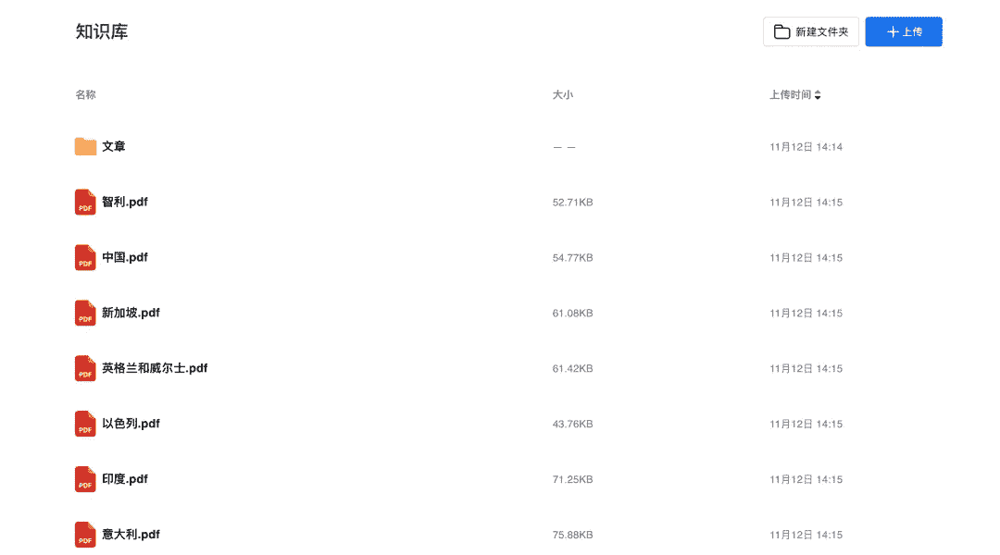

接着，我提问：“中国 AI 法律的监管情况”。然后，秘塔 AI 就会基于专题知识库进行搜索（不联网），信息来源仅限于这个专题知识库，然后输出答案，总体来看回答结果很准确。

先来个总结性的回答：

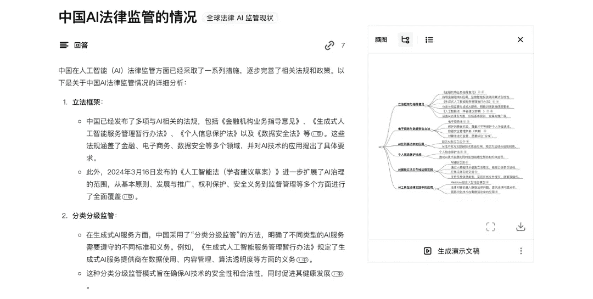

在这个总结性回答右侧，还有思维导图，甚至可以直接生成 PPT：

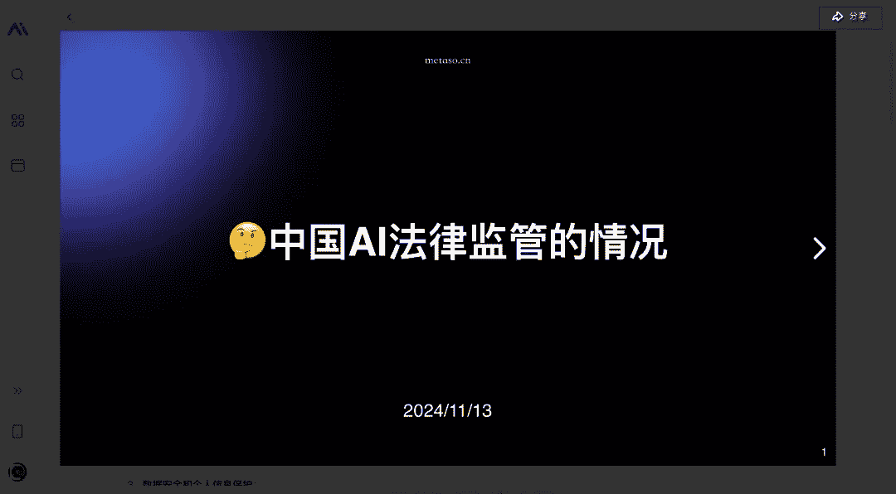

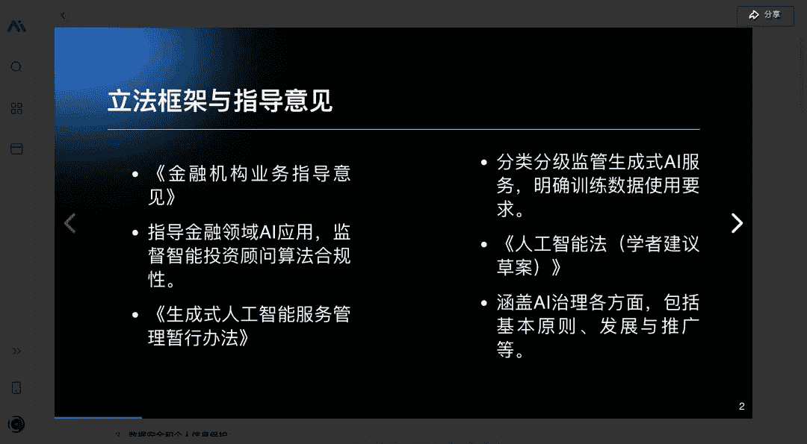

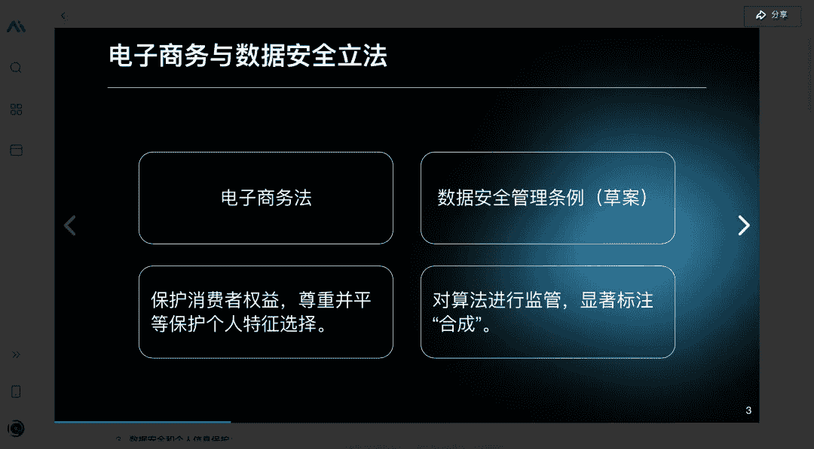

然后是这个问题的「相关事件」：

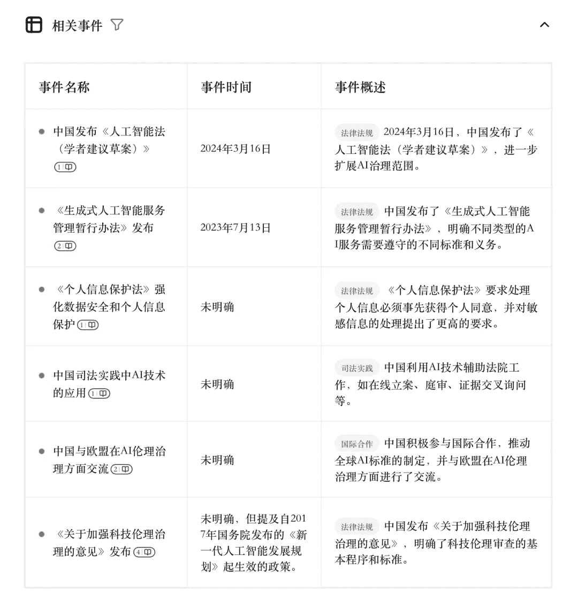

还有「相关组织」和「相关人物」：

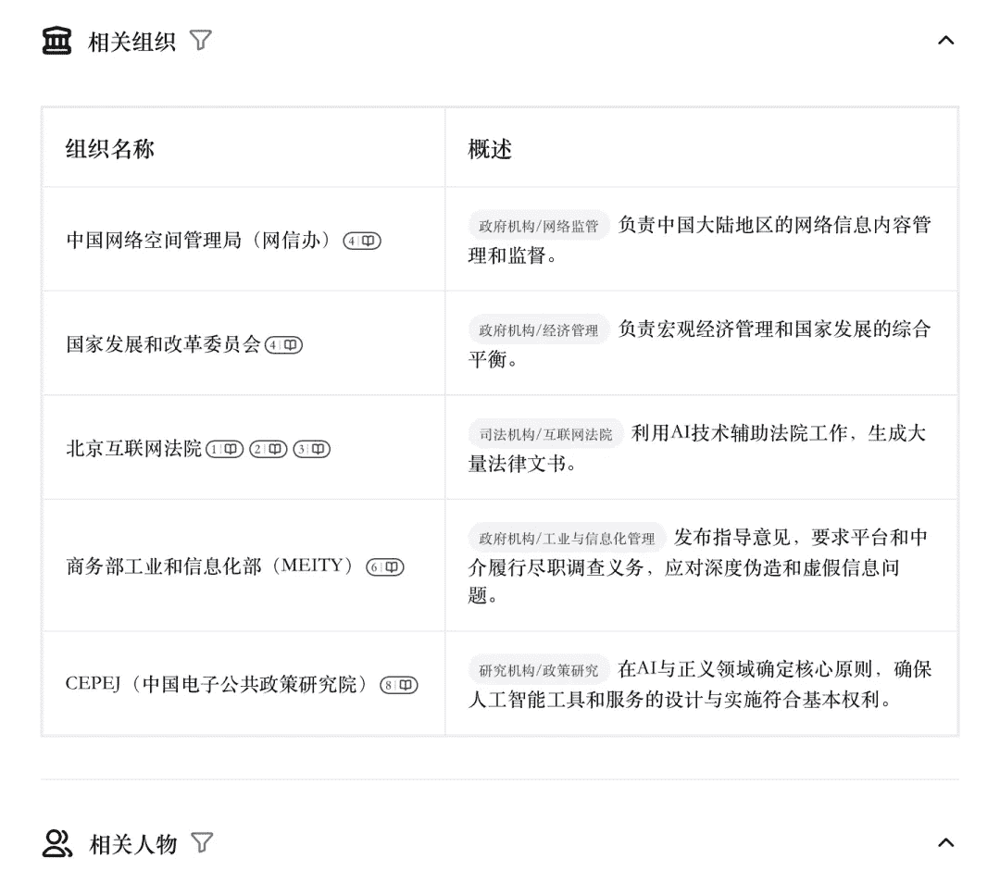

引用的信息源也清晰地标明——

点击回答中小书本📖一样的 icon，或者在参考资料里，就能看到 AI 参考了专题库里的哪个资料。

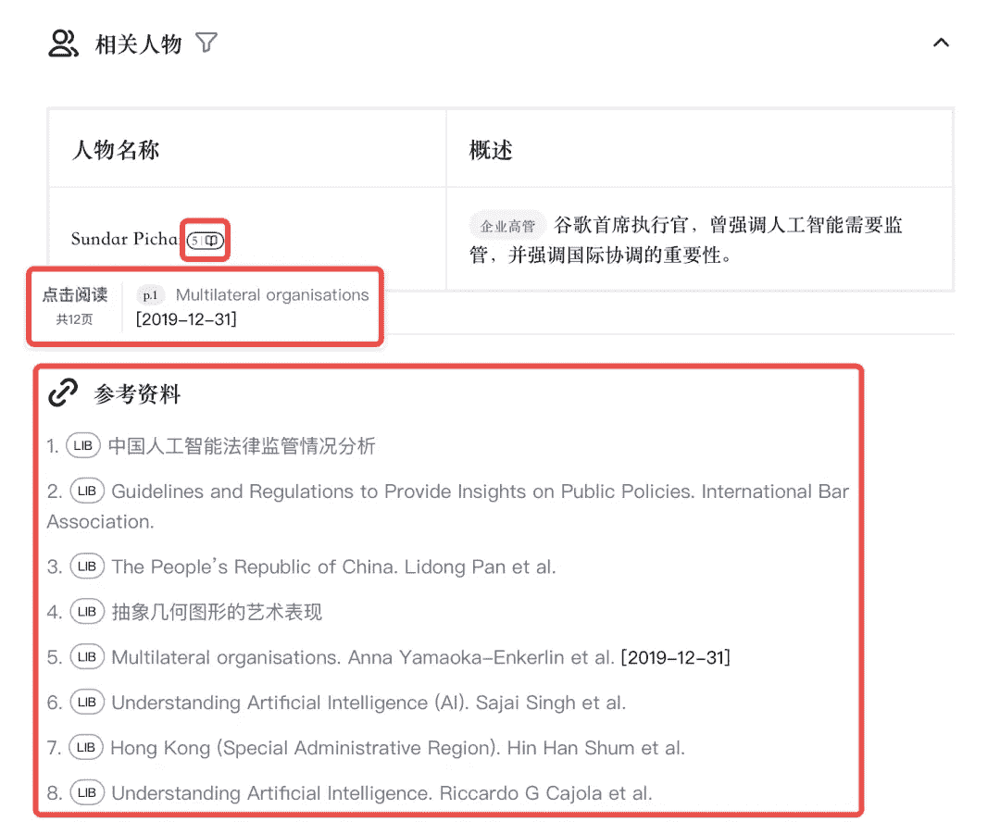

对于 AI 输出的内容，我们还可以点击“研究”，让 AI 对这个问题进行深入的研究，以及对当前的回答进行“追问”，或者人工“编辑”完善 AI 的输出，最后再导出 Word、PDF。

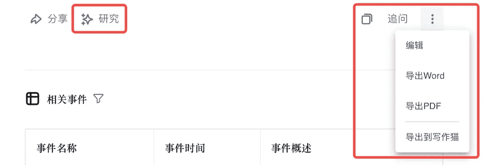

整个体验非常丝滑。

此外，你还可以把 AI 生成的内容收藏到专题中 —— 点击问题旁边的“+号”，即可将该回答收藏到知识库中。

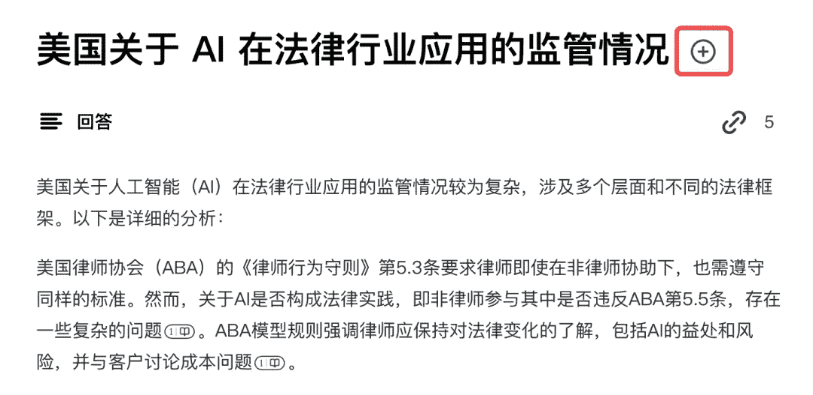

以后，你想问什么就问什么，当 AI 查到你满意的内容时，点个收藏，就可以把 AI 回答的结果以“文章”的形式保存在这个专题的知识库里。

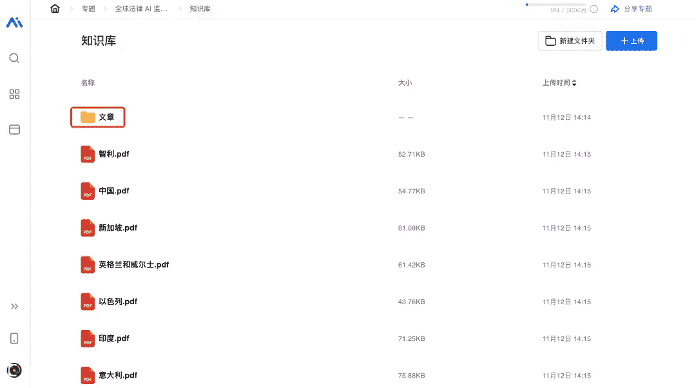

你平时使用这个专题时，收藏的问答会显示在专题页下的「文章」模块，方便你使用。

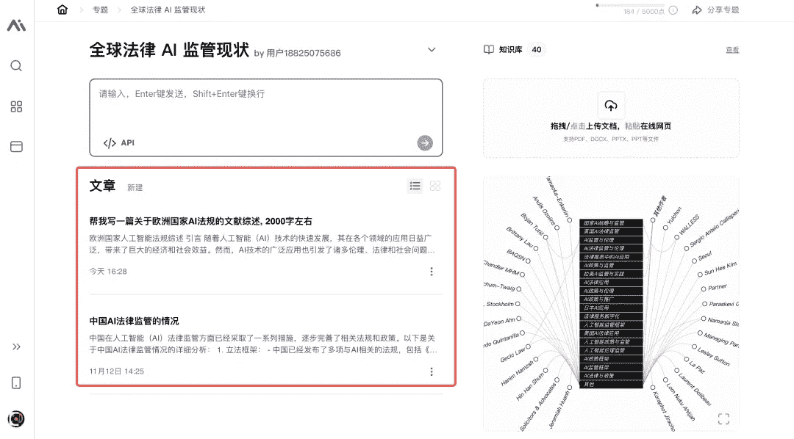

这样，我们再也不用自己手动复制粘贴，一个个下载文档再上传了，知识库搭建难度立减 99%。

同时，因为这些信息都是我们自己上传和筛选过的，所以非常干净，用的越多，知识库质量也会越提高，下次想找什么资料，直接在这个专题里问就完事了，效率🆙🆙🆙

**另外，秘塔这个专题功能还可以被分享、协同编**辑、开放 API 接口，未来还支持收费。

也就是说，这些专题知识库，未来可能会变成一个个可以流通的「数据」。

这就很有意思。

目前，AI 在法律行业落地应用的核心挑战，就是「数据」，而很多真实的业务数据都是律所、公司、法官和政府等机构所拥有。因此，某种意义上很多法律 AI 产品都是 50% 成熟度的产品，需要和客户共创。

然而，现实中即便很多法律 AI 产品也推出基于 RAG 的知识库功能，并强调上传的数据为用户所有，但并没有获得客户的青睐。这背后的原因，就是用户对厂商缺乏「信任」。

建立信任需要如履薄冰，厂商忽略品牌建设、不诚信的历史、过往降低信任的操作（如过度营销），都不利于信任建设。因为信任这东西，你可以一直有，但只要一着不慎，全部归零。

在 AI 和法律行业，一直以来优秀的产品力、“没有广告 直达结果”的 slogan，让「秘塔」成了一个高信任的品牌。在拉新和留存成本高昂的当下，这将是一个很棒的优势。

> 如果你有相关采购需求，可联系 Legal Studio 社区发起人 （微信：18825075686）。

---

Created by Legal Studio