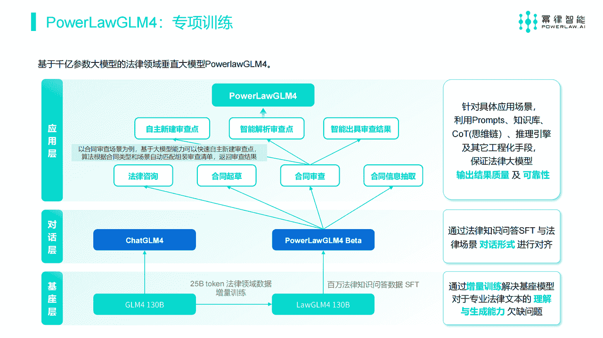
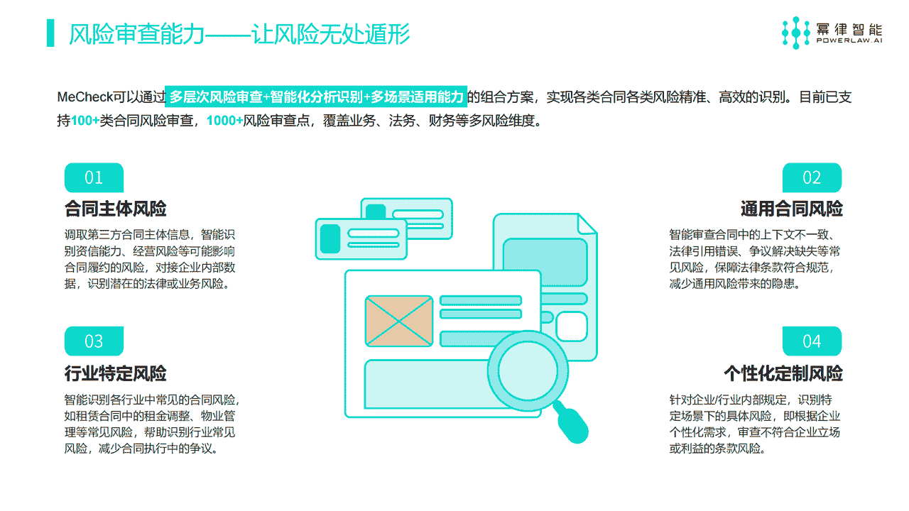
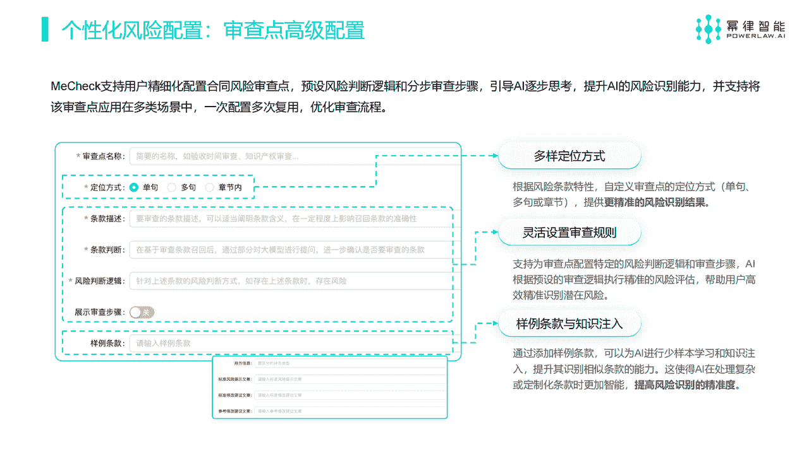
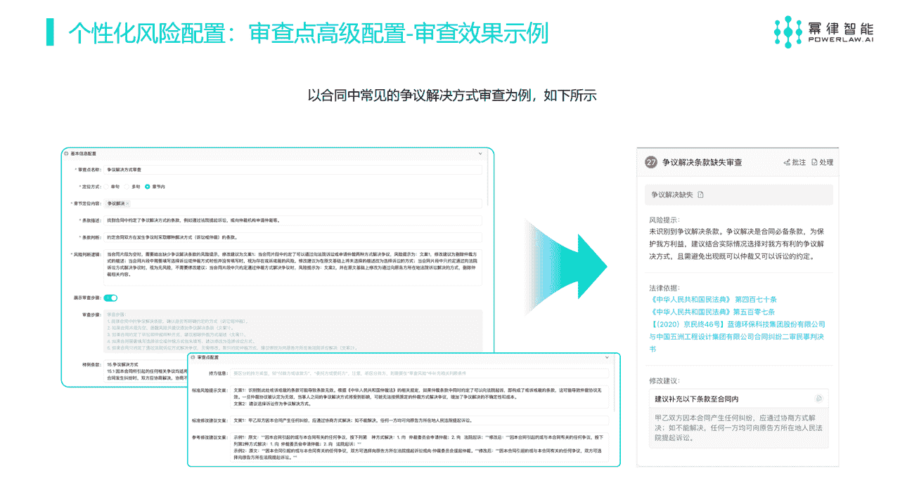
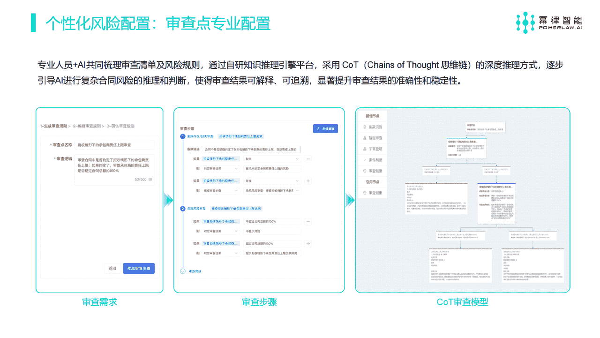
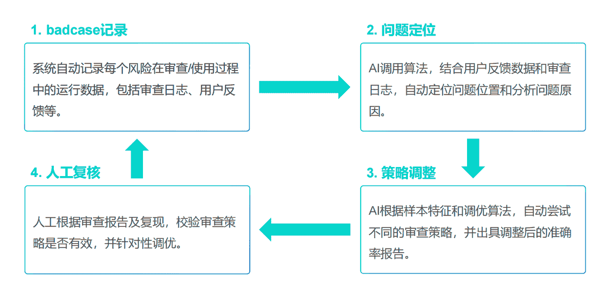
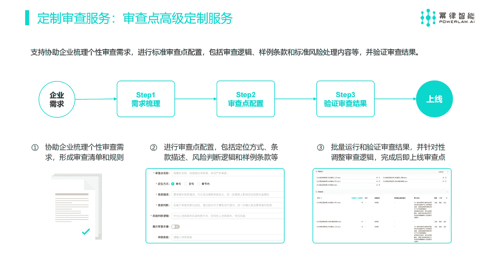
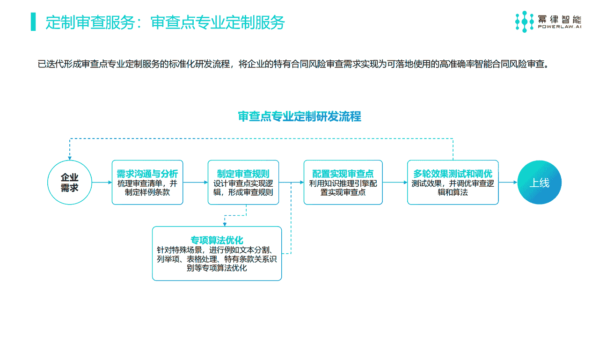
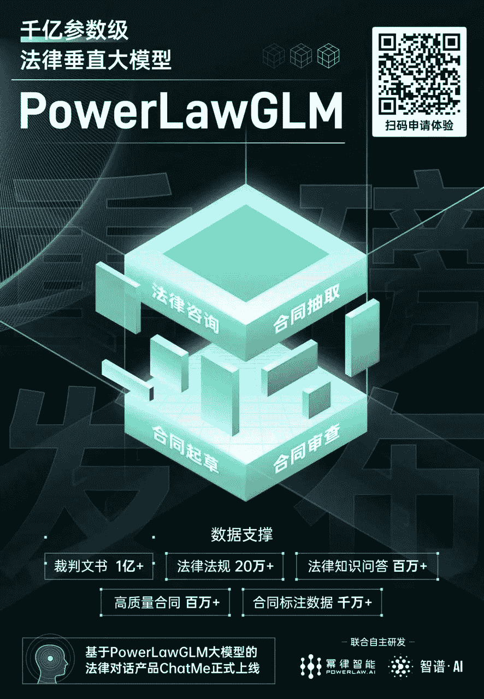

# 【甄选】幂律智能 -  AI 合同审查

> 来源：[https://docs.feishu.cn/docx/CFz7dgxqiou3BhxVTl9cYg9YnFg](https://docs.feishu.cn/docx/CFz7dgxqiou3BhxVTl9cYg9YnFg)

---

当下，生成式 AI 技术已趋于成熟，正在积极开展产业化落地，而法律就是 AI 落地应用的重点行业。2023 年以来，各家法律科技公司纷纷集成 AI 技术，在特定场景已初见成效。

合同生命周期管理 —— 从合同起草、磋商、审查、签署到持续监控的全部流程，是公司法务部门日常工作的重要组成部分。实践中，传统的合同审查基于人工逐字逐句审核，依赖于审查人员的知识和经验储备，审核耗时长且容易遗漏风险，尤其是在大型企业的成熟业务中，沉淀了大量已经类型化的合同，人工审查耗时耗力，难以应对快速发展的时代对高效合同审查的需求。同时，人工合同审查结果和经验通常分散在文档批注、邮件或聊天记录中，难以形成系统化的知识积累，自然也无法为后续的审查工作和团队经验共享提供有效支持。

因此，公司法务部长期以来都被认为是组织内部的“成本中心”，而且随着市场监管环境日益复杂，外部律所服务支出也越来越高，亟需通过法律科技提高合同审查的效率。

依托 AI 和自动化等技术，可以快速处理合同相关的任务，将手动繁琐的任务转变为轻松和快速的操作，显著缩短处理时间，并消除跨部门协作过程中可能发生的人为错误。

同时，基于合同管理流程自动化带来的效率提升，还可以辅助公司/律所提高创收。具体场景可能是降低合同谈判时间，或者是自动开具发票辅助财务工作开展，从而提高业务效率 —— 这是一个重要的驱动力。

[因此，智能合同](https://mp.weixin.qq.com/s?__biz=MzUzOTcwMTE5OQ==&mid=2247490806&idx=1&sn=178c7fab76219c489a24f9239bba757f&scene=21#wechat_redirect)就成了法律科技行业的一个热门赛道，近年来频繁拿到投资。

## **AI 时代下，合同审查创新范式**

基于市场对智能合同审查产品的需求，全球智能合同领域的法律科技公司，都推出了生成式 AI 相关的产品，包括 Icertis、Ironclad、Luminance、Spellbook、ContractPodAi 、Robin AI 和 LegalOn 等。

在中国，幂律智能是一家专注于合同管理智能化的 AI 公司，核心技术团队成员源自清华大学自然语言处理实验室，拥有行业领先的技术研发实力，7 年在法律 AI 领域的深耕细作，积累了深厚的技术底蕴和丰富的落地经验。

2023 年，幂律智能联合通用大模型厂商智谱 AI，研发法律垂直大模型 PowerLawGLM，并将法律大模型深度赋能智能合同业务。2023 年 12 月，幂律智能获得近 8000 万元 Pre-B 轮融资，蓝驰创投领投，电子签头部厂商e签宝跟投，红杉中国、华宇科创、源码资本、线性资本、智谱等老股东持续跟投。

2024 年，幂律智能推出 **PowerLawGLM4**，不断更新、为法律场景进行定制，性能更强、应用效果更好，并持续落地法律大模型应用，获得了多项 AI 行业应用场景奖项。

其中， MeCheck 是一款基于 PowerLawGLM4 法律大模型，专为企业提供高效、精准的智能合同审查服务产品。MeCheck 可以自动识别合同的风险条款，提供审查意见，并通过智能化分析，可提升合同审核的效率和准确性，帮助企业降低合同风险，加快合同审查流程。

MeCheck 基于合同审查的实际工作流程以及模式，配置了多项智能化的功能，用户可以通过 智能风险定位+智能风险意见+智能审查报告 等功能，开箱即用，实现合同审核过程的高效和智能化，大幅提升审查效率。

## **个性化风险配置：让审查更精准**

目前，市场上很多 AI 产品都能辅助执行合同审查工作，但质量参差不齐，往往只能起到很浅层的效果。例如，审查一份 5000 字的合同，AI 给出了 3000 字没有什么用的审查意见，最后律师的工作量不降反增。当下的 AI，可以说是“听君一席话，如听一席话”。

**同时，客户的业务需求是独一无二的，所以 AI 也应该适应这一点，而且从商业化**上看，当工具可以专门为用户配置以解决他们独特的问题时，人们更有可能信任并使用它。

**对此，幂律在智能合**同审查产品 MeCheck 中推出「个性化风险配置」的能力，支持用户根据自身业务的实际情况（如自定义条款、行业特定的要求等），配置风险审查的具体需求，从而更加精准地识别合同风险，优化审查流程并提升审查的稳定性和可解释性。

**「个性化风险配置」**功能无须技术经验，使 AI 训练变得简单快捷，训练门槛大幅降低，用户可以根据自身的个性化需求进行定制，为用户提供了对 AI 技术前所未有的控制权。

MeCheck**「个性化风险配置」**功能提供以下三个版本，支持不同复杂度的合同审查：

+   **审查核心目的配置**：自定义 AI 合同审查立场和核心目的， 聚焦业务风险重点，以灵活应对多样风险审查需求。

+   **审查点高级配置**：自定义合同审查点，预设详细的风险判断逻辑，并通过样例条款进行知识注入，从而标准化风险审查规则。

+   **审查点专业配置**：自研知识推理引擎，采用 CoT（思维链）方式，将复杂的合同风险逐步拆解，并支持全流程精细化调优，以保障审查结果可解释性与稳定性。

## **审查点「核心目的配置」**

Mecheck 支持用户根据自身的需求，自定义合同审查的立场和核心目的，保障审查结果更加贴合实际业务需求。

1.  **灵活选择审查立场**：**用户可以选择不同**的合同审查立场（如甲方/乙方、客户/供应商、收款方/付款方、出租方/承租方等），系统将根据不同立场的风险关注点，智能调整审查结果。

1.  **自定义核心审查目的**：**AI 智能识别该场景**下的核心目的，并支持用户根据实际需求调整/新增用户审查目标，AI 将智能解析合同中对应风险点，使得审查内容与风险提示结果更加符合实际需求。

## **审查点「高级配置」**

MeCheck 支持用户精细化配置合同风险审查点，预设风险判断逻辑，引导 AI 逐步思考，从而提升 AI 的风险识别能力，并支持将这一审查点应用在多类场景中，一次配置即可多次复用，从而优化审查流程。

1.  **多样定位方式**：根据风险条款的特性，自定义审查**点的定位方式（如单句**、多句或章节），提供更精准的风险识别结果。

1.  **灵活设置审查规则**：为审查点配置特定的风险判断逻辑和审查步骤，AI 可根据预设的审查逻辑执行精准的风险评估，以帮助用户高效精准识别潜在风险。

1.  **样例条款与知识注入**：**通过添加样例条款可以为 **AI 进行少样本学习和知识注入，以提升其识别相似条款的能力。这使得 AI 在处理复杂或定制化条款时更加智能，从而提高风险识别的精准度

## **审查点「专业配置」**

审查点「专业配置」版本能够将审查逻辑进行可视化的呈现，并且可以对审查逻辑做进一步的分解与调优，同时配备 AI 自学习机制，可以不断整合测试数据、审查反馈和使用数据，持续优化审查逻辑。此外，AI 审查的准确性还会随着持续使用而不断提升，真正实现“越用越准”，保障长期的审查质量与可靠性。

## **定制审查服务**

虽然 Mecheck「个性化风险配置」功能已经具有强大的个性化定制能力，但要想实现更加精准的 AI 审查效果，仍然需要专业人员进行处理。然而，现实中很多企业的内部缺少这种专业人员，这就需要借助第三方的力量。

对此，幂律智能不仅提供领先的 AI 合同审查技术，还配备专业的法律服务团队，基于 5 年智能合同审查实践经验，可以帮助企业梳理个性化合同审查需求，通过高级/专业审查点配置，审查准确率达到 80%-90%。

以下是 MeCheck 审查点「高级定制服务」和「专业定制服务」可以实现的效果：

同时，MeCheck 还支持多种使用方式，满足各类企业需求 —— 如果企业已经打造了内部的合同管理产品，幂律可以提供特定的模块化功能，比如智能审查、合同评审管理，也可以接入企业内部的 OA 系统、CRM 系统等。

目前，幂律的智能合同系列产品，已经在多个行业成功落地，积累了丰富的实践案例，尤其是在助力企业提升管理效率及防控风险领域，已经产生直接经济效益近亿元。这些实际应用成果以及诸多数据，有力证明了幂律智能合同智能管理产品在实际应用中的卓越成效，随着这些产品的进一步推广，将会为更多企业提供管理效率的提升和风险防控的加强。

可以预见的是，随着 AI 技术的发展，AI 合同审查将会更加准确，而且将会变得更加个性化，可以为用户特定的需求量身定制。

## 关于幂律智能

幂律智能是一家专注于合同管理智能化的 AI 公司，核心技术团队成员源自于清华大学自然语言处理实验室，拥有领先的技术研发实力，7 年以上在法律 AI 领域的深耕细作，积累了深厚的技术底蕴和丰富的落地实践经验。

幂律智能致力于用科技推动法律服务更好、更普及，深耕合同智能化领域，先后发布了智能合同审查产品 MeCheck、智能合同管理产品 MeFlow，帮助企业实现业财一体的合同管理模式升级，提升企业在复杂市场环境下的降本提效、合规风控、精准决策能力。

2024 年，幂律智能联合通用大模型厂商智谱推出基于千亿参数大模型的法律垂直大模型 PowerLawGLM，并将该模型的能力深度赋能智能合同业务，提升以智能化为核心的产品竞争力。基于幂律在智能合同赛道的差异化竞争优势以及法律大模型的亮点，公司业务相较于去年已经实现了 200% 以上的高速增长。

此外，幂律智能也推出了“无忧吾律”常年法律顾问服务业务，致力于用数千元每年的价格向数千万难以获取法律服务的中小企业提供及时不贵的高品质法律服务。通过 AI+法律人双保险模式，解决中小企业生产经营过程中的法律咨询、法律文书起草、审查等日常法律需求。

幂律智能的核心团队来自清华大学计算机系，拥有强大的算法实力，将自然语言处理（NLP）技术应用于法律领域，同时幂律始终坚持技术与法律深度结合的路线，超过 30% 的员工具有法律背景，资深法律人参与技术和产品研发，提供知识和场景的实务见解。

关于幂律智能 AI 合同审查产品的更多介绍，可联系幂律智能工作人员获取。

联系方式：13691307380 康女士

了解更多：

新皮层采访幂律CEO涂存超：标准化程度高的领域更适合AI，比如合同管理

法律大模型推动法务数智化转型 | 附PDF资料下载

幂律智能完成近8000万元Pre-B轮融资，持续加速法律大模型应用落地

幂律智能获得近8000万融资，同时发布全新产品及战略合作！