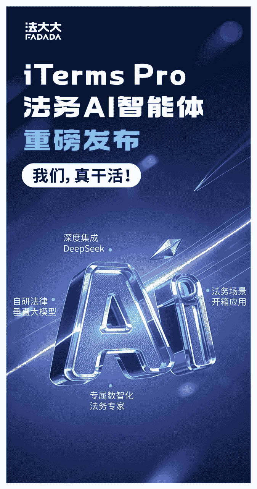
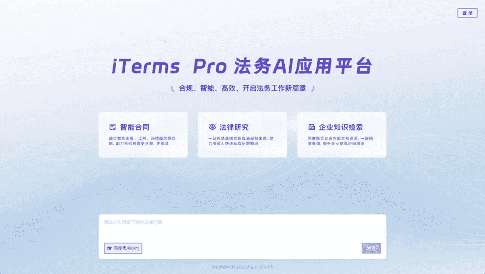
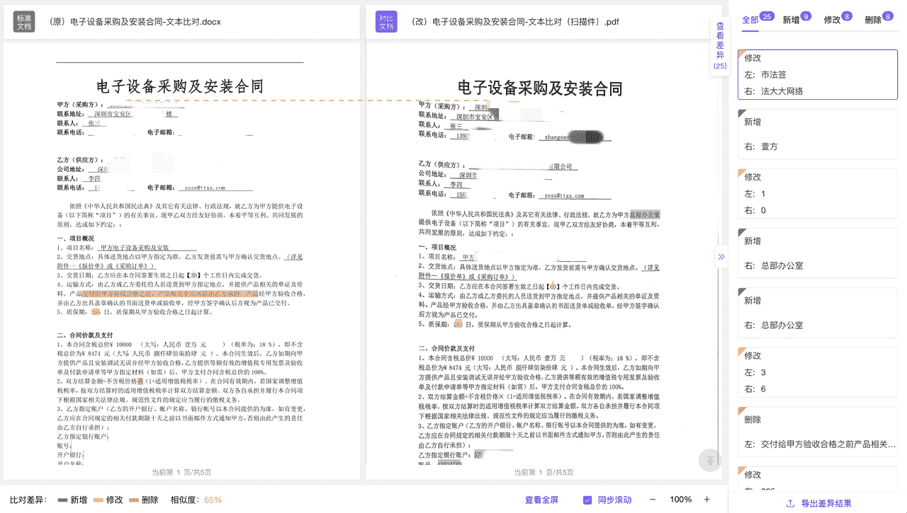
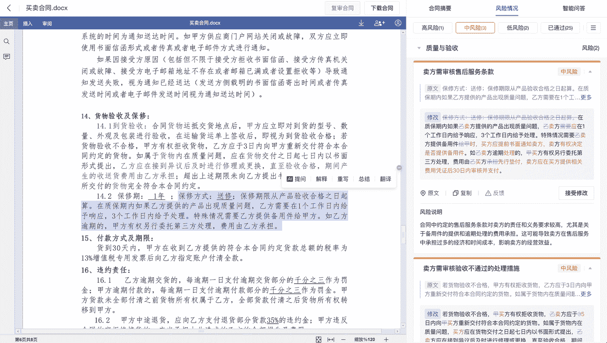

# 【甄选】法大大 - AI 智能体产品 iTerms Pro

> 来源：[https://docs.feishu.cn/docx/X5iMdwYgtoTmn2xNQ26cND7un7b](https://docs.feishu.cn/docx/X5iMdwYgtoTmn2xNQ26cND7un7b)

---

2025 年，AI 产业化元年已经是箭在弦上，只欠关键场景的“东风”。

从越来越多的 AI 应用自主接入 DeepSeek，到 Agentic AI（智能体）的崛起，技术和产品形态狂飙，AI 平权化时代来临，似乎也将各行各业的智能化转型推向了临界点。

**在法律科技行业，国内头部电子签名产品与解决方案提供商法大大，也以十年积淀给出了自己的答**案 —— 基于自研法律大模型，发布法务 AI 智能体产品 iTerms Pro。

深究 AI 产业化的本质，不难发现：AI 的价值不在于炫技，而在于让技术穿透专业场景，尤其是容错率极低的法务岗位，好的法务 AI 产品需要做的是放大专业价值，从而实现人机协同的效应。

所以，让 AI 产品化不难，难的是让 AI 应用帮法务“真干活”。

# **合规挑战下，智能体“破局”**

“法务数字化在中大型客户群体中已经落地了很久，但人与 AI 协同去驱动业务流转的愿景，却还有很长的路要走。”法大大产品负责人梅容告诉36氪，目前国内大概有一半以上的企业都已经完成了合同的数字化管理。但与此同时，其中的大多数仍困在“流程线上化”的浅水区，大量的非标合同依赖人工审查和驱动，数字化的协同价值非常低。

去年，《数据安全法》《个人信息保护法》等法规的深化落地，叠加全球跨境数据流动监管趋于严格的现状，让企业法务部门也正在经历从被动响应到主动防控的挑战。但一般的通用大模型，显然不适合容错率极低的法务岗位。市面上大多数的法务 AI 产品，也还是定位于单点工具。而 iTerms Pro 展现的，却是像人一样拆解任务，包括智能合同审查和履约监控、法律研究、企业内合规问答、纠纷案件处理等场景，通过组合式 AI 和多模态适配预置，实现多个 Agent 协同规划。

在法务、财务这些 AI 永远无法替代人工经验的领域，Agentic AI 也能通过 CoT（思维链）和 CoA（行动链）沉淀生成数字员工，实现人机协同。

“在早期产业化阶段我们感受最深的一点就是：在 AI 平权化的影响力下，企业客户比以往更主动地愿意和我们共建。比如结合他们深度应用 AI 工具的实践，探讨在业务场景中落地法务 AI 的构想，或者把业务 know-how 的数据提供给我们训练垂类模型，来提升大模型在业务应用的准确性。”梅容认为，AI 产业化落地的第一步，就是让企业中的不同角色，能够通过AI的推理能力解构需求，从而发散出更多的可能性。

# AI 升维法务价值，以“共生”解构“替代”

开源大模型带来的技术普惠趋势下，验证 AI 应用的方向能否在商业化层面跑通，并非一日之功。

2019 年，在法律科技领域探索 5 年的法大大，正式成立 AI 产品实验室。当时还没有大语言模型的概念，但法律领域里已经有很多知识和经验层面的内容可以沉淀为数据，结合机器学习、OCR、语义理解等技术，进一步用于工程化开发和商业落地。通过对监督学习的钻研和大量的数据标注时间，仅就合同数据识别这一个场景，法大大在当时已经为企业风险识别预警带来了不小的提升。

2021 年，法大大又结合合同起草、商务洽谈、交易结构审查的生命周期，上线了合同智审系统，由此逐渐摸索到了未来的法务 AI 应用“应该朝什么方向去走”。

根据法大大副总裁李琳当时的观察和判断，由于已经沉淀出了自己的合同模版库、标准审查流程，大客户只会在一些零星的法务场景上引入 AI 的能力，智能工具的价值其实还不足以参与判断与决策。

GPT 时代到来后，一直狂奔到 2024 年，大模型的训练、精调、推理部署成本、专业生成表现都在发生质变。法大大也意识到，技术已经可以实现“理解能力”的跃迁了。基于过去的研究和专业数据，法大大开始自研法律垂直大模型，并马不停蹄地投身工程化，围绕法务人员的核心场景寻找可以被智能化提升的突破点。

彼时，市场上几乎还没有能够投入企业应用的法律大模型产品，而法大大已经将应用定位于让法务人员开箱即用的上层应用。为了实现这个目标，从数据到算法，法大大都做了大量的专业训练和优化。比如，在和企业客户数据共建的前提下，将人沉淀出来的知识进行数据蒸馏，其敏感度和训练难度比生产经营中的数据更大。

今年年初，DeepSeek 的爆发宣告了推理大模型时代的来临，法大大这家走在垂直 AI 应用“单行道”上的技术公司，也感受到了前所未有的压力。不过焦虑很快就得到了释放：对法务这个专业领域来说，法律专业数据和知识图谱几乎都是以非标结构存在于企业的日常运营、专家学者的经验判断中，因此开源大模型只能算是“巨人的肩膀”，但它和垂直大模型，还真比不了。

李琳认为，iTerms Pro 的使命，是为法务群体实实在在地“真干活”，是人机共生之下的效率裂变，而不是替代法务。他表示，总体来看，未来法务 AI 应用的壁垒与演进方向主要体现在以下三个方面：

1.  高质量专有语料的积累及专家经验的算法转化能力，这是智能化决策的底层支撑。

1.  全球化背景下多法域合规监管的动态适配能力，需通过技术创新抢抓企业智能化转型窗口期。

1.  以 RAG（检索增强生成）、Agentic AI（智能代理）、法务数字员工等实用形态深化人机协同，既助力新人快速成长，又为管理层释放战略创新的生产力。

因此，以客户为中心，理解真实需求，进行定制化部署从而实现人机共生的价值，尤为重要。

# **三、重构法务部门的“战略价值”**

人机协同下的合规，是法务智能体的第一层需求和实现方式，而更深层次的追求则是让法务部门的价值得到重构。

在稳定的市场空间中，法务体系趋向于成熟，企业感受不到“合规策略即增长力”，所以很多企业的法务数字化仅停留在浅薄的合同管理，法务部门也没有太多创新空间。归其原因，主要还是法律领域存在大量的“非标准化难题”，占据了法务人员绝大多数的时间和精力，长此以往就形成了职能化的循环。AI 的目标是把这些生产力释放出来。以法大大的智能合同审查场景为例，相比人工 20 分钟的平均审查时间，每份合同可以节省 50% 的工作量。

从低效的检索、引用、校对转向策略型优化之后，法务部门就可以寻找定位“破局点”。比如，出海做全球化的需求，就极大地显化了法务部门的战略价值。在向外求变的过程中，地缘政治和各国数据安全与个人信息保护法规的要求远比国内市场复杂而严苛，基本都需要从企业法务部门开始打通策略，贯穿企业从生产到分发的业务线。

因此，想要拿到跨境合规的入场券，法律可行性的验证、数据审查流程的开放性和流通性、法务部门从专业视角主导风控策略，对企业稳健的出海航线来说至关重要。

“在法律行业，很多客户的期待和构想都是能够借鉴别人的经验，保障自身机制的完整性，再去探索新的业务。”

法大大创始人兼 CEO 黄翔直言，技术落地只是启程的手段，法律领域真正“诱人的果实”仍然在于实现“人的价值”，因为科技的本质是以人为本。在追求效率的同时，法大大也始终关注技术应用的伦理准则能否坚守法律精神、人机协同的工作流程如何保留专业判断、局部的创新实践如何转化为普适性解决方案等问题，从而让人的价值最大化。无论是借鉴还是自我沉淀，AI 想要真正在企业中为人所用，需要的是将业务流程和单点AI能力彼此打通，参照 MCP 协议的逻辑，构建系统性的智能体自主规划和协同能力。

这也是为什么，法大大一直以来非常注重自身产品的开放性，不但为 iTerms Pro 开放了 API 接口，在与市占率较高的 OA、ERP 系统合作时，也都做到了彼此开放。智能化转型的突破口，核心聚焦点是人本思维，也就是人机协同的突破。AI 并不能代替人，却能把人的价值推向更接近“大脑”的地方。当下，AI 应用正在告别拿着锤子找钉子的时期。法大大的发力能否让 Agentic AI 在法律领域得到更好的商业化验证，仍值得长期观察。

