# 【甄选】慧多宝 - 法律 AI 智能体

> 来源：[https://docs.feishu.cn/docx/XYqddBJDXoCQzgxuUGec9aYfnWd](https://docs.feishu.cn/docx/XYqddBJDXoCQzgxuUGec9aYfnWd)

---

1.  公司：**慧多宝/慧卷卷**

1.  产品链接：

1.  hjj.jurisai.cn     （专业版入口）

1.  hdb.jurisai.cn  （企业版入口）

1.  jurisai.cn          （官网入口）

作为一个法律科技博主，我经常关注各种法律 AI 产品。

2023 年以来， 各种法律 AI 产品推陈出新，有业内人士做的，还有很多科技公司入场，不计其数，大家都觉得法律行业是 AI 落地的绝佳场景，不断涌入这个行业。

很多朋友可能不知道，我一直有个梦想，那就是有朝一日法律科技发展得非常好，即使像我这样没有做过法律业务的人，也能通过专业的法律科技工具为客户提供服务。

同时，我都希望能看到 all-in-one 的法律科技产品，什么合同起草审查、文本纠错、法律翻译，统统都可以在这个平台搞定，不用各种产品之间切来切去。

毕竟，如果每个产品都买一遍，还挺贵的。

**最近，**我发现了一个法律 AI 产品 —— 慧多宝。

它的企业版名为“慧多宝”，而律师个人版则被称为“慧卷卷”。

说实话，各种法律 AI 产品我见过太多了，我真的好奇慧多宝他们还能怎么做。

体验过后，感觉还是不错的——

**慧**卷卷各项功能很齐全，文本纠错、合同审核、文书起草、法律翻译、智能问答等律师常用功能，应有尽有，而且还干得漂亮。

我用几个case，给大家感受一下这个产品的能力。

## **文书起草：一键生成，专业到飞起**

文书起草是律师日常工作中的重要组成部分。

慧卷卷支持起草律师函、起诉状、答辩状、证据链和各类申请书等 20 多种法律文书，以及 10 余种简易合同模板。

你只需要输入你的需求，它就能一键生成你想要的文书。这就像是你有个私人秘书，随时待命，帮你搞定一切文书工作。

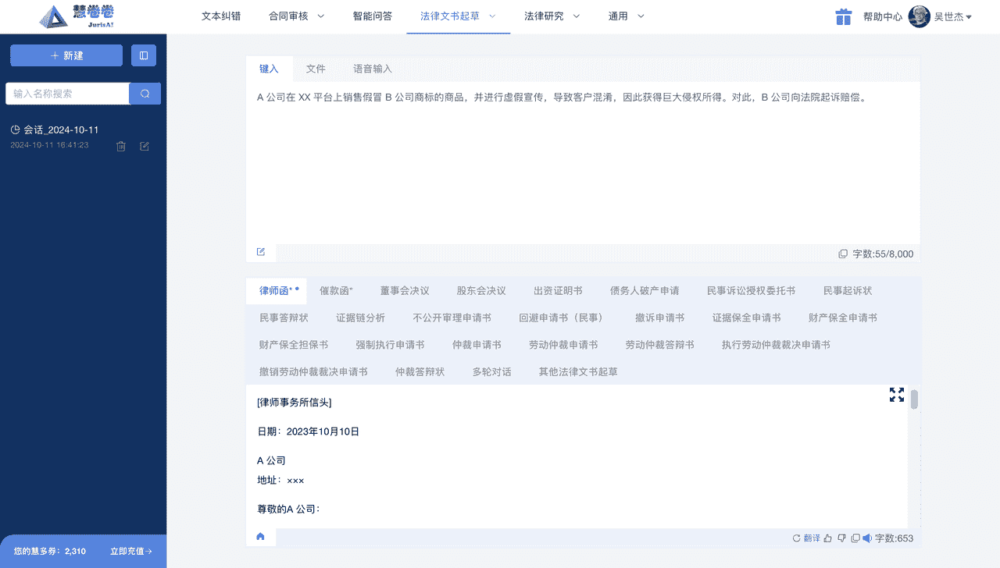

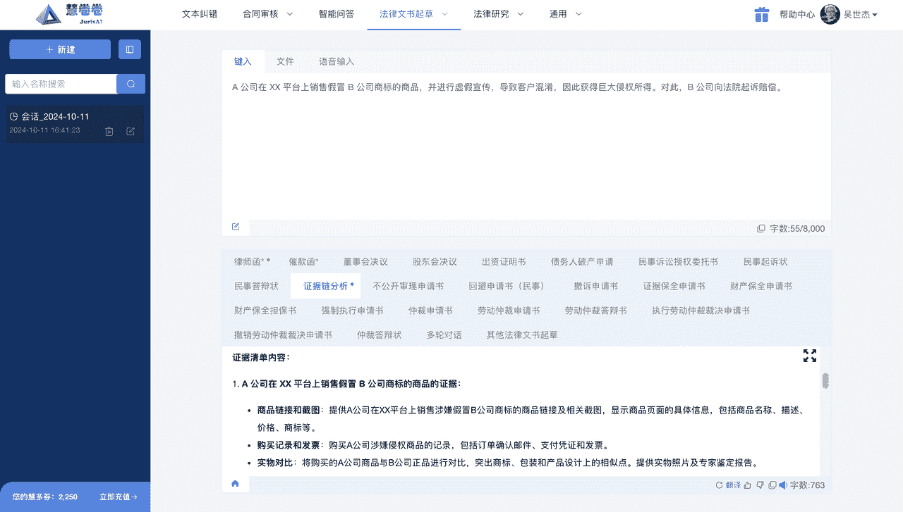

而且，它还有个超实用的功能 —— 起草法律备忘录（Legal Memorandum）。

实践中，律师或法律顾问经常需要撰写法律备忘录，用于记录和分析特定的法律问题或案件，比如：

+   **案件初步评估**：在接手一个新案件时，律师可能会编写备忘录来评估案件的强弱点，以及可能的法律策略。

+   **内部咨询**：律师或法律顾问可能会为公司内部的非法律部门提供备忘录，解释特定的法律问题，如合同条款的合法性、潜在的合规风险等。

+   **法庭提交**：在某些司法管辖区，备忘录可能作为法庭文件提交，以支持法律论点或请求法院采取特定行动。

+   **交易和谈判**：在商业交易中，法律备忘录可以用来记录双方对某些法律问题的理解和共识，或者作为谈判的起点。

+   **合规审查**：公司可能会使用法律备忘录来记录对特定合规问题的研究，以确保其业务活动符合相关法律法规。

法律备忘录通常包含以下几个部分：

1.  **问题陈述**：明确列出需要解决的法律问题。

1.  **事实摘要**：简要概述与问题相关的案件事实。

1.  **法律分析**：对相关法律原则和案例进行分析，解释这些法律如何适用于事实摘要中的情况。

1.  **结论**：基于法律分析，得出结论或建议。

1.  **引用**：列出所有参考的法律来源，包括法律条文、案例、法规等。

你只需要输入案件描述和问题，选择合适的法条，它就能给你生成一份专业的法律备忘录或邮件。这就像是你有个智能大脑，帮你把复杂的法律问题拆解成小问题，然后一一解决。

**如**果需要进一步的问题分析思路，还可以点击「问题拆分/解题思路」按钮，系统会将复杂问题拆分成几个子问题，通过解决子问题来实现对复杂问题的解决。

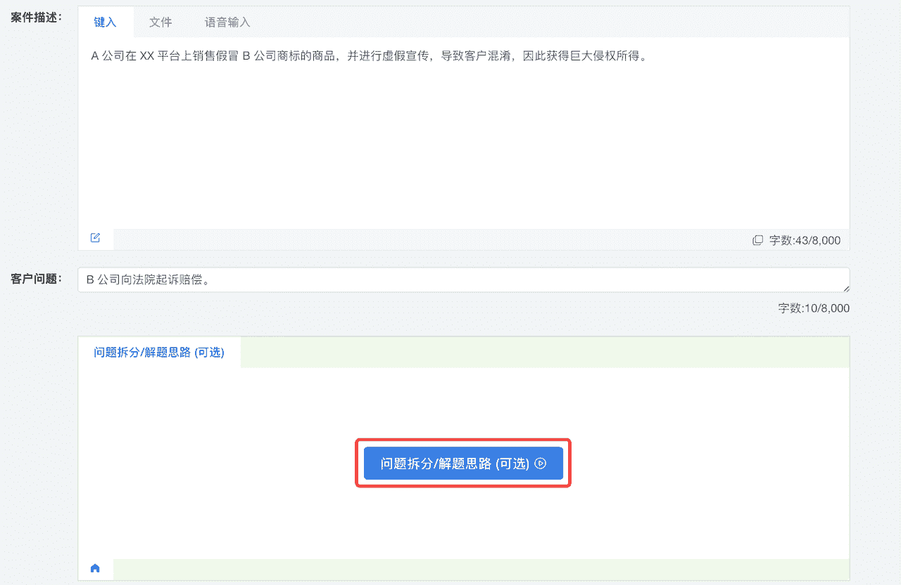

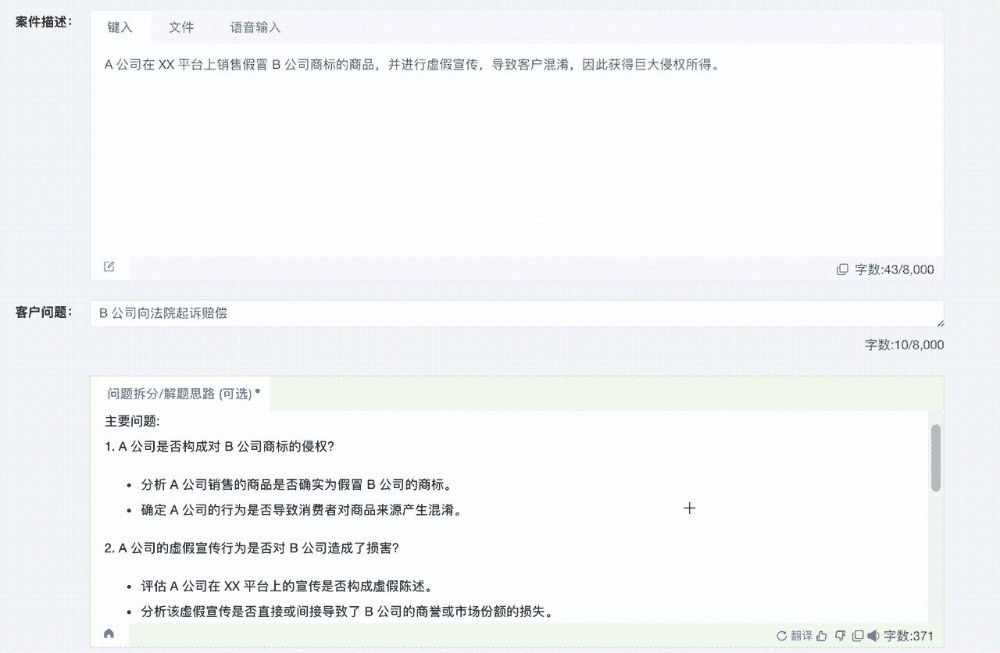

收到问题，先拆分问题，然后再给出解题思路。

它的思考过程，真的越来越接近人类的脑回路了。

真的很接地气。

## 合同审查：智能审阅，精准到骨子里

合同审查是法律工作中的重头戏。慧多宝提供了「短合同审核」和「复杂合同审核」两种模式，以适应不同场景。

其中，短合同审核适用于不超过 5,000 字的简易合同，系统会自动判定合同类型并执行智能化审阅流程，还可以从甲/乙方立场审阅，确保合同的基础合规性，同时提出修改意见。

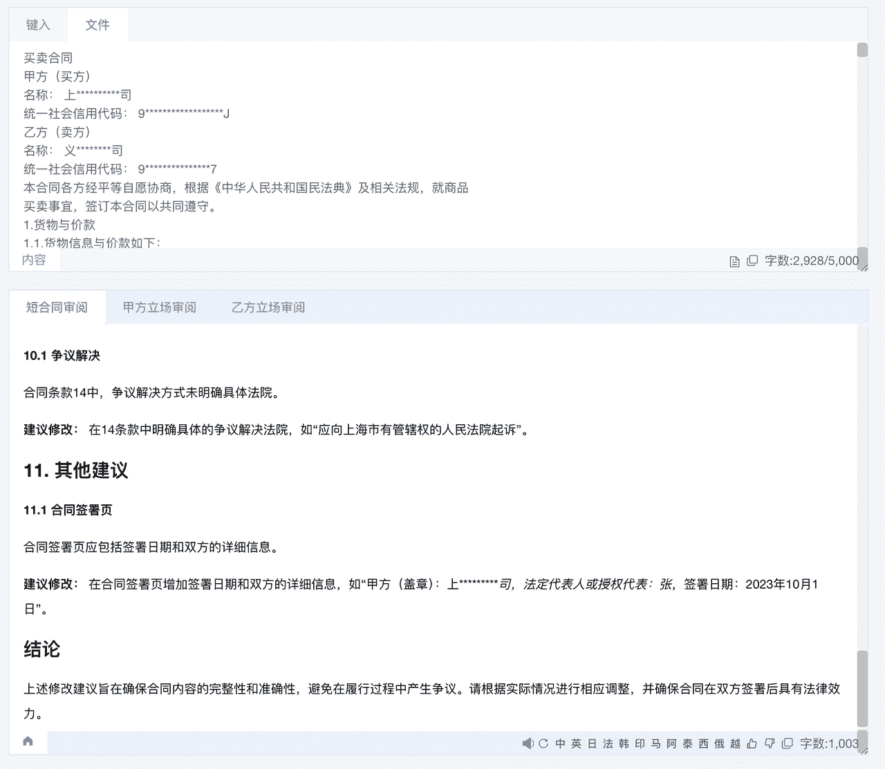

对于复杂合同，慧卷卷支持 100 多种不同类型的合同审阅，可以从甲方、乙方或者中立角度，快速识别潜在问题，并提供专业的修改意见。这种深度审查能力，可以有效确保审查的高精准度。

同样，这里也支持 40,000 字的合同审核。

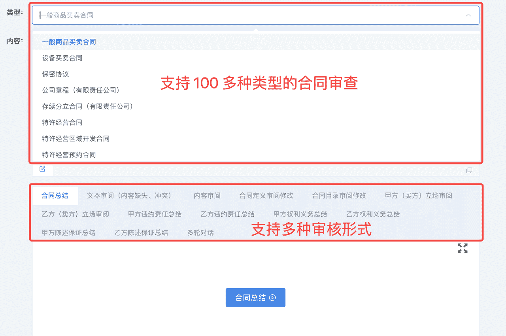

对于数据安全问题，如果你上传的文件涉及客户名称、联系方式等敏感信息，慧卷卷还支持「AI 脱敏」，一键脱敏。

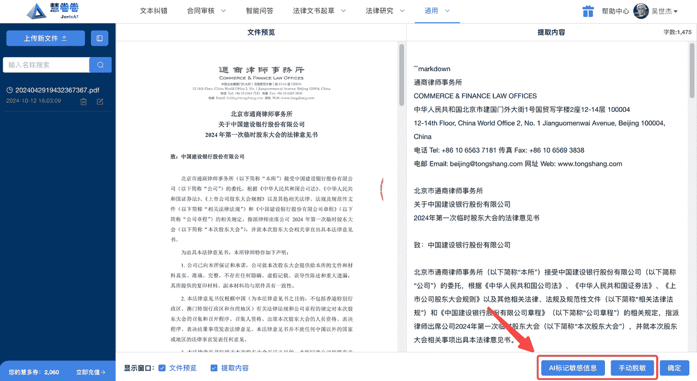

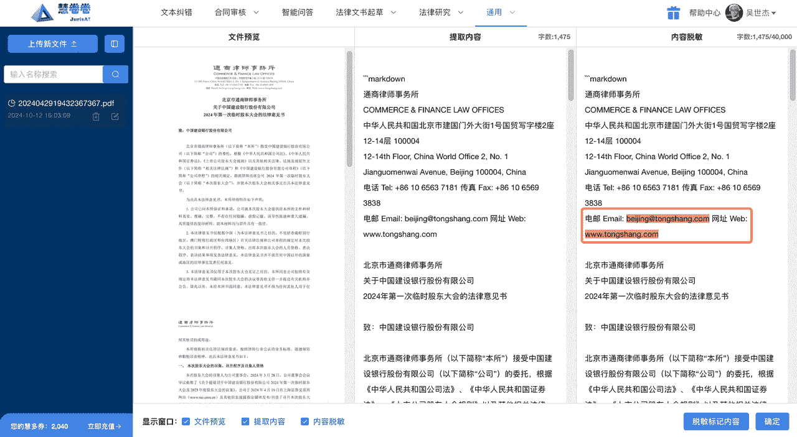

如果觉得 AI 脱敏的信息不够，还可以手动标记敏感信息，然后一键脱敏。

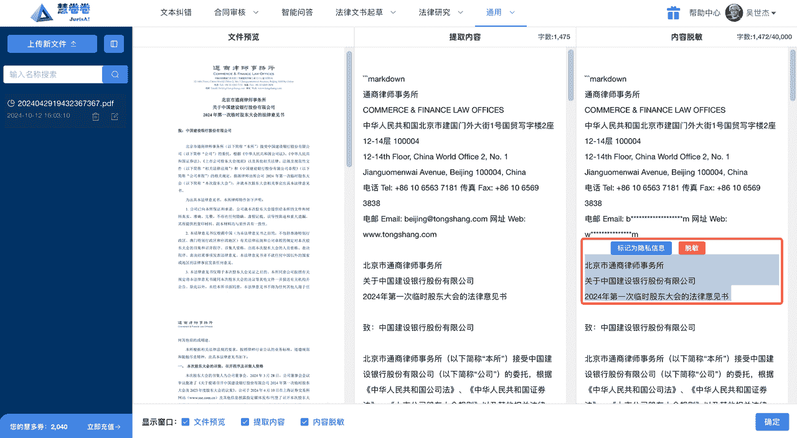

## **文本纠错：一键美颜，告别错别字**

文本纠错是律师工作中的家常便饭。无论是错词、错字、错序号，还是中文数字和阿拉伯数字不一致、错标点符号、多空格等，这些小错误都可能影响法律文件的严肃性和专业性。

例如，

**慧卷卷的文本纠错功能，能够一键改正这些文本性错误，支持长达 4 万字**的长文本纠错，这对于处理动不动就是长篇大论的法律文件来说，无疑是一个巨大的福音。

想象一下，你熬夜赶出来的法律文件，满篇的错别字，你都快绝望了。这时候，慧卷卷就像你的救星一样，一键帮你搞定，让你的文件瞬间变得高大上。

上传文本后，即可一键纠错，然后还可以点击右下角的“对比”按钮，进行纠错前后的对比，通过原内容、目标内容、对比结果，直观地看到对比效果。

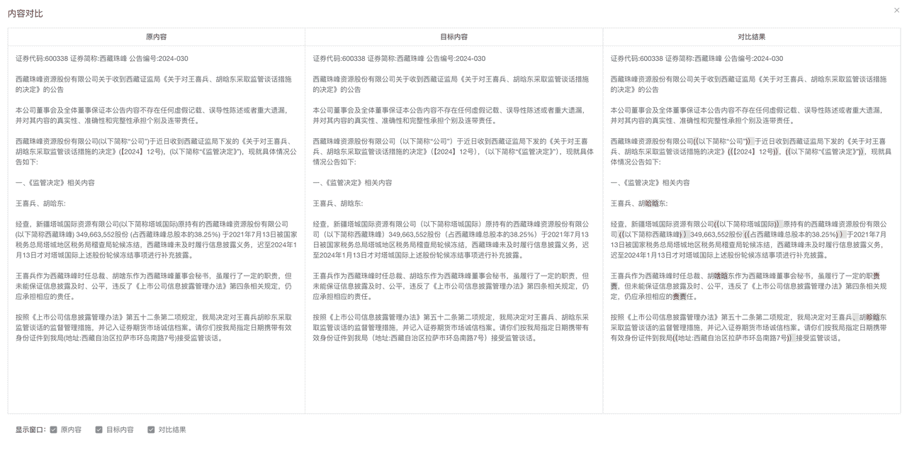

而且，支持 4 万字的长文本纠错，非常适合各类文本纠错。

## **法律翻译：多语种互译，支持出海**

在全球化的今天，律师的涉外业务变得越来越频繁，而法律翻译，就是涉外法律工作中的和核心痛点。

例如，律师在处理涉外合同时，往往需要投入大量的时间和精力进行语言转换和校对。这项工作不仅繁琐，而且容易出错，对律师的身心都是极大的考验。

**慧**卷卷「双语合同翻译」功能，支持中、英、日、法等 13 种语言的互译，单次可翻译长达 4 万字的长文本。

用户上传中文合同后，即可一键生成多语种的双语合同，还支持中文和外文对照翻译（一段中文，一段外文），满足不同国家的业务需求。

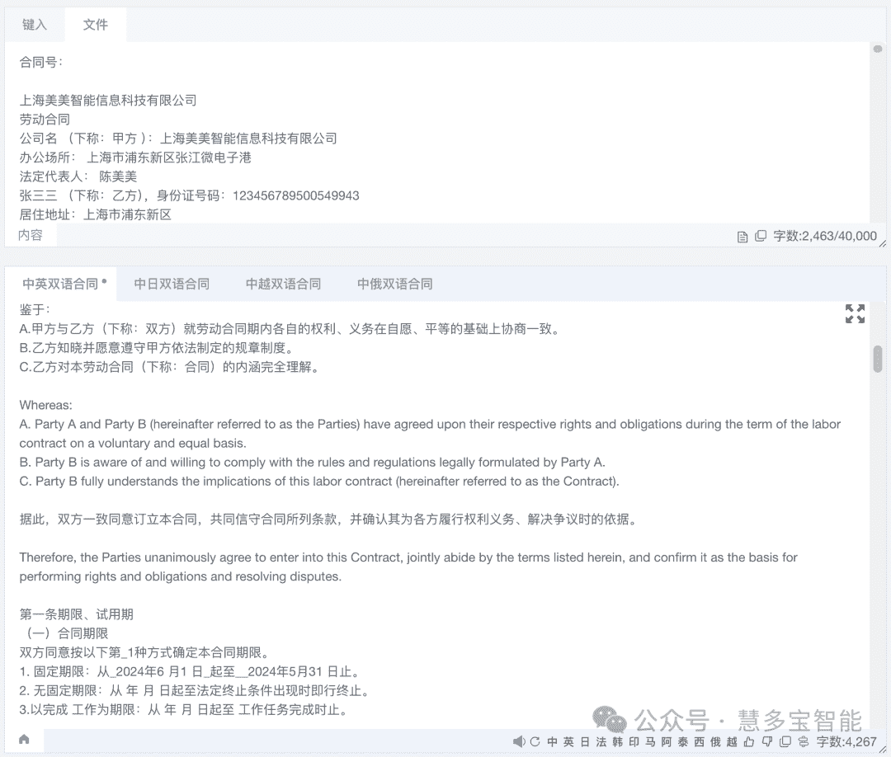

同时，慧卷卷还支持日常的文本翻译。

例如，我平时经常需要看国外的各种法律科技报告，但很多 AI 产品只能直接输出翻译，不能对比。而且，法律文件通常都很长，各种 AI 产品还不能一次性翻译完成，每次我都要发几次“继续”才能完整翻译，体验非常不好。

慧卷卷可以提供精准的法律翻译，而且支持长达 4w 字的长文本翻译，一键即可完成翻译对比，语言不再是障碍。

## 智能问答：全面覆盖，智能到没朋友

在「智能问答」模块，慧卷卷提供了中国法律问答、互联网问答和聊天三个部分。

+   **中国法律问答**：基于中国现行法律、法规、司法解释以及地方性法规进行智能化搜索，同时还包括证监会、银保监会、港股上市规则等相关政策指引。

+   **互联网问答**：基于中国互联网实时搜索的信息进行智能化问题解答。

+   **聊天**：基于大模型训练的通用问答，擅长泛化、概念性的对话，适合一些通用问题的总结以及思路梳理。

这种全方位的智能问答服务，让慧卷卷成为了律师工作中的得力助手。

**总的来说，慧多宝就像是法律界的“瑞士军刀”，功能全面，操作简便**，而且非常贴合律师的工作场景和使用习惯。

不再是一个空白的搜索框，不用写各种复杂的提示词，而是把各种场景拎出来，直接点点点，然后等 AI 输出就行。

每一步操作，都是对问题先拆解、再推理，最后给出答案。

这就是“思维链”（CoT）。

同时，通过直观的操作界面，让 AI 的输出更加直观和易于理解。

也就是说，慧卷卷还把这种思维链可视化出来了，很好地解决了 AI 不可解释的问题。

这玩意用在法律工作里面，体验还真的有点爽。

毕竟，法律人讲究逻辑严密的推理。

让 AI 成为法律人的助手，已经不是简单的噱头或口号了，欢迎感兴趣的朋友体验。

## 产品地址

[慧多宝法律AI产品介绍.pdf](https://internal-api-drive-stream.feishu.cn/space/api/box/stream/download/all/WndBbPPafo9EmuxEvqvcWxkbn3d)

+   电脑端：hjj.jurisai.cn

+   小程序：扫码立即体验

新用户注册即可免费领取 500 个慧多券，邀请好友还可获得更多赠券奖励！

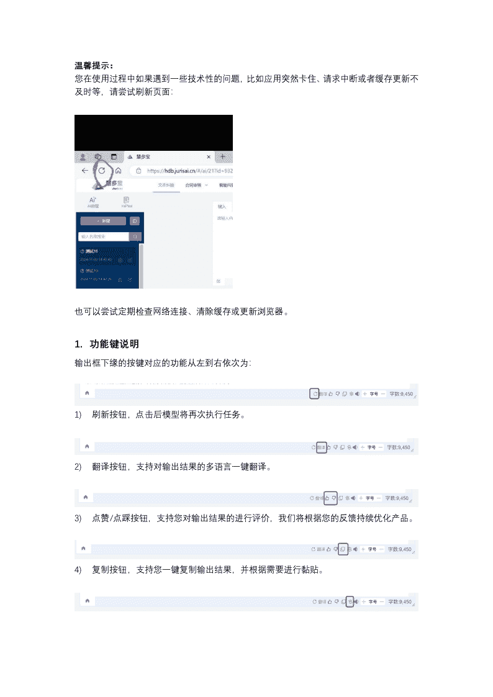

[慧多宝使用关键步骤指引.pdf](https://internal-api-drive-stream.feishu.cn/space/api/box/stream/download/all/RnoZbMXvKoYzScx3QzKc5pttnBg)

欢迎加入慧多宝专属群二维码

一起交流产品使用心得

有任何问题都可以询问

👇👇👇

如果律所和企业有采购需求，可联系：

电话：13917308699

邮箱：contact@jurisai.cn

关于这款产品的更多信息，欢迎关注「慧多宝智能」👸号

👇👇👇

