# 法律人狂喜！慧多宝「法律龙虾」重磅上新：全案工作一键成文，解锁躺平式办案

> 来源：[https://docs.feishu.cn/docx/QYBHdnmHoor5UhxFDeWcJA73n8d](https://docs.feishu.cn/docx/QYBHdnmHoor5UhxFDeWcJA73n8d)

---

律师办案，熬人的，是开庭前的无数个夜晚：案卷堆成山，证据乱糟糟，法条、类案翻破头……

如何快速搞定这些海量、重复、必须做、但又极其耗时的基础性工作呢？

于是你养起了龙虾，你希望可以躺平等着龙虾自己干活，然而你发现龙虾安装让人头大，干点小活花费很多 Token，最重要的，法律专业度不够......有没有一款真懂法律、真能办案、真能减负的 AI 工具呢？

作为一个法律科技博主，我经常关注各种法律 AI 产品。

2023 年以来， 各种法律 AI 产品推陈出新，有业内人士做的，还有很多科技公司入场，不计其数，大家都觉得法律行业是 AI 落地的绝佳场景，不断涌入这个行业。

很多朋友可能不知道，我一直有个梦想，那就是有朝一日法律科技发展得非常好，即使像我这样没有做过法律业务的人，也能通过专业的法律科技工具为客户提供服务。同时，我也希望能看到 all-in-one 的法律科技产品，什么合同起草审查、文本纠错、法律翻译，统统都可以在这个平台搞定，不用各种产品之间切来切去。

毕竟，如果每个产品都买一遍，还挺贵的。

**早在 2024 年 ****1**0 月，法律修音机就分享过的「慧多宝法律 AI」 ，就是这么一个产品。

**近日，慧多宝法律 AI **[**宣布**](https://mp.weixin.qq.com/s/CLGZ4NtxQJW39Og9PritZw)**完成** Pre-A 轮融资，金沙江创投领投，浦东创投跟投，本轮融资将会用于市场拓展、产品研发、场景深化及组织能力建设，进一步巩固在法律 AI 赛道的核心竞争力，加速推进产品的规模化落地。

金沙江创投主管合伙人朱啸虎表示：“我们一直看好真正能把事情做完、把结果交付出来的AI产品，而不只是停留在演示层面的能力。法律服务是一个专业门槛高、结果要求高、付费能力也强的市场，法律 AI 具备非常大的发展潜力。慧多宝团队对法律场景有深刻理解，在产品能力、技术路线和商业化方向上都展现出很强的执行力和落地能力。我们看好中国法律 AI 市场的长期机会，也看好慧多宝 AI 未来在这一领域持续建立领先优势。”

**同时，慧多宝重磅推出法律版 AI 龙虾 ——「案件分析龙虾」。专为律师的办案工作打造，围绕阅卷分析、证据清单生成、法律法规汇编、类**案检索、请求权基础总结、初步法律意见书生成六大核心技能，AI 自主规划，自主完成工作闭环，在安全稳定的基础上，助力大家高效搞定案卷梳理、法条检索等繁杂案头工作。

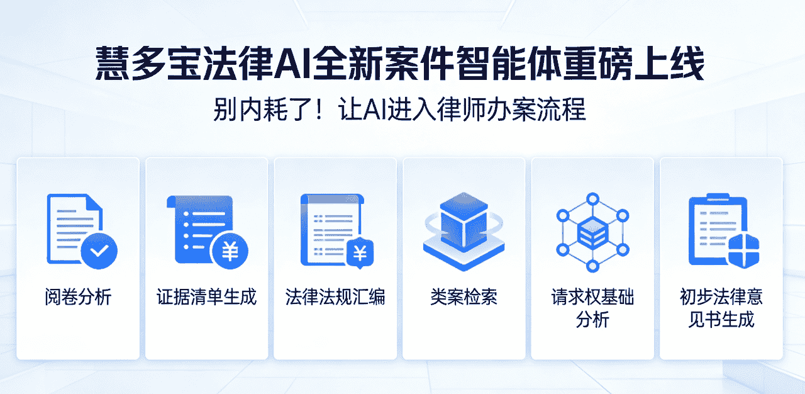

无需复杂安装，登录慧多宝账户即可使用，每个任务的执行，都有可靠的法律专业技能矩阵支持，不在小事情上绕路烧 Token，一键上传案件材料，一键输出报告文档，让 AI 成为您的办案助理！

# **慧多宝「法律龙虾」重磅上新**** 全流程赋能，解锁躺平式办**案

与市场上大多数简单的“问答机器人”不同，慧多宝围绕真实法律工作流，通过丰富的法律技能矩阵，实现复杂任务的交付闭环。慧多宝法律 AI 具备工作流自主规划和执行能力，可以高效处理案件分析、深度研究等长链路任务，擅长多文件、长文本处理，具备基于项目的永久记忆功能，适配律师长期、多轮、复杂协同的工作模式。

不用你手动分步操作，从上传案卷材料开始，AI 自主规划办案路径：阅卷梳理→证据整理→法条检索→类案比对→请求权分析→文书生成→案件报告整合，全程自主推进、无断点完成，真正做到“一次性上传，AI 全权代劳”。

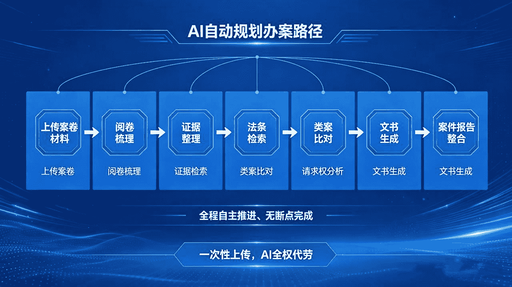

进入慧多宝首页（JurisAI.cn），我们可以看到全新升级的产品界面：

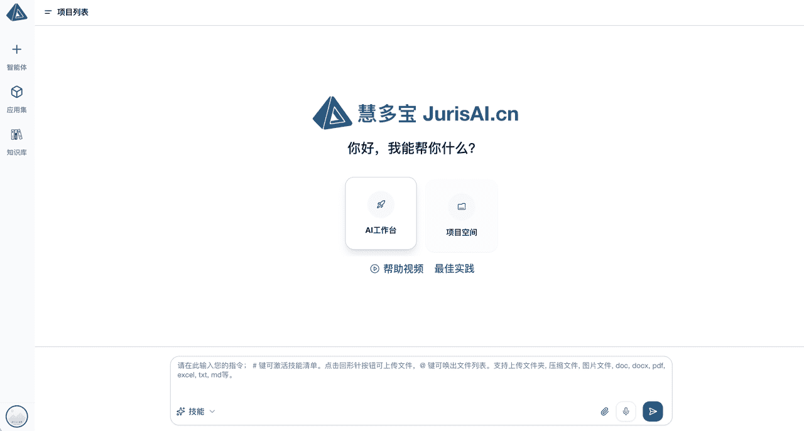

在首页，我们能看到「AI 工作台」和「项目空间」两个入口。

其中，“AI 工作台”适合处理“临时性需求”，比如法律问答、文书生成、合同审查、证据链分析、营销文案写作等，即开即用，任务结束即关闭，解决当下的具体问题。

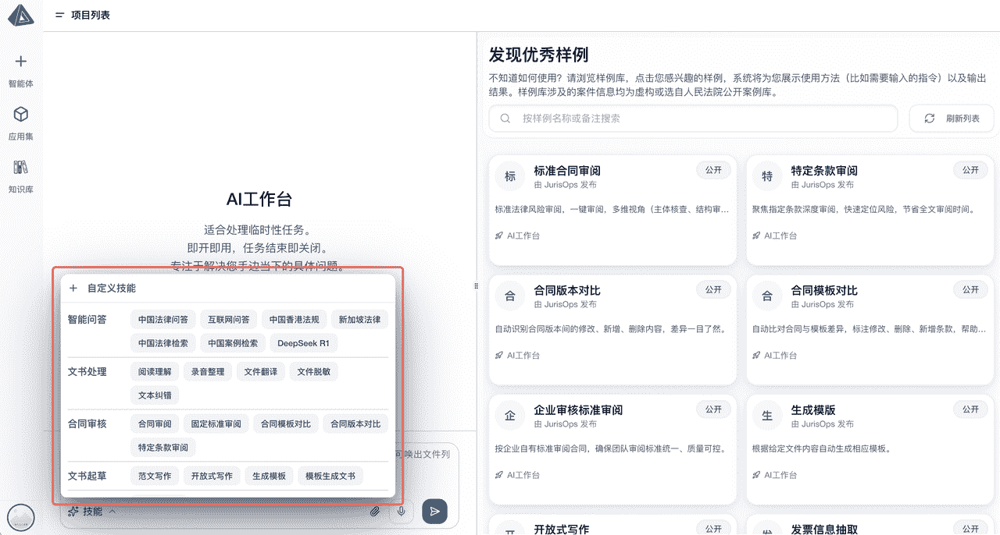

**“项**目空间”则是这个产品的灵魂——所有相关文件和任务成果都被长期保存，AI 会持续记忆上下文与项目全貌，对多文件进行阅读分析对比，并基于输入文件的内容生产，让你实现深度、连贯的项目作业。

说白了，就是给每个案子设立一个专属空间。

在这个工作空间，慧多宝内置了一系列法律技能矩阵——

进入“AI 工作台”或“项目空间”，点击左下角「技能」按钮，可以按需选择特定的法律 AI 技能，基本上覆盖律师接手一个新案子时几乎全部的基础工作。然后，用户只须上传需要分析的案件材料，AI 就开始埋头干活了。

以律师办案的第一步「阅卷分析」举例：

面对一大堆案件材料，律师首先需要清晰了解案件事实，帮助自己梳理案件核心要点，从而做出专业判断。

对此，案件智能体可以对律师**批量上传的案件材料**进行系统梳理、归纳和总结，识别关键事实和法律问题，助您快速从杂乱的信息中抓住案件主线。

进入“项目空间”，点击左下角「技能」选择「案件综合分析」，即可一键调用慧多宝预置的技能及提示词，并且支持用户自定义修改。然后，上传需要分析的案件材料（支持批量上传），AI 就会自动开展案情分析——提取关键事实、争议焦点，生成人物关系图、时间轴，3 分钟之内输出结构化阅卷报告。

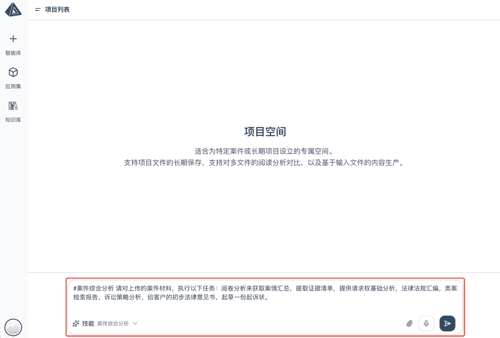

在案件分析界面，左侧将 AI 的分析过程，一步步地展示出来。

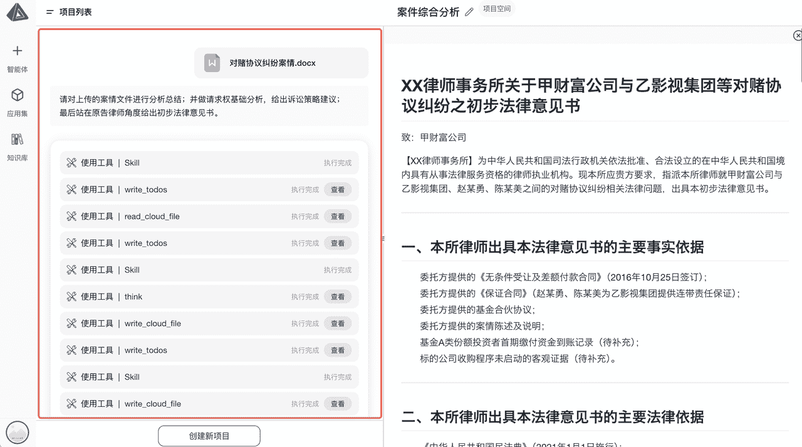

点击「查看」按钮，可以看到慧多宝预置的 AI 案件分析任务详情——这就是律师日常办案的工作流程。

然后，AI 会按照预设的工作流一步步跑完。

点击「查看」按钮，可以看到 AI 执行的具体任务，把 AI 的思维链可视化出来了。

这玩意用在法律工作里面，体验还真的有点爽，因为法律人讲究逻辑严密的推理。

最终，AI 输出若干份文件，点击「查看」按钮，即可在右侧阅读文件或下载。如需对任何一份文件进行深化或调整，或需要补充证据清单、起草诉讼文书等，可以随时让 AI 补充。

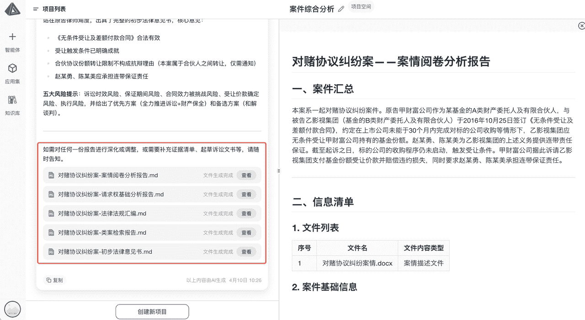

「龙虾」的核心能力，就是把各种技能串连成一条完整的流水线。你只需要告诉它：“我是甲方的律师，请一步一步引导我如何打这个官司”，然后它就自动开始干活了——自主调用 Skills 工具、读取云端文件、思考分析路径、拆解任务清单，按「阅卷分析→请求权基础分析→法条汇编→类案检索→法律意见书」的标准路径，一步不落。

简单来说，律师办案最耗时事情，AI 会帮你做一遍。

# **我用一个真实案子测了它**

目前市面上号称「AI写法律文书」的产品非常多，但大多数停留在「你问我答」的阶段，顶多帮你搜个法条、生成个模板。真到了复杂的商事纠纷面前，该翻卷宗还是得自己翻，该查案例还是得自己查。

那么，慧多宝的表现如何？

**我把**一个案件事实丢给慧多宝，然后看着它一步步把一个案子从头到尾跑完。整个过程大概就是——把事实扔进去，它自己规划路径、调取法条、检索类案、梳理证据，最后吐出五份完整的法律文书。

丢进去的案情是这样的：原告甲财富公司作为某基金的 A 类财产委托人，2016 年跟被告乙影视集团签订了一份《无条件受让及差额付款合同》，约定如果上市公司 30 个月内没完成标的公司的收购，乙影视集团就得无条件受让甲财富公司的基金份额。结果呢，截至起诉之日，那个收购程序压根就没启动过。

就这么一段事实描述，龙虾开始工作了。

第一步，它生成了案件阅卷分析报告——把案件事实梳理清楚，拉出了时间轴（2016 年 10 月 25 日签合同 → 2019 年 6 月 29 日条件触发 → 至今未履行），画出了人物关系图，整理了证据清单，还标出了争议焦点。

第二步，请求权基础分析报告——用六步分析法拆解了合同违约请求权的构成要件，做了抗辩审查预判，还站在被告视角模拟了可能的答辩思路。这个视角切换挺重要的，打官司的人都知道，不知道对方怎么反驳你就没法准备回击。

第三步，法律法规汇编——自动检索并分类了民法典、合伙企业法、诉讼时效司法解释、私募基金监管规定等相关法规，每一条都标注了时效性和适用场景。

第四步，类案检索报告——找到了 9 件相关案例，总结了裁判规则，并对本案提出了具体建议。不是简单堆案例列表，而是提炼出裁判倾向。

第五步，初步法律意见书——综合以上所有分析，给出了整体判断、风险提示和诉讼策略建议，甚至还列出了一个分优先级的下一步行动清单，从「立即执行」到「诉前准备」到「诉讼策略」，清清楚楚。

五份文件，一份不少。而且每一份都不是空话模板，是基于具体案情生成的有针对性的专业内容。

这个表现非常有意思。

第一，它真的在做「长链路任务」。大多数 AI 法律工具还在单点功能层面打转——搜个法条啦、翻译个合同啦、润色个文书啦。这些当然有用，但律师真正头疼的不是某一个环节，而是从接案到结案的整个流程中，大量重复性的案头工作堆积在一起，占用了太多本该用来思考和判断的时间。

「龙虾」尝试解决的正是这个问题——把那些标准化的前置工作自动化掉。

第二，它的输出质量确实超出了我的预期。特别是那个请求权基础分析里的抗辩审查和被告视角预判，以及最终意见书中分优先级行动清单的设计，这些东西说明背后的 prompt 工程和法律知识注入做得相当深。

这不是简单的「把案情塞进 GPT 让它写」，而是有一整套结构化的方法论在支撑。

**第三，项目空间这个设计很聪明。**法律工作的特点是周期长、文件多、需要反复回溯。一个基于项目的永久记忆机制，意味着你今天做的分析下周回来还能接着聊，这对律师的实际工作模式来说是非常友好的。

除了「阅卷分析」，案件分析智能体还支持以下场景：

+   **证据清单生成：**根据案件事实，对证据材料进行整理和分类，识别缺失项、划分补强优先级，输出规范证据清单

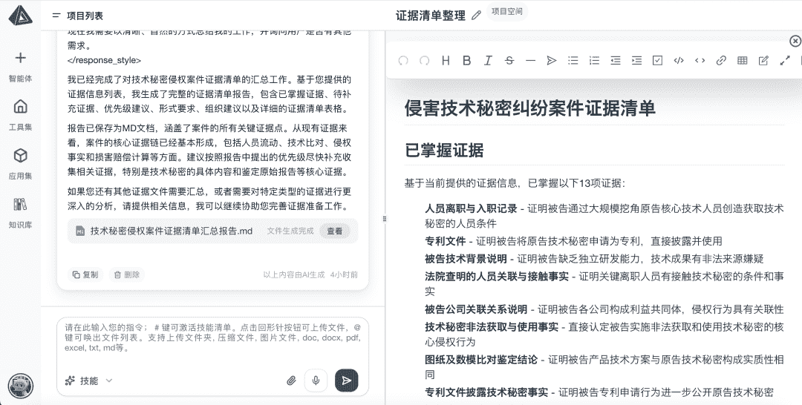

+   **法律法规汇编：**基于具体案情智能检索并匹配相关法律规范，按照效力层级进行结构化分类汇编，同时提炼案件核心法律问题及对应法条要点，并以符合司法文书辅助材料要求的格式输出

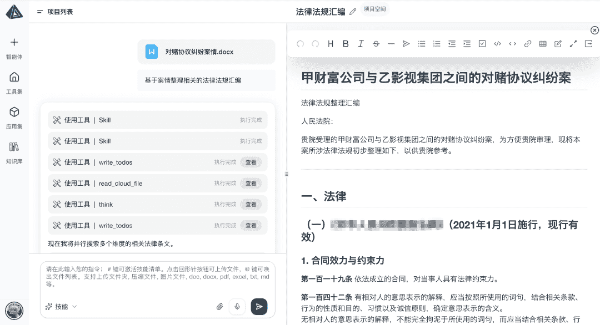

+   **类案检索分析：**根据案情自动生成案例检索报告，涵盖相关案例及结构化摘要，自动提取案件事实、法院观点与判决结果，归纳类案裁判规则、分析核心争议焦点，并提供诉讼策略建议

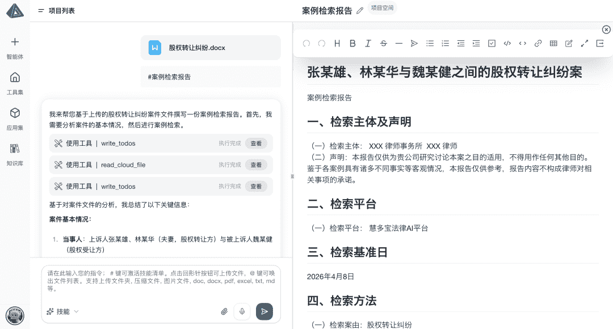

+   **请求权基础分析：**分析当事人的权利主张和法律依据，自动完从诉讼类型识别、请求权体系检索、构成要件归入比对、抗辩事由审查与竞合处理的全流程梳理，辅助律师更快建立案件的论证框架

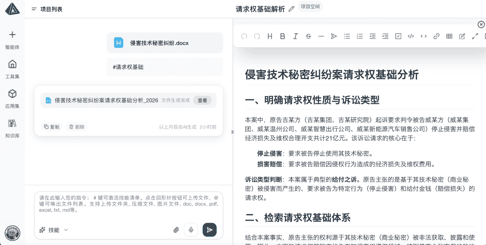

+   **法律意见书生成：**基于案件事实和法律研究结果，一键输出结构严谨、观点清晰的法律意见书初稿，帮助律师更快地进入审阅、修改和定稿阶段，把更多的时间聚焦在专业判断上

**总的来说，慧多宝就像是法律界的“瑞士军刀”，功能全面，操作简便**，而且非常贴合律师的工作场景和使用习惯。

如果你是一名律师或者法务人员，想看看 AI 到底能在多大程度上参与你的日常工作流程，慧多宝「法律龙虾」值得一试。毕竟，能用几分钟的时间换来自动化完成的五份专业文书初稿，这笔账怎么算都不亏。

接下来，慧多宝还将推出更多“法律龙虾”，敬请期待！

# **立即体验**

为了庆祝本轮融资成功，回馈每一位用户的信任与托举，慧多宝特别送上“法律龙虾”免费体验券！

扫描下方慧多宝专属群二维码，进群领取👇

+   电脑端：hdb.jurisai.cn

+   小程序：扫码立即体验

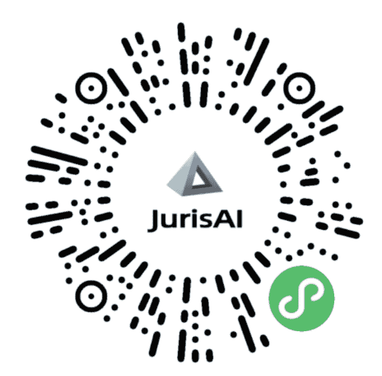

拓展阅读：[【甄选】慧多宝 - 法律 AI 智能体](https://legalstudio.feishu.cn/wiki/NyNzwNNtOiVazEkqdkgcZz7Tnoh)