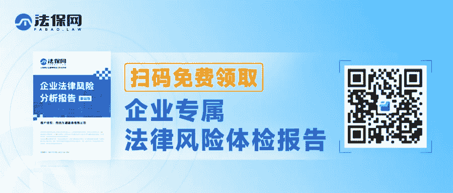
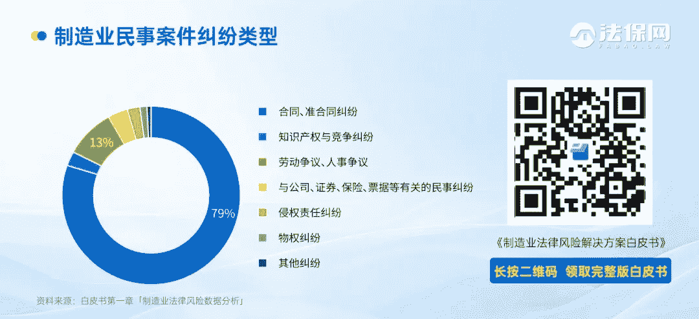
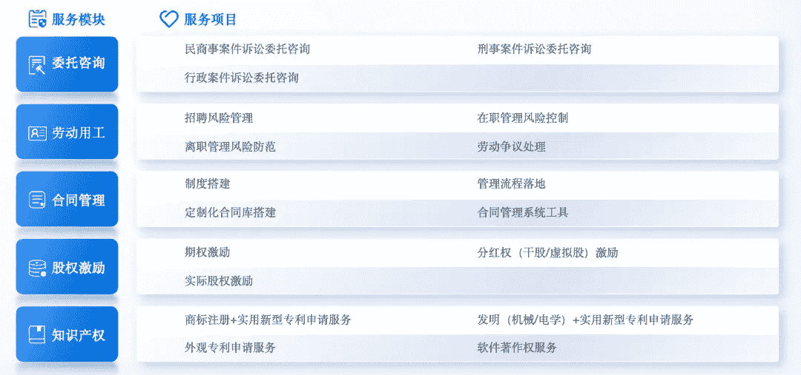
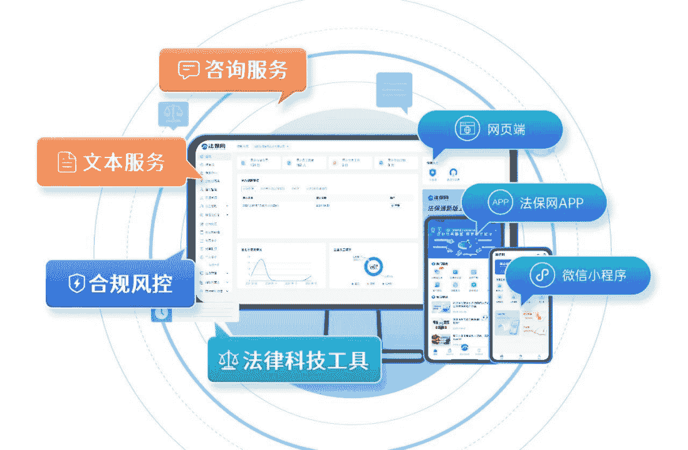
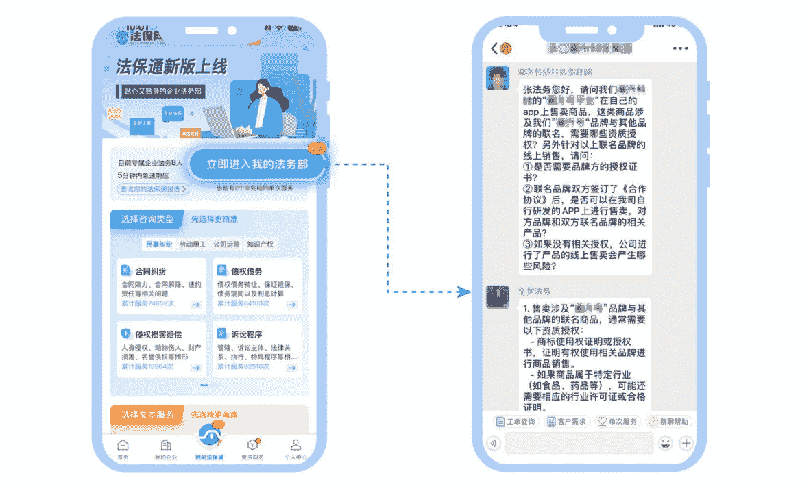
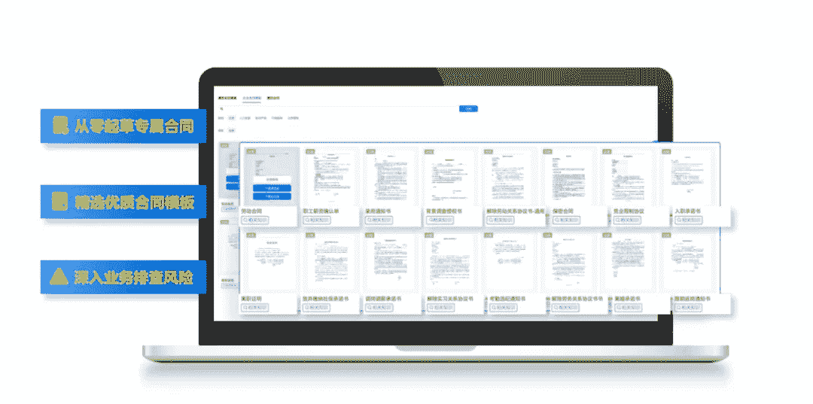
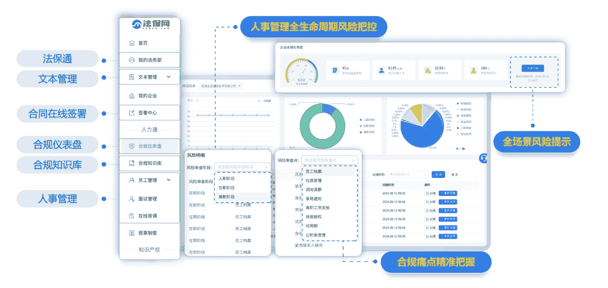

# 【甄选】法保网 - 企业合规法律服务

> 来源：[https://docs.feishu.cn/docx/KmBOdcA8aoyvOexTHiBcESdrn0c](https://docs.feishu.cn/docx/KmBOdcA8aoyvOexTHiBcESdrn0c)

---

2021-2023 年，最高人民检察院连续发布了涵盖大中小微各类企业在内的 4 批企业合规典型案例，旨在通过真实案例的警示作用，促进更多企业自觉遵守法律法规，强化合规经营意识，推动合规经营体系化建设。

这些案例显示，很多企业在经营发展和品牌声誉方面所蒙受的重大损失，往往是由于在内部制度和管理流程上所存在的合规漏洞，引发了一系列的“多米诺骨牌效应”，进而为公司的经营管理、企业形象带来了巨大的危机 ——「如何有效建立企业合规体系」这一话题值得每一位企业管理者深思。

在需求巨量膨胀的情况下，我们再将视线转回供给方 —— 传统法律服务行业。

根据政府统计，我国民企数量已达 5554.23 万户，而 2022 年仅 87.6 万家机关单位和企事业单位有律师担任法务顾问。粗略算来，拥有法律风险防范能力的企业很可能不足总量的 2%。

同时，高昂的传统法律服务行业价格，让中小微企业望而却步；而对于考虑建立一套全面的法律合规体系的大中型企业来说，更加复杂的需求必然也意味着更加不菲的成本 —— 这也解释了为何很多企业深知合规经营的重要性，但依旧选择在风险中谨慎前行，如履薄冰。

但是，在企业实际经营的过程中，交易风险点多、合规建设弱、资金及人才匮乏等问题始终是普遍存在的，伴随 AI+大数据的迅猛发展，法律服务也应该以更低成本、更优服务的崭新面貌，惠及更广泛的企业群体。

> 致力于为企业提供更加高效、专业、普惠以及有保障的法律服务，这正是国内领先的「AI+法律服务平台」法保网成立的初衷。法保网自成立以来，已累计服务企业客户 20w+，以「法务数字化+法律 AIGC」为核心技术优势，打破传统法律服务壁垒，形成了“线上+线下”深度融合的创新服务模式，致力于高效满足企业多样化的法律需求，用科技与企业共建法律合规体系。

# 踩刹车：企业法律风险识别与防范

国家标准化委员会发布的《企业法律风险管理指南》中提到法律风险识别的过程，分为以下 3 个阶段：

+   **查找描述风险**：先查找企业各业务单元、重要经营活动和业务流程中的法律风险，然后对查找出的风险进行描述和分类。

+   **分析和归纳**：对识别出来的法律风险进行原因、影响范围和潜在后果的分析归纳，最终形成企业的法律风险清单。

+   **形成法律风险清单**：在确定法律风险事件及名称后，将这些事件统一列表，并补充相关法律法规、风险动因以及可能产生的法律后果等信息。

法保网据此构建了一套标准化的企业风险识别机制，致力于为客户提供专业全**面的合规体系梳理与诊断。** 依托在人工智能和大数据领域的技术优势，法保网在业界首推【企业法律风险体检报告】，以提前发现企业在股权结构、人力资源管理、合同签订、商标及专利保护、合规性要求以及涉诉情况等方面可能遭遇的法律问题。

在初步识别风险后，法保网的专业法务团队会去深度了解企业运营的各个环节，结合客户的自我风险评估和法务团队的专业判断，对识别出来的法律风险进行深层次的原因剖析、影响范围评估及潜在后果预测，确保每个风险点都能得到充分的理解和重视。

# 做外脑：确立企业合规建设目标

在多方位掌握潜在法律风险情况的基础之上，鉴于企业文化、人员配置、资源投入以及业务需求等多方面存在差异，不同企业在构建合规体系时的具体目标和需求也各不相同。

法保网作为“外挂法务部”，可与企业现有组织架构“无缝对接”，与内部法务团队和相关部门紧密协同，识别出法律风险高发的部门，深入了解业务场景并梳理业务流程，与企业共同确立合规体系建设方向，力求为企业量身定制既符合实际经营情况，又能有效推动企业发展的合规策略。同时，法保网还会不定期提供线上线下相结合的法律培训，帮助企业及时了解和掌握最新法律法规及行业合规趋势，科学合理地设定目标并适时进行调整完善，确保在竞争激烈的市场环境中保持合规性与竞争力。

以制造业的企业为例，高劳动纠纷率、高合同执行风险以及产业转型升级中频发的知识产权问题，共同造成了制造业企业在法律领域面临的窘境。法保网依托海量客户服务数据、众多真实服务案例的深厚积累、专业的法务团队，提炼出共计 46 个制造业高频法律风险场景，涵盖合同风险、人事管理风险、知识产权风险及其他四大类风险，并精心设计了对应的法律风险解决方案，汇编成《制造业法律风险解决方案白皮书》👇（扫码领取）

# 造地基：合规制度建设

“制度建设”是合规体系的基石与核心。法保网通过 AI+大数据技术，结合亿级客户服务数据的积累以及专业法务团队的支持，精心锻造了一套覆盖合同管理、劳动争议解决、知识产权管理、债权债务处理、案件委托咨询等在内的企业合规体系标准与规范，并可据此提供定制化的合规建设专项服务，以适应不同企业的差异化需求。

例如，在“劳动人事管理”这一法律问题频发的领域，法保网可为企业提供劳动人事管理专项服务，包括但不限于招聘过程中的风险防控、在职期间的管理风险控制、离职时的风险预防和劳动争议的有效处理等人事管理全生命周期内的各个环节。除了详细的风险提示，法保网还可为企业量身定制解决方案，并提供必要的配套文档支持，如劳动合同、员工录用通知、保密协议或承诺书，确保企业在每个关键节点都能得到专业的指导和支持。

# 踩油门：合规流程落地

为了确保企业合规制度的切实落地、整体合规制度能够充分发挥最大效能，法保网通过核心产品「法保通」为企业的战略决策、业务活动提供了专业的服务保障和系统化的产品支持，可保障企业法律风险的有效防范与应对、企业运营的合法合规，最大限度降低法律风险可能带来的损失，真正促进企业可持续发展。

法保通是一个提供贴身法律服务的“企业专属法务部”，涵盖高效专业的法律咨询服务、量身定制的合同/法律文书起草与审定，并提供覆盖企业运营全场景的风险管理平台。通过法保通平台，企业可以获得一站式的法律支持，确保在各个业务环节中都能够有效降低法律风险，实现合规经营。

### 日常法律咨询

法保网为每家企业客户配备专属「线上法务部」，由多位法务专家和客户成功专家共同组成，为企业提供“5 分钟即时响应，7*15 小时实时在线”的法律咨询服务，确保企业能够在第一时间获得所需的法律支持。线上法务部可在微信小程序/APP/PC端多平台登录。

### 合同审核定制

法保网拥有超百万文本服务经验，无论是从零定制合同，还是对现有合同进行审查和修订，专业法务团队均能提供量身定制的服务，类型可涵盖买卖、租赁、劳动等多领域的企业经营活动，且原则上在 2 个工作日交付。

除此之外，法保通内设企业通用合同模板库，覆盖高频场景下所使用的合同范本，方便企业在紧急情况下快捷调用；内嵌的一站式电子签功能，更是大大简化了合同签署流程，全流程无需打印纸质文件，所有操作均可在线完成，不仅提高合同签署效率，还能有效地避免重要合同文件的丢失。

### 法律文书起草

面对事态更为复杂的法律纠纷，**法保网为企业客户提供法律文书起草服务。不受地理的位置限制**，客户可在法保通一键发起文书起草委托需求，包括但不限于律师函代写、起诉状、答辩状、上诉状等，专业法务团队原则上将在 2 个工作日内为客户完成各类法律文书的起草与审定，协助企业深入分析案件背景，根据实际情况提供专业的法律建议，并制定合理的诉讼策略，最大化保护客户的合法权益。

自成立以来，**法保网通过灵活有效的争端解决方式，曾多次帮助客户**成功地追回欠款、解决纠纷、维护正当权益。

### 劳动人事管理

法保通特别推出「人力通」SaaS 平台，集成人力资源合规风险评估、员工档案管理、人事管理、合同文库、合规知识库以及在线签署等核心功能，为企业提供多方位人力合规支持。

+   **事前预防**：快速建立用工管理制度，结合丰富的标准合同模板库，提供专业的合规管理指导和内部管控建议，帮助企业识别并规避潜在风险，避免不必要的经济和法律损失。

+   **事中管理**：实现规章制度与劳动合同等关键文件的一站式确认，确保员工从入职、在职到离职全过程的规范化管理，在提高工作效率的同时，及时发现并控制风险。

+   **事后应对**：当用工纠纷发生时，平台能够迅速启动应急响应机制，提供灵活多样的解决方案，帮助企业迅速采取有效的补救措施，最大限度地减少损失，保护企业的合法权益。

人力通平台全面覆盖人力资源管理的整个生命周期，依托超过 20 万家企业客户丰富的实践经验，深刻理解并精准解决企业在人事合规方面的痛点，致力于为企业提供从预防到应对的全流程、一站式人力资源合规管理解决方案。

### 知识产权管理

法保网还可以帮助企业有效降低知识产权相关风险。通过法保通，企业不仅能够实现商标和专利信息的自动检索与集中管理，还能实时监控知识产权的状态，有效提升权益保护效率。

此外，法保通借助 AI 技术可评估商标注册的成功率，辅助创意命名，提高商标注册的成功率，并支持通过关键词或多维度的信息检索，帮助用户快速获取商标和专利的关键法律流程与详细信息，确保决策的及时性和准确性。

建立健全合规管理体系对企业预防法律风险、控制事态发展和降低利益损失而言至关重要。截至 2022 年 12 月，全国检察机关累计办理涉案企业合规案件 5150 件，对成功制定合规计划并进行有效整改的 1498 家企业、3051 人依法作出了不起诉的决定。

自 2019 年成立以来，法保网已经成功地为超过 20 万家企业提供了一站式、标准化的法律服务解决方案，覆盖 100 多个行业领域，致力于成为企业最信赖的法务服务平台。

未来，法保网将继续秉承“用科技与企业共建法律合规体系”的使命，不断进行技术创新和服务升级，助力更多企业在复杂的法律环境中稳健发展，实现长期的战略目标。

