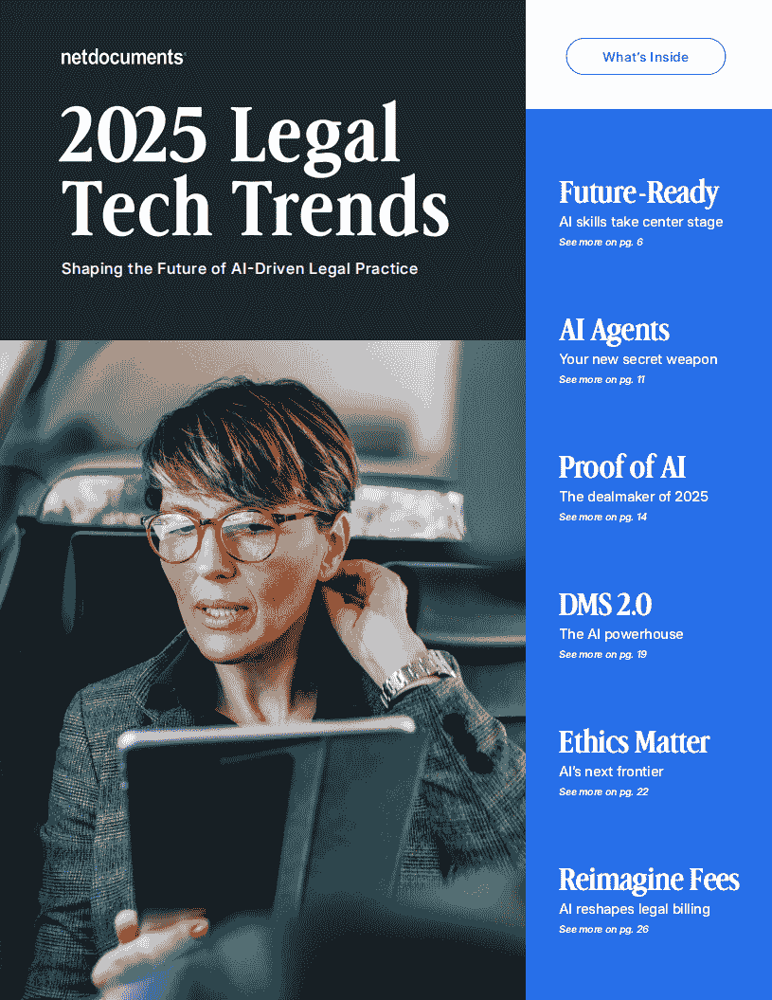
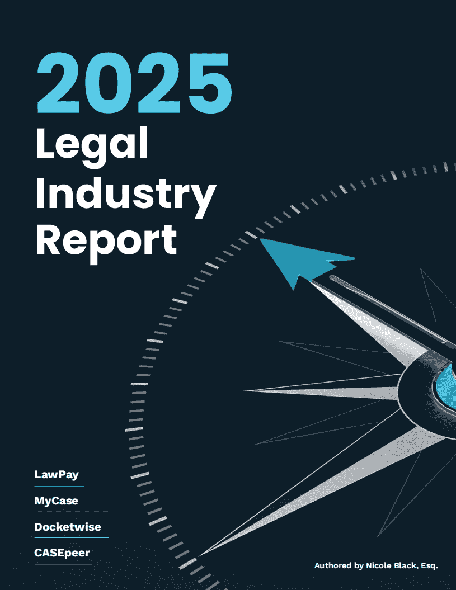
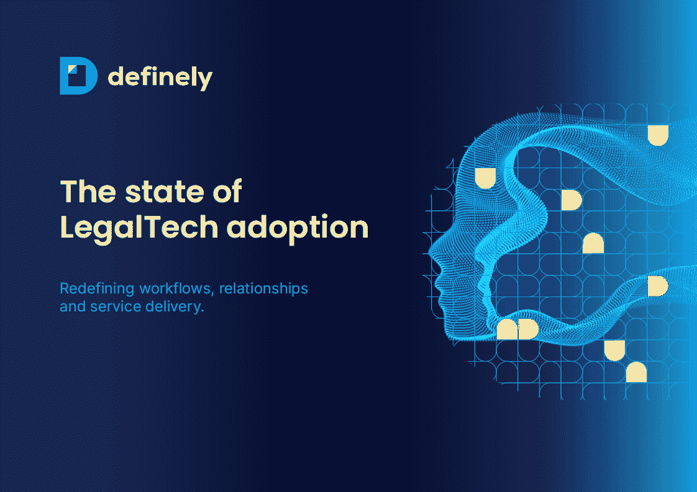
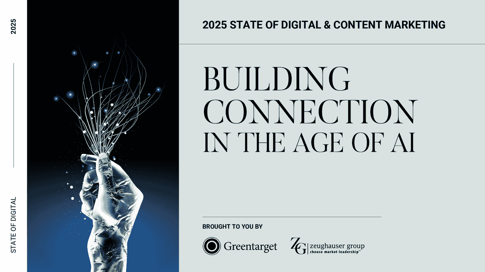

# 【研究报告库】

> 来源：[https://docs.feishu.cn/docx/OXGVdR14Pove05xVB4sccdgcnBh](https://docs.feishu.cn/docx/OXGVdR14Pove05xVB4sccdgcnBh)

---

> 本页面需 [付费会员权限 →](https://legalstudio.feishu.cn/wiki/DLtSwmrQYibygZklZ4NcuuASnJg)

2023 年以来，大模型和生成式 AI 对各行各业产生了深远影响，主宰了各领域从业者的讨论，其价值已无需赘言。

在法律行业，AI 必然也会带来深远的影响，不论是法律专业人士，还是打算在法律行业进行 AI 创业的创业者，亦或是关注「AI+法律」的投资人、学者等，首先要做的就是获取关于「AI 如何影响法律行业」的高质量信息，全面系统地学习，建立起相关知识储备与判断能力。以此为前提，我们才能跟上 AI 的发展节奏，正确地看待它，高效地使用它，借助这个技术来为自己带来更大的职业价值乃至产业价值。

但是，市面上关于「AI+法律」的内容质量良莠不齐，大部分都是肤浅且碎片化的信息，缺乏足够的专业度，甚至充斥着大量错误信息，非常不利于大家开展学习，甚至会产生误导。

法律修音机（Legal Studio）是一个具有全球视野的法律科技自媒体、高质量的交流社区，多年来一直对法律科技保持密切关注，致力于传播全球法律科技的前沿资讯和深度内容。随着 AI 浪潮席卷法律行业，我们也持续推出「AI+法律」的深度内容。经过多年沉淀，我们打造的法律科技社区以及智库，成为了这个行业的优质信息源。

当下，法律行业正在积极探索 AI 的实质价值。因此，我们觉得有必要在这个时间点建立一个全面、系统且高质量的法律 AI 智库。以下是我们已经推出的教育资源：

+   [法律科技社区](https://mp.weixin.qq.com/mp/appmsgalbum?__biz=MzUzOTcwMTE5OQ==&action=getalbum&album_id=3527497267156107272&token=1560504691&lang=zh_CN#wechat_redirect)

+   [法律科技智库](https://mp.weixin.qq.com/mp/appmsgalbum?__biz=MzUzOTcwMTE5OQ==&action=getalbum&album_id=3521007419251507205&token=1560504691&lang=zh_CN#wechat_redirect)

+   [公司项目库：海外版](http://mp.weixin.qq.com/s?__biz=MzUzOTcwMTE5OQ==&mid=2247489152&idx=1&sn=5ff34a7f776ae1f884c0ecb66df2d17c&chksm=fac52c20cdb2a536d0d2aead100f60c739b5a7966f3077b63c3373eb9910e991262e95cdca6a&scene=21#wechat_redirect)

+   [公司项目库：国内版](https://mp.weixin.qq.com/s?__biz=MzUzOTcwMTE5OQ==&mid=2247487814&idx=1&sn=8b2fbc982484fc9f1961609963b2b7b8&chksm=fac52be6cdb2a2f0b54d1ab0e2a921bc3cea2a3eed7480fa7df6e3c4a7afcf0adcc4e6c29fc1&scene=21&token=1560504691&lang=zh_CN#wechat_redirect)

+   [活动事件库](https://mp.weixin.qq.com/s?__biz=MzUzOTcwMTE5OQ==&mid=2247487814&idx=1&sn=8b2fbc982484fc9f1961609963b2b7b8&chksm=fac52be6cdb2a2f0b54d1ab0e2a921bc3cea2a3eed7480fa7df6e3c4a7afcf0adcc4e6c29fc1&scene=21&token=1560504691&lang=zh_CN#wechat_redirect)

+   [融资数据库](https://mp.weixin.qq.com/s?__biz=MzUzOTcwMTE5OQ==&mid=2247488390&idx=1&sn=70534df700f81ca9f2fc3ac7a81738b0&chksm=fac52926cdb2a0302935c3e453f1d5ef7e49d1a82a862eb9bfcf277efd244fa3b99746107448&scene=21&token=1560504691&lang=zh_CN#wechat_redirect)

+   [并购数据库](https://mp.weixin.qq.com/s?__biz=MzUzOTcwMTE5OQ==&mid=2247488390&idx=1&sn=70534df700f81ca9f2fc3ac7a81738b0&chksm=fac52926cdb2a0302935c3e453f1d5ef7e49d1a82a862eb9bfcf277efd244fa3b99746107448&scene=21&token=1560504691&lang=zh_CN#wechat_redirect)

+   [监管数据库](http://mp.weixin.qq.com/s?__biz=MzUzOTcwMTE5OQ==&mid=2247489388&idx=1&sn=a50fb253ed3b4183d09b78837036bd5b&chksm=fac52dcccdb2a4da43b001fe4bef9638de361ea619551598142790c2d55d53197152fc32d032&scene=21#wechat_redirect)

为了帮助大家全面且深入地了解 AI** 在法律行业**的落地情况，我们收集整理了 200 多份研究报告，并设计了阅读框架与学习路径，以便读者根据自己的需求进行浏览与研读，帮助大家全景式地了解法律科技市场。

## 研究报告目录

+   AI 对法律行业的影响

+   AI 在法律行业应用的监管

+   AI 对律师事务所的影响

+   AI 对公司法务部门的影响

+   律师协会 AI 指导文件及调查报告

+   法院系统 AI 指导文件和相关判决

+   政府机构 AI 指导文件

+   仲裁机构 AI 指导文件

+   AI 如何影响法律职业

+   AI 如何影响法学教育

+   法律 AI 工具性能测试

+   法律数据治理指南

+   法律科技行业趋势

+   法律科技供应商目录

+   AI 伦理道德风险

---

## AI 对法律行业的影响

[netdocument：2025 年法律科技趋势报告.pdf](https://internal-api-drive-stream.feishu.cn/space/api/box/stream/download/all/MZlDb6M72oaWQDxqIHScMsk6nQJ)

[AffiniPay：2025 年法律行业报告.pdf](https://internal-api-drive-stream.feishu.cn/space/api/box/stream/download/all/ZUHpbIpVIo015Rxps9ccyjEMnEK)

[Best Lawyer：法律市场调查报告（2025）.pdf](https://internal-api-drive-stream.feishu.cn/space/api/box/stream/download/all/T1hEbFUIpoVPVCxSBi6c7jpPnMd)

[Definely：2025 年法律科技采用情况调查报告.pdf](https://internal-api-drive-stream.feishu.cn/space/api/box/stream/download/all/CqzWbxj5noxpN1xLYHlcltywnWh)

[Consilio｜超越僵局：克服现代法律工作的挑战（2025）.pdf](https://internal-api-drive-stream.feishu.cn/space/api/box/stream/download/all/T9qibDpLyoKIVqxwn6YcQhxen0d)

[Greentarget：2025 年数字内容营销调查报告.pdf](https://internal-api-drive-stream.feishu.cn/space/api/box/stream/download/all/OcNMbxYOIohlpDxi7KccVBYoncd)