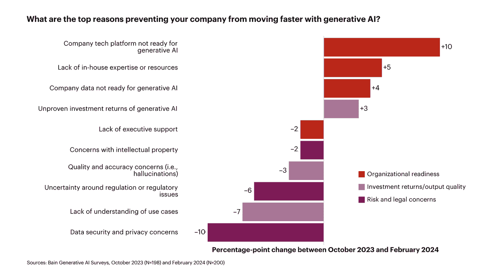

# 【贝恩】AI 落地应用进入新的阶段，但没有达到法律行业的预期

> 来源：[https://docs.feishu.cn/docx/HRPJdjrZUoXkfmxWwAEcIVqTn5g](https://docs.feishu.cn/docx/HRPJdjrZUoXkfmxWwAEcIVqTn5g)

---

6 月 20 日，全球管理咨询公司 Bain（贝恩）发布了 2024 一季度的高管调查报告。

报告显示，公司对 AI 的投资激增，且正在迅速采取行动，探索通过生成式 AI 来增强业务，其中大多数已经在开发或部署了相关工具。各个行业的公司，都对生成式 AI 赋能业务抱有很高的期望。

与此同时，受访公司对投资回报、质量和风险的担忧正在下降，而对组织关于 AI 准备情况的担忧与日俱增，说明 AI 在垂直行业的落地进入了一个新的阶段：从认知和实验，到追求实质性结果。

