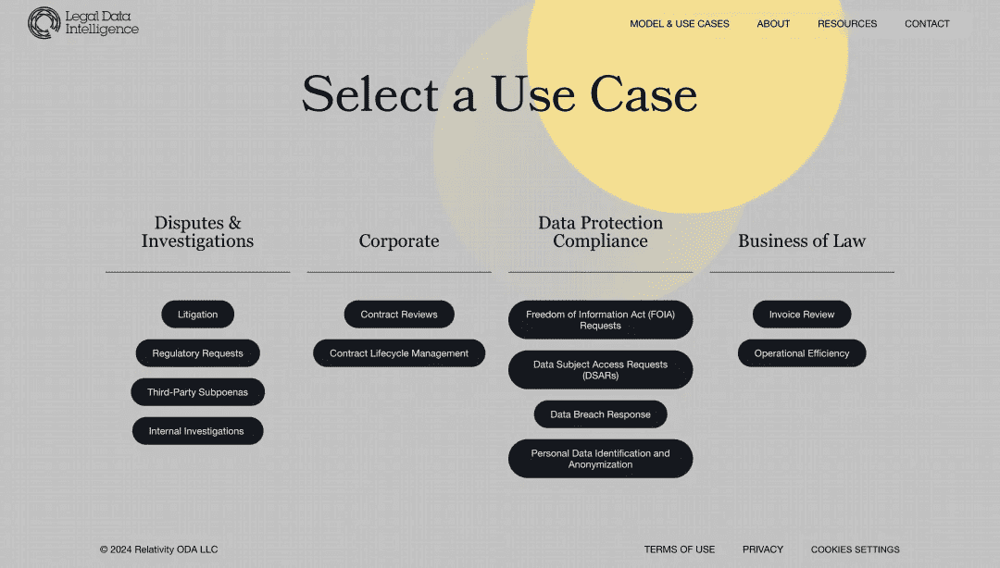
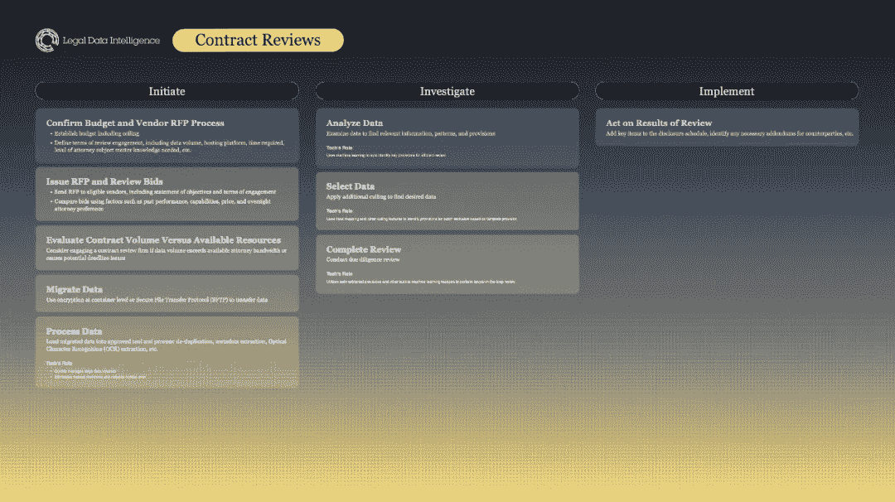

# 【CLOC】解决法律数据挑战的新范式！CLOC 2024 会议启动 Legal Data Intelligence

> 来源：[https://docs.feishu.cn/docx/Tubbd0UfGoKXtgxwpYXc79f8nic](https://docs.feishu.cn/docx/Tubbd0UfGoKXtgxwpYXc79f8nic)

---

众所周知，「数据」和「工作流程」（本质上也属于广义的“数据”）是数字化和 AI 技术在法律行业落地应用最大的挑战之一。

实践中，法律科技的发展需要法律专业人士和技术人士的充分合作，但现实往往是法律专业人士不懂技术，技术人士不懂法律专业知识，这就导致很多问题难以被解决，比如市场需求发掘、梳理流程和数据以打磨产品等，尤其是在数据爆炸的互联网时代，发现有价值的数据并使用，是个巨大的挑战。

近日，在公司法律运营联盟（CLOC）全球研究所 2024 会议上，19 名来自公司法律部门和律师事务所的行业专家，启动了一个名为「Legal Data Intelligence」（简称“LDI”）的网站，致力于解决目前的法律数据挑战。

Legal Data Intelligence 地址：https://legaldataintelligence.org

**这个网站提供了一套统一的完成法律任务的流程指南，以及一系列用例，旨在**解决法律工作「流程缺失」和「数据孤岛」的问题，从而帮助法律人更好地完成法律工作。

LDI 团队认为：

**不论具体的法律工作是什么，数据挑战大体上都是一样的：大多数的数据都是冗余的（Redundant）、过时的（Obsolete）和不重要的（ROT）—**— 简称“ROT”，但法律专业人士要找到敏感的（Sensitive）、有用的（Useful）和必要的数据（Necessary）—— 简称“SUN”，并予以使用。

然而，要想解决这些挑战，需要不同的技能组合。将 SUN** 数据与 R**O**T 数据分开需**要**多种技能：**法**律专业知识、强大**的数据导向、卓越的运营、对技术的深刻理解。法律专业人士需要多维、强适应性的和前瞻性。

为此，LDI 确定了以下几个原则：

+   **应对基础数据挑战**：每个法律挑战背后都存在一个法律数据挑战，数据的泛滥影响着每个实践领域和法律任务类型。

+   将 SUN 数据和 ROT 数据分开：所有法律数据挑战都源于同一个根本问题：从业者必须从大量冗余、过时和不重要的数据中筛选出敏感、有用和必要的数据。

+   **打破信息孤岛**：LDI 要求进行宏观思考，超越部门、职位，甚至超越公司和行业。

+   **重新集中精力**：LDI 使法律专业人士能够克服数据挑战，投入更多时间服务客户，并创造更大的价值。

通过这种思维方式，LDI 的实践者可以通过其法律背景和技术熟练度来获得数据洞见，并解决以往因数据量过大而难以执行的项目。

**具体**来说，Legal Data Intelligence 为各类法律工作提供一套词汇、框架和最佳实践，以帮助法律人更好地开展法律工作，并管理好数据，为更高层次的智能化打下基础。

目前，LDI 提供四个主要法律领域的用例：

+   **争议和调查**：诉讼、监管请求、第三方传票、内部调查

+   **公司业务**：合同审查、合同生命周期管理

+   **数据保护合规**：信息自由法案请求、数据主体访问请求、数据泄露响应、个人数据识别和匿名化

+   **法律事务**：发票审核，运营效率

以下是「合同审查」场景的工作流程示例：

从中可以看出，LDI 希望给法律专业人士带来以下三个启发式的方法：