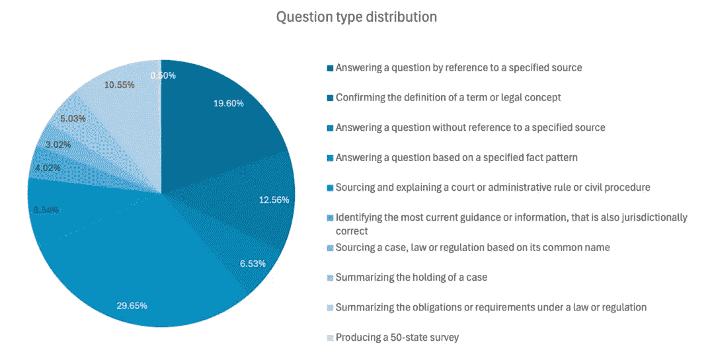
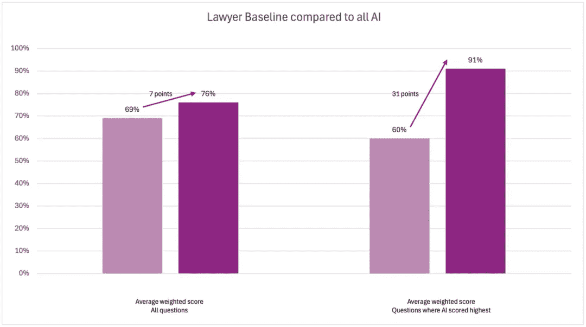
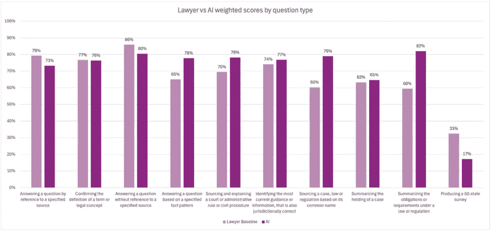
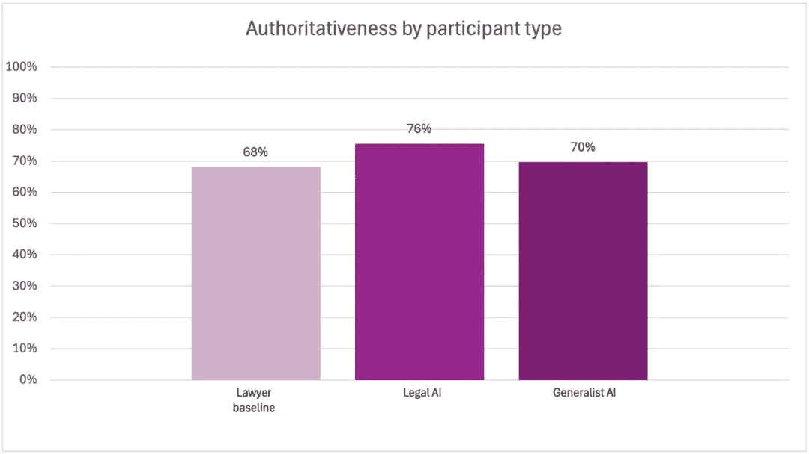

# 生成式 AI 法律研究基准研究：AI 优于人类律师，通用 AI 优于法律 AI

> 来源：[https://docs.feishu.cn/docx/X3sfdRuvMo9wxKxdTYBcNvb5nTb](https://docs.feishu.cn/docx/X3sfdRuvMo9wxKxdTYBcNvb5nTb)

---

**近**日，AI 产品和大模型基准评测初创公司 Vals AI 发布《AI 法律研究基准报告》，评估 AI 工具在法律研究任务上的表现。

该研究是 Vals AI 今年 2 月发布的《法律 AI 报告》的补充，这份报告测试了多个主流法律 AI 工具在文件提取和总结等任务中的表现。

法律研究旨在评估参与者回答需要参考法律、法规、规章、裁定、判决等问题的能力。报告评测的产品有法律垂类 AI 工具 Alexi、Couls Stack、Midpage 以及通用 AI 工具 ChatGPT，评测数据集包括 200 个美国法律研究问题，具体包括：示例问题、理想答案、引用信息以及其他正确性指标，由 Reed Smith、Fisher Philips、McDermott Will & Schulte、Ogletree Deakins、Paul Hastings 和 Paul、Weiss、Rifkind、Wharton & Garrison 等律所提供支持。

以下是评测数据集的问题类型分布：

同时，Vals 与一家美国律所合作，由该律所提供在法律研究方面经验丰富的律师。律师要根据提供给 AI 产品的完全相同的说明和上下文来回答数据集问题，并提供引用来源。律师可以使用所有各种研究资源和工具，但不包括 AI。这些律师提供的答案作为人类律师的基准线，用于和 AI 工具的输出进行比较。

Vals 综合往期研究和行业反馈，制作了一个评分标准，具体包括以下维度：

+   **准确性：**回复是否实质上正确，而且不含错误信息（占加权平均分的 50%）

+   **权威性：**回复是否具有相关且有效的法律来源作为支撑（占加权平均分的 40%）

+   **适当性：**回复是否易于理解，且可直接与同事或客户分享（占加权平均分的 10%）

报告显示，所有调研的 AI 工具都比人类律师更准确地解答法律研究问题 —— 人类律师的基准线为 69%，各个 AI 工具的得分都比人类律师基准线高出至少 5 个百分点。

这背后有几个有趣的发现：

# **1、**AI 工具的平均加权分数在 75% 的问题上超过了人类律师，尤其是在 AI 表现最强的地方，AI 的表现远远超过律师。

这是一个巨大的转变。

一年前，法律研究还是很多大型律所禁止律师用 AI 处理的任务，因为这个任务“似乎”比较复杂，但短短一年时间，AI 在这个任务上的表现就已经超越律师，说明 AI 技术还在快速进步，大大缩小了律师能力的差距，带来知识平权，法律专业知识壁垒进一步瓦解。

不过，律师在需要更深入理解背景、进行复杂的跨法域审查、基于判断进行综合性分析时，表现仍优于 AI，这可能是人类律师的壁垒，当然也可能只是暂时性优势而已。

# **2、**虽然 AI 工具的表现已经媲美律师，但其准确率仍然没有达到 80%，这意味着剩下 20%-30% 的工作还需要人类律师来完成。

那么，这 20%-30% 的工作，未来 AI 能否突破？还是最终仍然会有部分工作必须由人类律师完成，这些工作可能是什么？如果达不到 90% 以上，律师的付费意愿有多高？