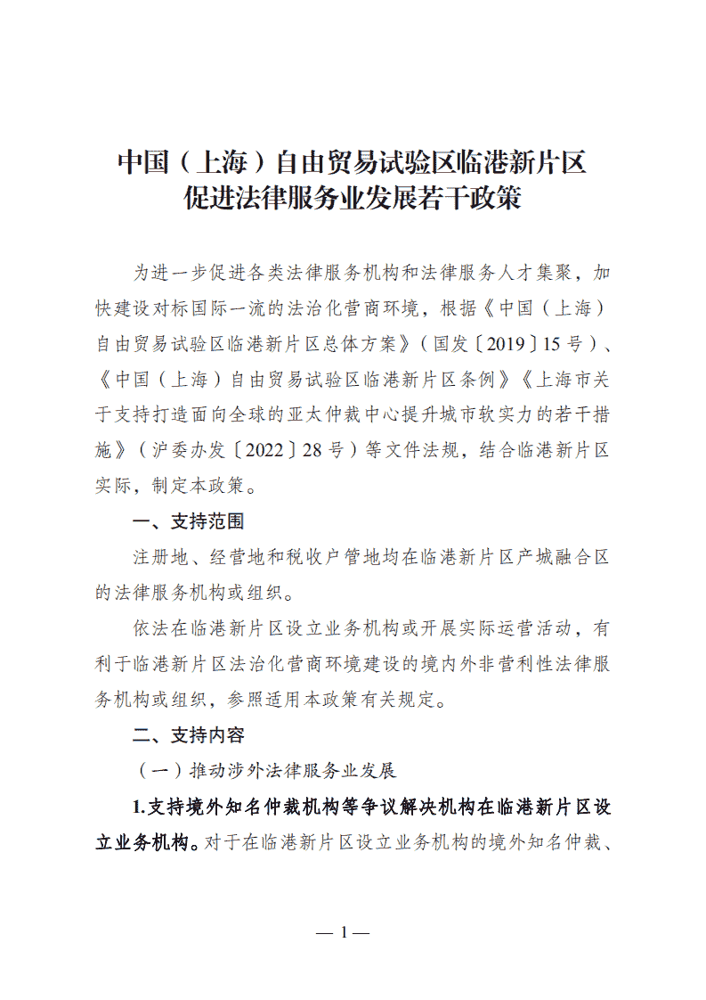

# 中国（上海）自由贸易试验区临港新片区促进法律服务业发展若干政策

> 来源：[https://docs.feishu.cn/docx/DO4xdKkaBoSnFqxkPegcY9WGnFf](https://docs.feishu.cn/docx/DO4xdKkaBoSnFqxkPegcY9WGnFf)

为进一步促进各类法律服务机构和法律服务人才集聚，加快建设对标国际一流的法治化营商环境，根据《中国（上海）自由贸易试验区临港新片区总体方案》（国发〔2019〕15 号）、《中国（上海）自由贸易试验区临港新片区条例》《上海市关于支持打造面向全球的亚太仲裁中心提升城市软实力的若干措施》（沪委办发〔2022〕28 号）等文件法规，结合临港新片区实际，制定本政策。

**一、支持范围**

注册地、经营地和税收户管地均在临港新片区产城融合区的法律服务机构或组织。

依法在临港新片区设立业务机构或开展实际运营活动，有利于临港新片区法治化营商环境建设的境内外非营利性法律服务机构或组织，参照适用本政策有关规定。

**二、支持内容**

**（一）推动涉外法律服务业发展**

1.支持境外知名仲裁机构等争议解决机构在临港新片区设立业务机构。对于在临港新片区设立业务机构的境外知名仲裁、商事调解等争议解决机构，经临港新片区管委会（以下简称“管委会”）审核认定，给予 200 万元奖励。

对境外知名仲裁机构在临港新片区设立的业务机构，根据其上一年度对临港新片区的经济社会综合贡献给予奖励，并给予一定的运营奖励或人才奖励。

2.支持境内法律服务机构开展国际合作。经司法部或者中华全国律师协会评定为全国优秀律师事务所的境内律师事务所（以下简称“境内全国优秀律师事务所”）与外国律师事务所在临港新片区设立中外律师事务所联营办公室，或与港澳律师事务所在临港新片区设立合伙联营律师事务所的，经管委会审核认定，最高给予 200 万元奖励。

前款规定以外的境内律师事务所与外国律师事务所在临港新片区设立中外律师事务所联营办公室，或与港澳律师事务所在临港新片区设立合伙联营律师事务所的，经管委会审核认定，最高给予 100 万元奖励。

3.支持外国律师事务所在临港新片区设立代表机构。近 3 年入选世界著名法律评级机构榜单的外国律师事务所（以下简称“外国知名律师事务所”）或港澳知名律师事务所在临港新片区设立代表机构的，经管委会审核认定，最高给予150 万元奖励；前款规定以外的外国律师事务所或港澳律师事务所在临港新片区设立代表机构的，经管委会审核认定，最高给予 100 万元奖励。

**4.支持重大涉外法律服务事项。**为临港新片区各级管理机构、企事业单位及海外企业的重大政府/商事谈判、诉讼、仲裁、调解、主导国际行业标准制定并发布、参与国际条约制定或修改等涉外法律服务工作作出突出贡献，挽回或获得重大权益，产生重大国内外影响的法律服务机构，经管委会审核认定，给予一定奖励。其中，在最高人民法院、国际仲裁机构、G20 成员国家、一带一路沿线国家司法机关或仲裁机构取得胜诉裁判，或被司法部等国务院相关部门、全国性行业协会向全国表彰推广的，经管委会审核认定，每个项目一次性给予最高 10 万元奖励，每个法律服务机构当年度奖励最高不超过 50 万元。

**5.支持法律服务跨境资金结算。**临港新片区内银行在“展业三原则”的基础上，凭收付款指令为法律服务机构办理跨境贸易人民币结算业务，直接办理法律服务业务下的跨境人民币收入在境内支付使用。

（二）打造更具活力的法律服务生态圈

6.支持各类有影响力的法律服务活动。对在临港新片区举办优化法治化营商环境、提升国际法律服务功能相关主题活动的法律服务机构或组织，经管委会审核认定，按照实际支出费用最高 40% 的比例，给予每场活动最高 10 万元、每个法律服务机构或组织每年度最高 20 万元补贴。其中，对于具有国内外重大影响力的活动，经管委会审核认定，按照实际支出费用最高 50% 的比例，最高给予承办单位 200 万元补贴。

7.支持“三特定”仲裁业务发展。约定在临港新片区、按照特定仲裁规则、由特定人员对有关争议进行仲裁的，管委会提供仲裁场地等支持，并经审核认定，按照实际支出费用最高 40% 的比例，最高给予 20 万元补贴。

8.支持优秀律师事务所在临港新片区设立总部或分所。获得全国优秀律师事务所荣誉或上一年度营业收入达到 3000 万元以上的律师事务所在临港新片区设立总所或分所的，经管委会审核认定，最高给予 100 万元奖励。其中，落户当年给予 50 万元奖励；落户以后累计营业收入达到 3000 万元以上、经营所得达到 800 万元以上的，再给予 50 万元奖励。

获得省级优秀律师事务所荣誉或上一年度营业收入达到1500 万元以上的律师事务所在临港新片区设立总所或分所的，经管委会审核认定，最高给予 50 万元奖励。其中，落户当年给予 20 万元奖励；落户以后累计营业收入达到 1000 万元以上、经营所得达到 500 万元以上的，再给予 30 万元奖励。

按照原政策落户的律师事务所，符合前两款规定的，在已享受奖励基础上补足差额。

**9.支持各类法律服务业态发展。**对落户临港新片区且年营业收入达到 3000 万元以上的法律科技、法律媒体、法律培训等法律服务新业态企业，经管委会审核认定，最高给予 50 万元奖励。对落户临港新片区的公证、调解、司法鉴定、域外法律查明等专业性服务机构，经管委会审核认定，给予一次性奖励 20 万元。

对落户临港新片区且在法治化营商环境建设方面具有重大意义的机构或组织，作为特殊情况或重大事项，按照相关审议流程进行审定后，给予一定奖励。

10.支持法律服务机构开展实际业务。对在临港新片区实际经营的法律服务机构，经管委会审核认定，根据实际办公面积和用途，按照 1.00 元/平方米/天的标准给予租金补贴（实际租金不足补贴标准的，按照实际租金补贴）。对在临港新片区实际运营的非营利性法律服务机构，经管委会审核认定，根据实际办公面积，按照年租金最高 100% 的比例给予扶持。对法律服务业集聚区重点项目，按照装修支出和年租金最高 100% 的比例给予扶持，并给予一定运营补贴。

11.推动法律服务机构融入区域发展。经管委会审核认定，对落户临港新片区的法律服务机构，按其上一年度经济及社会贡献给予一定奖励；对临港新片区招商引资表现突出、成功引进优质产业项目的法律服务机构和个人，给予一定奖励。

**12.探索税收便利化政策措施。**实施“无税无票不申报”制度，对当期无应税收入且未做票种核定的小规模单位纳税人，免于办理部分税种的申报纳税。

（三）完善法律服务人才引进、培养机制

13.鼓励专职法律服务人才参加高层次法学学历教育。对参加经管委会审核认定的境外知名法律院校法学学历学位教育并取得相应证书的法律服务人才，给予 50% 的学费支持，每人每年不超过 25 万元。对参加经管委会审核认定的境内知名法律院校法学学历学位教育并取得相应证书的法律服务人才，给予 50% 的学费支持，每人每年不超过 2 万元。

14.支持专职法律服务人才参加境内外高水平非学历法律培训。对参加经管委会审核认定的境外知名院校机构的非学历法律培训并取得相应证书的法律服务人才，给予 50%的培训补贴，每人每年不超过 15万元。对参加经管委会审核认定的境内知名院校机构的非学历法律培训并取得相应证书的法律服务人才， 给予 50%的培训补贴，每人每年不超过 1 万元。

15.给予优秀法律服务团队、法律服务人才贡献奖励。鼓励落户临港新片区的法律服务机构引进、培养契合临港新片区产业发展导向的优秀法律服务团队，法律服务机构上一年度经营所得在 500 万元以上 3 亿元以下的，经管委会审核认定，给予其法律服务团队 10 万元以上 600 万元以下的补贴；上一年度经营所得在 3 亿元以上的,经管委会审核认定，给予其法律服务团队 600 万元补贴。

对符合条件的境外或海外回流高端紧缺人才，按照国家和本市有关规定，给予个人所得税税负差额补贴。对符合条件的境内高端人才给予一定奖励。

16.给予法律服务人才各类工作和生活便利。按照临港新片区相关人才引进和保障政策，支持在临港新片区工作的法律服务人才享受子女入学、人才公寓、租房补贴、购房补贴、医疗保障等便利条件。

对在临港新片区工作的外籍法律服务人才给予口岸电子签证便利。对拟在临港新片区长期工作的外籍法律服务人才，一次性给予最长 5 年期工作类居留许可；符合认定标准的，推荐申请在华永久居留，并缩短审批时限。在临港新片区从事法律服务工作的入外籍留学回国人员可以直接办理长期海外人才居住证 B 证（最长有效期 10 年）。

**三、附则**

（一）本政策条款与本市或管委会制定的其他政策有重复交叉的，按照“就高不就低，从优不重复”原则实施。

（二）法律服务机构或组织应当将获得的奖励专项用于机构或组织运营。

（三）扶持对象如通过弄虚作假等不正当手段骗取扶持资金的，管委会一经查实，将立即取消扶持资格并追缴资金。情节严重的，将依法追究法律责任。失信行为将根据有关规定纳入公共信用信息服务平台。

（四）本政策由管委会负责解释。

（五）本政策自 2023 年 9 月 14 日起实施，有效期至 2025年 12 月 31 日。

---

原文链接：

[中国（上海）自由贸易试验区临港新片区促进法律服务业发展若干政策.pdf](https://internal-api-drive-stream.feishu.cn/space/api/box/stream/download/all/GvImbrMBIoPXk5xRzHtcUt3Inrs)