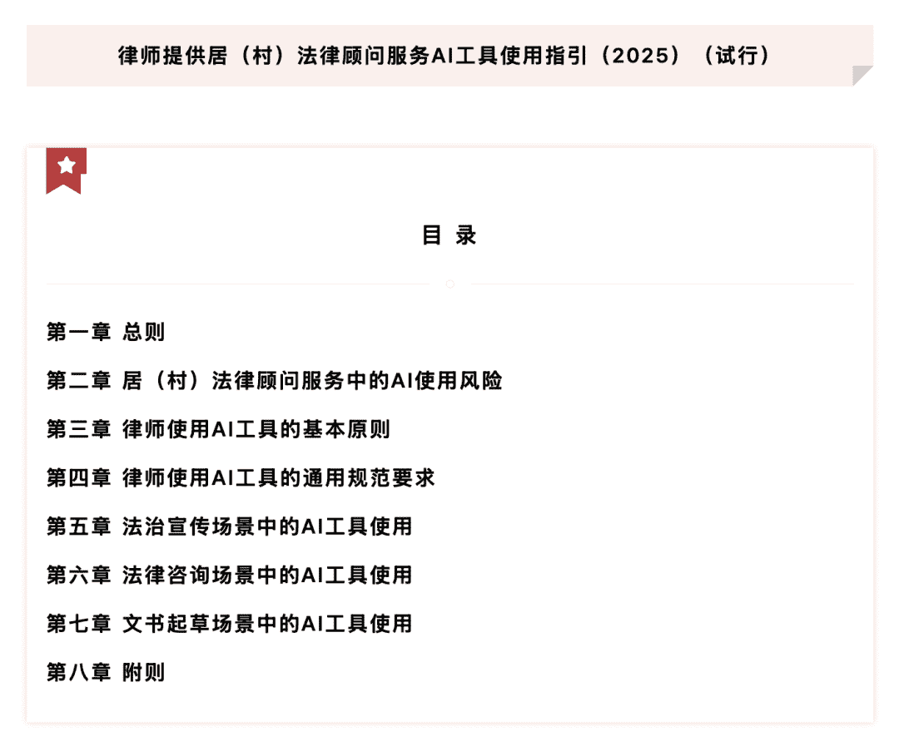
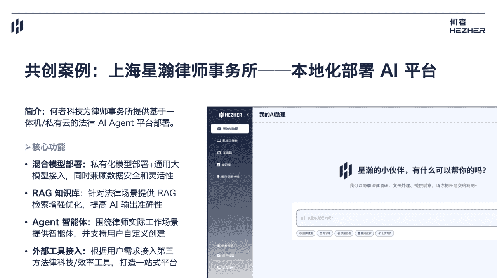

# 上海律协：鼓励有条件的律师事务所、律师，本地化部署 AI 及脱敏工具

> 来源：[https://docs.feishu.cn/docx/VjwLdba4hompNkxHEbocuQPsnec](https://docs.feishu.cn/docx/VjwLdba4hompNkxHEbocuQPsnec)

---

[近日，上海律协社会公共服务专业委](https://mp.weixin.qq.com/s?__biz=MjM5MDIxODEzOQ==&mid=2650394933&idx=1&sn=c91a30a56c9311902a2d9e8495d0ec6c&scene=21#wechat_redirect)员会发**布《律师提供居（村）法律顾问**服**务 AI 工具使用指引（**2025）（试行）》，旨在提升本市律师 AI 使用水平，防范 AI 使用重大风险。

这份指引的内容相当丰富，可以为律师运用 AI 工具提供法律服务提供借鉴和参考，欢迎大家阅读。

原文链接：

**h**ttps://www.lawyers.org.cn/info/71624f5df3184a90941f317aca231c18

值得注意的是，虽然指引鼓励律师使用 AI 辅助提供法律服务**，但也明**确提出律师应注意潜在的风险，比如数据安全。

第五条  【信息数据安全与隐私泄露】

AI 工具普遍采用云端部署的模式，当事人的信息数据经由输入接口，即被 AI 服务商采集和存储，存在因系统设计缺陷、存储介质管理不善、管理疏漏、黑客攻击等原因造成的信息数据安全风险，且部分 AI 服务商制定的用户协议中约定其对用户数据享有使用权、第三方共享权及内容审查权，存在当事人隐私、信息数据泄露和不当使用的风险。

律师提供居（村）法律顾问服务过程中，未经当事人同意擅自将包含当事人隐私或信息数据的文件资料上传至云端的，可能导致权利人的隐私、信息数据泄露和不当使用。

对此，指引建议：

第十二条  【隐私保护和信息数据保密】

律师使用 AI 工具，应采取合理必要措施**防**止个人隐私、商业秘密、国家秘密的泄露。鼓励有条件的律师事务所、律师通过 AI 工具的本地化部署等方式加强对当事人隐私、个人信息、商业秘密等信息数据的保护。

**第十五条  【信息处理】**

律师应审慎地处理当事人提供的各类信息，并遵守以下规范：

（一）向部署在云端的 AI 工具提供当事人信息的，应事先征得当事人的同意，已在合理的范围内由当事人自行公开或者经其他合法途径公开的除外；

（二）向部署在云端的 AI 工具上传相关案件信息和资料的，应事先对标识信息作脱敏处理；

（三）生物识别、宗教信仰、特定身份、医疗健康、金融账户、行踪轨迹等信息及不满十四周岁未成年人的个人信息属于敏感个人信息，即便有当事人的同意，律师也不宜向部署在云端的 AI 工具提供。

**鼓**励律师使用本地化的脱敏工具。非本地化部署的脱敏工具仍然存在信息泄露风险，律师应谨慎使用联机模式下的第三方脱敏工具。

第二十九条  【文书起草中的隐私保护和信息数据保密】

律师向 AI 工具提供文书起草所需的文件资料时，应保护当事人的隐私、信息数据和商业秘密。未经当事人同意，律师不得实施以下行为：

（一）将未经脱敏的判决书、裁定书、裁决书等司法文件直接提供给非本地化部署的 AI 工具，由非本地化部署的 AI 工具直接生成上诉状、执行申请书、异议申请书等法律文书；

（二）将未经脱敏的身份证、产权证、机动车行驶证等信息资料直接提供给非本地化部署的 AI 工具，由非本地化部署的 AI 工具生成相关协议；

（三）将未经脱敏的聊天记录、视频照片直接提供给非本地化部署的 AI 工具，由非本地化部署的 AI 工具生成起诉状、证据目录等法律文书；

（四）未经当事人同意，将包含当事人隐私、个人信息、商业秘密的其它资料上传至非本地化部署的 AI 工具；

（五）其它可能侵害当事人隐私、信息数据和商业秘密的情形。

针对指引提到的**「脱敏」**和**「本地化部署」**，我们推荐以下两个产品：

# **脱敏宝**

“脱敏宝”是一款免费的浏览器插件，用户使用网页端的 AI 工具并上传文档时，可以自动在本地进行数据脱敏。

🔗下载链接：t**uominbao.com**

👉了解更多：A[**I 时代下，法律人的「脱敏」痛点怎么破？今晚 7 点「脱敏宝」**](https://mp.weixin.qq.com/s?__biz=MzE5MTY1MjA5OA==&mid=2247490996&idx=1&sn=682c564e01f7940467a4df0b65bd6faa&scene=21#wechat_redirect)首发｜何者Hezher MINI 路演

# **何者 AI 智能中台**

“**何者 AI 智能中台”是何**者科技研**发的一款 AI 平台，支持模型**私有云**部署（即算力在云端且客户专**用）**和本地化**部署（即算**力**在本地），并提供针对本地小模型的 RAG 能力，以及一系列经过市场验证的智能体（如“脱敏”）。同时，何者科技还是国内主流算力厂商的战略合作方，可根据具体需求选配私有云 GPU 服务器或一体机，并享受一定优惠，欢迎垂询。

📲微信：1**8825075686**

👉了解更多：何[**者**](https://mp.weixin.qq.com/s?__biz=MzE5MTY1MjA5OA==&mid=2247491413&idx=1&sn=1a6861a99d811582388477badda91449&scene=21&poc_token=HOrHTGmjfIsjvwylPH_6ncJ8aAsVXQ5vPas0k4f4)科技「法律 AI 智能中台」荣获“数龙杯”全球 AI 游戏及应用创新大赛——最佳 AI 技术应用提名奖🏆

