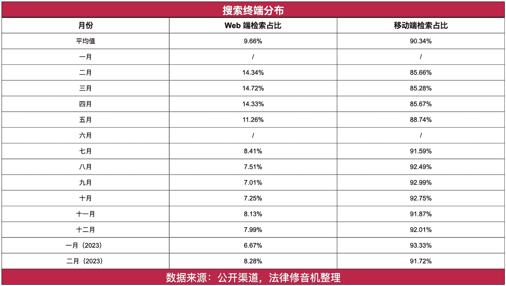
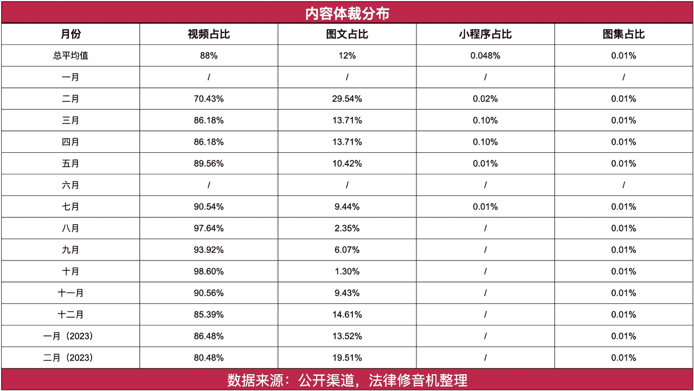
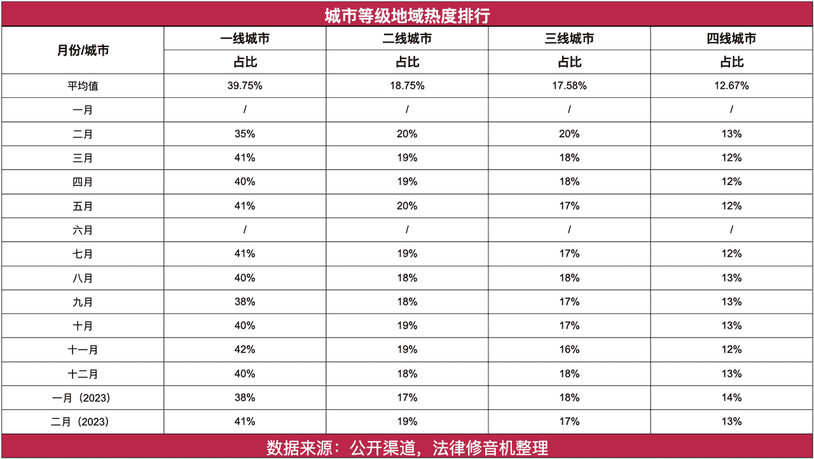
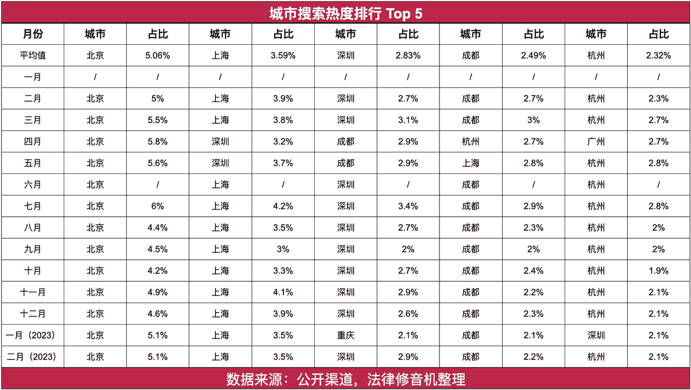
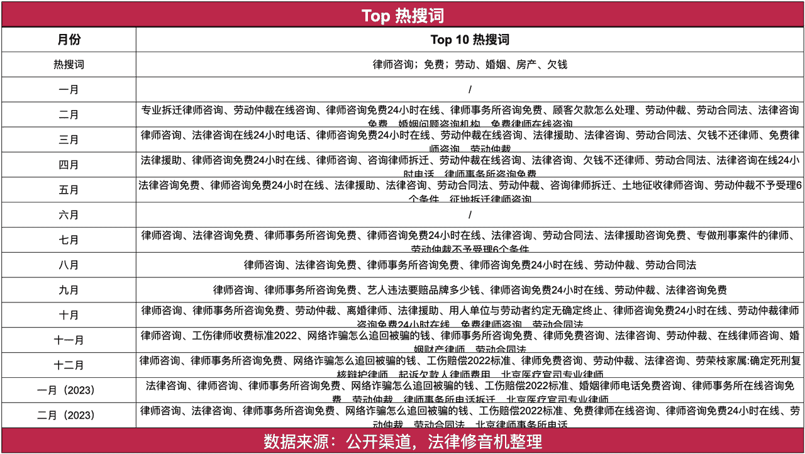

# 百度法律行业大数据：法律咨询需求巨大，但人们付费意愿并不强

> 来源：[https://docs.feishu.cn/docx/IW8idxci7odPy2xPU5GcXjq9nZe](https://docs.feishu.cn/docx/IW8idxci7odPy2xPU5GcXjq9nZe)

---

中国法律服务行业的市场如何？

这是很多法律人都在讨论的话题，我们可以从互联网大厂的数据中一窥究竟。

据百度官方透露，每天有 5600 万用户在百度搜索法律知识、观看法律内容、咨询专业律师。同时，百度旗下的「百度指数」👸号曾经按照月度发布法律行业数据报告，多维度展示了百度生态内的法律服务需求。

百度作为历史上最悠久的中文搜索引擎之一，20 多年的发展，中国绝大多数人都使用过百度，可以说百度的统计数据在某种程度上反映了我国法律服务行业的真实情况。

为此，法律修音机统计了 2022 年 1 月 - 2023 年 2 月（公开数据截至该时间点）的百度法律行业数据，从中筛选了部分关键数据维度，包括：搜索终端、内容体裁、城市等级地域热度、城市搜索热度、Top 热搜词等，总结出了我国法律服务行业的三大趋势，并给出几点可行的行动建议。

需要说明的是，百度的用户画像以 C 端人群为主，不代表 B 端尤其是大 B 的法律服务需求，相关数据仅供参考。

以下，enjoy ：）

---

## **趋势一：人们消费法律内容从「Web 端**」转向「移动端」、从「图文」转向「视频」

数据显示，人们搜索法律问题的终端分布，正持续从「Web 端」（网页端）转向「移动端」（手机端），近一年移动端和 Web 端的占比约为 9:1。

从内容体裁上看，人们消费的法律内容也持续从「图文」转向「视频」，近一年视频和图文的占比也约为 9:1。

## **趋势二：法律服务需求极其分散。**

近一年来，一线、二线、三线及四线城市，法律问题搜索热度占比的平均值约为 40%、19%、18%、13%。

其中，搜索热度 Top 5 的一线城市 —— 北京、上海、深圳、成都和杭州，热度占比平均值约为 5%、3.6%、2.8%、2.5%、2.3%，加总仅 16%，而一线城市的热度占比平均值为 40%。

这说明了，我国法律服务的流量极其分散，任何城市的律师都有机会。

## 趋势三：人们遇到法律问题，倾向于直接找律师咨询，但不愿意付费。

从 Top 热搜词上看，当人们遇到法律问题，并没有选择先搜索再自行解决，而是倾向于直接找律师咨询。

但与此同时，人们习惯于找免费的律师咨询，不愿为法律咨询付费，而这也反映出人们并不清楚律师的专业分类，律师要想获得客户，与其依赖各种律师评价体系、评奖榜单，不如直接提供免费咨询靠谱。

基于以上行业数据分析，以下是一些行动建议：

## 一、重视在线形象打造，持续输出专业内容。

目前，人们在找律师之前，往往会在网上对自己遇到的法律问题做一轮搜索，但并不清楚律师分类，因此律师应该重视在线形象打造，持续输出专业内容，甚至进行一定的广告投放，这样可以有效地获取线索。

## 二、在流量获取上，「移动端」和「视频」优先。

从搜索终端和内容体裁上看，「移动端」和「视频」是主流。其中，「移动优先」这一趋势在任何平台都适用，再加上「视频」的因素，说明应该重点做「竖屏」的「短视频」和「直播」。

当然，从占领用户时间的模型上看，中长视频也值得做。除此之外，由于文章给用户的感觉专业性更强，对获客也有帮助，因此在条件允许的情况下，短视频、中长视频、直播、文章和问答等，各种内容体裁都要补足。

但需要注意的是，流量不等于有效线索，用户消费法律内容不代表有法律服务需求，尤其是 ——

## 三、C 端人群的付费意愿不强，需要做好转化路径设计。

从热搜词上看，「免费咨询」是广大 C 端人群对法律服务最大的需求，这一现状短期内很难改变，而这也正是我国公共法律服务（包括非诉解纷、智能司法等）要解决的问题。

因此，对于还不具备议价能力的律师（比如还没有个人品牌、还处于求生存的阶段等），或许需要接受「法律咨询应该免费」这一事实，并想清楚哪些服务可以真正收上钱，再做好转化路径设计（比如知识付费、社群），这样才能有效提高收入。此外，C 端人群往往付费能力差且事多，服务这些客户的投入产出比也是律师需要考虑的问题。

## **One More Thing**

从法律科技的角度上看，C 端人群有大量的法律服务需求，律师又需要客户，因此「在线法律服务」就是法律科技领域一条主赛道，这类产品同时链接客户和律师，给律师推案源，向律师收案源费，由律师给客户提供服务。

但是，由于法律服务流量极其分散，在线法律服务平台获取线索本身就有很大的难度，十分依赖百度投放，而且很难抵抗互联网巨头的冲击，比如当百度亲自下场做「百度律临」，在线法律服务平台们就很难受。

因此，理论上百度才是国内最大的法律服务平台。

当然，到底是百度自己做赚的多，还是收在线法律服务平台们的广告费赚的多，还需要打个❓所以，百度做百度律临，可能是管理层精明的决策，也可能是管理层傻逼。

此外，我国人口受教育水平整体较低，很难了解清楚各种法律专业和律师分类，而且学习成本很高，这个用户习惯短期内很难改变，建立所谓的律师评价体系缺少商业化路径，需要细分场景和目标客户。律师评价体系这东西，有最好，没有也没什么影响，对律师来说，远不如直接提供免费法律咨询对获客有直接帮助。

但是，提供免费咨询属于机会成本，会占用律师的时间，而律师最宝贵的资产就是时间，如何解决这一根本矛盾？

随着大模型的出现，这一痛点或许可以通过 AI 来解决，法律修音机在《一款法律 AI 助手的产品设计思考》中详细分析过其中的逻辑，而笔者打造的 AI 项目，就是这样一款为律师开发的 AI 助手，可以实现像真人律师一样与客户进行引导式的法律咨询对话，致力于帮助律师提高获客转化的能力。