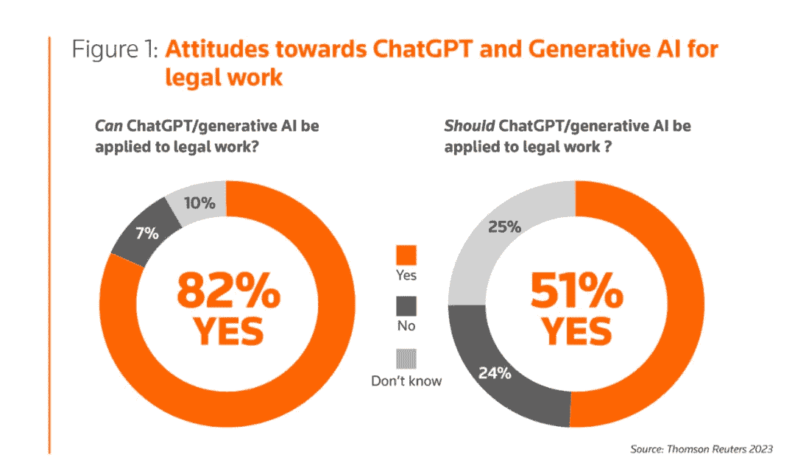
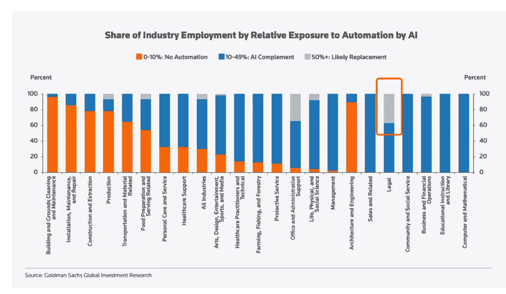
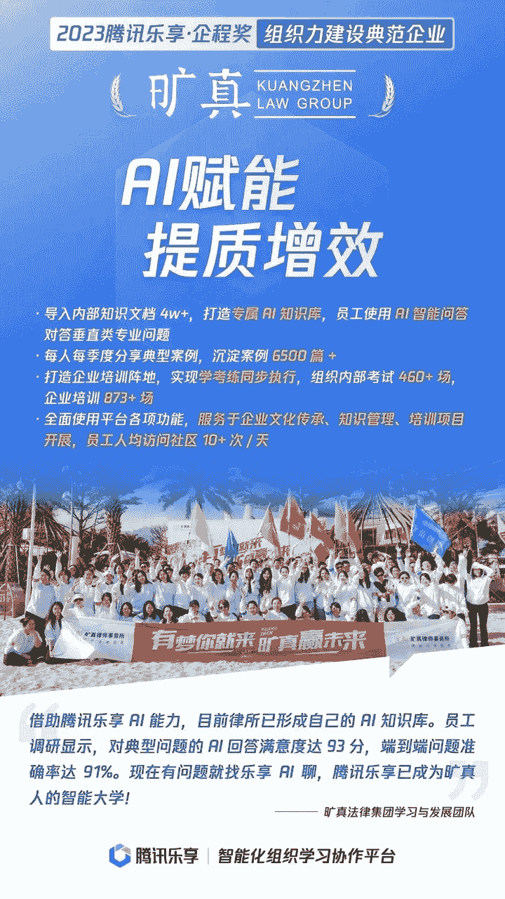

# 【旷真】律所如何用AI知识库培养法律人才

> 来源：[https://docs.feishu.cn/docx/Y3b2dtcXzosC99xikzvc3v2bnxc](https://docs.feishu.cn/docx/Y3b2dtcXzosC99xikzvc3v2bnxc)

---

4 月，腾讯召开“腾讯云协作 Saas 智能化升级媒体沟通会”，宣布其旗下协作 SaaS 产品全面接入腾讯混元大模型。作为旗下重要产品腾讯乐享的典型客户代表，旷真人才发展部部长龙庆受邀参加会议，并在现场以《律所如何用 AI 知识库培养法律人才》为题，分享了其使用腾讯乐享 AI 助手的实践。

2023  年 8 月，汤森路透社研究所发布了一则报告，报告显示，AI 对律师业自动化效率的提升是毋庸置疑的，但也可能颠覆、甚至破坏当前律师业架构：

“82% 的律师认为 AI 能用到法律工作，应用最广的依次是信息获取、文书写作、尽职调查、法律研究。对应只有51%律师认为AI应当用到法律中，理由是安全和合规。同时本调查还认为律师可能被AI替代的人数超过了40%。”

**旷真有个愿景是通过精益法律服务来贡献法治社会，精益是减少浪**费提高效率，所以旷真拥抱AI带来的变化。

作为“2023腾讯乐享·企程奖·组织力建设典范企业”获得组织，旷真于2017年正式引入乐享知识管理平台，开始沉淀大量律师实务案例和指引。2023年，开始使用乐享AI助手，极大地提高了获取知识的效率。展望未来，自培训、知识管理后，AI的加入，可能真的能够提高效率，引领法律业变革。以下是来自龙庆部长的现场分享。

## 一、律所如何用AI知识库培养法律人才

法律人才是律所最大的资产，所以对律师的培养就是律所最大的资产投资。

旷真推崇培养人是从知识、技能、能力、价值观（KSAV）来的。知识分成行业知识和法律知识，通过乐享平台让大家自学考试；技能主要分成技术技能和顾问技能，通过训战结合方式来在实战中练习；能力是通过能力认证，给每个岗位定详细的能力标准和材料要求，员工准备好就来答辩，通过乐享直播给全员来观摩、监督、学习。