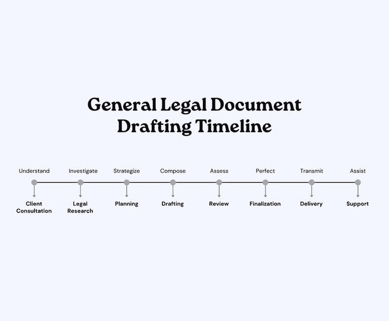

# 法律人如何与 AI 共生：以合同场景为例

> 来源：[https://docs.feishu.cn/docx/Ltq8deU9ooK04cxRmBUcNMxZnlg](https://docs.feishu.cn/docx/Ltq8deU9ooK04cxRmBUcNMxZnlg)

---

在当今快速发展的法律行业中，AI 的整合有可能会给法律工作带来深刻的改变。

特别是在**法律文件起草和审查**方面，大语言模型擅长“文生文”的能力，加上市场经济正在快速发展，法律专业人士起草文件需要及时跟进不断变化的监管环境和客户行业的发展情况，因此 AI 将发挥越来越大的作用。

但是，这并不意味着很多法律岗位很快会被 AI 所替代。正如斯坦福大学 Human-Centered AI 研究所联合主任李飞飞所言：“每个人类工作实际上都涉及到多个任务的集合。比如医疗保健领域，一个护士 8 小时的工作包含数百个任务。我确实看到 AI Agent 在许多任务上提供帮助、具有辅助和增强功能，但在讨论工作时我们应该非常小心。”

事实上，很多法律工作也可以被拆分为标准化的流程和工作要点。例如，合同生命周期就可以划分为：客户咨询、法律研究、制作方案、起草、审查、签署、履行、归档多个阶段，而且不同阶段有不同的工作重点。

然而，在法律工作中，平衡法律人和 AI 之间的分工是复杂的。为了更好地在工作中应用 AI，清晰地了解 AI 的优劣势至关重要，这将指导 AI 和律师之间进行合理的任务分配。

**在本文**中，法律修音机将合同起草审查过程简化为四个关键阶段，并探讨法律人和 AI 在每个阶段的角色，旨在帮助法律人理解 AI 将如何在合同起草审查的各个阶段发挥作用。同时，这个思考过程也是一个工具，用于思考如何在各个法律工作流程中集成 AI 技术 —— 每个环节都是一个创业机会。

以下，enjoy ：）

---

本文将合同起草审查过程分为四个阶段，讨论律师和 AI 之间的分工，并介绍每个环节中可以使用的法律 AI 工具。

## **第一步——**

### 律师-客户咨询 vs. AI-理解

在前期的客户咨询阶段，从目前来看，律师仍然扮演着最关键的角色。

律师通过挖掘客户的具体需求，从而与客户建立信任关系并成交。在这个过程中，辨别客户情况细微差别的能力，对于有效地提供解决方案至关重要，而需求越复杂越能体现律师的功底，再加上目前人们还不完全信任 AI 作出的回复，所以前期的客户咨询环节仍要以律师为主导，还很难被 AI 取代。

在这一阶段，AI 可以作为一个有效的助手，提供以下帮助：

1.  提供客户背景信息：根据律师和客户以前的互动、相关案例或者在网上抓取的信息中提取核心内容。这种辅助作用可以帮助律师能够全面了解客户的历史和背景。

1.  提供在线咨询服务：生成式 AI 可以像真人一样与客户对话，辅助提供客户咨询，包括免费咨询，或者律师在忙没时间回复等情况，比如律师正在开庭或者处于休息时间等，从而丰富律师的咨询服务。

法律修音机主理人此前的创业项目正是瞄准了这个场景，点击阅读 👉 发布 30 天，我的法律 AI 助手帮我服务了 2000+客户

然而，训练数据将会限制 AI 提供准确回复的能力。例如，当客户提出的问题 AI 没有通过训练提前学习过，那么就很可能一本正经地胡说八道。因此，现阶段人类律师对于前期的客户咨询环节仍然是不可或缺的。

## **第二步——**

### 律师-起草 vs. AI-撰写

在合同起草阶段，法律人和 AI 的角色分配，取决于待起草合同的复杂性。

**对于相对简单或常**见的合同，律师/法务可以直接从合同模板库（如“法天使”）中检索到合同模板 —— 合同模板库中内嵌的 AI 能力可帮助律师/法务高效地找到想要的模板，或者 AI 也可以直接生成一份合同初稿，然后律师/法务可以基于这些模板完成合同起草工作。

对于相对复杂、合同模板库中没有、AI 也未受过训练的合同类型，律师/法务就需要根据自身法律专业知识、经验和背景信息来撰写合同初稿，或者基于 AI 生成的草稿修改。

## **第三步——**

### 律师-审查 vs. AI-评估

在合同审查阶段，法律人和 AI 的角色分配，同样取决于待审查合同的复杂性。

**在形式审查环节，A**I 合同审查系统（如“幂律智能”）可以智能检查合同的语法错误、保持格式一致性、标记可能存在风险或者异议的地方等，从而加快进入到实质审查环节。

在实质审查环节，对于相对简单的合同（如 NDA），AI 合同审查系统自身就可以完成风险点的审查。但对于相对复杂的合同，由于缺少足够多的真实合同或审查点（也就是“数据”）用于训练，AI 合同审查系统将无法独立完成此类合同的审查，涉及业务内容或特定交易目标的部分 AI 更是无从审查，此时律师/法务必须承担主要的审查工作。

随着可用于训练的数据越来越完善，AI 将会变得越来越智能，可以承担更多审查工作。但不论如何，人类的监督对于确保 AI 审查的准确性和适当性仍然至关重要。

## 第四步——

### 律师-支持 vs. AI-协助

合同交付给客户之后，律师往往还需要提供持续的支持，包括解决客户问题、提供法律建议、修订合同等等，这对于真正满足客户需求和维护客情关系至关重要。在这个过程中，律师需要监控法律的变化、根据客户反馈提出修正案等，对此 AI 也可以参考以上几个步骤提供相应的帮助。

可**以看**出，以上协作方法可以有效提高合同起草审查的效率，使法律人可以将精力集中在更复杂的法律或解决方案层面的问题。同时，AI 在法律工作中可以发挥的作用取决于在特定场景是否足够智能，而智能又取决于训练数据的数量和质量，以及训练效果。除此之外，即便 AI 足够智能、成本也比人类低，也需要等待客户习惯的改变。

在当**今不**断变化的法律格局中，法律人和 AI 在合同起草审查过程中的共生关系，体现了人类专业知识和技术能力的平衡。当我们去剖析合同起草过程的四个关键阶段时，可以发现一个明确的人机共生的模式 —— 人类领导着独特的同理心、直觉和法律敏锐性，而 AI 则可以在各个环节辅助提高工作效率。人类领导和 AI 支持的这种人机共生的模式，不是意味着一个被另一个取代，而是将有效提高合同起草审查工作的效率和质量。

总之，虽然 AI 将持续改变法律行业，但人类和 AI 的合理融合将决定法律行业的未来。保留同理心、创造力和法律专业知识，同时利用技术力量，将造福客户和法律人自身。

> 拓展阅读：https://www.law.com/legaltechnews/2024/01/25/the-collaborative-division-of-labor-humans-and-ai-in-legal-document-drafting/