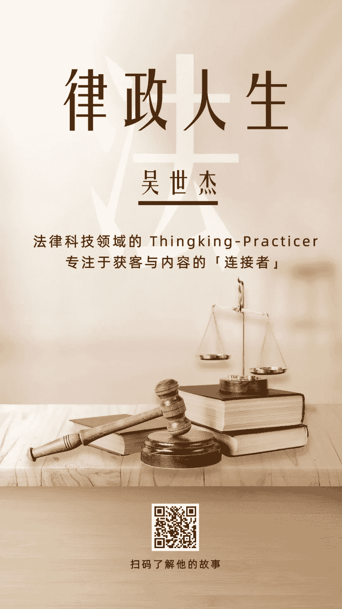
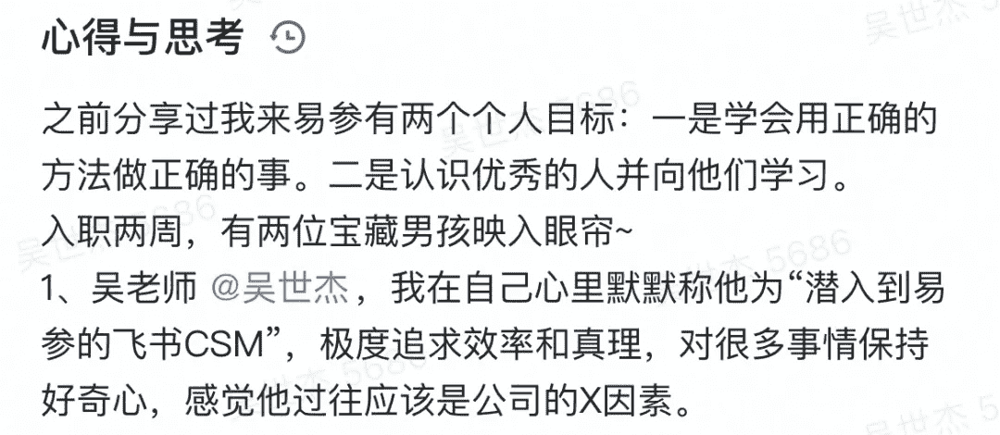

# 【访谈】飞书上的律政人生 Vol.5

> 来源：[https://docs.feishu.cn/docx/ZQ2hd2rOzoPx2wx1QFCcuUfsnGc](https://docs.feishu.cn/docx/ZQ2hd2rOzoPx2wx1QFCcuUfsnGc)

---

「飞书上的律政人生」是由飞书社区运营的一档人物视角栏目，采访具有一定话题性的法律工作从业者（包括但不限于：律师、法务、法官 / 检察官等），讲述他们与众不同的人生故事。

2022 年，我参加了「飞书上的律政人生」第五期的访谈👉

以下是我的访谈内容：

注：本文写于 2022 年，部分内容（如就职单位）已过时。

---

Q1：请用一句话来介绍你自己，最好能让大家一下子就记住你的特点。

A1：热衷于创造和漫想的 INTP，法律科技领域的 Thinking-Practicer（思考实践者）。

我是一个喜欢做实事的人（Pract[吴世杰个人介绍](https://legalstudio.feishu.cn/wiki/V5hSwC3eViWhrjk97IJcsyoUncc)cer），是一个法律科技创业者 👉

同时我也很爱思考（Thinking），光做事不思考对我来说很不满足，所以我做了一个叫「法律修音机」的👸号（欢迎关注👏🏻），是一个法律科技博主，以创业为实验对象，输出我对法律科技创业的思考和方法论。

前司的一位产品同学对我的评价👇🏻

Q2：你认为法律这个行业的前景如何？发展性、稳定性怎么样？

A2：欣欣向荣。

在法治中国的大背景下，法律服务需求快速增长，过去 30 年公共法律服务和律师行业一直在发展。2021 年是国家“十四五”规划开端之年，法律服务被重点提及，随后，各地政府、律师协会也纷纷发布律师行业“十四五规划”。可以预见的是，法律服务行业将会得到长足发展。

目前，法律服务行业正处于高速发展期，充满着变革的意味。任何一个行业都会经历从追求「数量」到追求「质量」的阶段，法律服务行业也是如此。目前，中国法律服务行业还处于追求「数量」的阶段，供不应求。

前 10 年司法机关面临的挑战最明显，直接体现在法院案子太多，结案是个老大难问题，但是经过近 10 年智慧法院的建设，这个问题基本得到解决了，现在挑战转移到了法律服务提供者这边 —— 也就是律师行业。

律师行业的现状是，客户找不到合适的律师，但同时多数律师却接不到案子，因为客户最后都找了头部的律所或律师，“二八效应”很明显，而且国家为了解决法律服务的供给问题，正在大力发展公共法律服务 —— 这意味着大量低端法律服务需求被取代，以及律师行业 —— 预计到 2030 年，全国律师人数将达到 100 万，因此获客将仍然是一个大问题。

**Q3：分享一个你从业至今最让你印象深刻的项目或者案例吧！有什**么体会、经验、甚至教训，想要跟大家分享？

A3：要说最让我印象深刻的项目，我想应该是我创业 5 年来做了大量优质且公开的内容。

在法律行业，很多律师对免费咨询是很抵触的，大家都认为咨询应该付费，更别说把宝贵的经验写成内容免费在互联网上传播了，即便写，也是遮遮掩掩不写真东西，大家更多会做成实体的物料，比如律所介绍、法律服务手册等，在见客户的时候使用。这是精准获客的逻辑。

但是互联网把一切场景都打散了，实体书、专辑等内容呈现形式，已经不符合这个时代对知识的需求了。因为一本书、一张专辑中通常都会有一部分不那么优质的内容，这是由于以前技术水平落后不得已而为之。而且，即便里面的内容都很优质，也不是所有内容你都想看。

同时，90 后、00 后已经成为就业主体，甚至是创业主力，这批年轻人是互联网原住民，特点是信息搜集、处理和逻辑推演能力更强，当他们看到好的内容或理念，然后正好有法律服务需求，他就会非常信任你。因此，在如今这个时代，好的内容可以打穿一切。

当我看到这个趋势或者行业本质时，我就坚定地推动公司专业内容公开普惠。目前在🛰️生态内，“易参”关键词的🛰️指数基本碾压了现阶段的所有竞品，这算是这几年做出的一些成果吧。这是品牌影响力的逻辑。

要说体会和经验的话，我想还是要关注最底层的东西，也就是对用户需求和科技发展趋势有深刻的洞察，随时做好准备把业务架构在最新的技术上，为用户提供更好的产品和解决方案。

举例来说，互联网把一切场景都打散了，这是技术发展的趋势，年轻人更喜欢通过搜集信息自己做出决策，而不是看广告，这是用户自身和需求的变化。当你看到了这些变化，大概就知道应该做什么了。

**Q4：你觉得当前在法律领域中存在哪**些不利于发展的因素？对你造成了什么影响？

A4：我不太喜欢用「不利于」这个词，因为我觉得任何阻碍都是需要被解决的问题，如果换成需要被解决的问题的话，我想应该是缺少「科学的评价体系」。

这个问题主要是律师行业面临的问题，因为司法机关面临的问题在国家的大力支持下基本解决了。正如上文所说，现在的情况是：客户找不到合适的律师，多数律师接不到案子，本质上还是缺少科学的评价体系，客户选来选去不知道选谁，最后还是选了头部律所，尤其是大客户选型多数情况下直接圈定了“红圈所”，那么除了那几家，其他律所就无法参与竞标了 —— 虽然红圈所的专业能力比较强，但是很多新兴的律所也很强，这种情况下，其他律所败北的原因不是专业能力，而是历史原因，这就很不公平。

除此之外，还有市场不成熟的原因，客户的认知还处于迷信红圈所和大所的阶段。

不过这些都是外因，是我们难以控制的因素，我们能做的就是做好自己，而且马克思唯物辩证法也告诉我们：内因决定外因。所以，现阶段我们要做的就是韬光养晦，等待时机。

**Q**5：自从 2020 年新冠疫情爆发以来，蔓延到现在已经两年多了。你的工作是否受到了疫情的影响？分享一下是怎样的影响？

A5：公司的业务肯定受到了一些影响，毕竟对于专业服务的成交来说线下见面还是挺重要的，但是对于我的工作来说其实影响不大。

因为我一直认为内容和品牌才是获客的核心，也是我们需要持续修炼的基本功，过去几年我一直在做，所以当疫情期间线下活动受阻，我的工作反而更加得心应手。

另外，疫情正是修炼基本功的时候。营销有很多基本功，但是很多公司都没想清楚，所以获客效果不好，比如用户画像、用户需求、解决方案和用户需求的匹配点等等，这些都要想清楚。

**Q**6：你选择现在这份职业的原因是什么？从业至今，是否曾经想过改行呢？如果真的改变职业的话，你希望从事什么工作呢？

A6：我们创业做易参这个项目，到今年年底就 5 年了，我是 2018 年初加入的，也快 5 年了。这是我的第一份正式工作，我在大学期间尝试过多家律所、外企、法律科技公司，但都不是我想要的，律师太乙方，法务太枯燥，服务律师市场太小，我还专门写过一篇文章说这个事：《创业之后，我很难回去做律师法务了》。加入易参是一件机缘巧合的事，最后发现创业真有意思。

目前没有改行的想法。如果真的要改变职业的话，我应该会继续创业。不过创业方向还没认真想过，或者去做投 To B 的投资人，因为很多投 To B 的投资人都不懂，我一直认为真正在某个领域创业的创业者才是最好的投资人。

**Q7：你日常工作的职务范围有哪些？**真正从事后，是否与最初的预期有什么差异？

A7：我目前的工作主要分两部分，一是获客，二是内容。获客是目标，内容是手段，但是内容才是核心，获客只是一个结果，虽然有很多精准获客的方法论，但都是次要的。

在我刚加入易参的时候，主要工作就是做内容，当时认知不到位的时候，还看阅读量、转发量、收藏量这些数据，但对于 To B 业务来说没多大意义，归根到底还是要为公司增长负责。

除此之外，我在公司里面还是一个「连接者」的角色，在提高组织效率和打造学习型组织上花了很多精力，比如试验各种效率工具和先进实践并在公司内推广、推动公司创建知识库等等。

**Q**8：对于法律从业者，在你看来，决定竞争者上限的最重要因素是什么？（比如：专业技能、教育背景、人生经历、个人性格……)

A8：快速学习的能力。从长远来看，任何组织或者个人唯一可持续的竞争优势，就是比对手更好、更快的学习能力。因为技术会过时、服务会过时，只有持续创新才能持续赢。

具体来说，就是根据客户需求持续提供相匹配的解决方案的能力，其他因素都不够本质。

Q9：除了经济利益之外，这个职业还给你带来了哪些收获？

A9：我们公司读书会刚好讨论过类似的问题，我分享了这个职业给我带来的收获👇

世界观逐渐形成：人类唯一的意义在于传递已经掌握的知识，商业回报是次要的。

价值观逐渐形成：创造真实持久的价值，我们可以创造的价值是能够无限精进的，这也是客户的需求，只要你能创造更多的价值，你就能获得更多的回报，包括商业回报和成长回报。

积累了宝贵的团队资源：要想做一件大事，团队是至关重要的，而创业算是一件比较难的事情，在易参创业几年来认识了几位值得信赖的伙伴，是那种即便此事不成，未来也能成事的伙伴。

积累了宝贵的创业经验：易参的团队都是基本零创业经验，我觉得能够走到现在实在是万幸，在这过程中真实地踩过很多坑，我想以后我应该不会犯同样的错误。

找到了 inner peace：我相信绝大多数职场人都没想过自己想做什么，进入一家公司就是看岗位要求，做的事情也是被安排的，比如市场岗位的要求是获客，那么很多人就会被上级基于自己过往的经验安排做事，没有自己的思考。但这也是正常的，如果你没有足够多的阅历，你不可能形成自己的思考，更不可能基于自己的思考做事。幸运的是，我在工作的过程中看到了行业本质和趋势，洞察到了最核心的东西，找到了 inner peace，而且复用到了自己的生活中，这主要是因为我从事的是和个人爱好结合的工作，这样才有助于我从中抽象出更高维度的知识，正如乔布斯所说：一个人在二十几岁就找到了自己热爱的事业，这是极其幸运的事情。

**Q**10：在科技高速发展的今天，你认为在哪些方面体现了“数字化”的转变？这样的转变对于法律工作来说是好是坏？分享一下你的看法和评价吧。

A10：整个世界都在数字化。最典型的就是「书」的行业。从实体书到电子书，数字化浪潮已经改造了这个行业。

思考一下，我们花钱买书，具体都花在了哪里？或者说，制作一本实体书的成本在哪里？一本二三十块钱的书，很大成本是花在伐木，造纸浆、造纸，挖矿，做油墨、印到纸上，包装好寄给你。绝大多数成本是花在改造「原子」上。但其实你需要的不是那些原子的结构，而是书上面的信息，也就是「比特」。另外，实体书难以满足人们高效获取信息的需求，如果知识有更新 —— 而且知识更新速度越来越快，实体书只能再版，所以书一经出版就过时了。

法律行业也是一样，未来会有越来越多的工作会被「比特化」。比如法律咨询环节，已经从线下面对面咨询变成了在线咨询，未来还会有越来越多的咨询变成知识，用户通过搜索即可获得答案，不再需要咨询律师。

对于整个行业来说，效率变得更高了，这当然是好事。但是对于律师个体来说就不一定了，因为客户会随着数字化进程而转移，所以大家都需要数字化转型。

**Q11：推荐几款你喜欢或常用的帮助你提高工作效**率的工具或者产品吧！说说推荐原因是什么？

A11：那必然是「飞书」。我可能是最早使用飞书的一批法律人（2019 年开始用）。之前用过印象笔记写东西，有一年我创建的笔记超过了 95% 的用户，应该算是深度用户了，另外还有 Xmind 等工具，但现在只用飞书，原因是功能好用，All-in-one、酷。

Q12：在工作之外的你是什么样的？有什么兴趣爱好呢？

A12：我是一个比较宅的人，独处的时候一般会读书、运动、看电影、打游戏等，玩累了就睡觉，或者继续工作，工作使我快乐！

不过我也会经常出去玩，吃饭、喝酒、探店，我觉得食物还是很治愈的，醉酒的感觉也不错，但是不包括宿醉 —— 那可太糟糕了。

另外，我还会不定期去环球影城玩，那确实是个很让人放松的地方。去年冬天我有一次去的时候北京刚好下大雪，那个感觉简直无敌了😌

Q13：请推荐一本你喜欢或最近在读的书籍，并简单分享一下推荐理由。

A13：《毛泽东选集》。最近我们公司的读书会正在读，陆陆续续读了两个多月。新中国被很多人比喻为最伟大的创业，毛选中的很多文章对我们创业和日常工作都很有帮助。

Q14：最后，请用一句话来赠予自己，或者赠予所有法律界同行吧！

A14：**做一个坚定的长期主义者，**[时刻准备着](https://mp.weixin.qq.com/s?__biz=MzUzOTcwMTE5OQ==&mid=2247485317&idx=1&sn=35e605f839ce612ff4baa4fe60deba25&chksm=fac53d25cdb2b433af9c6a5b6dee3c9c6ca44e91b9a7c2bcb43aaea4b101ee2bdbf69fbc3b87&token=1264774391&lang=zh_CN&scene=21#wechat_redirect)**，等待时机一拔头筹**。