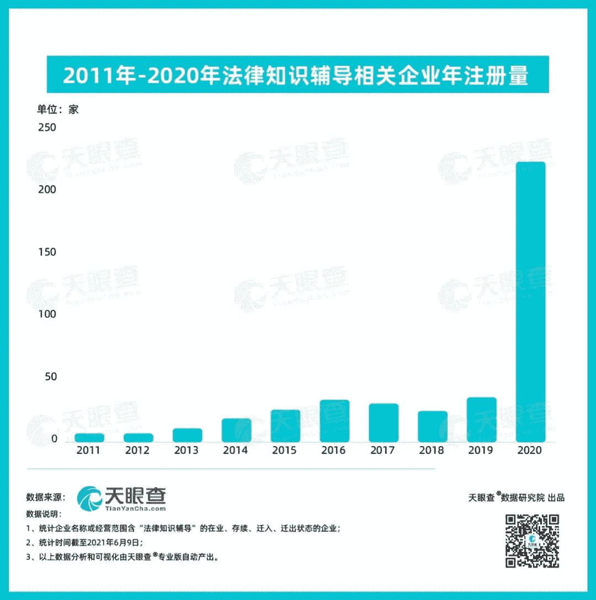
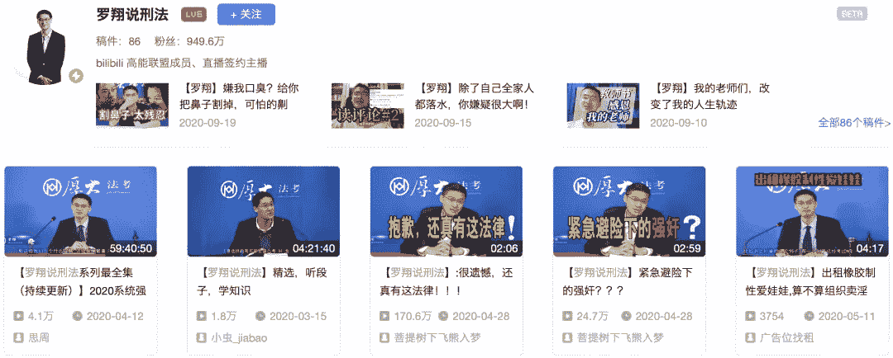
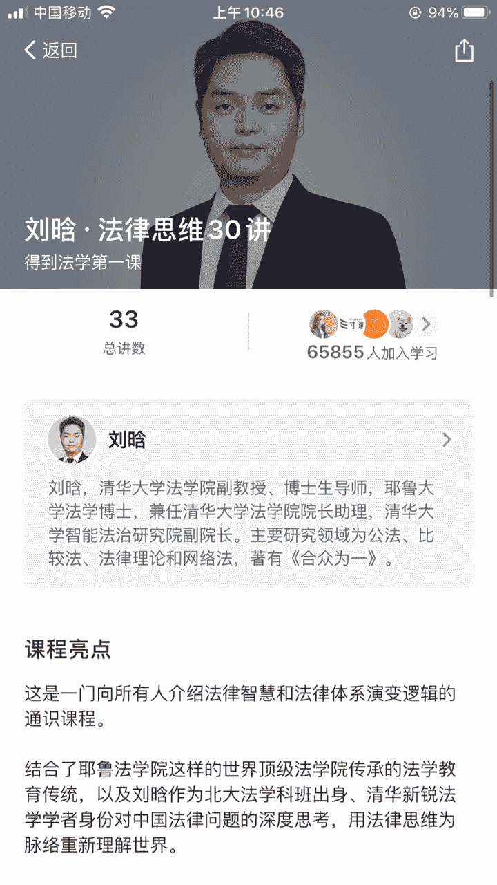
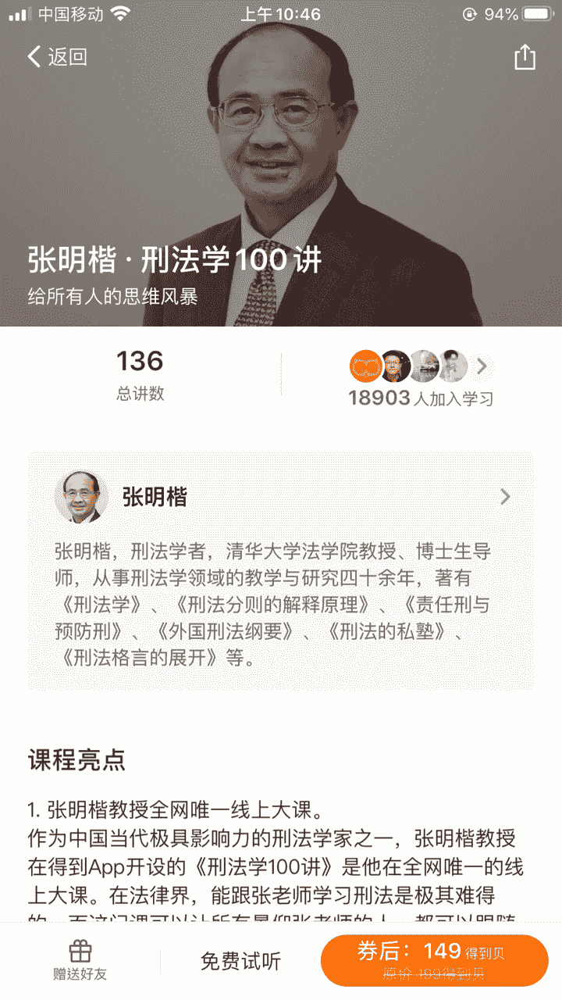
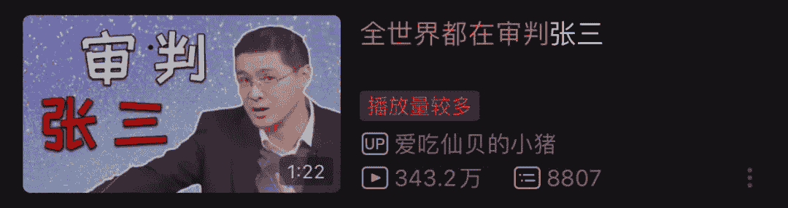
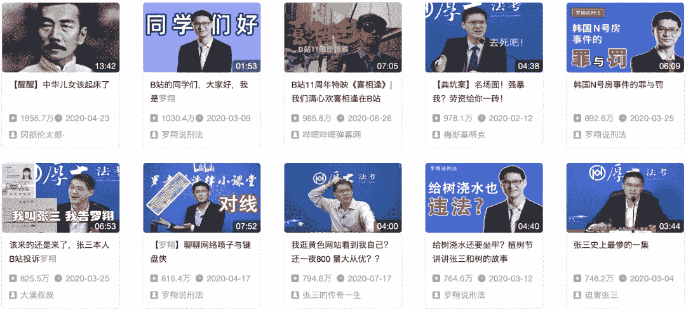

# 不 想 当 老 师 的 律 师 不 是 好 网 红

> 来源：[https://docs.feishu.cn/docx/TJ0vdqiGpo7B7FxXMuJccbNjnvg](https://docs.feishu.cn/docx/TJ0vdqiGpo7B7FxXMuJccbNjnvg)

---

天眼**查数据显示，我国目前经营范围或企业名称含“法律知识辅导”，**且状态为在业、存续、迁入、迁出的司法考试培训相关企业为 703 家。从相关企业注册时间来看，2020年是其凯歌高奏的一年。截至2020年年底，司法培训考试相关企业新增约 225 家，新增占比在整个行业中达到约 32% 。

为什么2020年法考培训机构大量出现？

是因为法律人考法考的热情空前高涨吗？

我觉得不是。

虽然法律人的数量逐年增长，但仍是线性增长，他们对法考培训的需求也是相对稳定的，所以2019年以前法考培训市场也很稳定。

那为什么会冒出这么多法考培训机构呢？

**我认为，2020年法考培训机构大量出现，其实反映出一个趋势**：市场对法律专业知识的需求极大提升，法考培训的用户已经不仅仅是法律人，还有大量非法律专业的普通大众。

而这个趋势的转变离不开一个人：**罗翔。**

本文首发于2020年9月

---

要说 2020 最火的业内出圈现象，当属 B 站 Up 主「罗翔说刑法」。

2020 年 3 月，罗翔本人正式入驻 B 站成为一名 Up 主，「罗翔说刑法」开号 2 天粉丝突破百万，被誉为“2020 最速百万粉传说”。截至 2020 年 9 月，发布视频 73 个，视频最高播放量超过 1000 万，粉丝数已经将近 950 万。

花式讲刑法的罗翔，也因此成为一个商业现象。

“表演系路过”“金融从业者来了”“测绘学前来充电”等弹幕，在罗翔讲解法律的视频里很常见。

就这样，罗翔，从一名影响力局限于法学圈的专家学者，凭借一段段脍炙人口、曲折离奇的刑法案例讲解视频，成为广大网友眼中的“网红”。

但是，这种破圈的例子，在法律行业并不常见。

那么，讲司法考试的老师，是如何成为“网红”的？接下来，新兴法律人会如何发展？法律人是否可以打破圈层限制，全网开花呢？

# **疯狂的“罗翔们”，席卷互联网**

早在 2015 年左右，法律人就有出圈的迹象。

当时以“厚大司考”为代表的司法考试（现在改名为“法考”）培训机构，就已经“捧红”了一批司考讲师。

要把枯燥的司法考试题讲好，有趣的段子成为了验证一位老师授课能力的要素之一。

在“厚大法考”的众多名师中，除了罗翔，还有钟秀勇、刘凤科等，两位也非常会讲段子，前者对“冰冰”的喜爱，后者常说的“二娃翠花”，都和罗翔老师的“法外狂徒张三”有异曲同工之处。

当时为了听老师们讲段子，甚至成为了很多法科生选司考培训机构的重要原因之一，很多其他系的学生也在听。

2018 年，行业看到了知识类内容创业的价值，以往内容平台作为补充存在的法律类知识，成为 B 站的 C 位，知识 IP 应运而生。

罗翔也在这时以「罗翔说刑法」一跃成为网红，他让普通大众了解到专业的法律知识，从而冲出了法律圈子，横扫各大泛娱乐平台。

你会发现，这几位老师都是讲法考出身的，他们服务的对象是法科生，和普通人没什么关系，但由于讲的内容有趣，贴近大众生活，就受到了大众的喜爱。

2019 年左右，在法考培训行业高速发展了多年之后，不少法律从业者开始寻找新的突破口。

比如在知识服务平台「得到 App 」上，就有几位新晋的网红法律人：

# **罗翔出圈，法律服务出现新趋势**

纵观这几位出圈的法律人，如果要说一个共同点，那就是“老师”。

**老师做的是教育，可以覆盖更多的人，边际交付**时间成本越来越低，这个生意天生就能做大。

而从律师业的发展上看，经历了诉讼律师、非诉律师、公司法务的演化过程，背后的逻辑是客户需求的演变：解决问题、避免问题、风险防控。

那我们要问的是，现在已经 2020 年了，客户的需求发生了哪些改变？

观察近两年的市场，我发现 2 个小趋势，二者共同引爆了法律人的出圈。

**（1）专业知识需求被激发**

随着互联网的发展，信息极大丰富，其中就包括法律信息。当人们遇到法律问题时，可以更方便地查到相关信息。

大众对于知识的需求，其实是伴随着知识付费行业的兴起而产生的。

由于互联网的普及，成本可以被分摊，让原本昂贵的知识变得触手可及，这也进一步激发了普通人的学习需求。

这一现象，在后来被冠为“知识付费”行业。

因此，罗翔的爆款选题，内容天然具有刚需性，每天一个入狱小技巧，老少咸宜。在座的都是法科生，那些奇葩的刑法例子，我就不举例了。

而且在疫情因素下，优质网课本身也供不应求。

**免费名师辅导，轻松易学还有趣。**

谁不喜欢？

对法律人来说，我们的观念也要转变：

**你**是要提供传统的解决方案型的咨询服务，还是把视角放大，把自己提供的服务定位为“法律服务”，这样就有了更多的发展空间。

**（2）知识服务平台的崛起**

为什么众多讲师都在讲法考，只有罗翔火了呢？

一个绕不开的因素，就是 B 站。

出圈意味着被更多人认识，这也意味着获得了大量的“用户”。

这个看起来是罗老师的内容引来了很多粉丝，但其实获得了 B 站相当大的流量扶持。

可以看到的是，B 站本身正在不遗余力地为了“破圈”做出种种努力。

最初，B 站的内容大多都是二次元，而随着用户量级越来越多，用户的需求也被进一步挖掘。

早在 2017  年，厚大法考就开始在 B 站上传罗翔老师的视频课程。从 2018 年开始，也有用户在 B 站上传罗翔讲课的视频，但头两年播放量一般，而且也不稳定。

要说真的出圈，还要从 2020 年初算起，大量 Up 主开始剪辑、搬运罗翔的在网上讲授法律课程的视频，甚至有的还做成了鬼畜。

其中，剪刀手们最为喜爱的鬼畜素材就是一个在罗翔老师视频中高频出现的名字 —— 张三。

熟悉 B 站的朋友们都知道，不管是人还是事，一旦成为表情包和鬼畜，就代表开始火了。

在罗翔入驻 B 站的同时，越来越多的科普、财经、历史、人文领域的专业人士正在进入 B 站成为 Up 主。

流量和品类的激增让 B 站不得不将原本的「科技区」改名为「知识区」。

Up 主们在这里分享各自在专业领域的知识和见解，也同年轻的粉丝们交流讨论。

可以说，是 B 站，将罗翔送出了圈层。

# **知识科普，也只是看起来简单**

目前，法律知识类内容已经出现了日趋饱和的迹象，每个人都觉得自己可以知识变现。

但是，下一步法律人要想突围而出，并不会如想象中那么简单。

而这，离不开以下几方面原因：

**（1）做内容要投入**

首先，做内容是需要投入的。

相比追求娱乐消遣效果的视频内容，严肃知识类视频对创作者的专业能力、知识储备、策划能力等要求更高。

罗翔老师本身是一名专业的法考讲师，以科普知识为目的进行内容传播，压力相对较小。

**但是，律师的时间成本多高啊，而且如果我们**理性地来计算时间成本，可能超出你的想象。

举个例子：

刘润老师在得到App开设了一门课程 ——《刘润·5分钟商学院》，目前用户超过 25 万人。

为了保证输出品质，每个 5 分钟，他都要投入 5~7 小时的时间。以他的时间成本来计算，他大概一共投入了 800 万元人民币，来做这门课。得到课程的定价是 199 元。

这意味着，这门课必须卖出 8 万份，和平台对半分后，他才能收回成本。

好。

现在你想，这个世界上，有没有商业讲得比刘润好的老师呢？当然有。肯定有。估计还很多。

但是，这时他们就需要做一个判断：

**“**在 199 元这个定价下，我有没有信心也卖出 8 万份？因为如果卖不到 8 万份，我就必须明知亏损，也要硬着头皮做完全年的课程。”

199 元之下的 8 万份，是刘润对课程下的重注，挖的护城河，用“一把全压”的方式直接上规模，把竞争对手吓退在护城河之外。

如果是你，你会赌吗？

**（2）选择合适的平台**

其次，网红老师的出圈，离不开他所依附的平台，尤其离不开平台的运营。

平台拥有丰富的运营经验和资源生态，而活跃的高黏性用户，则能带动站内作品破圈。

比如，“法外狂徒张三”的经典形象，由罗翔老师的作品树立，却是在 B 站用户频繁讨论和使用过程中，活跃到大众视野。

目前在 B 站上搜索“罗翔”，最火的前 10 条视频中，有 6 条出自其他 Up 主剪辑，只有 4 条是罗翔本人账号「罗翔说刑法」的作品。

这足以说明罗翔的火爆是人未到，爆款先行。

细心的你会发现，以上提到的几位老师，他们都是深度绑定某个平台，输出优质的内容，然后获得平台持续的流量扶持。

+   钟秀勇、刘凤科等法考讲师：法考培训机构

+   罗翔：B 站

+   刘晗、张明楷、王人博：得到App

但更常见的情况是，很多律师在多个平台上线一门或多门课程，收割短期的流量红利。

但由于缺少平台的运营，前几个月销量可能会不错，后续会迅速下滑。

因此，我们可以看到法律人“两极分化”的出圈尝试：淘宝制和邀请制。

淘宝制的意思是，谁都可以上我这个平台，如果认可你是大IP，就多给你一些资源倾斜。但也正是因为谁都可以上那个平台，会导致用户在该平台上的选择成本过高，试听一个不喜欢，再换下一个还是不喜欢。

从长期来看，这会导致真正的头部起不来。

而邀请制则是由平台邀请少数的大咖一起打磨产品，罗翔就是受邀入驻 B 站，刘晗、张明楷、王人博也是由得到App邀请入驻的。那么，如何成为被平台看中，就是我们需要去调研，去自我修炼的地方。

（3）输出的内容既要优质，又要服务好平台的用户

更进一层，提供的内容必须要优质。

法律是专业知识，门槛较高，优质的内容除了要保持专业度 ，老师还要讲得简单易懂。

原来普罗大众眼中的法律，都是诉讼、打官司，离我们的生活非常遥远。传统提供法律服务的律所，就是一个“黑匣子”，客户只能被动等待服务成果，难以感受到服务的价值。

但罗翔老师的讲解，让大家感觉到法律和自己息息相关，放大了服务过程。罗翔老师就是凭借幽默风趣、深入浅出的风格迅速圈粉。

但更重要的是，要获得平台的扶持，还要满足平台的需求。

**平台需要对用户负责，所以老师提供的内容和**形式就要服务于平台的用户，不能随心所欲。

比如在得到App上线的《刘晗·法律思维30讲》、《张明楷·刑法学100讲》、《王人博·宪法学30讲》，就不是传统的普法课程。

这 3 门课程，除了要提供与主题相关的内容以外，还要交付 “可迁移的知识”。

也就是说，不是要给你讲法条和程序，而是要交付给你一整套思维方式，全世界的立法者、法官、检察官、律师都共享的一套思维方式。听完这门课，你首先会理解很多法学界的现象。比如：

+   法律为什么关注程序 ，而不是正义的实现？

+   为什么法律人一说话，就是各种术语？

+   英美法系和大陆法系，差异那么大，为什么都能处理社会问题等等。

但得到App更高的要求是，不管是法律行业的外行还是内行，学完了这门课，都能有所收获。

你看，这是不是和我们平时的认知不太一样？

**他们提供的内容有所不同，其实都是**因为依附的平台不同，服务的用户群体不同。

当然，在“淘宝制”的平台中，就没有这么多的条条框框。

**（4）内容输出的稳定性难以解决**

任何领域的内容，都会因为专业门槛，最终导致内容品质出现差异化。

但更重要的，是内容输出的稳定性问题。

**首先是内容质量问题。**

不能一期内容好，下一期就不太行了，人都是有更高的期待值的，要对得起用户的时间。

虽然大部分法律人都很专业，但不同写作水平的内容，其实会存在一定的差距。

这方面 B 站拥有良好的内生培养体系，这些年平台上源源不断地产生头部创作人，经常能创作出火爆全网的内容。

比如财经领域的半佛仙人、知识区的罗翔说刑法，头部创作者的内容生产能力是非常强的。

因此，做内容需要自己的一套品控标准。

内容创作者需要根据用户的口味及时调整写作方法，通过设置吸引读者注意力的结构、详实的论据，最大程度地减少内容质量的变动。

**其次是输出频次问题。**

保证稳定的输出频次，是一种激励机制，能够提高用户粘性。

如果是做课程，必须保持课程目录的按时更新。在此基础上，还要根据热点做内容，这样才能保持你的内容是鲜活的，“你”是鲜活的 。

在得到App，老师会根据热点适时推出新的解读，然后作为“加餐”补充进自己的课程里。

也就是说，把原本不属于课程体系中的内容，补充进课程里，作为“加餐”。

竭尽全力，服务好自己的用户。

**最后是录制质量问题。**

不论是音频还是视频，录制质量不够稳定的问题时有发生。

对于录制的质量把控，在早期是很难通过标准化的标准去进行统一处理的。

当然，随着知识服务行业的发展，慢慢也总结出了一些品控标准。

举个例子，有哪位老师会根据录音设备的升级，重新录一遍音频，替换原来上传的音频？

此外，法律内容音频和视频的呈现效果也非常明显，这类内容的特性是专业。

仅音频是比较难懂的，还需要搭配文稿，但讲述稿和文字稿的结构也不尽相同。

视频更加合适，因为可以搭配字幕来学习，比如罗翔就是视频形式，而且 B 站的弹幕文化，还能起到一起学习的效果，每个用户都在用弹幕进行创作、表达。

当然，视频也有难度也有，讲述人出镜效果要好，你还要找素材、剪辑制作，时间成本很高。

所以说，想要持续做出好的法律内容，门槛还是相对较高的。

# **最后的话**

知识付费市场的火爆加速了法律行业的发展，也加剧了行业的竞争，法律服务泛化成为了很多法律人突围的方法。

优质内容创作者作为法律细分的一个品类，虽然有持续火爆的基因，但是要想做好，仍然面临着不少挑战。

未来，法律内容创作者能不能被更多人接受，再次破圈，需要解决好这些问题：

1.  要决心投入成本

1.  要选好流量平台

1.  要提供优质内容

1.  内容要有竞争力

1.  要稳定输出内容