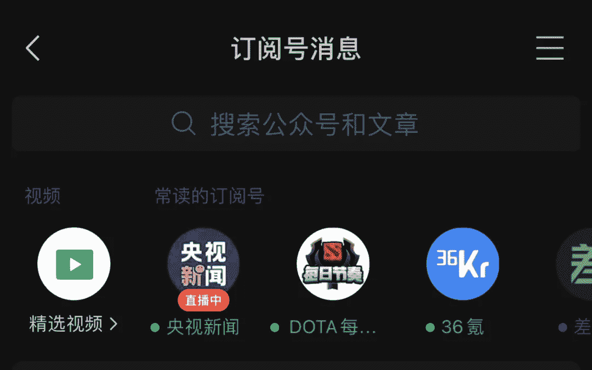
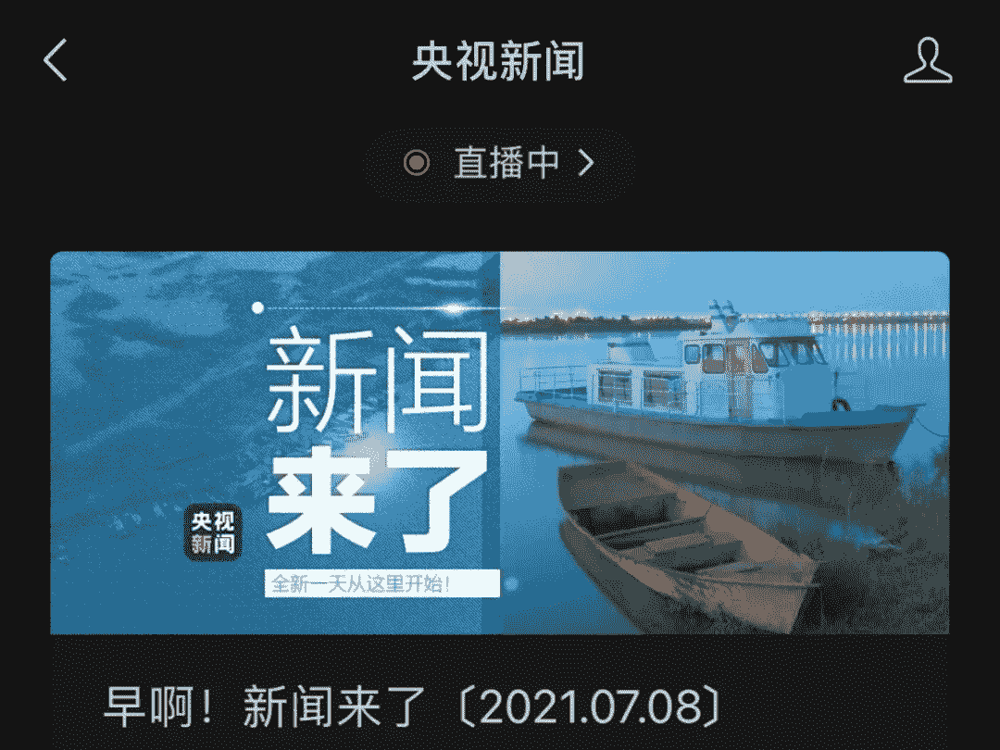
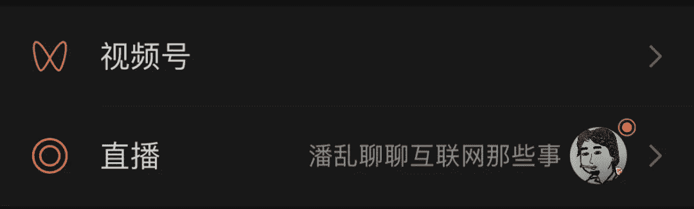

# 视频号直播 ≈ 线下销售

> 来源：[https://docs.feishu.cn/docx/KbzOdSnLcoqfmvx545GcmSyVneh](https://docs.feishu.cn/docx/KbzOdSnLcoqfmvx545GcmSyVneh)

---

要说 2021 年增速最快的短视频平台，非微信视频号莫属。

张小龙说过，在视频号，“关**注”、“朋友”、****“推荐”三个分类的**内容消费占比应该是 1:2:10 。我不知道现在的比例是怎么样，但目前“朋友在看”的流量已经被充分论证了。

据我观察，和抖音、快手相比，视频号有两类比较独特的内容：

一类是知识内容。也就是那种相对有些知识量的短视频，而且很多都超过了 1 分钟。

另一类是品牌内容。不论是抖音快手还是 B 站都开了自己的官方视频号，而且很多奢侈品之前是不玩视频的，比如香奈儿，现在全部都开了视频号。视频号已经成了品牌阵地。

除了短视频，以上两种类型的直播，即知识直播和品牌直播也在兴起，而现在的品牌直播也越来越内容化，甚至好的品牌内容，你甚至分不清它是广告还是知识。

可以预见的是，在未来 3-5 年内，“短视频+直播”一定还是最主流的内容表达形式。

今天，先来聊聊「直播」。

---

## **1.**为什么知识直播火了？

知识直播火了，是提高商业沟通效率的必然。

直接拿我们公司「易**参」举例。

每个易参的客户其实**都希望我们创始人 @怡然 本人提供股权服务。原因很简单，怡然是易参创始人，专业能力最强，也最有人格魅力。但问题是，怡然的时间是有限的，不可能亲自给所有客户提供服务。

这其实反映了一个确定的需求：人们都想获得最好的产品或服务。

虽然怡然无法亲自提供服务，但客户通过和易参建立合作，是有机会认识怡然的。这时，如果客户想要请教一些更深度的问题，比如行业向的问题，他的第一选择肯定是请教怡然。

这就涉及到怎么发起这个对话的问题。

如果直接打电话或微信视频通话，有点唐突，不合适。如果是打字，效率又太低，因为现在的人都很忙，不一定随时 online 。

所以现实是，客户打字发给怡然，但怡然出于某些原因，不是马上就能看到并回复的。比如可能就是没看到，或者看到了但手头有事不能马上回复，怡然可能过了十几分钟、几个小时、甚至一天之后才会回复。客户只有在怡然回复之后，才能确定怡然的时间是 avialable 的，然后才能再次发起聊天 。

这种发起聊天的方式效率很低，但没办法，这就是现代人的社交礼节。

怎么办？

要回答这个问题，我们首先要理解这个问题的本质。

这个问题的本质，其实是时间碎片化的问题。

陆奇也曾经谈到类似的问题：

> 虽然现在微信已经占了很大的空间，但短信通信这条赛道还是可以关注的。

> 我在带 Skype 团队的时候，有一个非常重要的经验教训，当时是没有这样的认知的。当时的团队认为语音、视频交互更有价值，如果我们要做短信的话其实很容易去做。

> 但是忘了一点，语音、视频是实时交互，你需要做协同，你需要事先约好什么时候打 Call 。人类社会越来越忙，协同的代价越来越高，这是一个致命的 Cliff 。短信不需要协同，但是你一旦回答过，我就知道你暂时在线，然后我马上可以给你打 Call 。

> 而且短信是可延伸的。我在 YC 看到很多新的创业公司，都是通过短信通信的方式，比如病人跟医生的互动，企业和客户的互动也有很多很多可以做。

因为时间碎片化，短信通信仍有很大的**价值。

基于这个逻辑，如果我们拆解一下网上聊天的过程，就可**以得到短信通信的交互链条：

A 发送短信给 B —> B 看到**短****信并回复 A —> A 看到 B 的回**复后，打字或打电话给 B

这就是人们日常聊天的方式。

如果放到企业和客户沟通的场景，比如上文提到的客户咨询，那么交互链条就会变成：

客户发短信（可能是一个问题）给怡然  —> 怡然看到短信并回复客户  —> 客户看到怡然回复后，继续打字或直接打电话给怡然

但问题是，客户问的问题，往往是十分常见且简单的问题，回答这些问题非常占用时间。

这不就是免费咨询吗？

有的律师不喜欢免费咨询，就是因为免费咨询占用自己的时间，而且还要被白嫖。

律师苦免费咨询久矣。

怎么办呢？

简单。

如果很多客户问你某些问题，你完全可以策划一场特定内容的直播，集中和客户交流。

比如某网约车平台最近被国家监管，涉及到一些数据安全和 VIE 架构的问题，这段时间很多客户来问你相关的问题，那你就可以开一场直播，专门讲这个问题。

当然，客户的咨询还是要回答的，只不过你回答个大概就行，然后告诉客户：“我明天会开一场直播，专门讲一下这个问题，欢迎到时候来捧捧场。”而之前，你可能要写一大段文字，或者打电话说个十几分钟才能解答客户的问题。如果你草草应付，客户的问题没有得到解决，那不是吃力不讨好么？

除此之外，直播还可以沉淀下非常丰富的视频文件，稍微剪辑一下就是短视频，一举多得。很显然，在时间精力有限的情况下，做直播比拍短视频效率更高。

---

## **2.**知识直播适合哪些业务？

目前，互联网直播主要分为四大品类 —— 秀场直播、游戏直播、泛娱乐直播、电商直播。其中，秀场直播已经高度成熟，电商直播已经证明了自己的盈利能力，泛娱乐直播和游戏直播还有成长空间。

但我们现在可以看到，不论是抖音快手还是 B 站，都开**了自己的官方视频号，而且很多奢侈品**之前都不玩视频的，现在全部都开了视频号。视频号已经成了众多品牌的阵地。

这时问题就来了：直播平台这么多，为什么品牌都选择视频号，在这里直播、做短视频？

原因很简单，微信是互联网流量的终点，一切引流手段都是为了加个微**信。

那你说，视频号的带货能力比抖音**和快手更强吗？也未必。这里需要分两种情况讨论：

如果你的产品 / 服务是高频、低客单价的标品，最适合你的其实是电商直播，找流量**大的主播带货，这**样效率最高，视频号提供的功能和其他平台一样，效果也比不上那些大主播，比**如薇娅、李佳琦（还有老罗）。

对于高**频、低客单价的标品，需要的是规模，是效率，不需要信任。

但对于低频、高客单价的非标品，客户的决策链条很长，规模和效率就不那么重要了，信任反而变得很重要。这些产品和服务的交易链条较长，很大的一个原因就是缺乏信任。

如果你的业务是低频、高客单价的非标品，你需要建立信任，那你就应该做视频号。

对于低频、高客单价的非标品，因为客户的决策链条很长，所以很难通过电商直播的方式走量。比如卖房产，主播说的天花乱坠，仍然很难成交，即便有成交，成交量也不会多。

但这些事情正在慢慢被“短视频+直播”改变。

首先，短视频正在跟各行各业做更深的结合。

我听说快手上有一个叫“王贝乐讲房产”的人，一年能卖 1000 套房。他做的事情很简单，就是通过短视频持续的积累，用户持续观看他的内容，他和用户之间就可能会产生“信任”。然后，他就可以通过“信任”来改变交易的决策链路，甚至把贝壳模式给颠覆掉。

直播和短视频一样。

对于低频、高客单价的非标品，直播最强大的功能其实不是带货，而是“建立信任”。

因为用户看直播花的不是钱，而是时间。花时间就是陪伴，陪伴比花钱更容易建立信任。

同时，视频号处于中国最大的私域 —— 微信内，它可以直接触达真实的人（其他平台接触到用户还要加个微信，视频号可以直接触达），所以视频号直播具有天然的优势。

具体来说就是：

1、对于微信好友

针对性地解答他们的问题或者针对性地分享特定的干货内容，以增进信任，寻求转化。

2、对于直播间内的观众（非好友）

通过分享干货内容和聊天互动，以建立信任，添加微信好友，长期培育，寻求转化。

和图文相比，短视频和直播更接近于线下，甚至可以说，视频号直播 ≈ 线下销售。

---

## **3.**为什么要现在做直播？

首先，从信号上看，视频号直播的重要性越来越高。在视频号的历次版本迭代中，直播从视频号内置的一个功能，到独立为「直播与附近」，再到现在成为一个独立的入口，已经是一个重要的流量入口。

其次，从流量上看，微信为视频号直播提供了诸多明显的导流入口。如果公众号关联了视频号，只要视频号开播，公众号就会至多在 5 个地方显示“直播中”标识，分别是：

+   好友列表

+   订阅号信息流

+   推送模块公众号名称右侧

+   公众号页面内

+   发现页直播入口右侧

除此之外，直播可以沉淀视频素材，发布在短视频平台，还可以做成文章，提高图文内容多样性和发文频次。通过直播，还可以输出品牌影响力以及维护合作伙伴。

因此，“短视频+直播”能够给各行各业业带来的变革，其实才刚刚开始。