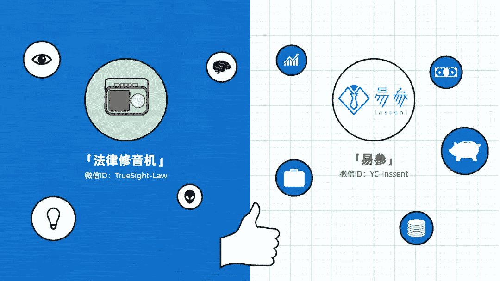
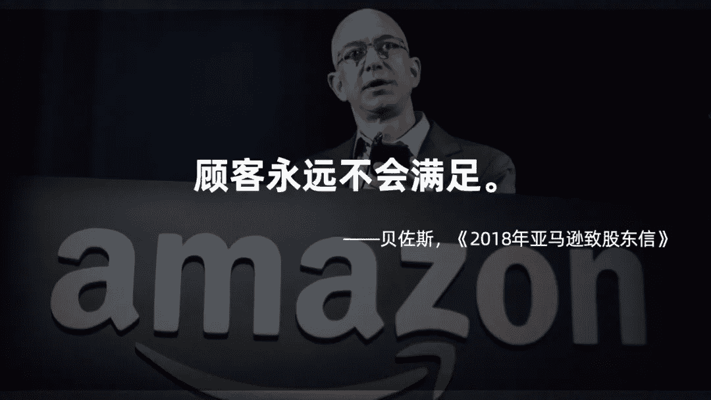
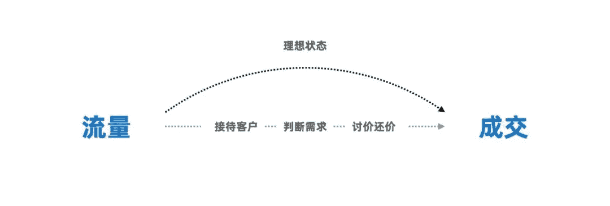
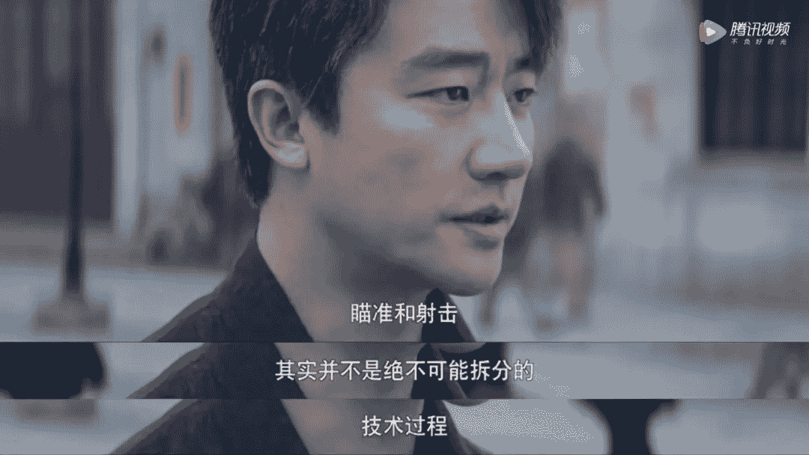
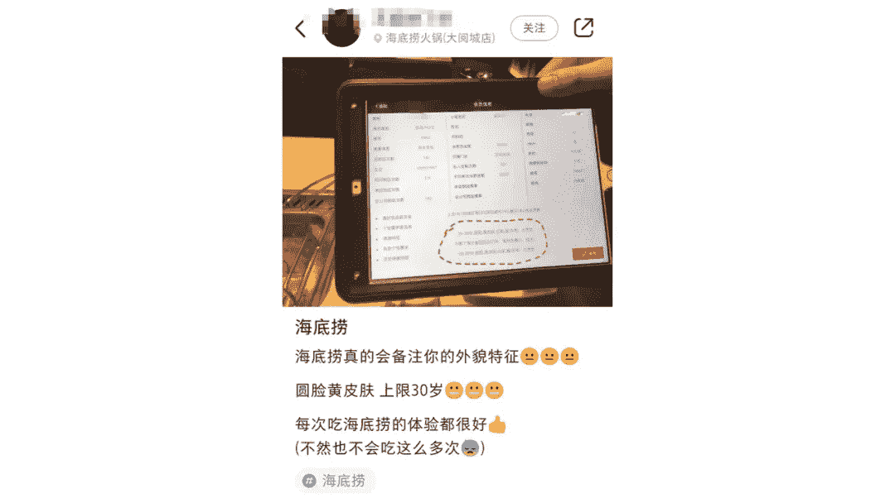
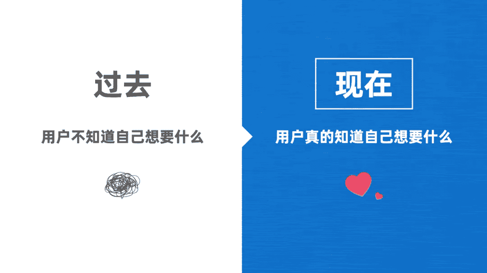
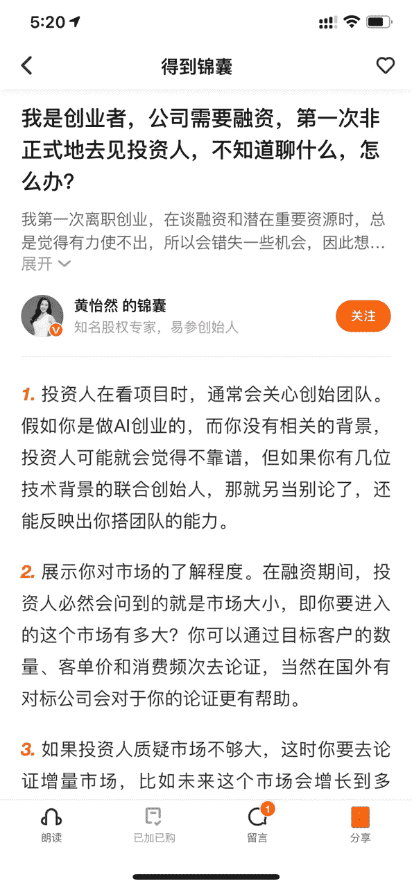
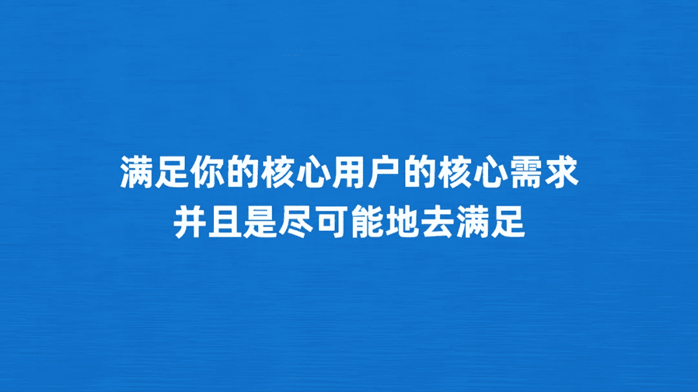

# 中小律所如何从0到1建立内容能力？

> 来源：[https://docs.feishu.cn/docx/YtrddVioPoijlcxlEX4cHizYnz5](https://docs.feishu.cn/docx/YtrddVioPoijlcxlEX4cHizYnz5)

---

尊敬的各位领导、律师朋友们，大家下午好。

在场的各位都是大咖和前辈，而我并不是一个专业的法律从业者，在场任何一个人的法律履历都能把我摁在墙上打，抠不下来那种，我讲不出很多干货，所以我今天的演讲就非常划水，来跟大家分享一下我对法律行业内容的认知，以及内容和科技赋能律所有什么关系。

先简单介绍一下自己，我是吴世杰。

虽然我是读法律的，但我对自己的认知一直是个不太正经的法律人，这主要是跟我大学期间的工作经历有关。

我的大学和很多人都不太一样，我是2013年入学的，因为我大一的成绩比较好，所以我和老师的关系混的不错，于是我就可以提一些特别的要求，比如调课。我是7班的，那我就可以调到和6班一起上课。调课的好处很多，你可以自由地控制你的时间，而且还可以认识隔壁班的女同学。

当大家都在上课的时候，我就去实习，然后在寒暑假的时候去做其他事情。所以我比大多数法科生都更早了解律师这个职业，以及去思考，我怎么做才能比别人厉害。

坦白说，我的实习经历非常丰富，认识了很多业界大佬，大家对律师这个职业一致的认知，就是要熬的足够久，只要你熬的足够久，你就牛逼。那像我这种一天正经律师都没当过的，明显是不及格的。

律师怎样做才能做到顶级，这个问题我一直没想明白，甚至快要毕业了，大家纷纷开始讨论是去律所还是继续读研的时候，我就面临着失业的风险，感谢易参收留了我。

但后来我想通了，这可能就是智商的差距，别人做律师就是比我厉害，我就是不适合做律师，而且我在很早的时候就意识到这点，其实也挺幸运的。所以我的心态一直特别好，比我强的人就是比我强，我不会去嫉妒，在哪里跌倒，就在哪里躺下。

后来，我写了两个公众号：

一个是「法律修音机」，平时会写一些我对法律科技和律师行业的文章，一本正经的写文风格，目的就是为了骗甲方的钱。今年运气比较好，冷启动比较快，在百度上搜法律科技，第一页就有我的文章。

另一个号是「易参」。我的本职工作是在易参负责内容，在公司成立初期**，只有我一个人在写公众号文章，现在我们**有了团队，内容也从单一的公众号文章，扩展至众多平台，包括国内最好的科技媒体 36 氪、知识付费头部平台得**到A**pp等等。

这里简单介绍一下「易参」，我们是一家做股权激励业务的创业公司，虽然我们做产品、去融资，但股权激励本质上就是从非诉业务中新分化出来的一个分支，所以你也可以说我们就是一家中小律所。

事实上，很多律师都知道要去做内容，一个最直接的原因，就是内容能带来低成本的获客。

当我开始做「法律修音机」这个号时，有很多律师朋友加我微信，大家对内容的关注点也是集中在“获客”上。在易参，我们也会统计我们的获客数据，这 3 年来，通过内容来的有效销售线索占比逐年提升，这带来的好处就是获客成本的持续降低。

做内容当然很重要，但为什么要在科技论坛讲内容呢？

因为我发现，现在大家都是围绕流量去做内容，但法律行业的内容其实有很大的延展性。

如果只专注于做流量内容，短期来看其实没有任何问题，你可能因此获得更多的客户。

但是，我们对内容的理解跟大家不太一样。我们认为，从长期来看，做好内容才是构建律所核心竞争力的关键。

我们在这方面想的比较多，因为易参是一家创业公司，我们要想快速做大就要去融资。易参目前已经拿到两轮融资，我们的股东源码资本、顺为资本也是国内的一线基金，所以我们对增长的要求比绝大多数律所更高。我们一直在思考，怎样才能做到快速且持续的增长？后来我们发现，内容是一个非常重要的因素。

我们在思考问题时，倾向于从行业的核心驱动力来看，也就是我们观察一件事情，先看它的核心驱动力是什么：为什么这件事情会发生？如果发生，未来会是什么样子？它的结构是怎样的？有了结构，就可以很容易看见未来。

1.一切行业发展都是技术驱动的

首先，我认为一切行业的发展都是技术驱动的，律师行业也不例外。

纵观历史的发展方向，我们可以看到，一个新时代的到来，总是伴随着一个「定义性体验」的诞生。

在互联网时代，当我们看到 Mosaic 浏览器出现的时候，我们就知道一个新的时代来了。

在 PC 时代，当我们看到 Win95 软件系统出现的时候，我们就知道一个新的时代来了。

在移动互联网时代，当第一个 iPhone 出现的时候，我们就知道一个新的时代到来了。人类和机器的交互形式，从键盘变成了手指。

在云的时代，虽然我们还没看到类似的产品，但云上协同，有点那个感觉。

和其他行业相比，律师行业的服务模式，已经很久没有更**新了，仍然采用一对一的方式提供法律服务。我们要思考的就**是，技术将会如何改变律师行业？在未来，一个定义性体验的法律服务，会是什么样子的？

**

贝佐斯在亚马逊《2018年致股东**信》中就提到：顾客永远不会满足。

如果你能提供更好的服务，客户就愿意为你多付费，甚至从其他产品迁移过来。

从目前来看，一个笃定的技术就是人工智能，未来的律师行业会比现在更加的自动化。

大家可以想一下，人们在什么情况下需要法律服务？一定是遇到法律问题的时候，对不对？

人类都希望用最高效的方法来解决问题，我有一个问题，然后找到专业的人来问，这就是最原始的解决问题的方式。

但是，随着人口的增长，找到专业的人越来越不容易，原始的办法行不通了。

后来，互联网技术发展，搜索引擎和众多第三方点评机构出现，人们可以更便捷地找到专业人士了。但现在问题又来了，随着律师人数越来越多，搜索引擎不好用了。

大家都知道，搜索引擎的商业模式就是广告，做广告就要去竞价。那么对律师来说，推广营销的费用会越来越高，对消费者来说，找到合适的律师也会越来越难，因为有钱打广告的并不一定是专业的。

由于这个问题的存在，我们通常会有一种幻觉，那就是流量来了，过不了多久就会成交。

我们可以设想一下，我们通过推广营销引来了更多的潜在客户，然后呢？要知道，成单是有周期的，这中间有很多环节，比如接待、判断需求、讨价还价等等。

你如何刺激他成交？还是得依赖人工。

人工提供服务，那么本质上还是一个传统的咨询公司，这就没有科技赋能。

前段时间，有一部剧很火，叫做《瞄准》，讲的是两个顶级狙击手对决的故事。里面有一个桥段我很喜欢：瞄准和射击，其实并不是绝不可能拆分的技术过程。

当时两位主人公要去执行一次刺杀，但是现场被封锁了，没有一个地点可以看到刺杀对象。后来，两位主人公通过配合的方式，把子弹给折射了，最终完成了刺杀。

我当时看到这个就觉得非常的巧妙，律师服务其实也是一样的，一些重复性的工作，完全可以拆分出来，比如销售。

中小律所最大的痛点就是获客。事实上，现在业内已经有一些律所开始搭建非律师团队了，主要来负责案源的获取，以及怎么把这些案源分发给不同的律师。

那么大家一定会遇到一个问题：你要招一个懂法律的人来做销售，还是招一个不懂法律的人来做销售？因为你卖的是法律服务，所以销售多多少少还是要懂一点法律的，这就意味着你要培训他。

这个问题很重要，因为直接涉及到人力成本问题，通常来说懂法律的人会贵一点，不懂法律的人便宜一点。

易参也遇到了这个问题，我们一开始也在纠结，很难选，但后来我们发现可以用内容来解决这个问题。

在销售环节，我们会记录客户的很多信息，也就是客户画像，比如这个客户是什么行业的、什么轮次的等等，但更重要的是客户提到的问题。我们会去测试哪一类问题是客户最常问到的，那我们就会考虑把它产品化。我们大概有 200 多个词库和 1000 多条问题库。当销售被问到相关问题时，他只需要在我们的数据库中调取相关的内容即可回答。

同时，我们还会记录很多奇奇怪怪的维度，比如这个创始人的性格、出身背景等等，这样我们的数据库才会越来越完善，销售调用数据库的时候才能更加精准。

从目前来看，这样的收集数据的方法挺笨的，似乎没什么太大的价值。但说起来你们可能不信，这还是我们跟海底捞学的。因为只有这样，在下一次你面**对这个客户的时候，才能提供更**好**的服务，然后刺激客户复购。

这也是为什么说：海底捞你学不****会。**

从长远来看，你的数据越来越多、越来越完善，它可能会演变成一个新的东西，比方说智能咨询机器人。目前行业中其实已经有人在做了，但主要是围绕司法判决书这个数据源，你在输入一些案情之后，系统会自动给你生成一些法律意见书。但是，律师日常工作中的业务数据，比如客户问到的问题、律师的解答，还远远没有被挖掘。

这就是法律行业内容的延展性。

现在行业内一直说数据赋能、科技赋能。那什么是科技赋能？很多人说我们有了新技术，有了司法大数据，这是吗？这不是。这根本就不是，大家都是在蹭热点。

真的是什么？是你把这些高大上的工具，应用到你的生产环节，并且拿到他的结果，这才是真正的科技赋能。

所以我们认为，做好内容才是科技赋能律所的基础。

2.客户真的知道自己想要什么

说完了供给端，接下来我们来看一下需求端，也就是我们的客户，他们有哪些改变？

这几年经常会看到有人说，公众号打开率持续走低，公众号不好做了，应该 all in 视频号。

那么我们去想，背后的原因是什么？

我大概总结了几个常见的说法：

+   内容过于专业，读者看不懂

+   内容同质化严重，读者注意力分散

+   内容输出持续性不强，难以形成黏性

+   读者对内容不感兴趣，阅读量一直不高

那么按照这个逻辑，我们试着去推演一下：

写的太专业，非专业人士看不懂，因此改变的方法就是写得**更加通俗易懂，这也是很多新媒体运营岗位**的要求。

内容同质化，相同的内容很多，客户的注意力被分散了，那解决的办法就是做不同嘛。大家什么都做，那我只做其中一类，比如案例。

最后可能的结果是什么？

阅读量提升。

这时就可能会出现一个目标滑坡的问题：提升阅读量是我们的目的吗？不是。获客才是。

这里我想跟大家分享一个事实，提升阅读量并不能直接带来获客。

易参做的是 To B 业务，所以我们就要找企业聚集的地方做推广。我们曾经在国内最好的科技媒体上做过推广，专业的非专业的都有，阅读量也很高，会进日榜前十，但获客并不好。

在全国最好的媒体上推广，流量很大，但获客仍然不好。所以我们得出一个结论：通过内容来获客，阅读量可能并不是重点。

**那么，导致公众号打开**率下降、阅读量不再等于流量的真实原因是什么呢？其实是现在的用户真的知道自己想要什么。

以前，用户不知道自己想要什么，只能被动地接受信息，他订阅的公众号推什么他就看什么，他是被动的在接收信息。

但现在，用户真的知道自己想要什么，用户行为也因此发生了转变：他会去主动寻找知识。

这时，用户对内容的需求就变了：从你的内容是否专业，变成了你的内容能否解决问题。

需要注意的是，解决问题并不是说通过内容就能帮助客户解决实际问题**，而是你的内容有一定的可执行**性，不是单纯的科普知识，但真正高技术含量的工作，还是需要律师来做。

那么，怎么做才叫“解决问题”呢？

我认为包括两个维度，一是你提供的内容足够丰富，二是检索难度相对较低。

我们现在随便看一篇法律文章，基本上都是采用线性的方式，也就是按照时间的顺序去写作。比如我要写一篇案例分析，通常就会按照事实、法律依据、法律分析的顺序去写。

但是，客户遇到的是非常具体的问题，他需要的内容也是非常具体的，但在现在的文章中，他就很难找到想看的知识。

因为这个原**因，律师的营销一直是个**难题。

更深层的原因，其实是律师行业还维持一对一的服务模式，真正高附加值的服务，只存在于一对一的沟通过程中。换句话说，这些服务，一般人是没机会看到的，因为你要付费。

这就导致了技术难以在律师行业得到应用。

我们可以想一下：

为什么算法推荐在短视频领域得到了很大的应用，但在长视频和专业文章中很少见？

因为在短视频领域，算法可以根据你的停留时间、观看次数等数据，判断你喜不喜欢，从而给你做推荐。反观长文和长视频，如果没有打好标签，算法其实没办法给你做推荐。

但现在，我们明显可以看到，各大内容平台开始慢慢释放相应的能力了，比如微信公众号和视频号的标签体系正在逐步打通和完善，大家只要输入“#+文字”，即可跳转至公众号、视频号以及其他内容。

如果你的内容还没有进行标签化，未来如何搭上算法推荐的快车呢？

因此，不论是从供给端还是需求端来看，法律服务内容化都是大势所趋。

那么，我们应该怎么做出改变呢？

（1）全面拓展解决方案型内容

内容的好坏不在于措辞、行文，而在于能否帮客户解决问题。因此，我们要全面拓展解决方案型内容，其中的关键，在于「场景化」。

举例来说，市面上讲「社保」的文章，基本上都是在介绍社保知识，比如交社保有什么用、社保怎么交等等。但很多人遇到的是非常具体的问题，比如 “入职一直没交社保，要求单位缴社保，单位不交，我提出辞职，单位又不批准，怎么办？”

我现在仍然记得在大学法律诊所和法律援助中心的时候，非常自信地说要帮助同学们解决法律问题，但是当我遇到这种具体的问题就没辙了，因为你会发现，你说的那些法律知识，都不能帮助当事人解决问题。

这类问题，不就是“免费咨询”吗？

要知道，大部分律师是不做免费咨询的，甚至是排斥的，很多律师会在微信个人签名中注明“咨询收费”，但这是一个巨大的需求。

从付费角度来看，很多看似是蹭免费咨询的案子，其实是客户还不信任你。当他还不信任你，凭什么要求人家付费呢？如果客户是有钱的，那他免费咨询你之后，大概率也会付费。如果你明知这个客户是有钱的，那他在跟你见面的时候，提多少问题你也愿意回答。

另外，不知道大家注意到没有，律师行业有一个特点，那就是：针对同一个法律问题，不同律师给出的解决方案都是不一样的。

你的专业水平不同，了解到的信息不同，甚至是当天的天气，你遇到的事情，都会影响你给出的解决方案。

再举个例子来说，如果大家对资本市场比较感兴趣，那你一定会知道“VIE架构”，这个架构的发明者，就是刘钢律师。

早年间刘钢律师接到一个案子，有一家大陆的房地产公司要到香港上市，因此需要从内资公司变成港资公司。如果采用常规的股权转换，就要缴纳巨额的所得税。但刘钢从婚姻法中找到了灵感。这家房地产公司董事长的太太是香港人。刘钢从夫妻资产共有的法律条文出发，设计出一个法律结构，为这家房地产公司节省了一大笔税务开支。

面对客户咨询的法律问题，我们要全盘考虑法规，但一般律师不会想到《婚姻法》。

因此，全面拓展解决方案型内容，这是每一个律师的机会。

（2）用清单体进行创作

除了创作的内容本身，在内容的呈现形式上，我们也可以做出差异化。

我自己非常喜欢阅读，但是要看的文章越来越多，一般都看不完。因此，我一直很想开一家小公司进入书这个行业，因为我认为书这个行业需要改革。

首先，要改革激励机制，其实大部分书真正值得看的就两句话，但是出版社是按页数付费，所以作者不得不写一大堆不那么有价值的。网上的内容也是一样，不论是文章还是音视频，我们往往一味地追求内容的丰富性，从而导致读者的认知负担过重。

其次，现在的媒介都是通过线性的方式去交付知识，线性的方式就是按照时间顺序交付，比如你要分析一个案件，你就要从事实开始，然后讲法律规定，最后讲结论。但是，人的思维其实是多维度的，想知道的信息也是千人千面的，所以现阶段交付知识的方式就不好用了。

过去 3 年，我们一直在思考怎么让我们的用户更愿意接受法律内容，后来我们总结出一个读者喜欢的内容形式 —— 清单体。

这是易参在得到上发布的锦囊类知识产品，用的就是清单体的形式。

清单体的意思就是每一条内容都彼此独立、逻辑平行、完全穷尽。

从技术角度看，清单体的内容更符合算法推荐机制，因为每一点内容都是独立的，所以更好检索，有利于在后期上算法。

从用户角度看，清单体可以降低用户的认知负担，易于理解，而且也帮助用户忽略掉他知道的信息，更加关注他想要了解的信息。

最后，一句话总**结：

所谓的内容能力，无非就是满足**你的核心用户的核心需求，并且是尽可能地去满足。

这才是从0到1的事情。建立内容团队、写内容的方法，都是从1到100的东西，如果从0到1的事情没想清楚，未来仍然会出问题。

我今天的分享就到这里，谢谢大家。