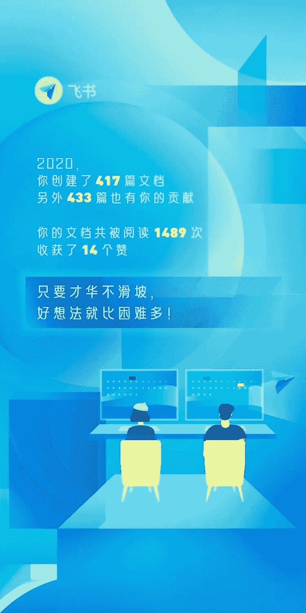

# 法律人如何塑造个人品牌影响力？

> 来源：[https://docs.feishu.cn/docx/EiwWdRos6o53LtxgfQRc9BpEnZc](https://docs.feishu.cn/docx/EiwWdRos6o53LtxgfQRc9BpEnZc)

---

在**这**个时代，影响力已经变成**除权力、财富以外的，第三类“资**产”。

什么是资产？当一样财富可以被提取出来、可以转移、可以运营、可以保值增值的时候，我们才可以称之为“资产”。

这对个人，对企业，都是一件大事。

在过去几年，我们能够看到太多人，把自己的知识变成产品、变成资产，以知识为杠杆撬动更大的影响力，完成个人崛起。

对企业来说，这个问题就更重要了。

华为不是有一句名言吗？企业最大的浪费，是经验的浪费。好不容易培养出来一个优秀员工，一旦离职或者被挖走，就意味着一笔经验和知识的流失。这对于一个知识型组织来说，是实实在在的巨大损失。

个人和组织的利益，难得走到了一起。

是时候塑造个人品牌影响力了。

---

## **1.**从一个飞书文档讲起

我所在的公司在日常办公中，使用「飞书」这个工具进行协同。2020年，我的飞书年度报告显示，过去一年我共创建了 417 篇文档，这些文档共被阅读 1489 次。

这些数据是什么概念？

要知道，去年我们公司总人数还不到 50 人，而且近乎一半的同事都是技术人员，我和他们几乎没有交集。但我创建的文档，却被阅读了 1489 次，平均下来人均阅读 30 次。

这看起来是不是很不可思议？

我仔细回想了一下，能让我看 30 次的文档，好像并不存在。

那这件事是怎么发生的？

我们公司的业务是股权激励，是从法律行业中分化出来的一个分支，但本质上还是属于法律业务，因此专业要求较高。

如果我们要快速发展，就不可避免地会遇到缺人的问题。

首先，做**股**权激励的律师本来就少。其次，招非法律背景的人进来，比如市场、销售、产品、研发部门，都需要培训。

培训当然必不可少，但我觉得并不合理。

第一，培训需要占用我的时间。

第二，即便把培训录成视频，让员工自学，学习效果也不会好。在线教育的“双师辅导”已经成了行业标配，凭什么在我们公司内仅靠员工自学视频就能达到培训效果？

第三，培训也不是一蹴而就的。培训只是一次学习的过程，如果一个人不能持续地学习，那他终究不能学会这一领域的知识。这种人通常会被我们公司开掉，结果就是我花出去的培训时间被浪费掉了。

为了避免我的时间被过度消耗，我创建了一个飞书文档：专业问题咨询手册（160问）—— 将股权激励的绝大部分基础知识，固化成一个可以被广泛使用的知识产品。

学完这个文档，就基本掌握了股权激励的基础知识。如果还没掌握，那就只有两个可能：

第一，你没好好学。

第二，这个文档还不完善 —— 那就迭代它。

如此一来，有自驱力的员工就会成长的越来越快，这个文档也会越来越完善。

现在，每一个新入职的员工进来，这个文档已经成为了必读教材。

当然，除了专业问题咨询手册，我在公司内还创建了很多和团队协作的文档，比如股权基础概念（110个）、内容品控手册、知识日历等等，每一个员工都可以看到。虽然很多新员工都不认识我，我也不认识他们，但他们却可以使用我的知识。这，就叫知识管理。

通过飞书文档，我的时间就被解放了。我不用每次都做员工培训，也不需要回答简单的问题。文档就在这，你可以查看，可以参与。

除此之外，通过文档协作，也帮助公司塑造了一种企业文化 —— 鼓励大家更积极地与他人协作，信息的流通也会更加顺畅。

无独有偶，在飞书 2020 未来组织大会中，笑果文化 CEO 透露李诞在公司内部写了一个 3 万字的工作手册，总结了他这几年做脱口秀和创作的一些基本想法，也是使用了飞书文档这个工具。

这种知识经验的产品化，就是个人品牌影响力的体现。

---

## **2.**个人品牌产品的必备要素

创造产品，是塑造个人品牌的第一步。

设想一下，如果没有产品，你会怎样塑造个人品牌？做一场又一场的培训，参加一场又一场的活动，一张一张地发个人名片......非常**低**效。律师越老越值钱，也有这部分原因。

但现实是，大多数人**都缺乏产品思维去塑造个人影响**力，每个人都有技能，也有优势，更有擅长，但极少人会有意识地将它们产品化。

因此，个人品牌很多时候仅仅停留在潜意识和感性认知层面，缺乏可落地、肉眼可见的产品实现，**没有足够的高频互动、内**容对外传达，缺乏长期一以贯之的坚持。

品牌这东西，就是靠“重复”建立起来的。

您就好比说，我家电梯每天都在放一个拖把广告：黄晓明摸着他的下巴，说，专门做拖把，做的更专业，大卫，拖把专家......

我直接裂开。

（扯远了）那么，如何**打**造个人品牌产品？

首先，如果你在一个组织内，我建议你要打造的个人品牌产品，应该和公司的发展战略紧密结合，这样能够更容易获得组织的支持。

你可以像我一样，将个人经验写成文档。

比如你是个律师，你就可以把你的流程经验，用文字的方式固定下来。

这种知识沉淀，对律所来说是非常宝贵的。但是，我不建议你是为了律所去做这个产品，除非你是律所的管理者，或者律所给你钱。

你做个人品牌产品是为了你自己。你可以将这些个人品牌产品做成文章发布出去，还可以用于以后带团队。

其次，它应该是你热爱的东西。

如果你不喜欢做，那就不要做。

如果你喜欢文字创作，那就以图文为内容体裁将你的知识产品化，没必要非要做视频。

如果你喜欢视频创作，那就以视频为内容体裁将你的知识产品化，没必要非要写长文。当然脚本还是要写的。

只有做自己喜欢的东西，你才能获得长久的乐趣和动力，这也会帮助你的产品走得更长久。

第三，务必要创造价值。

一个产品能走得长远，本质上是因为它解决了某个现实问题，这个问题越是刚需、越有痛点，你的产品价值就越大。

在公司内部，如果你能为同事、为公司提升效率、节省时间、降低成本，以及产出更多解决问题的创新思路和方法，你的产品就会赢得越来越大的影响力。

但是，如果你想做的事情，和你所在的组织没有一点关联，只是你的兴趣爱好，那么......

完全没有问题！

原因很简单，任何产品的尽头都是内容，不论是什么产品，To C 的还是 To B 的，用户永远在消费其中的内容。比如你在淘宝买东西，就要浏览大量内容。

在这个时代，好内容本身就是优质的 Assets ，无形资产。

你做出来一个好内容，几年之后还有人看，这本质上就是在积累资产。而在积累资产的过程中，你其实是快乐的，你会觉得有一种踏实的感觉。

而且，做个人品牌这件事，和年龄无关。

事实上，在很多平台上，你都能看到很多已经不是年轻人、但是非常成功的内容创作者。

在复杂性科学，有一个词叫 Emergence ，也就是“涌现”。你的人生可能会遇到很多坎坷，但只要你不下牌桌，你就总会有机会。

所以说，塑造个人影响力，还挺有意思的。

---

## **3.**影响力是相对的，不必较真

**最后，说了这么多，到底什么是个人影响力**？

对于个**人品牌影响力，市面上的定义**很多，每个人都有自己的理解。

我认为，当你有任何一件值得夸耀的东西，能**够**超出关注你的大多数人，你就有影响力。

这里的关注既包括视频媒体，比如 B 站 ，也包括社交网络，比如微信、微博等。这种拿得出手的东西越多，你就越有影响力。

但需要注意的是，影响力是一个相对概念，和关注你的人进行对比即可。

为什么？

因为和大部分人比没有意义。

您就好比说，詹姆斯作为 NBA 巨星，年入近亿美元，我跟他比没有任何意义。因为我不是 NBA 运动员，我跟詹姆斯根本不在同一个生态位，行业不同，社会不同，文化背景也不同，根本没必要比。

但如果换一个说法，说“贫寒单亲家庭出身的 80 后小镇青年如今年入近亿美金，而你在干什么？”这时，对比就出来了，而且焦虑感也随之而来。

这种话术无视你和詹姆斯之间巨大的不同，而刻意强调相同的地方，比如你们都是 80 后，都是小镇青年，以塑造同一生态位的假象。

当然，我不提倡这种对比，这种内容就是垃圾。但事实就是，只有在同一生态位下，才有必要讨论个人品牌影响力。

只和关注你的人对比，意味着你是在一个限定边界的舞台中起舞，可以帮助你将有限的时间聚焦到真正重要的事情上。

这样，你才能有更多的时间去思考、去做自己想做的事情。然后在未来的某个时点，被链接到趋势里。