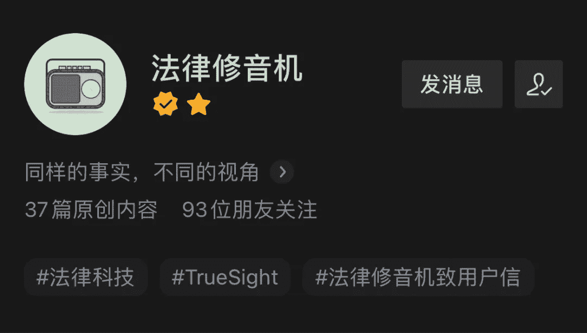
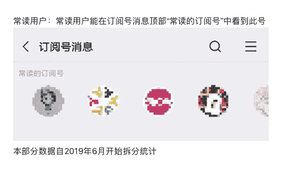
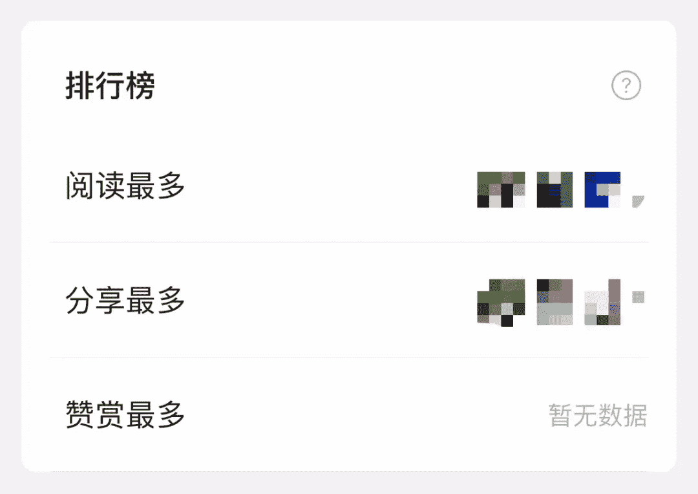

# 谈谈法律类👸号如何冷启动

> 来源：[https://docs.feishu.cn/docx/Gn2cd4GLPocHZLx9eI0cpNNbnLn](https://docs.feishu.cn/docx/Gn2cd4GLPocHZLx9eI0cpNNbnLn)

---

运营👸号正在变得越来越重要。

🛰️作为互联网流量的终点，不论是构建自己的影响力，还是为现在或未来获取客源做准备，👸号都是必做的渠道。

想想一个现实问题：全国都 50 万律师了，律所哪有这么大能耐给全部人供应案源。

但问题在于，做一个👸号并不容易，尤其是冷启动阶段，相当于一个产品的从 0 到 1 。🛰️又极其克制，不做广场也没有推荐 feed 流，这让👸号的冷启动更加困难。

怎么办？

今天就来谈谈这个问题。

---

## **1.**关注只是一次意外

很多做内容的朋友会觉得，用户关注了我，就代表用户喜欢我。其实不然。

首先，关注本身是一个不那么理性的行为，或者说，它往往是一个随性的行为。

事实上，关注并不能精准表达用户的偏好，只**能表达一时的情绪。可能是因为**你的某篇文章写的好，但不代表用户喜欢你。

比如，你可能因为本篇文章关注了「法**律修音机」，但并不代表你喜欢这个号。**

关注后，用户偏好是可能会改变的，👸号在输出频次和内容质量上，未必长期符合你的预期。于是，一篇文章带来很高的关注数，但月底一看，新增关注数却很少，这种情况很常见。原因很简单，由于无法持续输出优质内容，用户过不了多久都取关了。

因此，用户持续关注，其实是一种长期契约。

我持续关注你，是因为我相信你能持续输出优质内容。这和做一门付费课程是一样的。

大家可以想一下，为什么🛰️目前的付费订阅机制只有单篇付费，没有订阅会员专栏？

第一，读者不容易建立对作者长期付费订阅的信任感，作者也很难平衡“免费发文赚声望”和“付费发文赚现金”的利益取舍。

第二，🛰️不能约束作者收钱后持续输出。

付费订阅是长期契约，🛰️没有这个能力和意愿作为平台方维护契约。

其次，用户关注和管理👸号都是成本。

具体来说，用户关注👸号是第一次选择成本，管理👸号是第二次选择成本。

关注👸号的成本很低，一篇文章写的好，可能就引导用户关注了。

但管理👸号是一件麻烦的事。

比如，你关注了几百个👸号，后来你发现某些👸号质量不行，你宁可取关，也懒得去管理。最难取舍的是那些输出质量不稳定的👸号，取关也不是，不取关也不是。

普通用户会明显地感知到关注带来的负面结果，但很难理性地去修订关注列表，从而改变这些负面结果。以至于关注越多，关注带来负面影响的概率就越高。

朋友圈也是一样。很多人抱怨朋友圈质量不行，前几年有微商，这几年也没好到哪去，除非你的好友质量提高了。当然，朋友圈的设定本身就不是一个知识社区。

于是，一些🛰️好友多的人，直接就关闭朋友圈，或者保持现状。然后你会经常听到他们说：某某某的这条朋友圈怎么我没刷到啊？

也就是说，普通用户无力承担任何维护成本，依赖用户手工维护的思路都是不对路的。

关注只是一次意外。不论是平台还是👸号运营者，除了拉新，还需要特别关注“留存”。

那么如何解决呢？

---

## **2.**🛰️“放养”👸号

市面**上的解法很多，但要想知道正确的解法，首先要理解公****众号的本质。

👸号的本质，是因为内**容，去关注一个人。

因此，👸号和用户之间最重要的关系，是“关注关系”。

相比之下，视频号的玩法就更多了。

龙叔在今年🛰️公开课上说：“未来有一天，视频的播放量，关注、好友推荐、机器推荐的消耗比例，应该是1:2:10。”

原因很简单，相比👸号文章，视频内容的流动性更强，所以在关注关系以外，🛰️在视频号引入了机器推荐和社交推荐来做辅助。

与此同时，正是因为视频内容更适合机器推荐，也意味着用户关注的忠诚度会下降。因为用户在消费视频内容时，大家更关注“内容”，而不是“人”。

因此，👸号在算法推荐的应用上非常克制，因为这可能会引导用户关注“内容”，而不是“人”。

这和法律类👸号的需求不谋而合。

大家做👸号是为了追求高阅读量吗？

并不是。是为了获得关注用户，最好能加上🛰️，然后在互动中，用户对你产生信任。

虽然🛰️没有给出👸号冷启动的解决方案，但是提供了很多辅助工具。

比如，推出标签体系，给用户提供辅助信息，用以对👸号进行分层，从而迭代掉不喜欢的标签，帮助用户管理👸号关注列表。

**但事实是效果并不明显，要形成对事情分门别类**的习惯，本身就要培养。

您就好比说，很多人使用印象笔记，经常会出现文件夹管理失控的问题。设置的标签越多，笔记越多，就越容易管理失控。

原因很简单，辅助信息并不能推动用户去删掉一篇低价值的内容，因为低价值 > 0价值。

你会想着或许将来能用得上，留着也没什么坏处。用户这个想法很正常，村上春树也有自己的“抽屉”，以供自己写作时提取素材。

后来，印象笔记推出“知识星图”功能，通过技术帮你管理笔记，来替代手工管理的方式。但我还没用过“知识星图”这个功能，因为我的很多文档工作都慢慢转移到飞书了。

当然，🛰️在单篇文章上的标签体系还是很有用的，比如 XX 位朋友读过、分享过等等。

除了标签体系，👸号还在 PC 端和移动端，提供了强大的数据分析能力。

在 PC 端的👸号后台，👸号在用户增长、用户属性的基础上，新增了“常读用户分析”指标，用以衡量👸号的用户粘性，类似于凯文·凯利提出的“1000个铁杆粉丝”理论 —— 愿意为你付费的粉丝，才是真粉丝。

在移动端的👸号后台：“订阅号助手”App，在“我”-“关注我的人”里面，🛰️还提供了“阅读最多”、“分享最多”数据指标 —— 和常读用户一样，这些都是最忠诚的用户。

不提供直接的冷启动工具，但👸号内容生态就是做起来了。我只能说，很是佩服🛰️的克制，逼着👸号自谋出路冷启动。当然，这种克制也只有在亿级日活下才能成立。

降低成本驱动不了用户，提供价值才能。

我现在看，应该是做聚焦内容价值的增量驱动力，可以是「提高索引效率」或者「对有价值内容的二次review」等IP层面的事情。

---

## **3.**👸号如何冷启动？

由于🛰️不提供直接的冷启动工具，而且现在👸号已经过了早年的红利期，很多运营者发现冷启动非常难。

一方面，传统的引流方式行不通了，比如：

1、用🧣引流：🧣营销号疯狂为👸号引流，但🧣**现在已经禁止了；

2、**👸号互推：找到体量差不多且用户画像一致的👸号，双方共享用户群体，但问题是**现在流量红利已经没了，**如**果你是冷启动，那别人就**不是互推，而是给你做推广；

3、付费请已经做大的👸号推广自己：比如半佛老师的“几个让你目瞪口呆的👸号”就很有效，但大号的价格很贵，而且大号不一定愿意，**因为他要给你背书，他会**顾虑：你的号是否真的有很高的价值？

另一方面，即便通过各种方法引来了一批用户，后面留存做不好，那么还是“流量”。

一个字：难。怎么办？

第一，优质内容是前提。

刚才已经说过，用户关注👸号分为两步：关注和管理。很多人只看到第一步，也就是关注。关注的成本很低，一篇优质文章就可能带来关注。当然生产一篇优质文章并不简单。

但大部分人忽视了管理。管理的意思是，随着用户关注的👸号越来越多，在众多👸号中，他认为你是很有价值的👸号，并且选择持续关注，至少不取关。

你需要通过内容积累起第一批种子用户。

第二，明确自己的定位。

只有在积累第一批种子用户之后，明确👸号定位才是有意义的。

原因很简单，即便你的定位很明确，输出的也是这一类型的文章，然后呢？要知道，用户是通过你的文章来的，你的文章不精彩，用户不关注，那么讨论定位没有任何意义。

因此，👸号冷启动的逻辑是这样的：

1、通过优质内容引来第一批种子用户；2、初步明确自己的定位，持续输出内容；3、经过长期培育，逐渐提高用户粘性；4、在不断输出和获取反馈过程中，逐步形成自己的定位。

第三，找到自己的调性。

做过自媒体的朋友都知道，用同一套方法运营不同的媒体渠道，是根本行不通的。简单来说，就是做内容搬运，把自己在百家号上写的文章，在👸号再发一遍，根本不 work .

为什么呢？

传统平面媒体和网络媒体的共同点是，知道市场需要什么类型的信息，然后以文章的形态，供给有价值的信息，着眼点是信息价值。

比如，百度用户的需求是信息检索，你给他想要的高质量信息，他就很开心。另外还有很多垂直搜索引擎，比如马蜂窝，都一样。

但新媒体不一样，它的着眼点是“独特性”。

最典型的就是👸号。👸号的用户没有明确的需求，更在意信息的独特性和阅读的爽感。

然后，分享到朋友圈。

注意，分享到朋友圈是个很重要的用户行为。纯输入，不输出，这是无法想象的事情。

换句话说，朋友圈是👸号最大的流量入口。

那么，能够让用户分享到朋友圈的文章，基本带有几个特点：主题命中率高、内容有稀缺性，让读者觉得见所未见、行文风格和阅读收益都能带来爽感等等，当然还有很多。

这是需要特别设计的，传统媒体按固定套路去批量制造文章是制造不出来的。

半佛老师在2020年新榜大会上就说过，他是在用产品思维做号。比如他会在文章中设置一些小彩蛋来测试用户反应，用互联网的话说，不就是数据埋点嘛。

虽然我知道用产品思维做内容的道路是对的，但做起来很难。因为我不是全职做内容，时间精力不允许，个人做号的朋友也是如此。如果律所想要把内容做好，最好的方法就是招到会做内容的人，有条件的再扩大内容团队。

所以，好的新媒体文章无法量产，写一篇优质文章是高门槛、高成本的工作。

好的新媒体文章，相当于 UGC 精华帖，而不是传统风格的 PGC 。相比传统媒体文章，它更锐利，更带感，更能调动情绪。

比如，半佛老师的👸号我就很喜欢，他就完全满足了“命中率、稀缺性、爽感”，篇篇10W+。潘乱老师的文章虽然我也很喜欢，但他的👸号这三点都不如半佛。

当然，现在潘乱老师在视频号玩的风生水起，这也印证了👸号的本质是关注“人”。

所以说，👸号主理人的性格，决定了👸号的调性。

当然，形成自己的调性并不容易，现实中有趣的人也很少，但这确实是值得努力的方向。

当我知道这一逻辑之后，我就非常重视增量信息的获取。虽然我做不到半佛老师那么深入，那我起码保证内容是新鲜的吧。

比如，我会购买很多媒体的会员，因为我深知获取高价值信息是很难的，能花钱解决的就花钱解决。前段时间和菜头不是写过一篇文章吗？《有钱人才看新闻》。

胡适先生说，怕什么真理无穷，进一寸有一寸的欢喜。

日拱一卒，还在写就不错了。

是这个道理。