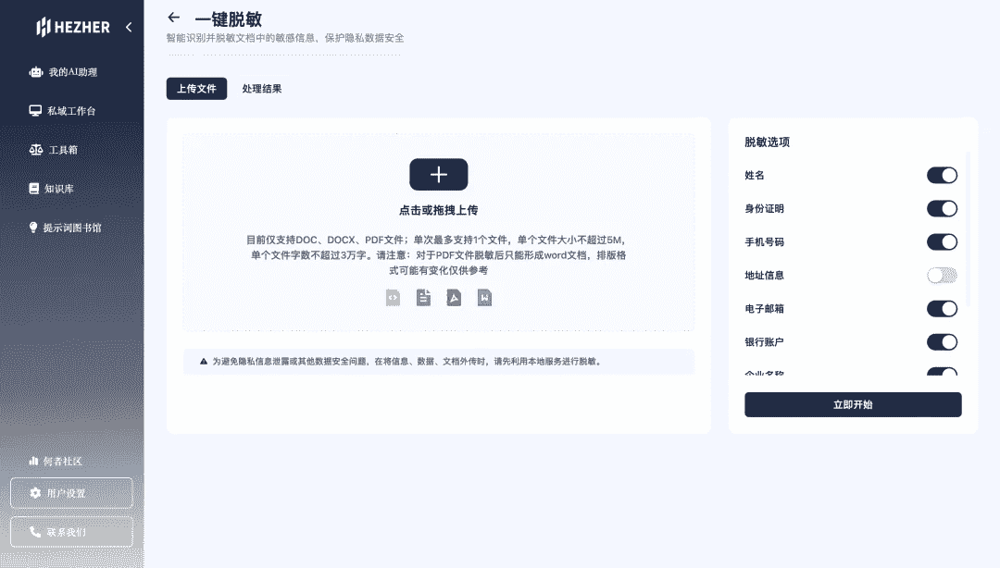

# AI 伦理道德及监管政策

> 来源：[https://docs.feishu.cn/docx/B6godG6S7o7WmIxE9E2cjqa4nZg](https://docs.feishu.cn/docx/B6godG6S7o7WmIxE9E2cjqa4nZg)

---

# **一、引言**

生成式 AI 的出现让很多任务比仅靠人类手动操作更容易完成，法律行业也不例外。目前，许多法律专业人士已经将 AI 整合到日常工作中，并受益于工作效率和服务质量的提高。

但是，法律人仍然需要遵守职业道德义务。

自** 2023 年 **6 月，一名纽约律师向法院提交 AI 生成的虚假案例以来，截至目前全球法律行业已经发生至少 871 起 AI 幻觉案例。为了帮助法律从业者了解 AI 幻觉风险，减少类似错误出现，以及为相关监管部门制定政策或指引提供参考，何者社区收集整理了市面上已知的法律 AI 幻觉案例，以期帮助法律行业负责任地应用 AI。

> 详见：[【幻觉案例库】](https://legalstudio.feishu.cn/wiki/Wu0lwX1gQiTV95koXsHc2exjnQf)（智库会员权益）

AI 在法律工作应用中产生的幻觉，严重影响了法律系统正常运营的秩序。AI 应用的伦理道德问题，已经成为了一个巨大的挑战。对此，很多法院、法官和律师协会，纷纷发布限制或禁止法律从业者及当事人，在法律工作中应用 AI 的命令或指导文件，一些律师事务所、企业法务部门也推出内部治理政策。

从统计数据来看，2023 年 AI 幻觉案件数量较少，但随着时间推移，案件数量总体呈现出快速增长的趋势👇

↗️2023 年：15 件

↗️2024 年：54 件

↗️2025 年：718 件

↗️2026 年：84 件

特别是从 2025 年开始，案件数量出现明显的上升，全年达到 700+，而 2026 年仅一月份就超过 80 件。

值得注意的是，这些案件中使用 AI 的一方，大约 40% 是律师、法官等法律专业人士，未能负责任地验证 AI 输出，存在职业疏忽。同时，高达 57% 的 AI 幻觉案件，则是由未聘请律师、自我代理的当事人发起。

虽然 AI 让普罗大众可以免费获得法律信息，但由于当事人缺乏法律知识和 AI 认知，过度依赖 AI，向法院提交虚假权威、无关材料，导致案件被驳回、可信度受损。这些 AI 幻觉案件极大地浪费法院资源，增加司法负担，导致案件延误，还可能加重当事人的诉讼成本（面临罚款），损害法律专业人士的职业声誉，降低公众对法律体系的信任。

随着 AI 技术在法律行业迅速渗透，全球各地律师协会和法院纷纷组建“AI 特别工作组”、发布指导文件，旨在规范在法律实践中使用 AI 的行为，确保利益相关方在享受技术带来便利的同时，能够遵守职业道德义务。

**据不完**全统计，全球各地已有超过 200 家律师协会和法院，推出了关于 AI 在法律行业应用的指南、政策、指令、规则（含拟议）。为了帮助法律从业者合理地使用 AI，为相关监管部门制定政策或指引提供参考，何者社区对这些指导文件进行汇总分析，梳理监管规则要点，帮助法律行业负责任地应用 AI。

> 如需获取**监管文件资料**，可订阅社区会员：[订阅会员](https://legalstudio.feishu.cn/wiki/DLtSwmrQYibygZklZ4NcuuASnJg)；如需采购**脱敏工具**、法**律 AI 应**用/伦理合规培训/共创大赛、内部政策制定等服务，可咨询何者社区团队📲🛰️：18825075686

# **二、监管规则要点汇总**

## 保密

随着 AI 技术的广泛应用，客户信息面临被 AI 平台收集、共享和不当使用的风险。

对此，监管机构明确要求律师不得在 AI 工具中输入客户的任何机密信息，必须对客户信息进行匿名化处理，确保客户身份不会被识别，除非确信 AI 提供者不会与他人分享数据或将其用于自身（如训练或改进 AI 产品）。

## **保持职业素养**

即便 AI 可以帮助律师更快地完成工作，律师仍然应该充分发挥自己的职业技能和判断力，不应该仅仅依赖 AI 处理需要专业知识的任务，甚至将 AI 用作律师专业判断的替代品。

律师需要了解 AI 工具的工作原理、局限性、对客户数据的处理方式等，可以将 AI 作为一个起点，但不能盲目依赖 AI 的输出、简单相信 AI 的输出是正确的，而是要像审查助理的工作成果一样，审查和验证 AI 输出的内容，并对 AI 输出的内容负责，确保律师能够在技术辅助下，仍然能提供高质量的法律服务。

## 沟通与坦诚

为了保障客户对服务过程的知情权，律师应该考虑向客户披露在代理过程中使用 AI 的方式和情况、好处及风险，这样客户可以更好地参与到服务中，增强对律师工作的理解和信任。

需要注意的是，不同地方的监管机构根据实际情况，明确了律师需要向客户沟通的具体情形，律师是否需要向客户披露 AI 的使用情况取决于具体案件的事实（即披露 AI 的使用不是必要的），让相关规定更具可操作性。例如，当客户询问律师如何开展工作、是否使用了 AI 技术，或者客户在委托协议或外部法律顾问指南中明确要求披露律师使用 AI 情况时，那么律师就必须披露。同时，如果律师提议将与代理相关的客户信息输入 AI 工具中，或者使用 AI 工具的输出将影响代理中的重大决策，比如评估诉讼结果或陪审团选择，律师也应该与客户沟通并获得知情同意。

类似的，律师在法院程序中使用 AI 时，也要确保提供信息的准确性，并遵守所在司法管辖区关于 AI 的任何规则，比如向法庭披露使用 AI 的情况，以维护司法程序的严肃性。

## 对 AI 的使用进行

为了避免使用 AI 时的潜在风险，律师事务所应该制定使用 AI 技术的内部政策，明确 AI 的使用方法，并确保律所的律师和非律师人员使用 AI 时严格执行，比如提供培训，包括 AI 的基础知识、能力和局限性、使用 AI 的伦理问题、数据安全、隐私和保密的最佳实践等，规范律所内部使用 AI 的行为，以避免因不当使用给客户和律所带来风险。

## 合理收费以及广告营销

在收费方面，如果律师使用 AI 更有效地完成工作，应该按实际工作时间合理计费，而不能就在没有 AI 辅助的情况下花费的时间或使用 AI 节省的时间收费，以维护客户的利益。

在广告方面，律师在使用生成式 AI 聊天机器人开展宣传时必须告知潜在客户，他们正在与 AI 程序进行沟通，防止 AI 向潜在客户提供误导性信息或以胁迫性的方式进行沟通。同时，除非客观且可核实，否则律师不能声称他们的 AI 工具优于其他律师或律所使用的 AI。

# 三、对于法律人如何拥抱 AI 的建议

## 主动学习

主动学习是法律人拥抱 AI 的基础。只有深入了解 AI 的工作原理、优点与不足，才能在实践中合理地运用 AI 工具，避免因对技术的无知而导致的风险出现，如盲目相信 AI 生成的不准确内容。通过学习，法律从业者将能够更好地将 AI 技术与自身专业知识相结合，提升工作效率和服务质量。当下，AI 技术更新迭代迅速，法律人只有不断补充相关知识，才能准确把握技术的发展方向。同时，法律人也有义务对不断发展的技术（包括 AI）保持充分了解。

具体来说，法律人可以参加专业培训、研讨会，或者向了解 AI 用途和局限性的专业人士（如 IT 专家）寻求帮助，持续学习 AI 在法律领域落地应用的知识，了解不同工具的功能特点，结合自身需求选择适配的工具，同时学习和借鉴其他同行的成功经验，快速掌握工具的使用方法。

**🤖推荐工具： **

## 建立内部规范与协作机制

建立内部规范与协作机制，可以让组织内部的 AI 应用更加有序。明确的职责划分可以避免责任真空，团队协作与反馈则能促进 AI 工具与业务深度融合，最大化发挥技术的价值。

例如，在引入 AI 工具前，律所可以组织律师和技术人员等进行多方面评估，分析工具可能带来的收益与风险。在使用过程中，定期收集反馈，根据实际情况调整 AI 工具的使用流程和规范，让工具能更好地服务于业务开展。

**🤖推荐工具：H**EZHER 本地化脱敏产品

同时，律所还可以在内部建立 AI 使用规范，明确不同岗位人员在 AI 应用过程中的权限和职责，比如律师助理可以使用 AI 辅助工作，而律师则需要负责最终审核。此外，还可以鼓励团队分享 AI 使用经验，这样有助于在内部形成良好的协作氛围，提升律所整体的 AI 应用水平。

**🤖推荐服务：法**律 AI 通识课程——详见：赛博法律指北｜法律 AI 通识课 .pptx｜盈科山东首届法律 AI 共创大赛

## 注重风险防控与合规应用

风险防控与合规应用，安全使用 AI 的保障。AI 技术带来了便利，也伴随着诸多潜在风险（如幻觉、数据泄露），只有提前做好风险评估和合规审查，才能在享受 AI 技术红利的同时，避免陷入法律或职业道德纠纷。

对此，法律从业者应该建立风险评估机制，对使用 AI 技术可能导致的信息泄露、输出错误等风险进行提前预判，并制定相关应对措施。例如，律师在使用 AI 工具处理敏感案件信息前，需要对工具的安全性进行全面检测，审查工具的使用条款，确保符合保密性要求，并明确双方在数据安全保护、责任承担等方面的权利义务，避免选择缺乏足够保密性和安全性的 AI 工具，以降低潜在风险。同时，不得输入客户的任何机密信息，必须匿名化处理。

**🤖推荐工具：法**律 AI 产品评测——详见：

## 以客户利益为导向优化服务

以客户利益为导向是律师行业的核心原则，在使用 AI 方面也应围绕这一原则展开。

具体来说，律师可以通过 AI 技术提升服务速度和质量，结合客户的实际需求调整和优化自身服务模式，这样不仅可以更好地满足客户需求，也能增强律师自身的市场竞争力，实现技术应用与业务发展的良性循环。

例如，对于注重成本控制的客户，律师可以考虑通过 AI 优化工作流程以降低服务费用；对于追求高效解决问题的客户，律师可以利用 AI 快速响应客户咨询、加快案件处理进度，实现个性化的服务；对于追求服务质量的客户，律师可以借助 AI 对案件进行多维度分析，从而为客户提供更全面的解决方案。同时，律师还可以考虑将 AI 的使用情况如实告知客户，让客户直观感受到技术带来的服务升级，增强对律师工作的满意度。

**🤖推荐阅读：温**和的奇点：AI 时代，法律科技的两个新机会

# 结论

总的来看，监管机构针对 AI 在法律行业应用发布的指导文件，从保密、职业素养、沟通与坦诚、监督、律师广告与费用等多个方面进行了规范。这些规定虽然存在一定差异，但总体目标一致，即确保法律从业者在使用 AI 技术的同时，也要遵守职业道德，保护客户权益，维护法律行业的公正与诚信。通过本报告的汇总分析，希望能为法律从业者提供全面、清晰的指引，促进 AI 技术在法律行业以符合伦理道德的方式落地应用。

**然而，AI 的飞速发展也对监管带来了挑战，现有的监管框架可能很快过时，需要适应 AI** 的发展而不断优化，法律专业人士、技术专家和监管机构之间的对话与合作，至关重要。

> 如需获取**监管文件资料**，可订阅社区会员：[订阅会员](https://legalstudio.feishu.cn/wiki/DLtSwmrQYibygZklZ4NcuuASnJg)；如需采购**脱敏工具**、法**律 AI 应**用/伦理合规培训/共创大赛、内部政策制定等服务，可咨询何者社区团队📲🛰️：18825075686