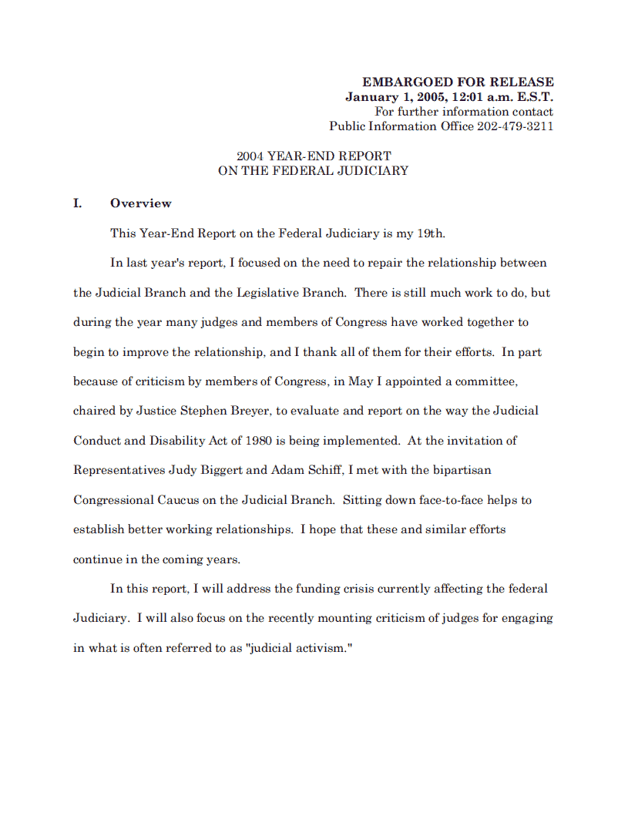
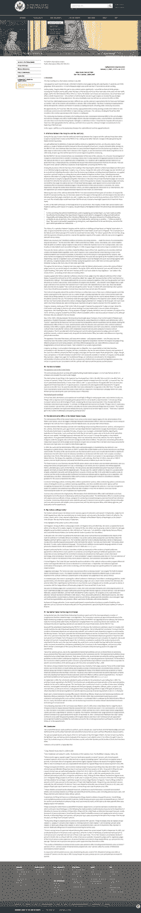
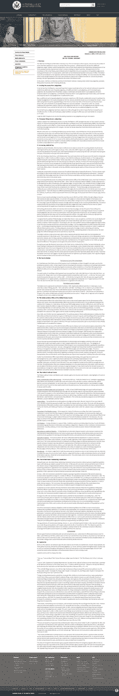
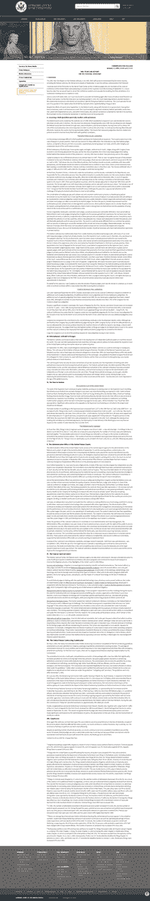
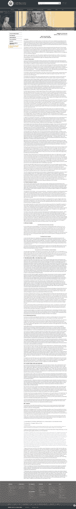
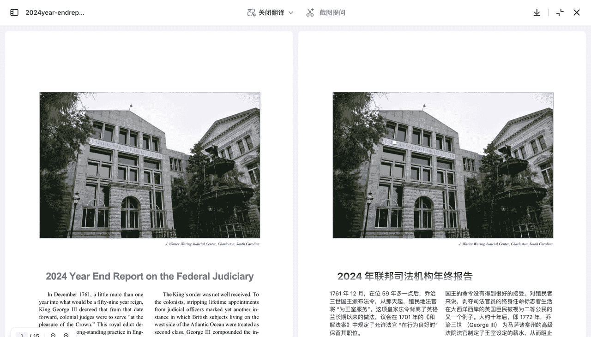

# 美国首席大法官发布《2025 联邦司法年终报告》，附历年报告（2000-2025）

> 来源：[https://docs.feishu.cn/docx/HmP2d0HKGovxZhx684qcpzSxnbd](https://docs.feishu.cn/docx/HmP2d0HKGovxZhx684qcpzSxnbd)

---

**2**025 年 12 月 31 日，美国首席大法官小约翰·G·罗伯茨正式发布《2025 年联邦司法年终报告》。

每年，美国首席大法官都会发布一份《联邦司法年终报告》，在报告中讨论一个与整个美国联邦法院系统都相关的重要议题，并展示各级法院工作量情况，为司法工作提供数据参考，也让公众了解司法运作的情况。

[2023 年，罗伯茨大法官在报告中重点探讨了 ](https://mp.weixin.qq.com/s?__biz=MzUzOTcwMTE5OQ==&mid=2247486658&idx=1&sn=e05648d1a1bcc6e1abb55032a224b128&scene=21#wechat_redirect)AI 对法律行业的影响，呼吁法院积极拥抱。2025 年，美国最高法院因对特朗普总统表现出顺从姿态，饱受美国媒体和坊间舆论的批评。在 2025 年终报告中，罗伯茨大法官延续 2024 年终报告的主线，重点论述了司法独立的重要性，以及当前司法面临的威胁，呼吁各方共同努力维护司法独立和法治。

**法律修音机收集了美国历任首席大法官发布的《联**邦司法年终报告》（2000-2025）：

[2025 年终报告.pdf](https://internal-api-drive-stream.feishu.cn/space/api/box/stream/download/all/G1z4b6ZyZocCvix9ZnScX6fvnkh)

[2024 年终报告.pdf](https://internal-api-drive-stream.feishu.cn/space/api/box/stream/download/all/JL5ibcjqxoXcm1xQt5ocNxeIn1f)

[2023 年终报告.pdf](https://internal-api-drive-stream.feishu.cn/space/api/box/stream/download/all/Jmd0b8hzQo6eF2xXdbwcnHzqnCg)

[2022 年终报告.pdf](https://internal-api-drive-stream.feishu.cn/space/api/box/stream/download/all/BAdVb6JHfowQGOxT7N7cenVOnVf)

[2021 年终报告.pdf](https://internal-api-drive-stream.feishu.cn/space/api/box/stream/download/all/UyNyb6SsLoORW1xSjEEc7GvTnxf)

[2020 年终报告.pdf](https://internal-api-drive-stream.feishu.cn/space/api/box/stream/download/all/UbD9bpPqEoUzJpxa42ucyJ6Zn3d)

[2019 年终报告.pdf](https://internal-api-drive-stream.feishu.cn/space/api/box/stream/download/all/MqJ3byUzjo6nH8xyKztcuZOdndb)

[2018 年终报告.pdf](https://internal-api-drive-stream.feishu.cn/space/api/box/stream/download/all/DeL5bZl4ToYBjoxpZxXcFiR7ndc)

[2017 年终报告.pdf](https://internal-api-drive-stream.feishu.cn/space/api/box/stream/download/all/WDJHbchBpo8e5dxB7E2clcijnpc)

[2016 年终报告.pdf](https://internal-api-drive-stream.feishu.cn/space/api/box/stream/download/all/BnmZbpdbzo6U1OxK7e7chutYnLc)

[2015 年终报告.pdf](https://internal-api-drive-stream.feishu.cn/space/api/box/stream/download/all/XExqbVRBDoxFT0xPeSdcScRlnfc)

[2014 年终报告.pdf](https://internal-api-drive-stream.feishu.cn/space/api/box/stream/download/all/H4O8b5jDgoADCvxNnUBcQ96cnqc)

[2013 年终报告.pdf](https://internal-api-drive-stream.feishu.cn/space/api/box/stream/download/all/EGr2bdl7xoj86bxSHVzcQXRAnnc)

[2012 年终报告.pdf](https://internal-api-drive-stream.feishu.cn/space/api/box/stream/download/all/GGT4bkljmo9MDYxDIiHcAQTdn3g)

[2011 年终报告.pdf](https://internal-api-drive-stream.feishu.cn/space/api/box/stream/download/all/NMILbj3j6oQj89x4GPJcbbrWnac)

[2010 年终报告.pdf](https://internal-api-drive-stream.feishu.cn/space/api/box/stream/download/all/G7Yabfv9xoq3OJxECVccQrh0npc)

[2009 年终报告.pdf](https://internal-api-drive-stream.feishu.cn/space/api/box/stream/download/all/At7GbrW2Sok6kMxXVW8cFRbHn4f)

[2008 年终报告.pdf](https://internal-api-drive-stream.feishu.cn/space/api/box/stream/download/all/VLzpbVIMdoi7iixrP46cFJHEnvb)

[2007 年终报告.pdf](https://internal-api-drive-stream.feishu.cn/space/api/box/stream/download/all/UXJ7bnLX9oP6y9xiw7Scc38kn7b)

[2006 年终报告.pdf](https://internal-api-drive-stream.feishu.cn/space/api/box/stream/download/all/Jxrnb6oOBonEtvxk4RBcqUREnqe)

[2005 年终报告.pdf](https://internal-api-drive-stream.feishu.cn/space/api/box/stream/download/all/IfAmbgk9Uoyy1zxLnCacaczhnCh)

[2004 年终报告.pdf](https://internal-api-drive-stream.feishu.cn/space/api/box/stream/download/all/RneFbj5byoSwYMxs9f0ctz6fnJb)

[2003 年终报告.pdf](https://internal-api-drive-stream.feishu.cn/space/api/box/stream/download/all/URo3bnSF8ohstFxpmf5cvXKKnzd)

[2002 年终报告.pdf](https://internal-api-drive-stream.feishu.cn/space/api/box/stream/download/all/RBSebX7pxovwYQxNSr1cJSVknmd)

[2001 年终报告.pdf](https://internal-api-drive-stream.feishu.cn/space/api/box/stream/download/all/HdRKbsgxiokkH1xID9EcMIyQnNm)

[2000 年终报告.pdf](https://internal-api-drive-stream.feishu.cn/space/api/box/stream/download/all/NwZGbVcDMoPWYoxubRNcHmy0njg)

信息来源：https://www.supremecourt.gov/publicinfo/year-end/year-endreports.aspx

法律修音机不提供中文翻译，读者可以使用 AI 工具辅助阅读：

**示例：使用「豆包」翻译阅读**

将文件上传到豆包后，右侧有「翻译全文」的选项，可以左右分屏、中英对比翻译，而且免费。

示例：使用「秘塔 AI 专题库」辅助阅读：

美国历任首席大法官发布的 26 份《联邦司法年终报告》（2000-[2024）已全数上传到秘塔 AI](https://mp.weixin.qq.com/s?__biz=MzUzOTcwMTE5OQ==&mid=2247489851&idx=1&sn=faa55058950fbea3e94ae4daf472eaf3&scene=21#wechat_redirect) 专题库，用户可以在该专题库自由提问。使用方法：秘塔 AI 搜索+知识库：每家律所，每个律师，都可以拥有一个强大的 AI

🔗 专题库链接：https://metaso.cn/s/6b0YwFi

---

Created by Hezher