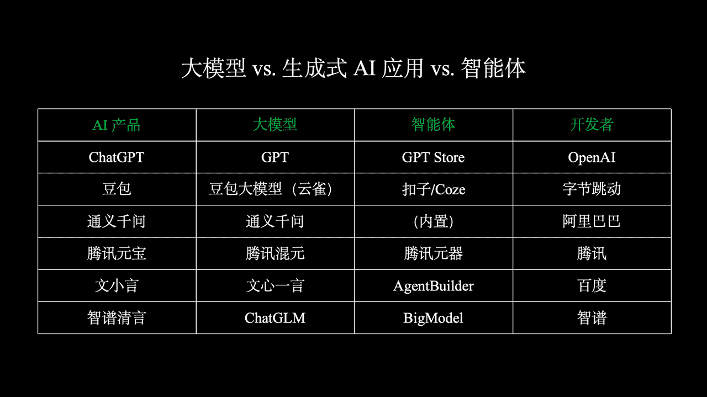

# 法律 AI 应用学习手册（Beta）

> 来源：[https://docs.feishu.cn/docx/RQL0dXkrhoZmDsx2umrcZLqCnqf](https://docs.feishu.cn/docx/RQL0dXkrhoZmDsx2umrcZLqCnqf)

> 本手册旨在为法律从业者、科技爱好者，提供 AI 及法律科技的系统性学习路径与实战指南，帮助大家更好地利用法律科技提高自身效率。

> 《法律 AI 应用学习手册》目前为 1.0 版本，由「何者 Hezher」社区发起，与多位社区伙伴共创，在此，特别感谢以下共创伙伴的支持和推荐：

> [法天使-中国合同库](https://legalstudio.feishu.cn/docx/RQL0dXkrhoZmDsx2umrcZLqCnqf#D02Ydeyoao8yCyxEzjscxpj4nod)

> [潘扬｜植德律所首席运营官](https://legalstudio.feishu.cn/docx/RQL0dXkrhoZmDsx2umrcZLqCnqf#FsY8dQ4CooeOMyxM3pVcjaebn31)

---

# 第一章｜应用场景：AI 改造法律行业的三大场景和案例

## **一、工作提效革命**

+   **法律检索/研究**

在法律数据库中集成 AI 技术，通过分析法律大数据，支持通过自然语言搜索法律法规、案例和期刊等，进行总结提炼，并提供权威的来源以避免幻觉，可以更高效地获取需要的信息，帮助律师洞察法官的判决模式和倾向，为律师代理案件和法官审判提供有力支持，并自动执行后续的庭审流程，或者开展法律研究等。

+   **合同起草审查**

利用 AI 技术实现智能合同分析、搜索、起草、审查，提高法律专业人士的合同工作效率，也可以辅助销售环节，促进谈判交易进程。部分产品还支持多人在线协作编辑合同，产品边界扩展到文档自动化领域。

## **二、管理提效革命**

+   **简介**：以前，组织内的协作方式是人问人，比如律师想查询案件在律所内部是否存在利益冲突，或者有哪些管理规定，通常都是问行政助理，效率很低。现在，AI 有强大的推理和生成能力，可以阅读文档并提取关键信息，帮助用户快速地获取到想要的信息。也就是说，AI 可以把组织的知识串联起来，让知识流动起来。

+   **内部：知识管理升级**

使用组织内部的规章制度和专业文件训练 AI 问答机器人，回答内部常见问题。同时，AI 机器人还可以和组织正在使用的各种系统打通，帮助组织更好地使用内部数据，提高内部工作效率，从而提高客户交付质量。

+   **外部：客户服务升级**

在律所的官网和社交媒体等对客渠道，上线 AI 客服，24 小时全天候回复客户咨询，帮助用户更好地找到所需的官网页面及信息，并引导客户找到律师的介绍信息和联系方式。

## **三、创收新场景**

+   **简介**：AI 可以极大地提升法律工作效率，借助 AI 的能力，律师可以发掘出新的创收场景。

+   **批量处理案件**：通过 AI 大幅提高工作效率，从而大幅提升创收。

+   案例：利用 AI 批量筛查知识产权侵权。

+   **法律服务产品化**：利用 AI 开发法律科技小工具，可以按照 SaaS 年费的收费模式出售给客户，也可以作为现有服务的增值服务，或者作为现有服务的引流工具。

+   案例：利用 AI 开发企业合规自检工具。

+   推出 AI 内容或工具进行引流获客：推出 AI 相关的内容或工具，批量触达新客户、维护老客户。

+   案例：随着 AI 应用快速增长，生成式 AI 相关的知识产权问题成为了法律诉讼的关键，同时全球监管部门也在积极推出监管政策 —— 仅在 2024 年，美国各州的立法者就提交了 400 多项与 AI 有关的法案。

+   Gowling WLG：推出一个名为“Saturn”的法律 AI 产品，可以识别假冒产品、侵权网站和在许多全球最大的在线市场、社交媒体平台、搜索引擎和视频流媒体网站上的非法广播。

+   Bryan Cave Leighton Paisner：推出一个按州划分的立法提案地图，这个地图跟踪了美国各地提出、失败和颁布的 AI 监管法案，旨在帮助使用 AI 技术的企业了解合规义务。

+   Norton Rose Fulbright：推出一份 AI 的知识产权问题相关的指南，研究了全球的法律规定，分析侵犯版权、知识产权、信息和责任保密的规定，为客户和法律专业人士提供参考。

+   **营销物料快速生成**：利用 AI 快速生产营销物料，批量触达新客户、维护老客户。

# 第二章｜学习路径：法律人应用 AI 的三个等级和行动指南

## 🥉 青铜：通用工具基础能力释放

**简介**：初次接触 AI 技术，我们需要了解必要的 AI 基础知识，这样将有助于我们更好地使用这项技术；同时，积极探索各类 AI 工具的使用方法，将各类 AI 工具应用于自己的实际工作中。

**学习目标**：这个阶段，我们需要理解 AI 技术的核心概念、技术边界与伦理问题，以及 AI 在法律行业的应用场景。同时，掌握主流 AI 和法律科技工具的应用场景与操作技巧，从而有效提高工作效率。



> 附：[法律人应该知道的人工智能词汇表](https://legalstudio.feishu.cn/wiki/GR8PwMp3niZxzakmuHYcCm1GnLh)

### 常用 AI 工具

| AI 工具 | 产品链接 |
| --- | --- |
| DeepSeek | https://chat.deepseek.com |
| Kimi | https://kimi.moonshot.cn |
| 豆包 | https://www.doubao.com/chat |
| 腾讯元宝 | https://yuanbao.tencent.com |
| 通义千问 | https://tongyi.aliyun.com |
| 智谱清言 | https://chatglm.cn |
| ChatGPT（海外产品） | https://chatgpt.com |
| Grok（海外产品） | https://grok.com |
| Claude（海外产品） | https://claude.ai |

### 提示词（Prompt）

「提示词」是我们与 AI 交互的桥梁。熟练掌握提示词设计方法，我们就可以使用各种 AI 工具处理日常工作。

**【总原则】**明确、清晰 —— 尽可能做到

**【基础公式】**角色+背景+任务+要求

**【示例】**使用 AI 工具审查合同

```
#角色描述指令：作为一名经验丰富的律师，你熟悉中国法律法规，擅长审查并修改合同。
#背景描述指令：你的委托人（甲方－出租方）即将签署一份《房屋租赁合同》。

#任务指令：

第一种情况，针对性审查某一条款或部分内容的一系列指令。
明确审查焦点：聚焦合同中的租金条款，尤其是支付方式、支付周期、押金金额及退还条件、续租及提前终止等细节。
法律合规性：根据《民法典》、相关司法解释等法律规范关于房屋租赁的规定，审查上述列举的合同条款是否合理。
风险识别：分析租金与押金条款是否存在对出租方（甲方）不利的因素，比如押金过低可能无法覆盖损失的风险等。
具体修改建议：基于前述评估结果，针对所发现的问题，提供修改建议及理由，列出建议修改的部分、替代措辞或新增条款，但不直接修改原，在合同原条款上直接作出修改，并在修改处下方使用批注形式明确标注修改内容及修改理由。

第二种情况，针对整个合同全面审查。
确立审查立场：以最大化维护出租方（甲方）利益为核心，结合上述供参考的审查清单，全面审查合同各个条款，确保在房屋使用、维修责任及违约责任等各方面均对甲方有利。
法律合规性及风险识别：审查合同内容是否符合《民法典》以及相关司法解释等法律规范的规定，识别对甲方潜在不利的法律风险或模糊表述，尤其是关于租期、续租条件、提前终止等条款。
具体修改建议：同第一种情况。

#要求指令：确保法律规范的有效性：
在审查合同时，务必审查文本中法律规范的有效性，确保均为最新的法律条文及司法解释等；
确保合同文本的准确性：在完成所有审查之后，进行全面的语言校对，更正文本中所有错别字、语法错误以及不规范的标点使用并将错误标注。
```

**【学习资料】**[1.2 Prompts（提示词）](https://waytoagi.feishu.cn/wiki/Q5mXww4rriujFFkFQOzc8uIsnah?from=from_copylink)

**【注意事项】**提示词只是一个工具，用来提醒你：如何像和一个正常人交流一样和 AI 对话 —— 在与人交流时，对方可能知道某些背景信息，但 AI 不知道，所以要给 AI 更多上下文信息，这背后代表了我们作为人的独立思考能力，如果完全依赖提示词，我们很容易变成 AI 的傀儡。提示词可以成为你的工具，但不能用来代替你思考。

## 🥈 白银：专用工具深度协同

**简介**：与通用 AI 工具相比，专业级的法律 AI 工具、专注于特定领域的智能体（如“AI 合同审查工具”），本质上是对提示工程和数据集的封装，在处理特定问题时表现更好，而且可以免去很多繁琐步骤（如每次都要写大段的提示词），是我们必备的工具箱。对于法律专业人士来说，用好现有工具，是性价比最高的方法。

**学习目标**：这个阶段，我们需要知道市面上有哪些好用的 AI 及法律科技工具，熟练使用这些工具；同时，在使用工具的过程中，梳理自己的工作流程并加入 AI 赋能，探索出人机分工优化的模式，实现「AI 工具-业务流程-质量控制」的闭环设计，甚至重新思考原有工作流程，发掘新的商业模式。

### 法律科技工具图谱

<https://legalstudio.feishu.cn/share/base/view/shrcndoQ1dNfaFjK98BbP99kwWZ?iframeFrom=docx&ccm_open=iframe>

> 附：[【工具推荐】法律场景最好用的 AI 产品清单](https://legalstudio.feishu.cn/wiki/D1BJwh3pniPCDgkaj1ocn8o9noe)

### 法律 AI 应用最佳实践

+   作业端：

+   合同起草审查：[【工作流】AI 合同审查](https://legalstudio.feishu.cn/wiki/TO21wvmBtiFSyJkzQxYcNTU9n2b)

+   法律研究与诉讼实务：[【工作流】AI 法律问答](https://legalstudio.feishu.cn/wiki/Dxu9w1tbIim500kQb2XcyOomnpd)

+   阅读外文网站或文章：[【工作流】阅读外文网站/文献](https://legalstudio.feishu.cn/wiki/FuKWw2NuSiQKYxkyBP3cXpytnDL)

+   营销端：

+   撰写👸号文章：[【工作流】写👸号文章](https://legalstudio.feishu.cn/wiki/FaHOwcCtRibV15kBC38c2Dptndg)

+   工具：[各类 AI Chat 工具](https://legalstudio.feishu.cn/docx/RQL0dXkrhoZmDsx2umrcZLqCnqf#JIiydVqcmogaWixixDwctHNjnRc)

+   文章选题管理：

+   教程：法天使视频号-视频回放-对 AI 的认识及应用实例

+   工具：飞书-多维表格

+   分享人：常金光｜法天使创始人

+   管理场景：待补充

### 利用 AI 改造工作流

熟悉使用提示词与 AI 互动后，我们可以尝试根据不同工作场景，梳理自己的工作流程/操作步骤，然后在不同环节中加入各类 AI 工具进行赋能，逐步构建自己的工作流改造 Checklist，提高日常工作效率。

【示例】使用 AI 工具审查合同

```
根据特定需求选择或者设计合适的 AI 智能体（非必需操作）—— 可以自己搭建专属合同审查智能体  
对合同信息进行脱敏，然后上传脱敏版合同（Pdf/Word/文本）—— 可以本地化部署脱敏工具
上传供 AI 参考的审查清单（非必需步骤）——平时多多收集审查清单，或者用 AI 辅助生成
输入指令（可根据具体情况对提示词作出删减）
根据 AI 输出的结果追加新指令（可根据具体情况进行多轮追问）
使用多个通用 AI 工具交叉询问开发思路
使用专业级法律科技工具对 AI 生成的结论进行结果验证  
得到 AI 的最终输出结果，并进行人工筛选及复核
长期保留对话记录（对于需要长期跟进的事项，作为辅助记忆的工具） 
```

> **实战任务**：

1.  使用通用 AI 工具完成一项法律工作（如法律/类案检索、生成一份简单的合同模板），通过不断调整提示词，以达到更好地 AI 输出结果。

1.  使用 Prompt 优化法律咨询问答结果

+   网址：http://deepseek.com

1.  使用「法天使」起草一份简易合同模板

+   网址：https://www.fatianshi.cn

1.  使用「案牍」完成一份合同的风险点审查

+   网址：https://screen.autodocs.cn/contract/home

## 🥇 黄金：自研工具价值创造

**简介**：智能体，是对 AI「提示词」和「知识库」封装形成的专有 AI 工具。通过封装专有提示词和知识库，AI 将更懂你擅长的业务和你的使用习惯，而且可以免去每次都要写大段提示词的繁琐步骤，使用体验更好。

为了构建自己的专属智能体，我们需要：熟练掌握提示词设计能力（“青铜级”能力）、详细拆解工作流程（“白银级”能力），有意识地收集整理特定领域的知识库，并按照 AI 友好的数据格式整理知识。

**学习目标**：轻量化开发，搭建法律 AI 智能体

**推荐平台**：低代码智能体平台

| 智能体平台 | 产品链接 |
| --- | --- |
| 扣子 | coze.cn |
| 腾讯元器 | yuanqi.tencent.com/ |
| Dify（须魔法） | [dify.ai](http://dify.ai) |

### 搭建专属智能体

搭建专属智能体很简单，登陆智能体平台，按照平台指引输入智能体名称简介、撰写提示词、上传知识库即可。

【指引】以腾讯元器为例：[腾讯元器操作指引](https://legalstudio.feishu.cn/wiki/TUCew9M9ZinzYNkLX08cnsTjnjg)

需要注意的是，AI 智能体输出的质量与知识库的质量有很大的关系。其中，AI 训练过程遵循“思维链”（COT），模拟人类的思考模式，对应不同的“知识点”，因此按照思维链的方式整理知识点，将有助于提供 AI 输出的效果。

【示例】思维链

```
# 上下班途中受伤的工伤认定
- 判断事故类型
- 确认事故责任
- 判断时间合理性
- 判断路线合理性
```

【示例】知识点

```
# 时空要素相关知识
Q1：如何判断“合理时间”？
A1：基于《工伤保险行政案例若干规定》第6条
- 正常上下班时间
- 加班加点时间
- 单位临时指派工作时间
- 结合当地交通状况的合理通勤时间
Q2：如何判断“合理时间”？
A2：依据司法实践标准
- 工作地与住所地之间的常规路线
- 接送子女、购买生活必需品等日常生活所需的适当绕行路线
- 多个工作地点之间的必经路线
- 异地工作地城际往返路线

# 责任认定相关知识
Q1：如何确定“非本人主要责任”？
A1：基于交通事故处理规则
- 以交警部门出具的事故责任认定书为准
- 人民法院生效判决认定
- 其他有权机构的结论性意见
```

### 设计 AI Agent 工作流

构建智能体时，除了封装提示词和上传知识库，还可以设计「工作流」，让 AI 自动执行某些工作任务。

对此，我们需要：熟练掌握提示词设计能力（“青铜级”能力）、详细拆解工作流程（“白银级”能力）、了解如何搭建智能体（“黄金级”能力），还要熟悉各种互联网工具，以及一定的编程能力。

### 本地化部署 AI 模型和知识库构建

待补充

> **实战任务**：设计一个自动化催告函生成流程

## 💎 钻石：系统性部署 AI，重塑组织工作流程

对于律所/公司而言，通过前述几个阶段，我们已经在组织内部建立了拥抱技术的文化氛围，培养了律师应用法律科技和 AI 工具的能力，甚至还孵化了若干个 AI 小工具，这时我们就可以开发新一代组织工具（集成 OA、CRM、知识管理等律所常用系统），重塑组织的工作流程，发掘新的商业模式 —— 新质律所将由此诞生。

## 🃏 王者：持续关注 AGI 的发展，探索人与 AI 该有的协作方式

AGI 是一个拥有历史上所有知识（主要指已经写出来的知识，如全量纸质书籍）的智能，也就是说，对于历史上所有人类知识可以回答的问题，都不再需要人类的介入。因此，人类通过现有的语言表达方式（如各种提示词）与其交流，并要求 AI 按照特定形式输出，就像原始人用他的语言和高等文明交流一样，是很奇怪的。

当然，人类仍然具有不可替代的价值，尤其是大脑中还未写出来的知识、人与人之间的情绪价值、美好的品质，当 AGI 来即将来临的当下，我们需要持续关注 AGI 的发展情况，探索人与 AI 该有的协作方式。

# **第三章｜学习资源与共创计划**

## 📚 AI 及法律科技学习资源

+   Legal Studio 法律科技智库

+   [通往 AGI 之路](https://waytoagi.feishu.cn/wiki/space/7226178700923011075?ccm_open_type=lark_wiki_spaceLink&open_tab_from=wiki_home)

+   [OpenAI 学院](https://academy.openai.com)

+   微软 Copilot 法律场景库

## ⚙️ 法律 AI 开源社区与数据集

+   **中国裁判文书网：**中国司法数据集

+   网址：wenshu.court.gov.cn

+   Harvard Case Law：美国判例数据库

+   网址：[case.law](https://case.law/)

+   **HuggingFace：**法律大模型汇总

+   网址：https://huggingface.co/models?other=legal

+   **HF for Legal：**开源社区 Huggingface 上的法律开源社区，可以免费获取各个国家的法律模型和数据资源

+   网址：huggingface.co/HFforLegal

+

## 🙌🏻 社区共创计划

何者 Hezher 法律科技社区开放共创，诚挚邀请各位同行者一起共建。

目前，社区正在建设的项目包括：

1.  法律 AI 及科技工具测评

1.  法律 AI 应用场景及提示词库

1.  法律 AI 相关优质文章库（含外文翻译）

## 🏗️ 社区建设路线图

+   2025 Q2：上线《法律 AI 应用学习手册 1.0》、法律智能中台（Beta 版）

+   2025 Q3：上线交互式法律 AI 工具导航地图 1.0

+   2025 Q4：发布《法律 AI 伦理白皮书》社区版

# **🤗 社区伙伴 & 致谢**

这里是由一群热爱法律的技术派共同建设的 AI 知识库，大家一起贡献和整合各种 AI 资源，广大的法律人和技术人都可以在这里学习各种法律+科技的知识、各类 AI 工具和实战案例等。

在搭建知识库的过程中，特别感谢一直以来共建、支持和推荐本知识库的伙伴们！正是你们的肯定与支持，使得我们有信心持续地为知识库添砖加瓦，探索「AI+法律」的无限可能。

## [法天使-中国合同库](https://legalstudio.feishu.cn/wiki/KTIUw7DGeihDgikBzNccoveYnOd)

## [潘扬个人介绍](https://legalstudio.feishu.cn/wiki/HUvWwAx2EiAy13kGrdNc6LU5npb)

## [王杰文律师个人介绍](https://legalstudio.feishu.cn/wiki/B5dUwGrKwigWR0k9ayfcXh8unb0)