# AI 合同审查

> 来源：[https://docs.feishu.cn/docx/LLqzdgCIjoRzJBxZmJyclgcenOg](https://docs.feishu.cn/docx/LLqzdgCIjoRzJBxZmJyclgcenOg)

> 本工作流来自：观韬律所的项晨律师团队

---

历史潮流滚滚向前，法律从业者（包括但不限于律师、法务、法律工作者等）通过法律 AI 审查合同已是大势所趋，这源于三个坚实的理由，分别是三个具备：

首先，法律 AI 日新月异、不断进化，现阶段的法律 AI 已具备合同审核能力；其次，法律从业者具有专业经验，具备操作法律 AI 进行合同审查的基本素质；再者，法律从业者结合法律 AI 是强强联合，一加一大于二，可以实现高效、全面完成审核工作的效果。

但现阶段，尚缺一套普遍公认、行之有效、成体系的法律 AI 审查合同指南。目前各方都在积极探索，寻找最适合自己的审查方法。

正是基于这样的背景，我们团队在经过长达 6 个月的深入研究与实践后，对数十种法律 AI 进行了高强度的使用与测试，总结出一套系统的操作经验（指南）。在此，我们愿意将这些经验分享给广大法律从业者，并真诚地邀请大家提出宝贵的意见与建议，共同打磨出一套宝典级的法律 AI 审查合同指南。

以下，便是我们总结的具体指南：

**要点概览 >>**

+   合同脱敏

+   上传供 AI 参考的审查清单（非必需步骤）

+   上传脱敏版合同（pdf/word/文本）

+   输入指令（可根据具体情况对提示词作出删减）

+   根据首次输出结果追加新指令

+   得到最终审查结果，进行人工筛选及复核

# **一、合同脱敏   **

1.  **备份合同原始版本**

1.  明确敏感信息范围，包括但不限于：

+   主体身份信息（如个人身份信息：姓名、身份证号、邮箱、地址等；企业信息：公司名称、统一社会信用代码、电话、地址等）；

+   交易中的财务信息（如具体交易金额、银行账户等）；

+   商业秘密等专有信息（如产品配方、设计图纸、商业模式、销售数据等）；

+   合同中的其他信息（凡是存在可能使第三方通过分析或比对，帮助推断或关联到特定交易或客户身份的信息，都将被视为脱敏处理的范围）。

1.  **选择脱敏方法：**

+   替换：用虚构信息替换真实信息（如使用假名、虚构账号等）；

+   遮盖：隐藏或者部分隐藏信息（将敏感信息涂黑或打码）；

+   删除：彻底移除敏感信息（可用“【】”代替）。

请在该步骤中确保脱敏后合同的关键条款和逻辑保持不变。

# 二、上传供 AI 参考的审查清单（非必需步骤）

该步骤的指令：你是一名专业律师，接下来需要你审查一份合同，我会提供一份审查清单供你参考，对于审查清单无需给予回应。

审查清单为 AI 提供了一个框架，确保每次审查能够涵盖到合同的关键条款和风险点。通过预设审查清单，使 AI 有针对性地对特定信息进行全面审查，有利于加速审查过程，并且可以避免 AI 因疏忽从而遗漏合同中的重要细节问题。此外，用户可以自行搜索不同类型合同的专门审查清单，根据自己的需求对其进行调整或补充。

以下是一个房屋租赁合同（针对出租方）审查清单示例：

1.  **租赁条款**

+   租赁标的：明确租赁房屋坐落地址、出租形式（整租/部分出租）。

+   租赁期限：明确租赁起止日期与续约条件。

+   出租条件：明确租赁房屋的用途（办公/仓储）、使用人数及转租权（如未经同意，不得转租）。

+   租金与支付：审查租金包含的范围，以及租金支付期限、支付比例、支付条件等是否明确；对于租赁物使用过程中所产生的水电、煤气、冷气、暖气、物业服务等各种费用的承担和缴纳方式是否作出明确约定。此外，审查是否约定迟延支付的罚息及租金调整机制（避免因市场变动造成收入损失）。

+   押金：押金是否过低或退还条件不明确，对于强势出租方而言，可约定在合同履行期内，押金作为乙方主动、及时和全面履行合同的担保。如果乙方发生任何违约行为的，甲方有权单方决定部分或全部扣除押金。

1.  **使用与维护**

+   是否约定日常维护与突发维修的责任，对于强势出租方可约定：承租方对租赁房屋和设备有维护保管的责任。租赁房屋在租赁期间所需的各种维护、保养、修缮及其费用均由承租方自行承担。

+   是否约定房屋改造或装修相关的许可。

1.  **优先承租权**

+   触发条件：明确承租人何时能够行使优先承租权，通常是在租赁期限届满且出租人计划继续出租的情况下。

+   同等条件的确认：与优先购买权类似，优先承租权也需要在同等条件下行使。请确保合同中对此有详细规定。

+   通知机制：应规定出租人在计划重新出租时，需向承租人发出正式通知，并给出承租人回应的期限。

+   终止条件：明确在什么情况下承租人丧失优先承租权，比如租赁期间的重大违约行为。

1.  **租赁物返还**

+   返还时间：审查关于租赁结束时房屋具体返还日期和时间的规定。

+   迟延返还的后果：审查是否约定了迟延返还的罚则，比如占用费的收取并确认占用费的计算方式。

1.  **违约责任**

+   检查双方违约时的责任、赔偿方式及计算方法是否明确妥当。

+   检查解除合同的条件及程序。

1.  **争议解决机制**

+   检查是否明确约定管辖法院或仲裁机构。

# 三、上传脱敏版合同（pdf/word/文本）

不同 AI 有各自规定的文件上传格式，可按要求上传相应的脱敏版合同文件。若只想针对合同中的某一条款或者某段内容进行审查（审查文本较少），仅需要将该部分文字复制到输入框即可。

# **四、**输入指令（可根据具体情况对提示词作出删减）

+   提示词（Prompts）是用户与 AI 在具体任务上交互的桥梁。

+   提示词总原则：明确、清晰、可操作

+   提示词可以按照**角色－背景－任务－要求**的组织模式来进行设计。

以审查房屋租赁合同为例：

1.  角色描述指令

作为一名经验丰富的律师，你熟悉中国法律法规，擅长审查并修改合同。

1.  背景描述指令

你的委托人（甲方－出租方）即将签署一份《房屋租赁合同》。

1.  任务指令

第一种情况，针对性审查某一条款或部分内容的一系列指令。

+   明确审查焦点。

指令示例：请你聚焦合同中的租金条款，尤其是支付方式、支付周期、押金金额及退还条件、续租及提前终止等细节问题。

+   法律合规性。

指令示例：根据《民法典》、相关司法解释等法律规范关于房屋租赁的相关规定，审查上述列举的合同条款是否合理。

+   风险识别。

指令示例：分析租金与押金条款是否存在对出租方（甲方）不利的因素，比如押金过低可能无法覆盖损失的风险等。

+   具体修改建议。

指令示例：基于前述评估结果，针对你所发现的问题，请提供修改建议及理由，列出建议修改的部分、替代措辞或新增条款，但不直接修改原文/请在合同原条款上直接作出修改，并在修改处下方使用批注形式明确标注修改内容及修改理由。

第二种情况，针对整个合同全面审查。

+   确立审查立场。

指令示例：以最大化维护出租方（甲方）利益为核心，结合上述供参考的审查清单，全面审查合同各条款，确保在房屋使用、维修责任及违约责任等各方面均对甲方有利。

+   法律合规性及风险识别。

指令示例：审查合同内容是否符合《民法典》、相关司法解释等法律规范的规定，识别对甲方潜在不利的法律风险或模糊表述，尤其是关于租期、续租条件、提前终止等条款。

+   具体修改建议。同第一种情况。

1.  要求指令

+   确保法律规范的有效性。

指令示例：要求在审查整个合同时，务必审查文本中法律规范的有效性，确保均为最新的法律条文及司法解释等。

+   确保合同文本的准确性。

指令示例：在完成所有审查之后，进行全面的语言校对，更正合同文本中的所有错别字、语法错误及不规范的标点使用并将错误标注。

# **五、**根据首次输出结果追加新指令

基于 AI 初次输出后的结果，作出进一步指令的追问是一种强化沟通和优化成果的有效方式。此时既可以让 AI 对已经修改后的内容再次进行补充完善，也可以就新的问题继续提问。若个别 AI 未能按照首次指令要求输出，如其未能对原条款直接修改，用户可再一次强调该指令使其更正，直至得到自己满意的结果。

指令示例：注意我的要求，请你在原条款上直接修改，并标注修改理由即可。

指令示例：分析哪些修改建议是必须坚持的，哪些则可以根据谈判情况适当调整，以及在谈判中可能的妥协方案。

# **六、**得到最终审查结果，进行人工筛选及复核

接着是笔者团队使用上述步骤审核《房屋租赁合同》的实例演示（实例中使用的 AI 分别是通义千问和 kimi 智能助手）。

**步骤一：合同脱敏**

（1）遮盖示例：

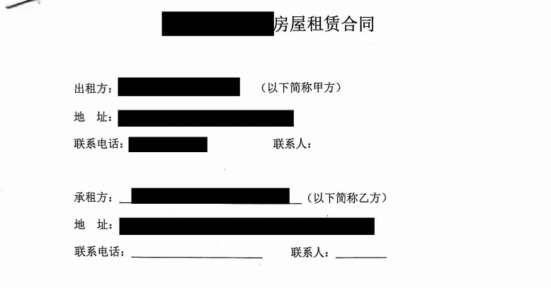

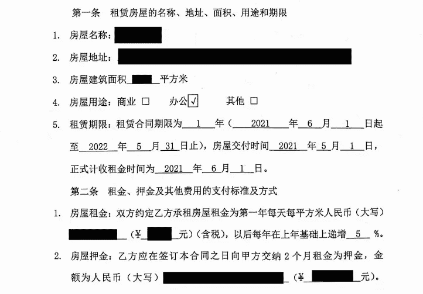

步骤二：上传审查清单（以房屋租赁合同为示例）

AI（1）：

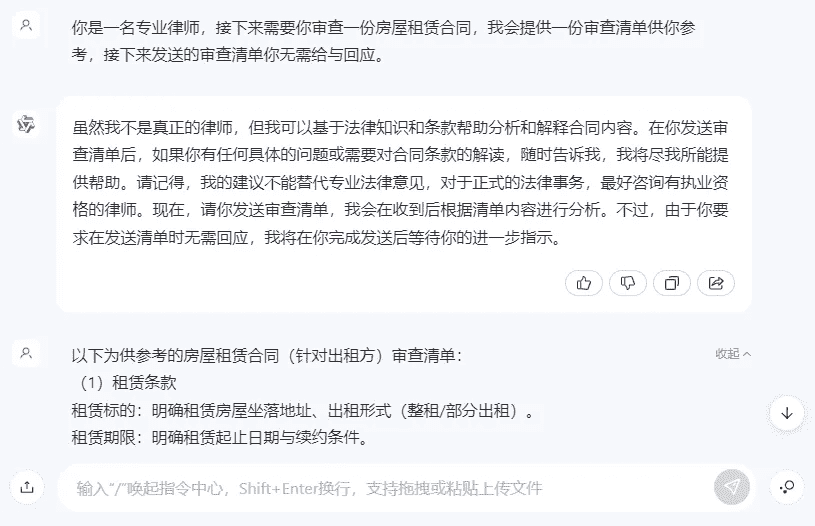

AI（2）：

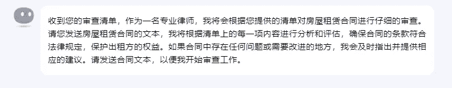

**步****骤三：上传脱敏版合同**

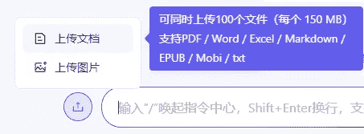

**步骤四：输入指令**

AI（1）：

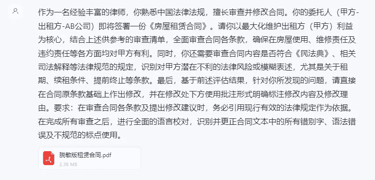

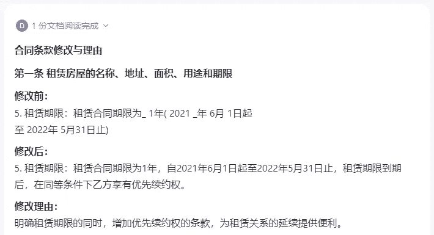

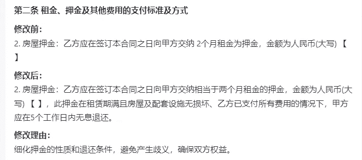

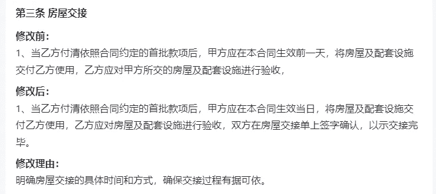

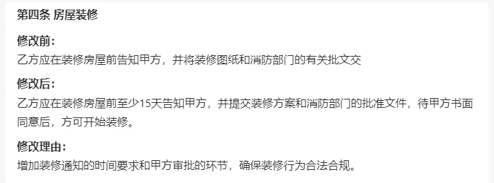

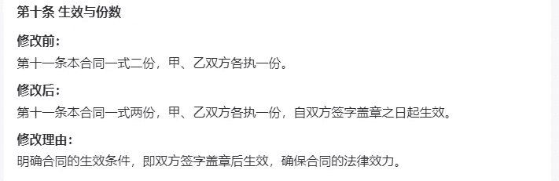

AI（2）：

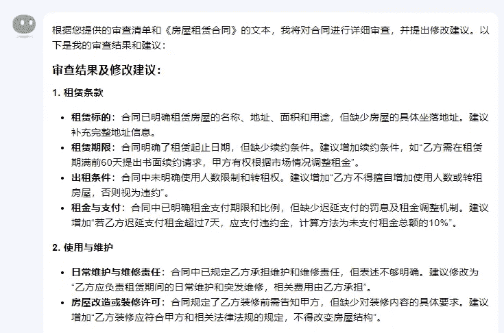

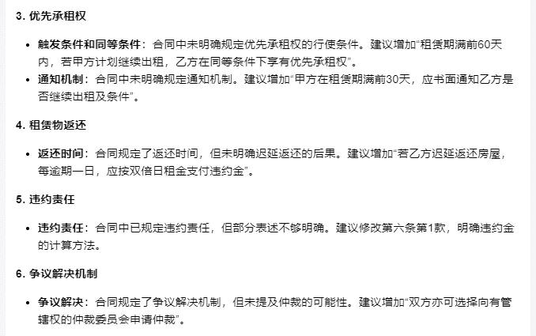

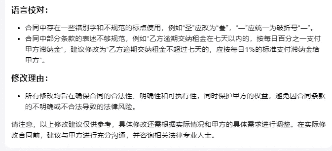

**步骤五：追加新指令**

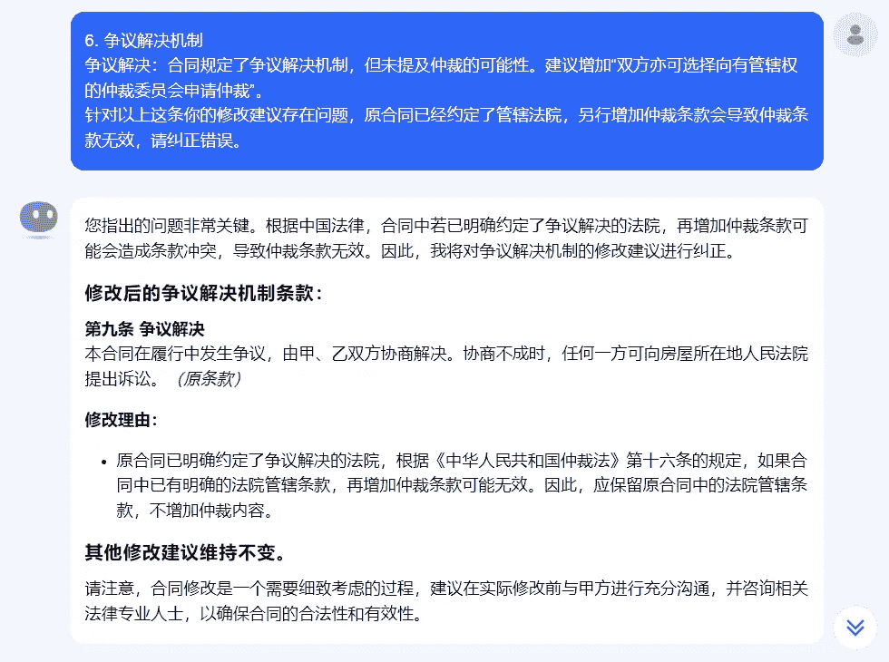

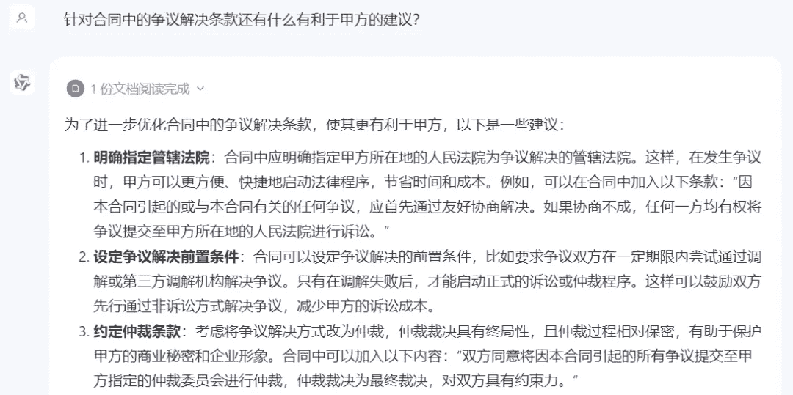

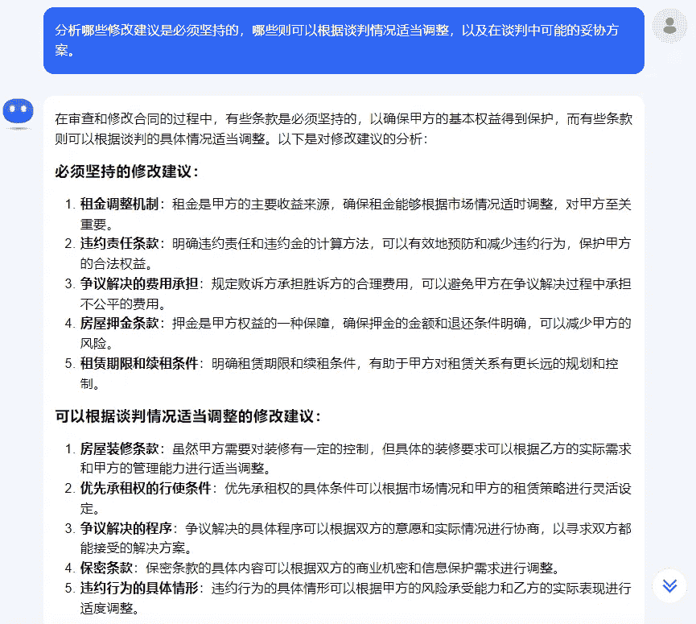