# AI 法律问答

> 来源：[https://docs.feishu.cn/docx/LwDSduaCTo85KKxFqaMcmmtzn9e](https://docs.feishu.cn/docx/LwDSduaCTo85KKxFqaMcmmtzn9e)

---

**要点概览  >>**

1.  根据特定需求选择或者设计合适的“助理”（非必需操作）

1.  指令（提示词）设计简洁、明确（部分AI可借助指令润色功能）

1.  利用多轮对话逐步深入问题

1.  利用AI可视化帮助理解

1.  利用多个AI交叉询问对结论进行验证

1.  长期保留对话框中的对话记录（对于需要长期跟进的事项，作为辅助记忆的工具）

1.  其他注意事项（AI 输出的人工审查）

**前言：**生成式AI大模型能够基于丰富的数据库以及对于情境的分析能力，充当法律咨询顾问的角色，针对所给案情，给出初步的法律建议，回答关于法律法规的问题，解释相关法律条文。对于法律工作者而言，AI所提供结论及法律依据可以起到一定的参考作用。

## 一、根据特定需求选择或者设计合适的“助理”（非必需操作）

（1）AI大模型一般通过提示词（Prompt）与用户进行沟通，其表现往往依赖于用户指令的明确性与清晰性。然而，“助理”（又称“Agent”或“智能体”）在接到目标指令后能够独立进行思考并自主采取一系列行动。一旦“助理”被赋予了目标，它们就能够自行生成提示词、构建任务、执行任务、创建新任务、调整任务列表的优先顺序、处理新的主要任务，并持续这一循环直至目标达成。简而言之，“助理”是经过一整套专业提示词训练之后的AI工具人，具备特定的专业技能，解决特定的问题。相较于仅依靠提示词来生成响应的大模型相比，“助理”展现出更强的主观能动性以及对于特定领域更深入的理解力。

（2）“助理”的主要作用是为满足用户的特定需求而提供更加个性化的服务。特定的“助理”可能在某个领域拥有更深入的知识或技能，如法律咨询、文案设计或编程指导等，在上述领域中又存在着进一步的分类，如法律咨询领域中又细分为劳动法助理、刑法助理及公司法务助理等。因此，选择其他用户已经训练过的助理或者使用以特定的整套提示词为基础去设计而成的助理，在一定程度上能够帮助用户快速获得更专业、更全面且更有针对性的回答，从而节省用户在每次使用大模型时反复输入提示词所耗费的时间。

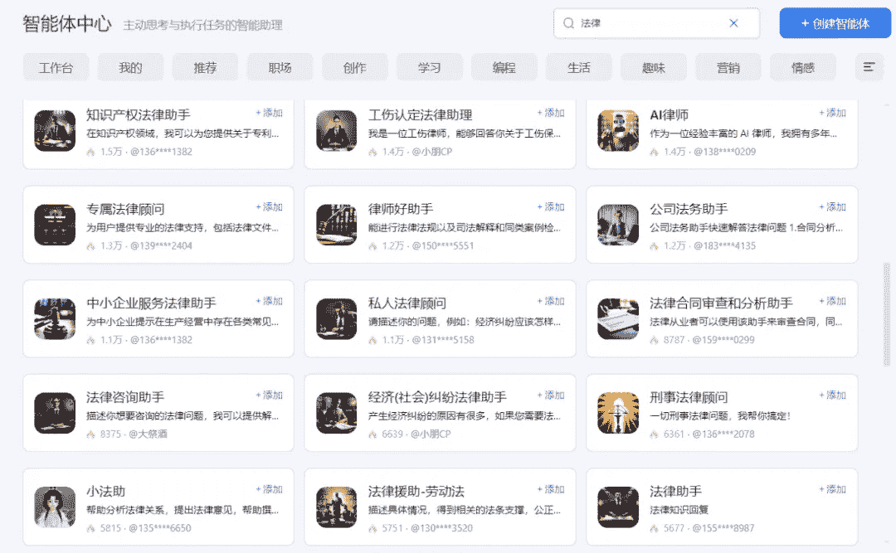

（以上为讯飞星火大模型智能体展示界面）

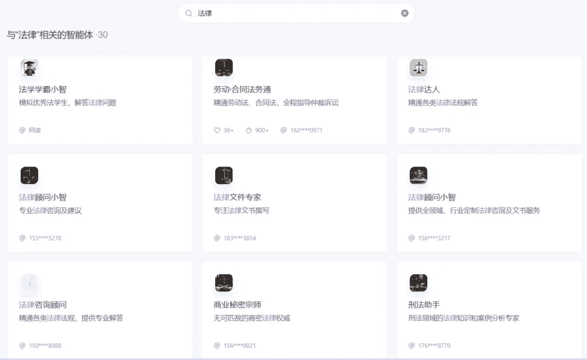

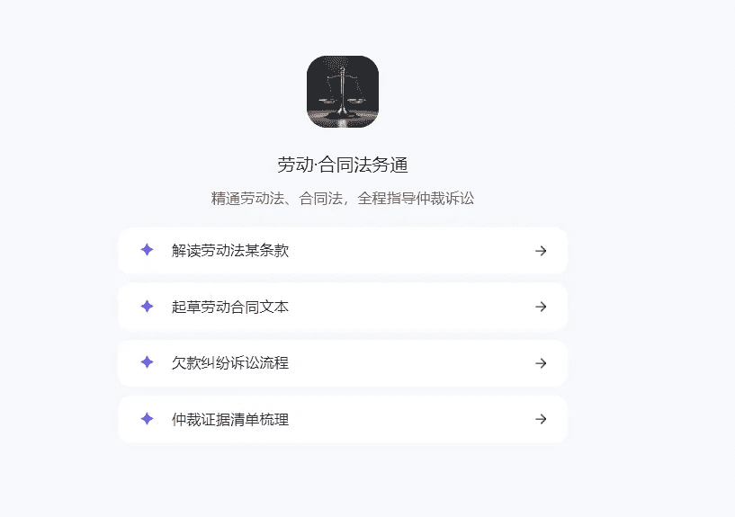

（以上为通义千问智能体展示界面）

## 二、指令（提示词）设计简洁、明确（部分AI可借助指令润色功能）

基础指令形式：【身份】+【背景事实】+【任务（问题）】+【要求】

（1）在【背景事实】部分，为确保AI能提供最准确和相关联的回答，用户应尽量提供详尽且具体的案件背景信息，包括但不限于案件发生的具体地区，因为不同地域的法律规定可能有所差异。通过提供详细信息，AI可以更快、更精确地检索到适用于该特定地域的法律条款。因此，全面而准确的事实描述对于获得高质量的法律咨询服务至关重要。

指令示例：

+   本案发生在上海地区，重点查找该地区与本案相关联的法律规范。

（2）在【任务（问题）】部分，为了让AI正确理解用户的意图，并据此检索、分析来输出相关高质量的回答，用户应当尽可能清楚地输入具体而非含糊、模棱两可的问题。

指令示例：

+   【模糊指令】我被公司解雇应该怎么办？

+   【具体指令】我被公司解雇后没有得到应有的赔偿，请帮我查找关于公司违法解雇员工的法律规定及赔偿金计算方法。

（3）在【要求】部分，用户需要向AI强调法律规范的时效性，确保AI的输出中用以支撑其结论的是最为准确且适配的法律依据。此外，用户还可以增加部分指令使AI的输出在结构更具有逻辑性、在表达上更具有专业性。

指令示例：

+   在结论中务必引用现行有效的法律规范。

+   输出内容以【结论-分析-法律依据】的形式展现；输出内容以法律专业术语来表述，不得使用生活化、口语化的词汇或语句。

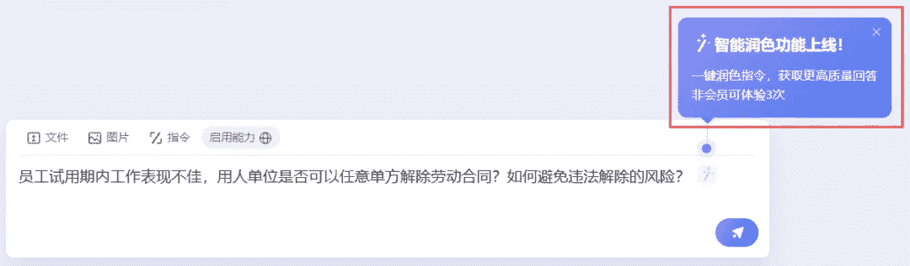

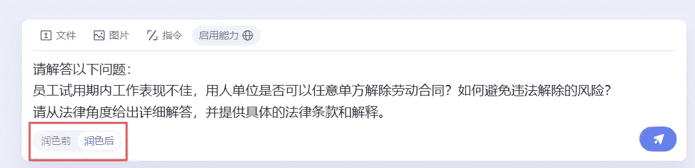

（以上为文心一言大模型指令输入界面）

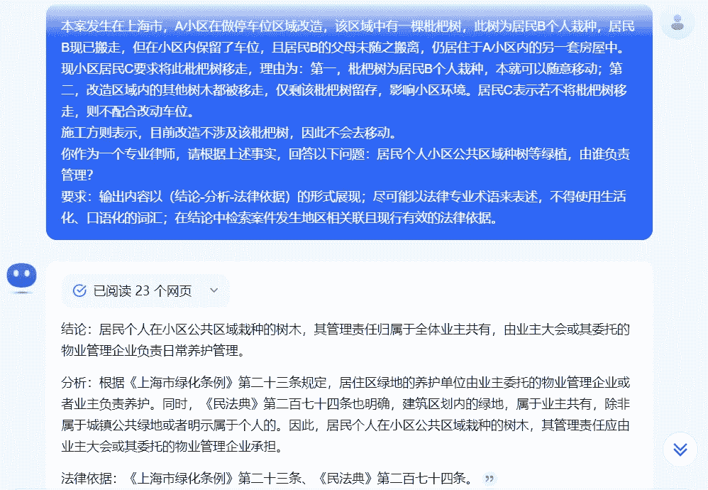

（以上实例内容由Kimi智能助手生成）

## 三、利用多轮对话逐步深入问题

AI的输出具有随机性，会存在漏洞，用户不要想着输入一整段冗长且繁琐的指令好让AI在一次回答中就能够输出令人满意的完美结果。用户应当是站在甲方的立场，通过多轮对话不断补充追问，提出新的需求，进而一步步完善并修正AI的结论。因此，面对法律咨询这样一个复杂且需要细致分析的过程，AI的回复往往也是需要在用户的追问和补充信息中逐步优化。

指令示例：

+   第一轮指令——“我被公司解雇后没有得到应有的赔偿，请帮我查找关于公司违法解雇员工的法律规定。”

+   第二轮指令——“我因为业绩不佳被解雇，工作了3年，平均工资是8000元，如何计算赔偿金？请列出相应的计算公式。”

+   第三轮指令——“公司没有提前通知我，我是否可以要求额外的赔偿？”

+   第四轮指令——“我需要哪些证据来证明公司是违法解雇我？请列出一份证据清单。”

+   第五轮指令——“如果我想起诉公司，需要准备哪些相关材料？”

## 四、利用AI可视化帮助理解

在法律咨询领域，针对具有复杂事实背景或多个时间节点的案件，与传统的文字描述相比，图表作为一种信息呈现的工具，能够更加直观和清晰地传达关键信息。然而，制作一张高质量的图表并非易事，它要求设计者进行深入地思考和反复地修改，去除不必要的细节，凸显核心内容。

当前，随着AI技术的进步，用户可以利用部分AI来创建图表，只需向AI提供案件的详细信息和个人的作图构思，并通过输入相应的指令，AI即可自动生成初步的图表草图，便于用户在AI生成的图表基础上做出进一步的调整和优化，以实现信息可视化。这种AI辅助的图表创建过程不仅提高了效率，而且通过智能化的处理，增强了图表的逻辑性，使得法律咨询过程中的信息传递更为高效和准确。

指令示例：

+   用纵向（横向）的Mermaid图表来展示法院财产保全的相关内容，包括但不限于财产保全的类型、费用、时间节点等具体细节。

+   用Mermaid图表将以下事实按照时间顺序，梳理成一张时间轴。内容如下：【案件的具体内容或时间节点】

**注意：**当前的绝大多数AI大模型主要通过文本交互的方式来输出，无法直接形成思维导图或流程图，用户可以自行将AI提供的Mermaid代码复制到支持Mermaid渲染的编辑器中，以生成流程图。

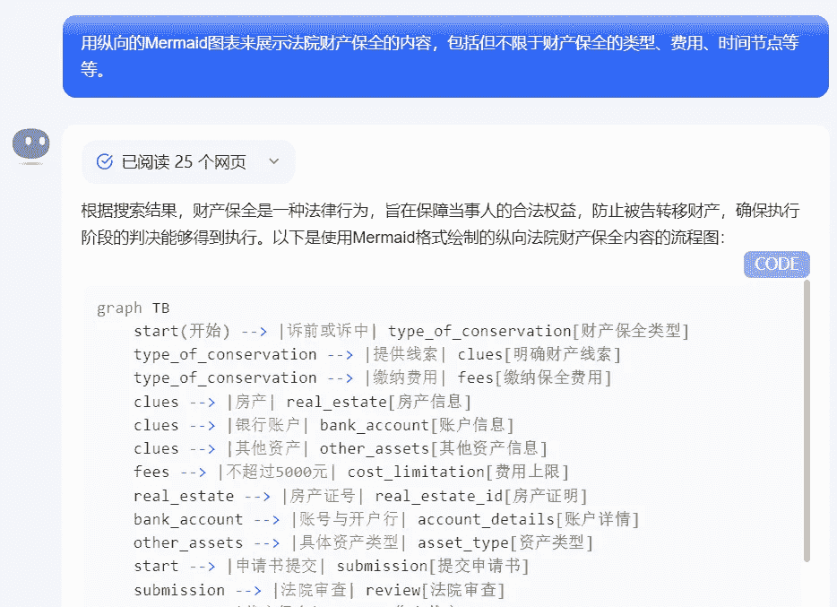

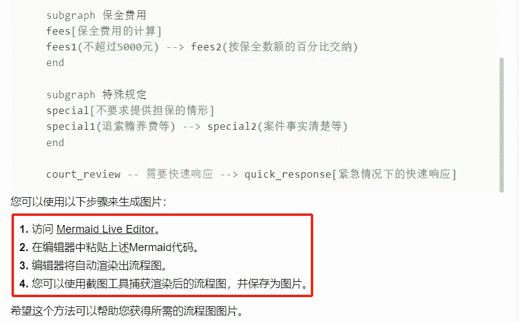

（以上实例内容由Kimi智能助手生成）

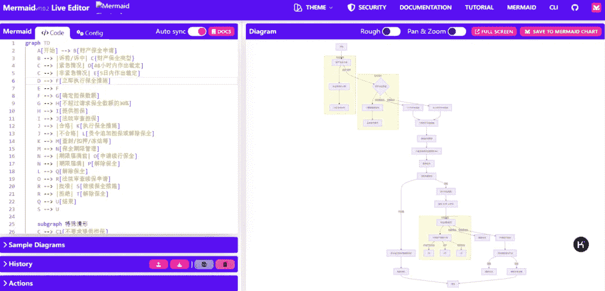

（以上实例内容由Kimi智能助手提供的Mermaid Live Editor生成，网站链接https://mermaid-js.github.io/）

## 五、利用多个AI交叉询问对结论进行验证

不同的AI模型采用不同的算法和数据集进行训练，往往各有所长，然而没有一个模型能够在所有任务上都拥有优秀的表现。通过多个模型的交叉验证，避免用户过分依赖某单一模型，使用户能够从多个视角获取答案，促进对问题的全面理解。这种多模型交叉验证不仅减少了单一模型可能存在的偏见和错误，提升了答案的准确性，而且各AI模型间的互动还能激发新的思考，加强对复杂问题的深入分析。

指令示例：

+   问题：股权回购纠纷属于公司纠纷还是合同纠纷？若回购协议未约定管辖，应当如何确定？

+   结论：【此处可以直接复制某一AI大模型对上述问题的作答结果】

+   对于以上结论，你认为存在哪些错误之处？有什么补充或者完善建议？请列出错误并在下方标注理由及修改建议。

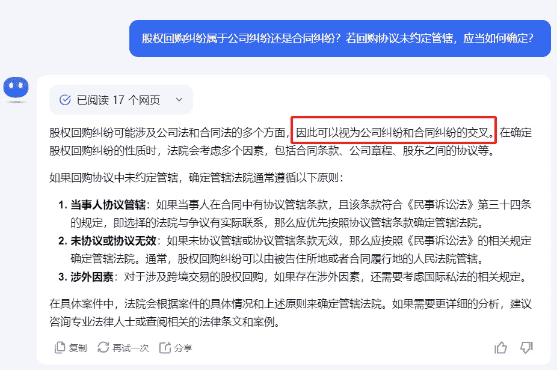

（以上实例内容由Kimi智能助手生成）

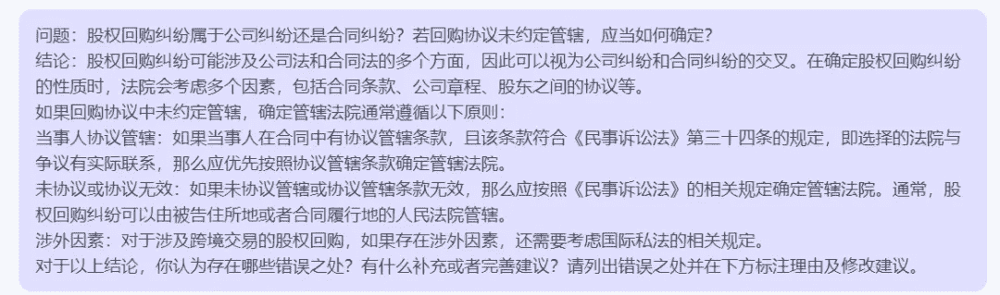

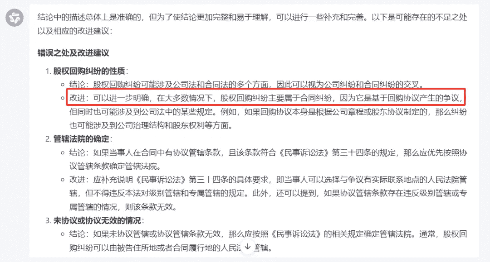

（以上实例内容由通义千问生成）

## **六、长期保留对话框中的对话记录（对于**需要长期跟进的事项，作为辅助记忆的工具）

在同一对话框下进行问答能够维持对话的连贯性，使AI基于已经发生过的对话内容来更好地理解用户意图。尤其是在法律咨询中，复杂的法律问题往往需要多轮次的沟通才能准确界定焦点和细节问题，而连续追问可以积累丰富的上下文信息，使AI可以快速回顾之前的讨论或者调取阅读用户早先所上传的文件，避免重复劳动，有助于提高后续回答的质量。

此外，对于需要长期关注和跟进的事项，保留对话框记录可以作为一个有效的记忆辅助工具（为了便于查找，用户可将历史对话重命名，如【A与B借款纠纷+日期】）。这可以帮助用户回忆此前的对话内容，确保信息的连续性和一致性，避免在不同时间点上重复解释相同的问题，从而提高沟通效率。

（以上为Kimi智能助手历史会话板块重命名后的展示界面）

## 七、其他注意事项（AI输出的人工审查）

“AI幻觉”，指人工智能在处理信息及生成回答的过程中产生的错误，目前这是一个普遍存在的现象。这种现象产生的原因包括但不限于数据的不完备、算法的限制，以及设计者自身认知的局限。例如，设计者和训练者的个人偏见可能在不自觉中嵌入AI系统，从而左右其决策。

当AI模型在面对用户提出的复杂法律咨询时，倾向于检索网络上普遍赞同的高评价回答作为其自身的“观点”。如果这些模型所依赖的法律数据库缺乏全面性或未能及时更新，就可能造成AI为了迎合这些“观点”来构建答案，并以其编造的虚假法律条文对其“观点”进行支撑。

因此，用户在获得AI提供的答案时，应保持审慎，不应完全依赖AI的输出。用户应自行对法律条文的真实性和时效性进行核实，以保护自身利益不受损害。

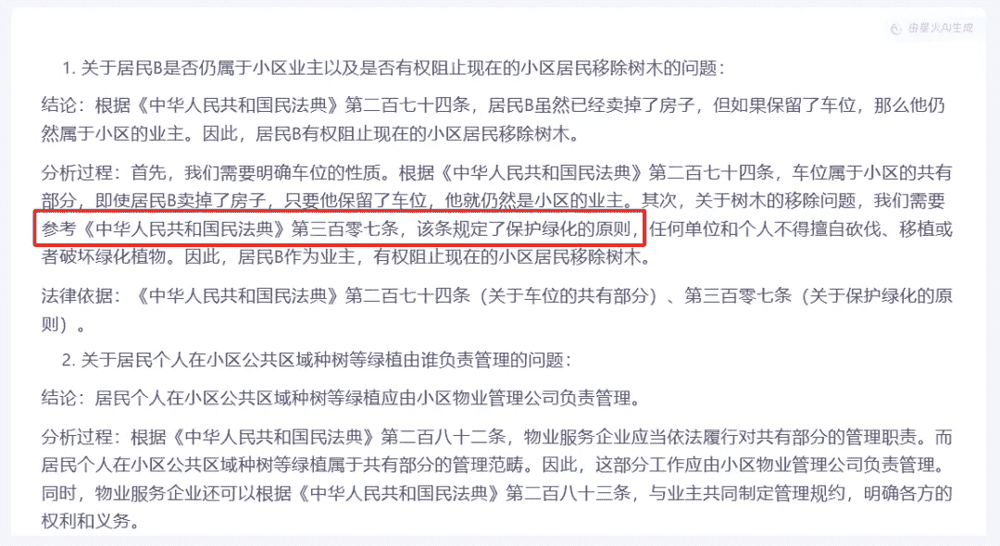

（以上实例内容由讯飞星火大模型生成）

## **小结**

AI大模型能够给予用户初步的法律咨询意见，但若想真正做到替代律师处理实际纠纷，仍需迭代升级。AI的回答大多是从多元角度分析问题，要深入解决问题则需不断地追加指令，这和AI大模型的数据库有关，其数据库种类多样、内容极广，但鉴于法律相关的信息资源仅为其训练数据中的一小部分，导致其在深入分析某一复杂法律问题的能力还有所不足，有待进一步投喂数据加强训练。