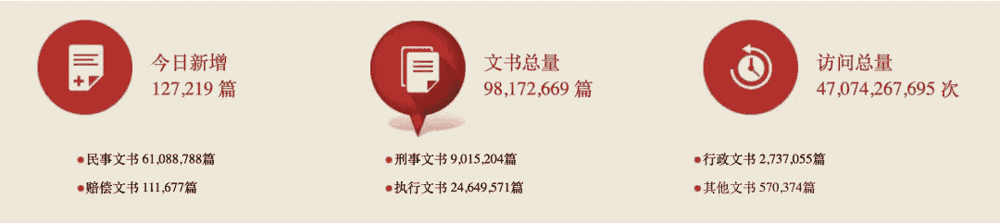
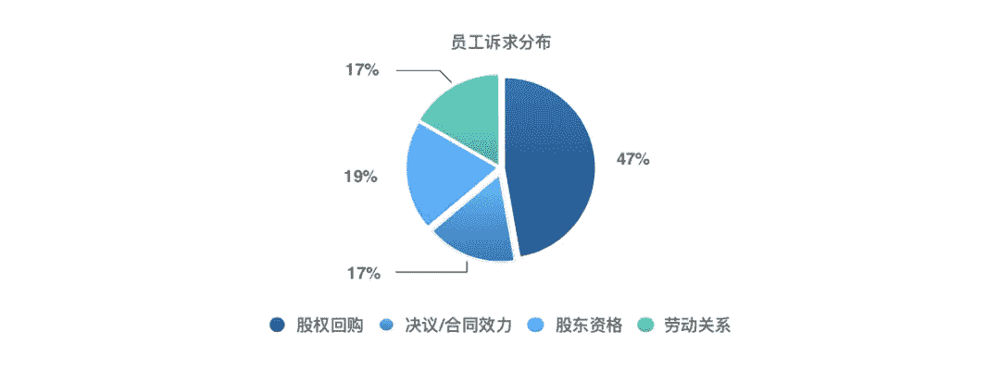

# 类案检索来了，司法判决书还可以怎么玩？

> 来源：[https://docs.feishu.cn/docx/FBQ8dzICYod5XcxOd0Xc40Vvnxd](https://docs.feishu.cn/docx/FBQ8dzICYod5XcxOd0Xc40Vvnxd)

---

2020年7月28日，最高人民法院发布了《关于统一法律适用加强类案检索的指导意见（试行）》（以下简称《意见》），并于今日开始试行。

对法院来说，类案检索有利于统一法律适用，保证同案同判；对律师来说，研读判决书已经是提高法律素养的重要途径。

除此之外，这个新规还有什么影响呢？

我想，一个重要的理由就是，“类案”的载体 —— 判决书，作为重要的法律数据来源，将会发挥出巨大的商业价值。

**1.**司法判决书是什么？

在「得到」App 中，有一门付费课程《刘晗·法律思维30讲》，主讲人刘晗老师提到一个八卦：

> 「得到」App 创始人罗振宇老师，曾经在央视担任过《经济与法》这个节目的制片人，罗老师就和我讲过，做内容，永远都缺好选题。那如果没有好选题怎么办？罗老师想了一个办法，就是到法院去查判决书，一份份看，从判决书里发现那些反常识的案子，那肯定就是好题目。

这个方法很聪明，因为对于一个从来没学过法律的人来说，判决书就是理解法律的一把钥匙。

判决书是什么？

它是司法系统处理一个案件最终输出的结果，但它又不仅仅是写给当事人看的，还是给全社会的一个交代，要不然现在判决书也不会公开。

从2014年判决书上网开始，中国裁判文书网已经上传了 9800 万份判决书，访问总量高达 470 亿次。

（图**片来源：中国**裁判**文书网）

一份**如此**专业的文书，**却有**如此高的访问****量，它一定解决了****某个****用户痛点。

这就好比在**蒸汽机发明之前，煤炭几乎没有任何商业价值，但蒸汽机出现之后，很快就引爆了工业革命。

事实上，判决书是一个司法“产品”，它要告诉全社会，一个案子究竟是什么情况，为什么这么处理，理由是什么，这也是在提示全社会，以后类似的事情会怎么处理。

判决书中的这些内容，用现在的话说就是“数据”。

那一份标准的判决书承载了哪些数据呢？有几个关键词需要特别注意：

一是“代理律师”：这部分内容在判决书的开头部分，和当事人信息在一起，你可以很快找到。

二是“经审理查明”：这部分内容在正文里的论证部分，交代了这个案件的事实，也就是在法官眼中究竟发生了什么。这部分叫做事实认定。

三是“本院认为”：从“经审理查明”往下看，你会找到“本院认为”，这是法官看到这个法律事实之后，依据法律对于这个事作什么样的评判和处理。这部分叫做法律推理。

四是“裁判结果”：也就是法院对这个案件当下的审理结果。

通过统计和分析判决书里的这些数据，判决书最主要的应用就是“裁判结果预测”，而且面对不同的用户画像，你可以发现不同的使用场景。

2.用判决书来解决信任问题

前段时间，国家鼓励地摊经济，在别人热火朝天干起来的时候，很多人却不知道如何入手。

对于这个问题，在 B 站上有个 Up 主 叫“农小宣_”，有一期视频是教做葱油拌面的，里面有一句话让我感触颇深，忍不住写下来：

葱油拌面的灵魂是葱油，把这个灵魂做好了，想拌啥都是一拌一个香。

换句话说，很多人**看似缺少**创业的点子，其实是缺**少核心竞****争**力。

餐饮行业的壁垒在于“味道”，律师行业的壁垒在于“信任”。谁能更快地取得客户信任，谁就能降低售前成本，有更多的时间去创收。

从目前来看，客户和律师之间，还处于个人与个人之间的信任关系，律师需要花时间精力去找客户、去说服客户，售前成本很大，获客和营销是每个律师的痛点。

因此，让供需匹配，就是一个创业方向。

事实上，这个需求一直存在，市场也在期待更好的解决方案。在技术日渐成熟的今天，有没有可能通过判决书，建立起一个类似于“支付宝”的信用体系，在律师和客户中快速建立起信任呢？

To 消费者：建立一个「智能律师对接平台」

“XXX律师，你看我这个案子，能赢吗？”

这个问题，应该每个律师都会被客户问到。

其实，客户想知道案子能不能赢，背后只有一个需求，那就是解决问题。

这个需求可以分两层来看：

一是心理需求，如果能赢，收获一份安全感，如果不能赢，我也想心里有个底；

二是如果你说能赢，具体怎么赢？如果不能赢，你有办法帮我赢吗？

在技术不成熟的情况下，律师代表了专业，客户只能相信律师，他只能问他眼前的这个律师，我能赢吗？

但在这之前，客户遇到的一大痛点，就是如何找到靠谱的律师。

如果亲朋好友是律师，由于长期以来的信任关系，找他就好了。那如果没有律师朋友呢？上网查律师？怕遇到骗子，很难受。

目前，行业的普遍做法是提供一个平台，律师可以入驻，通过上传成功案例、在社区中回答问题等方式建立专家形象，然后上算法按照访问量给客户推荐合适的律师。

现在，如果加上判决书，律师对接平台可以发挥出更大的价值。

第一步，平台通过分析判决书中的“代理律师”、“经审理查明”、“本院认为”、“裁判结果”，就可以知道在特定案件事实下，法院的倾向于怎么判，以及哪些律师的胜诉率比较高了。

比如某个律师做了100个这类型的案子，先不论胜诉还是败诉，既然有那么多人委托他来做，起码靠谱一点吧？如果这个律师胜诉率还很高，那就更靠谱了。

第二步，通过自然语言识别等算法，客户输入案情信息，就可以初步了解案件的裁判结果。

第三步，平台通过大数据分析给客户推荐合适的律师，比如胜诉率高、在同一个城市、在某个法院开庭次数多等不同维度。

在这个平台上，客户的行为也会发生改变，像“XXX律师，你看我这个案子，能赢吗？”这种问题，大概率会成为过去式。

相反，客户会这么问：“我的情况是这样...我赢的概率大吗？哦，有机会，那我要怎么才能赢？啊，这么复杂，你能给我对接一位合适的律师吗？”

律师对接平台的做法遵循了一个古老的常识，即如果你为某件事情付费，你是客户，但如果你免费得到它，你就是产品。

当某个产品或服务会随着更多人的使用而变得对用户更有价值时，就产生了网络效应，而这又会对增长产生飞轮效应。

与真正的律师费相比，平台对消费者几乎是免费的，它可以通过各种方式来盈利，比如广告，当然也可以收取订阅费，但也会很低。

对于已经开始期待 "免费 "服务，并且通常不太关心隐私方面的公众来说，免费且好用的产品无疑会带来更多的用户。随着用户量级的增长，平台还可以往知识服务、媒体服务等方向发展，产品外延非常广。

To 律师：制作大数据报告、行业标准合同、出版著作

客户找律师的痛点，从反面来看也是律师的痛点。

律师和医生一样，客户找过来，首选一定是专家，越资深越好。

你说你是专家，凭什么？

要包装自己，可以用成功案例来背书，但由于法律行业的咨询特性，每个律师的带宽是有限的，职业生涯最多做100个案子（当然小案子会多一些），这意味着年轻律师起码得熬上个几年。

当然，你也可以通过进入大所来获得背书。因为在客户看来，大所就是“信用中心”，你能进大所，说明你更靠谱。相对的，进大所的要求也更高。

由于个人品牌的背书少，律师需要去读研究生，取得高学历；去上商学院，结交人脉，获得各种title；自己写👸号，花钱去打广告，这些都是成本，甚至北京还有个规定禁止律师个人打广告，很难受。

这时，判决书的作用就出来了。

司法裁判结果是对法律风险控制的终极检验标准，分析足够样本量的判决书，出具大数据报告，是展示律师专业性的好物料。

笔者曾经以“股权激励”为关键词，筛选了全网2461份判决书，发现员工诉求多种多样，而且每一类诉求又能进一步细分，但大部分可以在事前进行风险规避，可以给客户传递专业的形象。

**

大****数据报告看起来让人不明****觉厉，而且成本较低，一个律师**或者律师团队就可以完成，但客户大概率不会因此付费。

遇到纠纷的客户，找律师就是为了解决问题，而不是学习；没遇到纠纷的客户，压根就不会想去看这么专业的东西。

使用最多的人群，没准就是律师群体本身。

因此，对于律师来说，大数据报告更多是一种为客户提供的增值服务，用于建立专家形象，打造律所或律师个人的品牌。

对于诉讼业务来说，分析判决书可以做成某一领域的大数据报告，沉淀为行业经验；对于非诉业务来说，直接应用场景就是合同。

分析大量判决书后得出的风险点，可以完善自身提供的合同。如果数据量够大，可以因此建立起行业标准合同，从而拥有更强的议价能力。

当然，如果你对判决书有很深的洞察，也可以将案例进行汇编之后出版著作，目前市面上知名度比较高的有天同律师事务所出版的《天同码》。

3.类案检索来了，智能判案近了吗？

相同或相似案件，应该有一个相同或相似判决结果。这是一种非常朴素的正义观，也是《意见》试行的初心。

如果类案检索制度能全面推行，还可以减轻一线法官的工作负担，司法拖延的问题也能得到一定程度的解决。

但是，作为司法的最后一道关卡，法院真的可以像律师一样，通过大数据报告的形式，进行同案同判吗？

笔者认为，由于法律行业的特殊性，智能判案从风险和实现的可能性上看，难度都不小。

事实认定的误差天然存在

首先，判决书中的事实认定部分，法官基本是不说理的。

什么意思？

举个简单的例子，A和B辩论，A说“你错了”，B说“我错哪了”，这时A说“我不管，你就是错了”。这就让人很崩溃。

法官只是简单地在判决书中，写清楚了事实的经过，但他是基于哪些证据，通过什么逻辑认定的，法官不说。

因此，很多事实认定部分一样的判决书，只是法官“认为”一致而已，真实情况可能并不一致。

因为庭审都是看证据的，法官是根据诉辩双方提供的证据，根据自由心证做出了事实判断。

也就是说，现实中可能出现同样的事实认定，但裁判结果完全相反的情况。

由于事实认定的误差天然存在，如果以此为基础判案，恐怕有失公平。因此，《意见从类案识别和比对、检索报告或说明、结果运用等维度对类案的使用进行了规定。

通过技术来实现智能判案，现阶段还为时过早。

标注数据长路漫漫，人工成本大

即便《意见》推荐了多种类案的检索方法，目前市面上的案例平台也可以在不同程度上实现，但分析海量的判决书还是困难重重。

首先，知识图谱、语义计算技术、算法已经趋于成熟，但起点是数万个小时的标注数据。在法律行业，数据的标注成本非常高。

判决书作为数据来源，每篇的篇幅动辄5000字，甚至超过1万字或2万字，从中辨识出核心裁判观点及逻辑，仍需要大量的人工成本。

其次，法律本身就是一个高度概括性的规定，每个法条都对应千百种场景。事实与法律之间的运用，也是一个复杂过程。

如果没有法律人去提炼、分类、整合，并作标准化处理，将之转化为算法嵌入系统，机器就只能回答“股权回购规定在公司法第几条？有哪几种法定情形？”等简单问题，进而推送数据库内援引相关法条作出的裁判文书。至于“调解协议回购”等复杂案情，就无法作出反应了。

为此，很多学术型组织开展了一系列活动，加速法律行业数字化的进程。

其中，由中国中文信息学会语言与知识计算专业委员会主办的，第十四届全国知识图谱与语义计算大会，还在报名当中，感兴趣的朋友可以点击阅读原文报名。

总的来说，AI 技术运用到法律行业，所面临的障碍远远比一般人想象的要多。

这条路，还很长。

但不可否认的是，与合同一样，作为重要的法律数据来源，判决书将会发挥更大的价值。