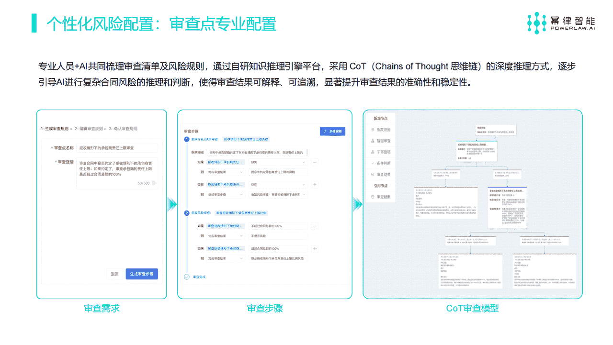

# 更准确、更个性化：AI 时代，智能合同审查迎来价值创造新范式

> 来源：[https://docs.feishu.cn/docx/AEz4dQT7so0jvRxGVHHcHdTlnBe](https://docs.feishu.cn/docx/AEz4dQT7so0jvRxGVHHcHdTlnBe)

---

一切机会都来源于「势」，源自真实的市场需求，智能合同赛道的兴起也是如此。

当下，生成式 AI 技术已趋于成熟，正在积极开展产业化落地，而法律就是 AI 落地应用的重点行业之一。2023 年以来，各家法律科技公司纷纷集成 AI 技术，在特定场景已初见成效。

其中，“合同”作为企业经营数据的载体，承载着市场经济活动的方方面面，一直是企业数字化的关键，因此市场上围绕合同出现了多个创业赛道，比如：CLM（合同生命周期管理）、智能合同审查、合同模板库等等。

然而，合同管理体系建设属于成本环节，与企业增长关联不大，多年来发展缓慢。直到新冠疫情的爆发使远程办公成为新常态，反映到商业上，原本稀松平常的合同签约成为困难，从而导致商业交易效率严重降低。

与此同时，企业的降本增效需求不断提高，越来越多的公司法务部开始重视数字法务部建设。据欧盟统计局 2021 年的数据，欧洲有 3000 多万家企业正在推动全球 CLM 市场的发展；Claight 公司的数据也显示，2024-2032 年，CLM 市场将以 17% 的复合年增长率增长，2032 年将达到近 98.4 亿美元。

当下，企服市场对智能合同产品的需求大幅增长，加上电子签名等行业基础建设成熟，以及生成式 AI 技术的持续进步，智能合同领域的创业公司逐步开始智能化升级，智能合同赛道也进入了一个新的快速发展期。

# 群雄逐鹿：智能合同赛道正在融合发展

**目前，智能合同赛**道**下主要有三个**子**赛道****，分别**是：合同生命周期管理、智能合同审查、合同模板库。

**第一，合同生命周期管理。**

合同生命周期管理，英文全称是 Contract Lifecycle Management ，简称 CLM，即在合同启动、起草、审查、工作流程管理、谈判、批准、签署、执行、持续监督、合规和续订等全流程，通过实现合同流程的自动化来提高效率。大多数 CLM 软件的主要目标就是提高企业支出的可见性，旨在提高整个合同生命周期的工作效率，并降低成本。

可以说，CLM 是智能合同赛道最热门的领域之一，国外已经有比较成熟的公司，包括但不限于 Icertis、Ironclad、Spellbook、Robin AI、Luminance、ContractPodAi 和 LegalOn 等，国内也有幂律智能、秀合同等公司。在有史以来全球法律科技最大的 25 笔融资中，CLM 公司就占有多个名额：

+   Icertis：1.5 亿美元，2022 年

+   Ironclad：1.5 亿美元，2022 年

+   ContractPodAI：1.15 亿美元，2021 年

+   LegalOn：1.086 亿美元（基于 2022 年日元对美元的汇率），2022 年

+   Evisort：1 亿美元，2022 年

+   Ironclad：1 亿美元，2020 年

+   LinkSquares：1 亿美元，2022 年

+   SirionLabs：8500 万美元，2022 年

同时，近年来 CLM 公司频繁拿到投资，以下是 2023-2024 年获得新一轮融资的智能合同公司：

多维表格（CJ0vbFytPaG8HasSylFcUexsncf_tblcLAYUvFjrk1OF）

**第二，智能合同审查。**

在合同管理的多个环节中，部分环节涉及到大量重复性工作，比如「合同审查」。

实践中，传统的合同审查基于人工逐字逐句审核，依赖审查人员的知识和经验储备，审核耗时长且容易遗漏风险，尤其是在大型企业的成熟业务中，沉淀了大量已经类型化的合同，人工审查耗时耗力，难以应对快速发展的时代对高效合同审查的需求。同时，人工合同审查结果和经验通常分散在文档批注、邮件或聊天记录中，难以形成系统化的知识积累，自然也无法为后续的审查工作和团队经验共享提供有效支持。

因此，公司法务部长期以来都被认为是组织内部的“成本中心”，而且随着市场监管环境日益复杂，外部律所服务的支出也越来越高，亟需通过法律科技提高合同审查的效率。

依托 AI 和自动化等技术，可以快速处理合同相关的任务，将手动繁琐的任务转变为轻松和快速的操作，显著缩短处理时间，并消除跨部门协作过程中可能发生的人为错误。

同时，基于合同管理流程自动化带来的效率提升，还可以辅助公司/律所提高创收。具体场景可能是降低合同谈判时间，或者是自动开具发票辅助财务工作开展，从而提高业务效率 —— 这是一个重要的驱动力。

目前，国外聚焦智能合同审查领域的公司有 Lexion（被 Docusign 1.65 亿美金收购）、Henchman（被 LexisNexis 收购）、Evisort（被 Workday 收购）、Spellbook、Robin AI 等；国内聚焦这一领域的有幂律智能，法天使/案牍、法智、轻舟晓法、火眼审阅等。拓展阅读：2024 年，CLM（合同生命周期管理）赛道的八大收购事件

**第三，合同****模板库****。**

合同模板，是法律专业人士在日常工作中不可或缺的工具。法律人在处理各类业务时，无论是商业合同、劳动合同还是其他类型的契约，合同模板都可以为法律专业人士提供一个标准化的框架，大大提高工作效率。

合同模板库，即汇总各种合同模板的平台，包括第三方合同模板库，或者作为其他产品中的一个功能模块。国内外聚焦该领域的公司有 Law Insider、oneNDA（被前者收购）、ThisFirst、DocPro、法天使等。

从市场规模上看，合同模板库这条赛道似乎很垂直，想象空间比较小，但在实践中，很多合同工作都是从一个优质模板开始，而不是从头开始写一份合同，所以合同模板库其实是合同起草审查工作的基建。而且在 AI 时代，AI 的输出质量取决于训练数据的质量，因此合同模板库也是一个优质的合同数据源。

除此之外，合同模板库其实符合很多发展中国家律师行业的发展现状 —— 服务质量整体不高，律师对标准合同模板有较强的需求，因此对世界各地尚未成熟的法律行业来说，合同模板库其实有着相当大的市场需求。

拓展阅读：AI 时代法律行业的基建：合同模板库

除了以上几个赛道，智能合同的延展性也很强。例如，“合同”是“文本”的子集，不只是合同审查，企业在日常经营活动中大大小小的营销活动，也存在很大的文本审查需求，而且更有可能对企业造成真金白银的损失。

当下，合同全生命周期管理（CLM）和智能合同审查，是资本市场最火热的两条赛道，原因是市场规模较大，而且通过技术改造，未来规模化复制的可能性较大。

同时，随着生成式 AI 的诞生和快速发展，CLM、智能合同审查、合同模板库，以及更广泛的文档自动化等赛道，开始融合发展，最明显的特征就是加入 AI 技术，逐步融合为技术驱动的「智能合同」赛道。

# 新的叙事逻辑：更成熟的市场，以及对技术能力的更高要求

基于市场需求和技术进步，近年来智能合同赛道出现了一些新的叙事逻辑。

首先，最明显的变化是根据用户需求，围绕“合同”提供一站式服务。

早期，大多数 CLM 产品主要聚焦于合同审批阶段，即把合同审批的所有流程从线下搬至线上，解决的是怎么更加高效地审批和管理合同的问题，也就是合同管理的“流程化”，对于合同风险、履约问题涉及较少。

**但是，实践中客户更希望将合同全生命周期管理、**合同智能审查、合同模板库进行有效的融合。即借助数智化技术把控履约进度，促进合同目标的达成，从而降低逾期回款或坏账几率 —— 更能为企业带来增长的环节。

对此，有的智能合同公司针对性地提出“AI 赋能合同谈判”的概念，也就是通过智能技术提高合同审查效率，使双方可以集中在合同中的错误或遗漏进行谈判，从而消除双方在谈判期间不必要的来回，提高合同谈判效率。

要想实现这一点，CLM 产品需要与各种企业业务系统链接，如客户关系管理（CRM）、企业资源规划（ERP）、从采购到付款（P2P）和办公协作（OA），打通各个环节的业务数据，然后制定相应的履约计划，以实施履约监控和预警，实时反馈交易情况，并及时施以积极的影响，比如合同到期自动提醒。例如，海外的头部 CLM 公司基本都与 Salesforce、Adobe、DocuSign 等业务软件集成，客户可以将合同数据直接连接到这些系统使用。未来，有能力创建和支持高效、互联技术生态系统的组织，可以有效地降低运营风险，最大限度提升技术的投资回报。

这个趋[势变化背后，是相关领域](https://mp.weixin.qq.com/s?__biz=MzUzOTcwMTE5OQ==&mid=2247490265&idx=1&sn=557a783e1625ae8d27f513151c44b5f6&scene=21#wechat_redirect)的头部企业已经完成了行业基础设施建设。现阶段，智能合同初创公司在合同生命周期管理和电子签名产品之上，重点开发以智能合同审查为代表的应用，仍有比较大的创新空间；同时，领先的 CLM 和电子签名厂商将围绕用户需求，把业务拓展到产品延长上的相关领域，合并和收购活动也会增加。

其次，随着 AI 技术的突破，智能合同赛道所创造的价值正在回归本质。

从整体上看，中国企业服务行业的主流叙事逻辑是「降本增效」，但中国企业服务土壤并不肥沃，多数企业倾向于采购能够给自己直接带来营收的服务或工具，比如 S/CRM（营销领域），以及在政策的要求下才会采购的系统，比如上世纪国家对于财务的要求，使得金蝶、用友一跃成为企服龙头。

事实上，中国企业服务厂商以「降本增效」作为卖点，总体上获客效果都不好，往往只对大企业有用，因为大企业的业务很成熟，而中小企业的关注重点在于活下去、在于业务发展，通过产品降本增效并不是他们最关心的，因为可能业务明天就不行了。事实上，中小企业最大的降本增效需求，其实就是裁员，甚至大企业也是如此。

智能合同赛道的主流叙事逻辑同样是「降本增效」，这也意味着只有大企业才有更强的需求，为此 CLM 公司需要提供定制化开发和私有化部署，服务做得很重，而且因为服务成本较高，拿下客户并不容易。

在这种情况下，CLM 公司开始关注企业降本需求背后更本质的需求：增长。商业的本质是交易，所有企业的增长都是交易达成带来的，只要交易可以顺利达成，企业就能获得增长，而合同是交易的载体，所以激发企业增长就是 CLM 产品要解决的最根本的需求。例如，智能合同审查系统可以检测合同中的错误或遗漏，智能地标记出来，这样团队就能将工作流程导向适当的人员，从而赋能合同谈判，极大地使双方集中在谈判本身。

**因**此，合同管理不是目的，而是抓手。合同管理要解决的根本问题不是管理和提高工作效率，而是促成合同背后的交易。或者说，所有企业服务产品要解决的最根本的需求，都是激发企业的增长。

# 更准确、更个性化：AI 时代下，合同审查的创新范式

目前，市场上很多 AI 产品都能辅助执行合同审查工作，但质量参差不齐，往往只能起到很浅层的效果。例如，审查一份 5000 字的合同，AI 给出了 3000 字没有什么用的审查意见，最后律师的工作量不降反增。

当下的 AI，可以说是“听君一席话，如听一席话”。

**同时，客户的业务需求是独一无二的，所以 AI 也应该适应这一点，而且从商业化**上看，当工具可以专门为用户配置以解决他们独特的问题时，人们更有可能信任并使用它。

也就是说，客户对于智能合同产品的需求可以总结为：专业度与个性化。

**在「专业性」上，要想提升 AI 的输出**质量，首先要针对特定领域选择合适的模型。

例如，根据大模型评估公司 Vals 对各类 AI 工具的基准研究，在合同领域性能表现排名前三的模型是 Llama 3.1 Instruct (405B)、Claude 3 Opus 和 o1 Mini，这意味着选择这几个模型处理合同问题，效果更好。

除了模型本身的性能，在严肃的合同领域安全性也很重要，因此在选择模型时，安全性也是一个重要考虑。例如，与大多数使用 GPT 大模型的 CLM 厂商不同，Robin AI 是少数使用 Claude 大模型的 CLM 公司之一。Robin AI 的 CEO Robinson 表示：“我们发现 Claude 可以与我们所有的核心用例相匹配。此外，人们确实非常关注安全。结果是，当提示和微调正确时 Claude 非常好，在不回答它不知道答案的问题方面非常好。”

国内，在法律垂直大模型领域，智能合同创业公司「幂律智能」也推出法律垂直大模型 PowerLawGLM，并且深度赋能智能合同场景，推出合同审查产品「MeCheck」。还有法信、北大法宝、阿里巴巴等公司，也分别推出了各自的法律垂直大模型和智能合同智能化应用，比如阿里的通义法睿，北大法宝的法宝来签等。

除了针对特定领域（比如合同）选择合适的模型之外，要想提升 AI 的输出质量，还要做很多工程方面的优化 👉 了解更多：说实话，用法律大模型直接审合同真不太行

在「个性化」上，行业也做了很多探索。

2024 年 1 月，CLM 厂商 Evisort 推出一个名为 Document X-Ray 的合同分析产品，支持用户通过自然语言对话从合同中提取数据，并将问题转化为可自定义的 AI 模型。用户可以向该产品提问，比如在特定协议中问“应付金额是多少？”然后该产品会创建一个新的字段模型，并支持用户选择这个模型适用的范围，比如只关注订单和发票，而不是所有文档。字段模型创建完毕后，用户还可以对其性能进行审查评价，以及通过编辑初始查询来进行优化。

5 月，CLM 头部厂商 Ironclad 推出无代码的 AI 训练能力，用户不需要任何技术经验，就可以根据独特的用例（如自定义条款、行业特定数据等）调整 Ironclad 的 AI 模型。无独有偶，CLM 厂商 Agiloft 也推出类似能力，还支持用户使用自己的数据和大模型。有了这些无代码的能力，可以极大地简化 AI 产品在 B 端落地的定制能力。

幂律智能近日也推出可视化的「智能合同 Agent 平台」，支持用户根据自身业务的实际情况（如自定义条款、行业特定数据要求等），配置风险审查的具体需求，从而提高 AI 智能审查合同的输出质量。

**目前，市面上的智能合**同产**品主要分为 To B**（面向企业）和 To L（面向律师）两大类。其中，面向企业级智能审查服务，对 AI 输出的准确率、模型和数据的安全性，都提出了更高的要求。而聚焦在律师市场的智能合同产品，则更加侧重审查结果的多样性，旨在提高在合同起草审查方面的效率与质量。

虽然是两个市场，**但智能合同产品的用户都是法律专业人士，因此都对 AI 输出的准确性提出了很高的要求 —— 合同审查准**确性高，企业法务部才能更有效地支持业务，同样对律师来说才能真正实现提效，而不是 AI 先审一遍，法务/律师还要再审一遍。那么，如何才能提高 AI 审查合同的准确性？

首先，要有足够多高质量的数据。这意味着智能合同系统要和各类系统打通，实现业财法一体化，这样才能通过 AI 技术实现智能化，这就对客户的数字化程度和配合程度提出了一定的要求。其次，现实中不同行业有不同的合同类型，而且客户合同都是非公开的，这意味着在很长一段时间内，智能合同公司都需要想办法解决客户对数据安全的担忧，比如定制化开发，逐步积累各个行业的交付经验，然后再打造标准化产品。

其中，大企业是 AI 合同审查产品的理想客户 —— 业务成熟、合同已经类型化，虽然大企业的需求通常比较非标，而且对安全性的要求很高，服务大企业需要做很多定制化开发，但大企业的需求很全面，往往代表了其所在行业的成熟业务，而且生成式 AI 的进步也让定制化开发的成本得到大幅降低。幂律智能作为在这一领域最早开启探索的团队，发展至今积累了较多的实践经验与教训。因此，早期服务大企业打造的带有行业属性的解决方案（仅产品或产品+服务），未来也可以适用于中小企业 —— 这是一个从慢到快，从线性增长到指数级增长的过程。

而 to L 的智能合同审查产品，虽然也会随着更多用户使用而变得更加智能，但 C 端用户贡献的数据量和质量，能否对 AI 系统的智能优化起到很好的帮助，还有待观察。

可以预见的是，随着 AI 技术的发展，智能合同审查的输出结果将会更加准确，而且将会变得更加个性化，可以为用户特定的需求量身定制。群雄逐鹿的智能合同赛道，最后鹿死谁手，还要看哪个玩家对行业本质的理解更深入，以及技术和执行力更强，让我们拭目以待。

> 了解更多：[【幂律智能】「个性化风险配置」能力正式开发，即刻定制你的 AI 合同审查工作流](https://legalstudio.feishu.cn/wiki/FEXDwssEiiDSpYk5MozcBJ9cnuf)