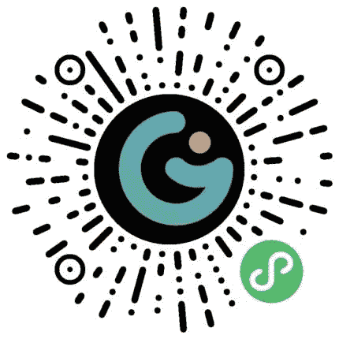

# 直击企业文本审查痛点，智能文本审查赛道方兴未艾

> 来源：[https://docs.feishu.cn/docx/Sle3dz5TUomzZzx9NqWcPFWnnfc](https://docs.feishu.cn/docx/Sle3dz5TUomzZzx9NqWcPFWnnfc)

今年以来，「企业合规」成为了企业服务，尤其是律师服务的热门领域。

实践中，企业合规最高频的场景不是合同，而是企业日常经营活动中大大小小的营销活动。比如今年 5 月，北京市中伦（深圳）律师事务所为一家上市公司“和而泰”出具的《北京中伦（深圳）律师事务所关于和而泰 2022 年第一次临时股东大会的法律意见书》，其标题将“临时股东大会”写成了“临死股东大会”，还有奥迪广告抄袭事件。

很多人纳闷，说中伦和奥迪这么知名的品牌，怎么还会犯这种错误呢？发出去之前难道不检查一下吗？

事实上，对于大多数公司来说，营销场景的「文本审查」是个很大的挑战。

企业需要增长，往往需要对外营销，营销就会涉及文案，涉及文案就有可能涉嫌抄袭或《广告法》禁止使用的极限词，面临侵权和行政处罚，这就需要做文案审查。

但问题是，文案审查这事儿挺难的。

**大多数企业并没有审查文案的能力，它们通常没有设置文案审查职能的岗位，甚至没有**承担文案审查职能的人员，即便有人承担文案审查工作，多数人实质上也没有审查的能力。

为什么？

首先是文案审查难度很大。

我们都知道，知识产权分为著作权、专利权、商标权等。专利不侵权好办，上国家知识产权局查就行，但文案这种东西，它往往没有申请专利，也没有写成论文可供查重，比如我在网上拍一条视频，写一条🧣，或者发一条朋友圈，都可能被抄袭。

为了解决这个问题，企业需要雇很多专业的审核人员和技术人员，爬取和审查全网的文案，成本非常高，所以很多企业不愿意为此花这么多钱。

**其次，虽然市面上有一些以「智能」为名的文案审查产品，但其实**智能审查极限词，而且这一场景也解决不好。

具体来说，只要文案中涉及广告法禁止使用的极限词，这些产品都会给你标注出来，可能还会给你标个风险等级，哪些是绝对不能用的，绝对会被罚，哪些用了有风险，可能会被罚等等。仔细想想，这些产品和律师很像，就是“Mr.No”：我把可能存在的风险都告诉你了，你自己决定吧！

但问题是，企业有能力做出判断吗？

并没有。对于企业来说，肯定是极限词的营销效果最好啊，而且处罚也不一定落到我头上，就看谁是那个倒霉蛋了 —— 这就是墨菲定律，索性抱着侥幸心理，用了就用了。

**总之，企业很难做。**

那让律师做可不可以呢？

律师也是人，也面临以上问题，想想看，审查全网的文案，你能保证不出错吗？

**换言之，**企**业文案审查面临的挑战主**要有两个：「人性」和「好的技术性解决方案」。「人性」的问题取决于企业自身的认知，短期内有明显改变很难，只能通过教育解决，而「好的技术性解决方案」可以有所作为的。

目前，市面上的「智能文本审查」产品存在一些技术难题，即只能提出风险，无法给出针对性的建议或解决方案，就像很多律师一样，而企业没有能力作出判断的。

为什么？

对于一个人来说，敢下判断是因为足够专业，反之亦然，对于机器来说也是如此。

这个问题的背后，其实是数据库的问题。

为什么这些产品只能提示风险程度，不能提示哪些情况有风险，做了大概率会被处罚？因为这些产品的数据库中，法律/法规/政策的及时性不够，即便足够有及时性，也不敢给客户明确的建议，因为这意味着要担责。

同理，为什么有些律师只能提示风险，或者在某个数据上只能给个参考区间，因为你没做过足够多的案例，就无法通过行业数据给客户提供精准的建议，而且也有不愿意担责的原因。

但是，当你能给出非常精准的建议，客户就会听你的。就像比尔·盖茨说的：“我相信，如果你向人们展示问题，并向他们展示解决方案，他们就会采取行动。”

**因**此，「智能文本审查」类产品需要解决的问题就变成了：如何建设好数据库？同理，律师或咨询公司需要解决的问题也变成了：如何提高服务客户的数量？

除了极限词审查，文案侵权也是很大的场景，因此想做好智能文本审查也不容易，一方面要审查全网的文本文案，另一方面还要审查全网音频和视频里面的文案。

「[智能文本审查](https://mp.weixin.qq.com/s?__biz=MzUzOTcwMTE5OQ==&mid=2247485596&idx=1&sn=12e93c2572e2ab20cbb8257e361c6d88&chksm=fac5323ccdb2bb2a5be1818c3630d3d157e4834250436e2d92ae36d462540a3dd6458243e08a&token=2111952427&lang=zh_CN#rd)」[虽然任重道远，](http://mp.weixin.qq.com/s?__biz=MzUzOTcwMTE5OQ==&mid=2247485050&idx=1&sn=10907ae7744431e05fe6ca3519100698&chksm=fac53cdacdb2b5ccca6dd615c895ecb1b5f544a2feb45a452fe5ee0b5d8ec637764f3f8debb5&scene=21#wechat_redirect)但也是个蓝海，目前多家法律科技公司均推出了这类产品，比如法律修音机曾经介绍过的「幂律智能」和「秘塔写作猫」，另外还有部分通用型产品（如飞书文档」）以及内容平台的文章编辑器（如头条号）也提供文本纠错功能，在创作过程中就可以实时纠错，非常方便。

2022 年 11 月 11 日，幂律智能正式推出针对广告营销场景的智能文本审查产品「广审助手」，致力于降低企业和个人被处罚的概率。

与市面上常见的文案审查产品相比，「广审助手」提示的风险除了风险类型和法律依据以外，还包括真实的案例，而且除了文档和图片，还支持审查视频。

[12 月 5](https://mp.weixin.qq.com/s/8TcZqVIcE3wwRoAbSqf3Sw) 日，另一家法律科技公司「法狗狗」也推出了智能文本审查产品「火眼审阅」，依托人工智能技术，能够识别不同格式文档、自动读取文档内容、精准比对文档，辅助人类秒速处理“重复、枯燥”的文本工作。

2023 年即将开启，法狗狗联合上上签、法天使、威科先行、安盾网等众多伙伴，共同推出“法律人工作 2.0 福利大礼包”，超多惊喜权益，助力法律人提升工作效率，满足日常充电学习、高效办公所需。

福利

**活动时间：**12月7日-12月12日

**领取方式：**

1.  扫描下方二维码，进群后联系小助手获取活动宣传内容；

1.  将获取到的宣传内容转发至朋友圈（保留至少 3 小时）；

1.  3 小时后截图并发送至小助手，即可领取福利包。

（尾图 + 群二维码）