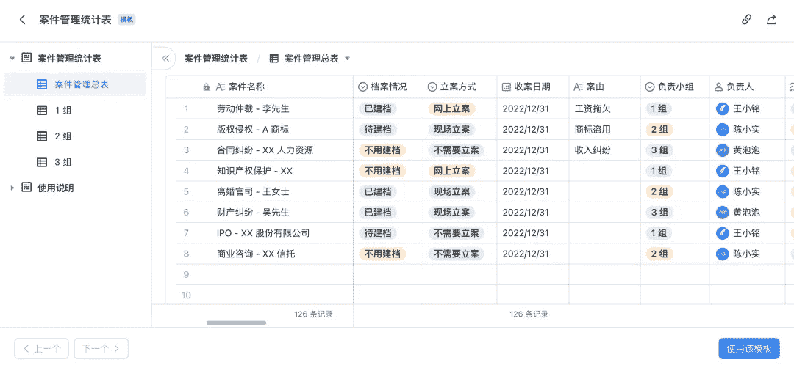
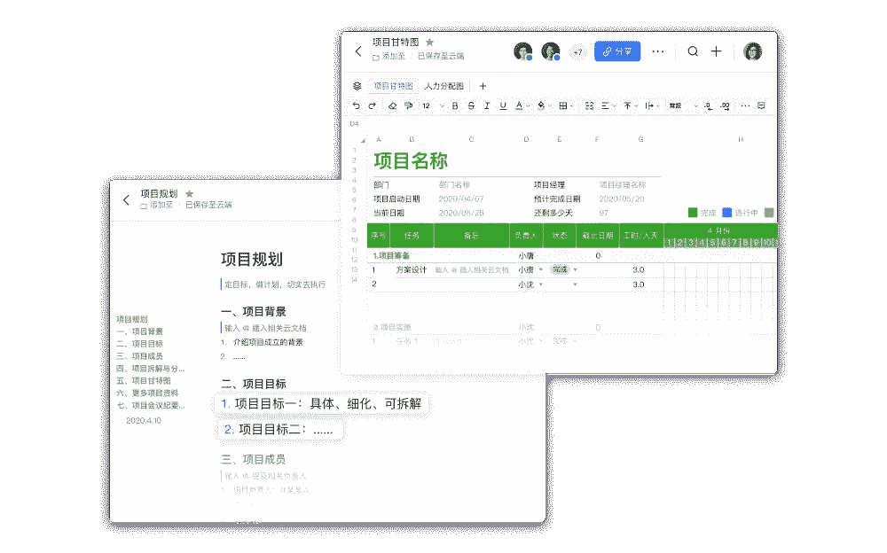

# 飞书可以替代部分法律科技产品了，但也没那么简单

> 来源：[https://docs.feishu.cn/docx/doxcnpV10Bb5TloOHVkUDvDVXac](https://docs.feishu.cn/docx/doxcnpV10Bb5TloOHVkUDvDVXac)

---

当巨头下场，如何与之抗衡？

这是我在创业过程中经常思考的问题。虽然唯物辩证法告诉我，内因起决定作用，但内因和外因是辩证统一的，所以也要适当关注外因。事实上法律修音机的第一篇文章《融了 4 亿多的 Atrium 都倒了，法律科技创业还有前途吗？》就是我写的一篇竞品分析文档。

竞争环境是典型的外因，而其中的关键因素就是行业巨头。巨头有更多的钱、更多的资源，这是巨头相对于创业公司显而易见的优势。

虽然钱和资源也不总是无往不利，我们都知道「创新者窘境」，优秀的创业公司总能依靠创新和恐怖的执行力赢得胜利，但问题是，能够颠覆巨头或者能够抵御巨头冲击的创新非常少。

它要么是「颠覆性创新」，要么具有较高的专业壁垒，而且市场规模或者利润率还不足以吸引外部资源大举进入。所以这个问题，投资人会问，也是一个合格创业者需要思考的问题。

法律修音机曾在[《巨头生态给律师行业的启示》](http://mp.weixin.qq.com/s?__biz=MzUzOTcwMTE5OQ==&mid=2247484095&idx=1&sn=70748635ed038f0392419a9ef21cbf98&chksm=fac5381fcdb2b109ec54f15c6e6b4ebb1ada0a50c579e15715959cae501c986c54ef814db70b&scene=21#wechat_redirect)中提到：当某件事情发生时，一定有其背后的逻辑，但我们往往一无所知。

**当**巨头下场，我们所处的这个行业，会如何被它改变？我们所熟悉的业务模式和工作方式，又会遭受怎样的挑战和冲击？

这其实是一个「狼来了」的故事 —— 我们总是在讨论巨头会不会做，但这个寓言的结尾是狼真的来了，所以问题应该是巨头会做哪些领域？

事实上，国内互联网大厂布局法律科技已有数年，初衷往往是为了解决自身庞大的法律服务需求，但近年来似乎发生了一些变化：

**从**研发特定领域法律科技产品（如合规科技），到研发通用型产品（如 IM、OA），且能够适用于法律服务场景。

飞书就是一个典型例子。

飞书官网有一篇《法律服务行业：飞书帮你打包解决 4 大工作场景》（可点击阅读原文查看）—— 这是一篇介绍如何使用飞书解决律师办公和律所管理部分需求的文章。比如：

# **场景一：销售线索管理**

一家律所的市场部（如有），每天收到的销售线索又多又杂。没有统一、标准化的线索管理跟进系统，不仅难以统计销售线索真正的转化率，还会影响跨部门之间的协作效率。

## 解决方案：「多维表格」 用一张表轻松搭建“线索需求池”

用多维表格管理线索需求，能实现：

+   信息实时汇总编辑，开启高级权限，协作的同时有效保障数据安全

+   分组、分视图，多维度查看信息

无论是查询跟进线索、案件分配、进度追踪，用一张表就能进行轻量化管理。

在我看来，多维表格已经可以替代绝大多数 CRM 产品了。CRM 系统的价值主要是什么？无非就是按照负责人或跟进时间等不同维度对信息进行分组筛选，让线索按照自己需要的方式排列。而这些功能，多维表格都能实现。

## 场景二：与客户沟通案情

客户经理在前期跟当事人了解案情时，沟通信息量极大，访谈后整理材料、提炼关键信息耗时费力。律师经手后，也往往需要重新梳理案件材料，进行二次消化。

## 解决方案：「飞书妙记」 一键录制，自动生成文字记录

用飞书视频会议跟客户开会并进行录制，录制内容会实时转为文字，会议结束后，录制的妙记文件将自动发送给会议组织者/主持人，包括：

+   会议的音视频画面

+   音视频自动转化的文字版记录（与音视频画面对应）

客户经理可以对妙记文件进行编辑、分享，或直接导出为飞书文档，快速完成二次编辑。

另外，你还可以在文档中嵌入不同文件形式的材料物证（如图片、mp4、word、PDF 文件），完善背景信息，有助于接手律师更快理解案情全貌。如果有哪处需要重点关注，也可以直接在文档中 @负责律师，对应的同事会自动收到消息提醒。

## 场景三：案件分配及跟进

案件分配给负责律师跟进后，律师往往需要重新梳理客户以往资料，并且在关键时间节点前完成法律文书的筹备撰写。在此期间如有任何变化或进展，也免不了与多方反复沟通。

## 解决方案：「日历」 把日历变成专属“案件管理看板”

创建一个“案件管理中心”的公共日历。分别为每个案件单独创建一个专属日程，覆盖整个案件处理周期，还可以将所有相关材料放进日程详情中，以便统一查看。客户经理和律师都可以订阅，查看律所同期所有案件的进度以及每位律师的排期。

你还可以将案件日程发送给对应的外部当事人，并把他们邀请到案件专门的讨论群中。这样所有相关方都能第一时间了解案件的处理进度，如果有任何问题，也可以在群里一起参与讨论，节省了问来问去的时间。

## 场景四：文书撰写与存档

客户资料、案件证据、法律文书材料多，材料的撰写与筹备离不开团队协作，成员之间反复发送不同版本的文档，讨论修改意见，耗费了大量时间。历史文件如何留存整理，又是一个难题。

## 解决方案：「飞书文档」一个文档链接，告别 V1.0 到 Vx.0

用飞书文档直接协同编辑，可以在线起草、修订内容，针对具体内容实时互动、评论，也可以直接 @同事进行补充、修订。如果有相关辅助办案的证据材料，无论是图片、音频还是 word、PDF，都可以方便地嵌入飞书文档中，方便成员一同查看。内容准备完成后，可以把文档便捷地导出为 word 形式，再进行最终的格式调整。结案后，可以将所有相关文档整理在云空间中，进行存档，方便日后查看。

以上使用场景，均是由飞书 —— 一款在线办公平台的多维表格、飞书妙记、飞书云文档、飞书日历、云空间等办公套件实现的。

早年间，部分法律科技公司正是从 OA、IM、CRM 这类需求更高、市场更大的场景切入，并获得了一定体量的律所或律师用户。

但是 OA、IM、CRM 这类通用需求市场很大，那么我们就有理由判断，作为一家走在时代前沿的公司，字节跳动肯定会涉足相关领域，对现有玩家带来挑战，飞书就是一个典型例子。

事实上，我认为飞书已经可以替代类似的法律科技产品了，比如面向律师办公和律所管理的 OA、IM、CRM 等产品。

**但是，说到替代现有产品，其实也没那**么简单，梦想和现实之间往往隔着一条鸿沟。

一方面，律所管理这个市场太小，飞书大概率无意与法律科技公司直接竞争，带来的影响还有待观察。事实上，如果一个产品不真正下场直面竞争，只是在市场层面宣传造势，通常雷声大雨点小，对其他行业的冲击是非常有限的。

另一方面，产品创新也不是成功的唯一路径。

虽然我个人很喜欢飞书，以上介绍的场景也确实 work，但飞书真的能甩其他产品几条街吗？那倒也不至于。有的人就喜欢用钉钉，腾讯文档很多人也爱用。虽然飞书看起来侵略性很强，似乎能改变各行各业，网上也有很多重度用户在疯狂安利，但市场格局好像也没有多大改变。

我也经历过一些匪夷所思的工具选型。

比如飞书的打卡、审批等日常办公高频应用这么好用，但我们公司却上线了一个极其难用、每天都在恶心我的 HR 产品，而上线这个产品居然是为了置换服务以及满足 HR 部门的需求。

又比如我们公司上线了一个 CRM 系统，上线前 invlove 了各个业务部门，说可以给大家赋能，但用了快一年，除了销售部门能用起来的没几个，而且各种功能需求实现不了，对我更是一点价值都没有。在我看来，这个 CRM 系统能做的事情，用一个在线表格就能搞定。对工具的认知水平也会直接影响工具选型。

我至今难以理解这些工具选型决策。

以前我可能会说，创新的产品总会胜出，但亲身体会之后，我现在已经不这么认为了。

飞书刚推出时各种引领用户，但现在也做了很多妥协。因为喜欢和需要创新的用户并没有那么多，愿意付费的客户就更少了，而飞书作为一个商业化产品，也是要给公司带来盈利的。

**所**以归根到底，一个产品只能吸引气味相投的用户，没有哪个产品能一直赢，因为进化论告诉我们，这个世界就是会允许多样性存在。

飞书会给各行各业带来多大的影响？

让我们拭目以待。