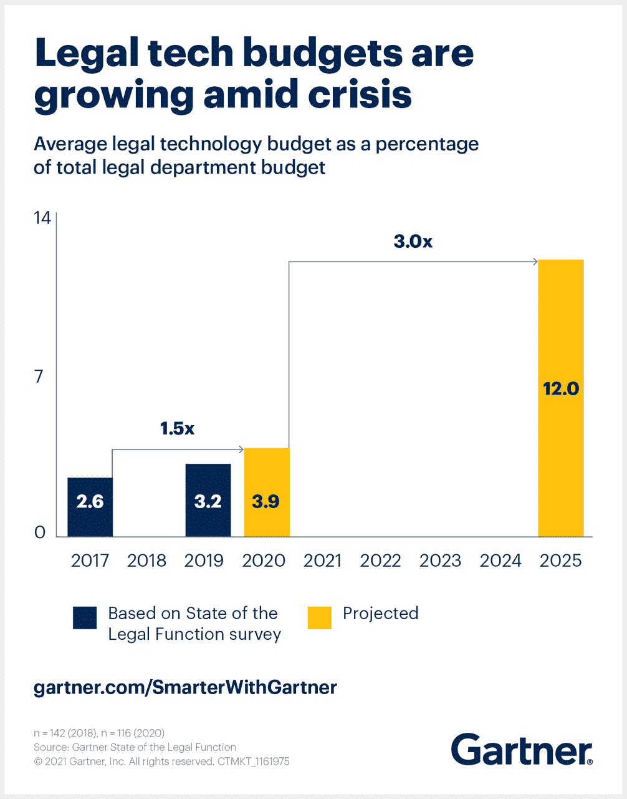

# 知名咨询公司 Gartner：改变企业法务部门的 5 个法律科技趋势

> 来源：[https://docs.feishu.cn/docx/GuKFdsiDcoV2MxxRxtwcgJBpnPb](https://docs.feishu.cn/docx/GuKFdsiDcoV2MxxRxtwcgJBpnPb)

目前，法律科技可以为法律从业者提供在生产力和盈利能力方面获得显著提高的潜力，已经成为行业共识，而且这个趋势一直在持续发展。

在这个趋势下，如何更好把握科技的发展方向，不论是对法律从业者还是对法律科技公司来说都至关重要。近几年来，国内外多家法律科技公司和先锋法律人们做出了自己的预测，法律修音机翻译了这些文章，并进行持续放送。

[2](https://www.gartner.com/smarterwithgartner/5-legal-technology-trends-changing-in-house-legal-departments)022 年 2 月 24 日，Gartner 发布了《5 Legal Technology Trends Changing In-House Legal Departments》—— 改变企业法务部门的 5 个法律科技趋势。这篇文章首发于 2021 年 2 月，Gartner 团队对其进行了更新。

众所周知，极少人有能力对未来作出精准预测 —— 预测的未来离当下越近，作出精准预测就越难。这篇文章发表于 3 年前，目前距离 2025 还有 2 年，Gartner 作为海外知名的咨询公司，其预测是否会出现？让我们拭目以待。

以下，enjoy ：）

---

> Gartner 法律科技趋势向法律领导者展示了如何利用法律科技推动业务增长。

**简而言之：**

+   新冠疫情带来了新的压力，这迫使更多的企业法务部门追求或考虑自动化，尽管长期以来他们一直抵制该领域的变革。

+   Gartner 专家预计，到 2025 年，法务部门在法律科技上的支出将增加三倍。

+   以下五个预测，可以帮助企业法务领导者规划法律科技投资和更广泛的转型工作。

长期以来，企业法务部门一直抵制自动化，不愿承担风险，但疫情的影响迫使很多人从 2020 年开始改变方向，去追求 —— 或者至少积极考虑 —— 某些法律工作更广泛的自动化，尤其是那些围绕重大公司交易的工作。现在的挑战是：采用哪些技术来推动真正的业务增长。

Gartner 咨询总监[ Zack Hutt](https://www.gartner.com/en/experts/zack-hutto)o 表示：“新冠疫情带来的压力是这一转变的催化剂。（与企业其他职能部门相比）企业法律和合规团队很少是现代化、数字化和自动化的领跑者。疫情降低了法务部门的人力预算，同时增加了工作量，对于很多法务部门来说，技术是最明显的解决方案。”

**立即下载：**[高效法律部门做对的 5 件事](https://www.gartner.com/en/legal-compliance/trends/cost-effective-legal-departments)

Gartner 的研究强调技术创新对企业法务和合规目标的影响。特别是，它着眼于法律科技对企业法务生产力和效率的积极和直接的影响、其降低不断提高的合规风险和复杂性的潜力，以及它在法律价值链上的转型作用。

以下五项预测，可以帮助您规划 2021 年及以后的法律科技投资和更广泛的转型工作。

### 到 2025 年，法务部门在法律科技上的支出将增加三倍。

根据 [2020 年 Gartner](https://www.gartner.com/en/newsroom/press-releases/2020-12-17-gartner-survey-shows-outside-counsels-share-of-legal-spending-down-6-percentage-points-since-2018) 对[法律领导](https://www.gartner.com/en/newsroom/press-releases/2020-12-17-gartner-survey-shows-outside-counsels-share-of-legal-spending-down-6-percentage-points-since-2018)[者](https://www.gartner.com/en/newsroom/press-releases/2020-12-17-gartner-survey-shows-outside-counsels-share-of-legal-spending-down-6-percentage-points-since-2018)[的](https://www.gartner.com/en/newsroom/press-releases/2020-12-17-gartner-survey-shows-outside-counsels-share-of-legal-spending-down-6-percentage-points-since-2018)[调研](https://www.gartner.com/en/newsroom/press-releases/2020-12-17-gartner-survey-shows-outside-counsels-share-of-legal-spending-down-6-percentage-points-since-2018)[，](https://www.gartner.com/en/newsroom/press-releases/2020-12-17-gartner-survey-shows-outside-counsels-share-of-legal-spending-down-6-percentage-points-since-2018)到 2025 年，用于技术的法律预算将大幅增加。

2020 年，87% 的法务部门预计其全职员工总数将保持不变或减少。

Hutto 表示：“新冠疫情给工作量本已非常饱和的企业法务团队带来了更大的工作量，人员配备却保持不变。法务领导人已经看到，其他部门的技术投资成果显著，法律科技市场也取得了重大进步。这将推动他们扩大技术使用，以改善工作流程和提高生产力。”

制定一项能长期随着企业环境的变化和科技市场的进步而发展的法律科技战略，对于法务部门的成功至关重要。法务部门应该避免临时购买技术服务，这些技术往往与支持实现短期和长期业务目标的职能不一致。

### 到 2024 年，法务部门将用“非律师”工作人员取代 20% 的律师工作。

工作量增加和预算持平的趋势，让企业更加重视效率。这意味着法务部门必须改进其工作流程，部署法律科技、分析工具和其他数字化战略，以支持这种增加的工作量。

**现在下载：**GC 必须在 2025 年之前做出的 6 个转变

目前，效率问题已经促使法务团队去思考如何最大化地利用时间和专业知识，包括将工作从律师转移到非律师人员。然而，推进这些改进和创新工作，可能需要一套不同于传统法律教育培养的技能或观点。

对此，考虑一下法律运营（Legal Operation）岗位。曾经几乎只在技术或金融服务公司中才有成熟的法律运营岗位，2020 年所有行业的受访部门中有 58% 设置了这一岗位，高于 2018 年的 34%。

该角色的设置往往会随着组织规模的增加而增加。企业法务团队中的下一个创新角色是什么？Gartner 研究发现，法务部门对法律项目经理（增长 56%）和法律部门雇用的数据科学家（增长 30%）的投资不断增加。

未来几年，领先的企业法务部门将更多地专注于不断权衡特定工作领域的资源分配，无论是依赖内部律师、内部非律师、律师事务所，还是“非律所”法律服务提供商。此外，他们还将通过在现有员工中培养技能，从其他内部职能部门（如通过轮换计划）或外部各方（如通过借调）借用专业知识，或者从新人才库中招聘，来提高团队内部的法律科技和创新能力。

**阅读更多：**[如何成为一名更高效的总法律顾问](https://www.gartner.com/smarterwithgartner/how-to-be-a-more-effective-general-counsel/)

### **到 2024 年，法务部门将实现 **50% 与重大公司交易相关工作的自动化。

目前，公司交易的需求已经从疫情导致的低点中回升。随着企业从疫情中恢复过来，并购工作将在未来几年继续增加，特别是在疫情的影响下，企业往往会降低收购估值。

Hutto 说：“我们 2020 年调研的法务部门中，有 87% 的受访者预计其全职员工总数将保持不变或减少。传统意义上，更大的工作量只能通过更高的内部生产力或昂贵的外部咨询来满足。但现在，自然语言处理和机器学习技术的进步，为处理这些工作开辟了第三条道路。”

但是，尽管自动化概念一直在宣传，市场对这个领域并没有特别感冒。在 2019 年的一份调查中，法务部门反馈称只有 33% 的公司交易工作已经自动化了，还有 55% 的工作是可以自动化的，这说明还有很大的提升空间。

对于自动化，没必要单干。一些领先的法务部门正在他们已经合作的律师事务所和“非律所”法律服务提供商中寻找愿意合作创新的伙伴。

成功的关键是先确定可以通过自动化解决的具体问题，而不是先部署法律科技再寻找问题。

### **到 2025 年，企业法务部门将仅获得其 CLM（合**同生命周期管理）投资潜在收益的 30%。

如前所述，自动化不是灵丹妙药，某些工作可以自动化并不意味着它很简单或者容易获得成功。最普遍、最有潜力的解决方案，如机器学习驱动的合同审查，在底层功能上有很大的复杂性。

此外，大多数法务部门对这些举措的规划都很糟糕。一个常见的错误是追求法律科技本身，而没有充分考虑业务或最终用户的需求。通常，考虑技术将如何推动改善特定运营功能或业务成果的组织比不考虑的组织表现更好。

如果企业法务领导者不能充分规划技术投资，就可能把钱浪费在采用不合适甚至不当的系统上。市面上对技术的营销，容易使人对技术抱有很高的期望，但这些期望很少能实现。

最关键的是，企业法务部门在追求这些技术和自动化举措时冒着很大的资本风险 —— 法律科技和自动化投资需要花费的时间比许多人想象的要长，法务团队平均需要 2.4 年才能收回初始财务投资。因此，利益相关者（比如公司老板）可能会对新技术表现不佳感到失望。

当法务团队不能纠正利益相关者对技术回报期不切实际的期望时，可能会导致其对新技术的负面看法。法务领导者可能会发现自己陷入一个恶性循环：利益相关者的失望会影响技术投资的持续性 —— 随着时间的推移，法务团队可能会失去改进和调整投资的重要资源。

如果负面情绪变得太大，组织就可能会被迫放弃一些技术计划，这可能会导致一位总法律顾问所说的“职业生涯时刻”：因为一项失败的合同生命周期管理（CLM）投资，其被迫注销了一项六位数的投资和数千小时的员工时间。

为了获得 CLM 投资的最佳回报，法务部门必须优先考虑与其工作流程成熟度相匹配的能力，而不是直接部署可能只能达到预期价值一小部分的技术 —— 这往往会影响团队能获得的支持。

### **到 2025 年，至少 25% 的**企业法律应用支出将流向非专业技术提供商。

长期以来，专业技术供应商一直主导着法律科技市场，最大的通用企业软件供应商在企业法务部门中的发展有限。然而，随着 CEO、CFO 和 CIO 们认识到法律和合规的战略价值，其对法律和合规转型的需求将超越各部门本身。

为了利用其他部门已经开展的一些更普遍的转型投资（比如线上办公），专业法律技术供应商将越来越多地在微软、SAP 和 Salesforce 等商业应用平台上构建法律应用程序，并确保容易集成 —— 这将吸引希望利用现有投资的大企业。

随着创新型初创公司利用人工智能、机器学习、高级分析、流程自动化和其他新兴技术，“非法律专门”技术的使用将有所提升。