# 通往AGI之路

> 来源：[https://docs.feishu.cn/docx/NDsAdX4spozsglxgqm7caJqdnVf](https://docs.feishu.cn/docx/NDsAdX4spozsglxgqm7caJqdnVf)

## 🎯 愿景和目标

> 要实现通用人工智能（AGI）也许有很长的路要走，
>
> 我们的目标是让每个人的学习过程少走弯路，让更多的人因 AI 而强大。

## 🔖 简介 | W[aytoAGI.com](http://waytoAGI.com)

欢迎来到通往 AGI 之路 / WaytoAGI社区是致力于人工智能学习的知识库与社区平台，提供系统全面的 AI 学习路径，整合资源、组织实践活动。覆盖近 900 万学习者，知识库访问量超 8000 万次，联动 180 所高校及 100 + 企业，举办 500 + 场活动。

[知识库介绍说明](https://waytoagi.feishu.cn/wiki/BE57wlWV2iDkOvkbYIockX11nTC)｜[通往AGI之路社区 业务](https://waytoagi.feishu.cn/wiki/PhZwwGR7jinzLVkqohOc7oofnzf)｜[WaytoAGI 品牌 VI ](https://waytoagi.feishu.cn/wiki/Cvu8wBkLXiATBckEwl7c6eSvncf)

👸号：通往 AGI 之路

[Bilibili](https://space.bilibili.com/259768893)｜[📕](https://www.xiaohongshu.com/user/profile/6457d2e4000000001f030dbe)｜[Twitter](https://twitter.com/WaytoAGI)

## 🥳加入飞书知识问答

WaytoAGI知识库内10000+篇内容，现在一句话即可出现精准答案加原文链接！

[📌 提问入口（](https://ask.feishu.cn/shared-space/7226178700923011075?referrer=agi_zsk)[需先点击「](https://waytoagi.feishu.cn/wiki/KKF6wrrHBiXvJzkxP0wcD8dyn5f)[加入知识](https://waytoagi.feishu.cn/wiki/KKF6wrrHBiXvJzkxP0wcD8dyn5f)库」再提问）👉飞书客户端操作路径

## 🚗加入社区三部曲

» 1️⃣ 开源免费知识库，包含所有资料，最新动态和日常活动

解锁每月线下 AI 切磋大会、各类 AIGC 赛事...

资料地址（首页每日资讯+左上角目录可展开）

» [通往AGI之路](https://waytoagi.feishu.cn/wiki/QPe5w5g7UisbEkkow8XcDmOpn8e)

» 2️⃣ 日常共学：每天晚 8 点共学直播（必订！）

一键订阅直播日历，每天上新知识不漏看！

或关注 #通往AGI之路视频号

» [订阅日程](https://www.feishu.cn/calendar/share?token=e2b16267282604efa375f8829e3d2cc7)

» 3️⃣ 加入群聊：获取最新动态，参与交流共建

» [立即加入](https://waytoagi.feishu.cn/wiki/QPe5w5g7UisbEkkow8XcDmOpn8e#GjhAd91P5o988vxjOYwcdLPRn3c)

## 📝 欢迎投稿

不错的教程见解等欢迎投稿：

🔬 AI技术探讨与分析

💡 实践经验与案例分享

🚀 行业动态与趋势观察

💻 开发心得与技术教程

投稿要求：✅ 原创、严谨、有深度

📊 配图说明更佳

🎯 观点明确，结构清晰

📏 建议字数1500-5000字

审核流程：

📬 提交后2-3工作日反馈

✍ 必要时沟通修改建议

»»»[立即投稿](https://waytoagi.feishu.cn/share/base/form/shrcndlVeIpGvhhWvnsVfMhuFbf?iframeFrom=docx&ccm_open=iframe)

## 🫐社区最新栏目

### [Mini Camp](https://waytoagi.feishu.cn/wiki/W3k8wQJQviH6PbkFL5mcCYe2nmd?from=from_copylink)训练营进行中：[OPC创造营](https://waytoagi.feishu.cn/wiki/PzkNwVQ1yiTpFskoAPmcjaS5nme)

WaytoAGI Mini Camp 是 WaytoAGI 推出的轻量化 AI 系列活动品牌。

你有没有想过，脑海中计划了那么久的创业计划，什么时候才能落地？

WaytoAGI 和 Enter.pro 联合发起 Mini Camp 第二期「OPC创造营」，用一周时间，带你从 0 到赚取一个真实产品的第一桶金。

不需要有任何编程基础，只需要有一个想法。

### 📺直播共学

所有历史直播回放看这里👇👇👇

[共学数据库（历史）](https://waytoagi.feishu.cn/wiki/UKqNw8Un0iaCsXkECfCcNkl0nGc?table=tbliNls1Wi1mV6bY&view=vewcZAYD0u)

4月24日[ 直播回](https://waytoagi.feishu.cn/minutes/obcn8otzx8ck73kexj5uydq1)放

4月20[日 直播](https://waytoagi.feishu.cn/minutes/obcn5xc39o6zebgp427f2662)回放

4月1[9日 直](https://waytoagi.feishu.cn/minutes/obcn49ktsag4vc3414np876f)播回放

## 🎡近期活动

[WaytoAGI近期活动](https://waytoagi.feishu.cn/wiki/So9cwfj9yiuZJ8kSfLZce7a8nrf)鼓励大家以赛代练，多参加活动，和社区小伙伴一起动手实操

## 🎏 近 7 日更新日志

查看所有更新日志：[4.3 历史更新](https://waytoagi.feishu.cn/wiki/FjiOwWp2giA7hRk6jjfcPioCnAc)

### 4 月 27 日

+ 《[AI音乐周刊 W.A 025](https://waytoagi.feishu.cn/wiki/Jw0xwNk0EiFkqWk75p9clxfSnBc?from=from_copylink)》AI音乐行业正迎来高速变革，本周资讯整合了产业数据、平台政策、工具更新与前沿学术成果，带你快速拆解核心趋势。主流流媒体纷纷出台差异化管控策略，完善AI音乐标注、反刷量与版权监管体系。多款音频大模型、编曲工作站全新升级，降低专业创作门槛，版权方也布局智能维权技术。多篇顶会论文，覆盖音乐生成、音频分离、乐谱识别等技术突破。

+ 《[4.19-4.26｜本周 AI 论文精选](https://waytoagi.feishu.cn/wiki/PYyKweMx0ikbK2kqILrcuCy1nhd?from=from_copylink)》本期AI精选论文速递，集中拆解了十大重磅研究与模型革新。DeepSeek V4凭借原生百万超长上下文架构，以开源成本比肩闭源顶尖模型。自我进化Agent、轻量化模型蒸馏、按需检索等创新方案接连落地，高效解决传统架构高耗能、检索冗余、扩展受限等痛点。同时，研究深挖多智能体同质化、RAG落地短板等关键问题，结合无状态记忆设计、自主知识生成与EDA工具迭代实践，搭配深度学习理论新探索为模型部署、Agent开发、技术优化提供了前沿解法！

+ 《[用 Subagents 保持 Claude Code 上下文干净（译）](https://waytoagi.feishu.cn/wiki/Fq5lw2ZDVi0oNeku7ZCcaMk5nxb?from=from_copylink)》长时间使用 Claude Code 时，上下文会很快变得一团乱。每一次 `grep`、`find`、`ls` 都会留在你的上下文里，占掉大量你之后根本不会再读的空间。Subagents 就是为了解决这个问题：它们会在自己的窗口里完成工作，最后只把结果带回来。这篇文章会直接切入重点：subagents 是什么、如何创建一个、Claude Code 自带了哪些内置 subagents，以及如何通过 `CLAUDE_CODE_FORK_SUBAGENT=1` 来 fork 上下文。

+ 《[AI Engineer 学习路径（译）](https://waytoagi.feishu.cn/wiki/LCSHw5fXqi0UbIkfFXec4H7OnQc?from=from_copylink)》这是一份非常实用的路线图，告诉你该学什么、按什么顺序学，它基于大约 2000 份真实岗位描述中的需求总结而来。如果你想进入 AI engineering，而不只是停留在 ML 理论层面，这条路径更贴近生产环境中的真实系统构建方式。

+ 《[喝点VC｜a16z联合创始人：真正危险的不是投错项目，而是错过下一个Google](https://waytoagi.feishu.cn/wiki/ZSZCwzGsEigPFBkpqSmcvENunlb?from=from_copylink)》 a16z (Andreessen Horowitz) 是一家风险投资公司，以其多元化的投资领域著称，被投资公司包括 Airbnb 、 Meta 和 Twitter 等。本次访谈，20VC with Harry Stebbings和 a16z 围绕风险投资、创业者判断、AI、宏观环境与个人心智展开。

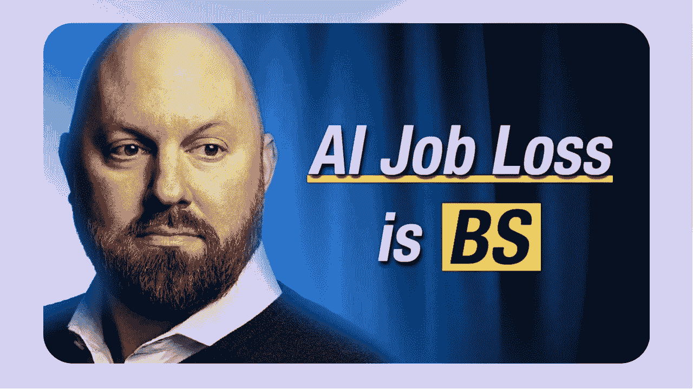

+ 《[YC CEO：如何让 Claude 为你的 AI 工程团队编写代码？丨Y Combinator](https://waytoagi.feishu.cn/wiki/Kv8xwMDDGiGKkvkhcOJcUGeSnCd?from=from_copylink)》YC总裁兼CEO Gary Tan早年在 Palantir 做过工程师、设计师和产品经理，后来联合创办 Posterous，也写过 YC 内部社交平台和知识库 Bookface 的第一版。本期对话试图回答一个更具体的问题：当 Claude Code 这类 agent 已经能写大量代码时，人应该怎样组织它，才不只是得到一堆看起来合理、实际会坏掉的代码？

### 4 月 26 日

+ 《[你不知道的 AI Coding：非技术人的上手、场景与实战](https://waytoagi.feishu.cn/wiki/Nl2Xwa1vSifcCzkYMz2c4EitnDd?from=from_copylink)》这篇实用指南面向产品、运营等非技术人群，拆解了Claude Code零门槛落地玩法。本篇文章分享了需求精准描述、项目规范配置、Skill工作流沉淀等核心技巧。无需深厚的编程基础，就能搭建高效AI工作流，将重复繁琐工作自动化，全面提升日常办公与内容产出效率。

+ 《[为 Agent 设计产品【译】](https://waytoagi.feishu.cn/wiki/C01kwFKSEiRRZkkYGXVc2XIHnwd?from=from_copylink)》人机交互正在迎来颠覆性转折，传统图形界面不再是软件的核心入口。企业软件正全面向Agent适配升级，依托MCP等协议实现无界面自动化操作。本篇文章结合真实产品案例，拆解了Agent时代的产品设计关键：主动提供规范标准、搭建反馈机制、补齐信息缺口，为产品研发与企业数字化升级提供全新设计逻辑与落地方向。

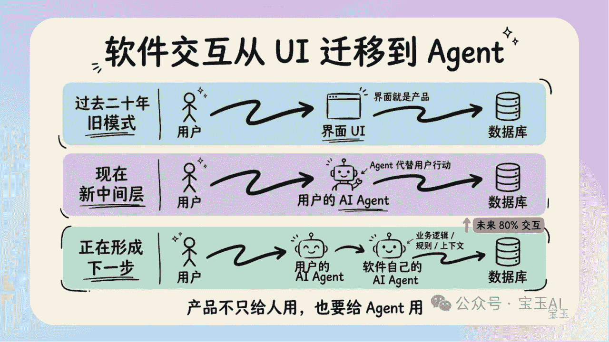

+ 《[记忆，是 Agent 基建｜对话 Calvin@Vida](https://waytoagi.feishu.cn/wiki/KuLiwf9cAiobk7kZjhechzaYnOb?from=from_copylink)》随着大模型性能趋近同质化，专属记忆能力已成为AI体验突围的关键。对标OpenAI付费封闭的Chronicle，开源项目OpenChronicle横空出世，以本地优先方案夺回用户记忆所有权。它搭建跨应用统一记忆池，借助MCP协议打通各类AI工具，实现工作行为与项目上下文无缝衔接。跳出单一对话记忆，深耕行为习惯沉淀，为主动式Agent筑牢底层基建，打破大厂生态绑定，给用户自由、连贯、无束缚的AI全新交互体验！

### 4 月 24 日

+ 《[顶级孵化器YC的最新指南：如何构建AI Native的团队，为什么传统管理层正在消失？](https://waytoagi.feishu.cn/wiki/Pm0wwLzpxikm2mknS4acxkpin0h?from=from_copylink)》

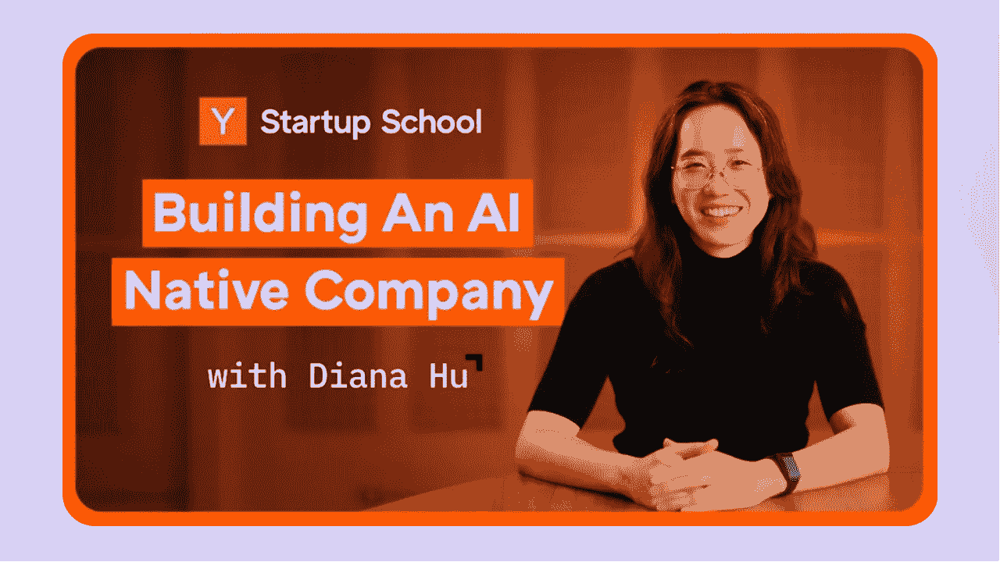

+ 《[子智能体 vs 智能体团队：颠覆全局的架构抉择](https://waytoagi.feishu.cn/wiki/TAx1wE2XbiQ0dpkbZxFc0SOOn3e?from=from_copylink)》大多数的AI架构设计都存在核心误区，复杂任务盲目堆砌多智能体，反而加剧了协作混乱与信息损耗。本篇文章带你厘清sub-agent与agent teams的底层区别，可以帮助你规避上下文断层、协调成本过高的问题，高效搭建轻量化、高稳定、易维护的智能体系统！

+ 《[AI / ML 所需线性代数知识（完整路线图）](https://waytoagi.feishu.cn/wiki/UTSCw2RD5i9W55kMiLZcM6HJnZF?from=from_copylink)》做 AI / ML 并不需要数学博士学位。你只需要掌握足够的线性代数，这样在打开论文或 PyTorch 文档时，不会总觉得自己在迷雾里打转。这份路线图会按正确顺序告诉你该学什么，以及为什么它重要。

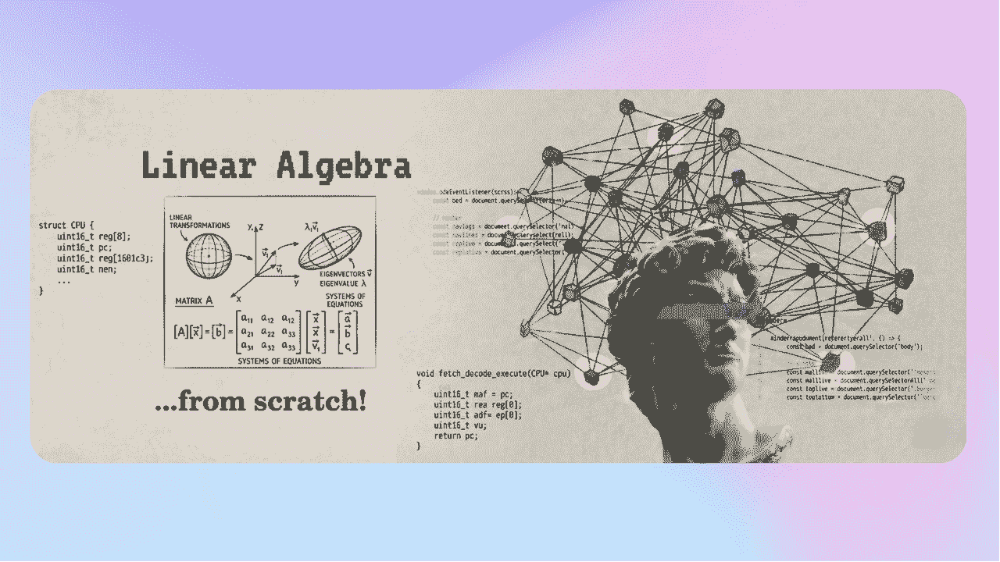

+ 《[Z Tech｜对话王子涵：离开DeepSeek，我人生的逆向思考](https://waytoagi.feishu.cn/wiki/FsT1wvukii49sVkZrrQcE2binof?from=from_copylink)》本篇深度对话对话顶尖青年AI学者王子涵，介绍了他的学术成长与DeepSeek实战经历。结合一线研发经验，他拆解了MoE模型优化、强化学习训练缺陷，剖析推理坍塌、环境噪声等行业共性难题，还给出了可落地的过滤优化方案。快来一探究竟！

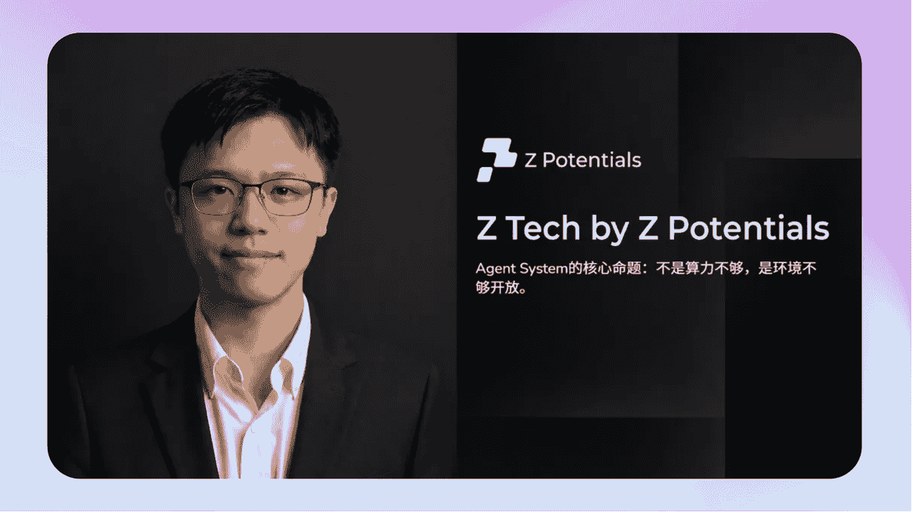

+ 《[如何构建一个 Deep Researcher（译文）](https://waytoagi.feishu.cn/wiki/QVjbwk5bYiAT9Jk5cDlcC7g0nBd?from=from_copylink)》本篇文章带来一套百分百开源、支持本地自托管的深度研究技术栈。整合Onyx检索、CrewAI流程编排与Voxtral语音能力，通过分层隔离、迭代反思、多维度检索规避幻觉。整套方案代码完全开放、可以自由定制搭建，既能保障数据主权与合规性，又能低成本搭建高质量私有化AI研究工作流，快来上手试试！

+ 《[DeekSeekV4发布](https://waytoagi.feishu.cn/wiki/Cz3fwvWcVieOMxkePAtcQs41n6O?from=from_copylink)》4月24日，备受期待的DeepSeek全新系列模型——DeepSeek-V4预览版，终于正式上线并同步开源。在业界长达数月的猜测与等待后，DeepSeek没有让大家失望：它带来了1M（百万）超长上下文的普惠标配、Agent能力的全面跃升，以及一次引人瞩目的国产化转身。

+ 《[Cat Wu 面试了几百个 PM 候选人，几乎没人答对一个问题：AI 产品经理到底应该干什么？](https://waytoagi.feishu.cn/wiki/Vn35wYDOeiaVWmk2jIxcORTVnXg?from=from_copylink)》Anthropic Claude Code和Cowork的产品负责人Cat Wu和Boris Cherny搭档，带着团队把产品功能的交付周期从半年压到了一天 。在Lenny's Podcast最新一期中，Cat 聊了Anthropic内部的速度文化、PM 角色的剧变、源代码泄露的善后，以及那个让开源社区炸锅的OpenClaw封堵决定。

### 4 月 23 日

+ 《[🧠✨ChatGPT 5.5 有了判断力](https://waytoagi.feishu.cn/wiki/MOTwwBN2oiHYo9kq5kvc9zZQnQd?from=from_copylink)》GPT-5.5 的核心意义，不是“更会答题”，而是更像一个能把复杂工作真正往前推进的执行型智能体。代码、知识工作、科研分析、网络安全全面进阶，400K 上下文支撑复杂任务，延迟不变、生成效率提升 20%，还助力数学难题取得新突破。今天已经开始向 ChatGPT 的 Plus、Pro、Business、Enterprise 用户滚动开放！

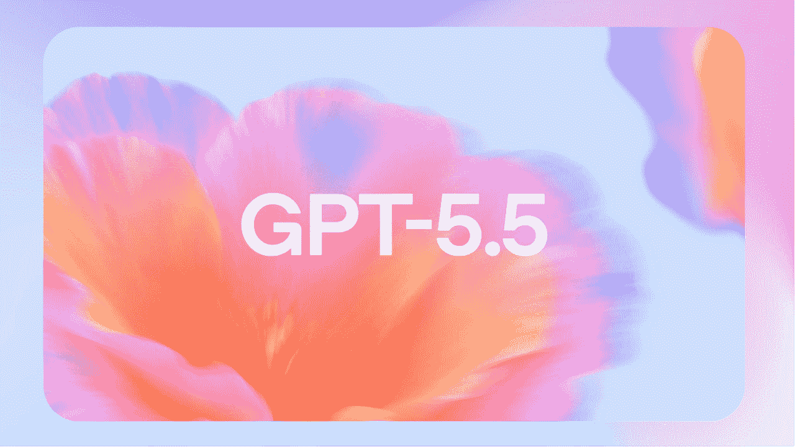

+   《[Kora产品负责人：如果Agent负责中间 80% 的工作，人还剩什么价值？丨Every](https://waytoagi.feishu.cn/wiki/QBFcwFdwsiwfIUkxSO7cVsVHnBf?from=from_copylink)》Kieran 是 Kora 的产品负责人，他在这期对话里，和 Dan Shipper 讨论了一个越来越紧迫的问题：当 AI 能做的事越来越多，人类的位置在哪？Kieran 的答案是：人类不是被挤出去，而是变成"三明治两端的面包"——在最开始定义问题，在最后打磨作品，中间的执行让 AI 去填。整个对话的核心，就是在帮你找到你在 AI 时代的具体位置。

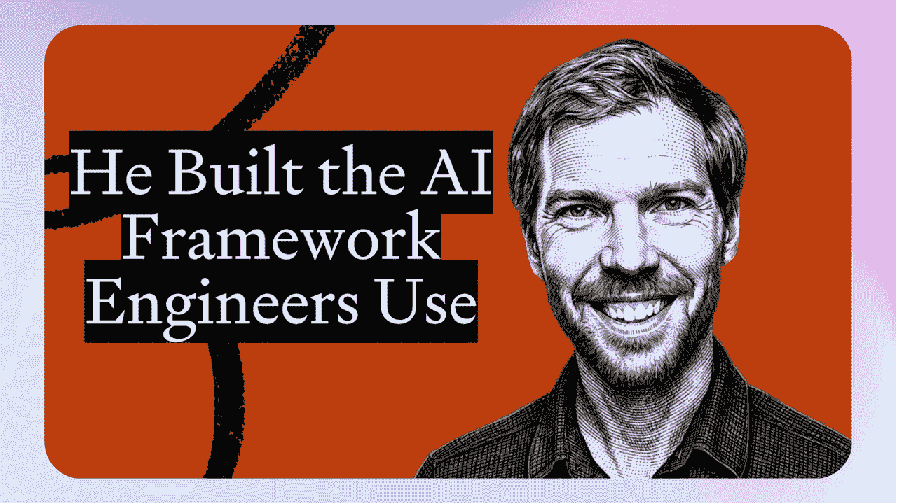

+   《[斯坦福经济学家：职业阶梯正在失效，年轻人该怎么在 AI 时代往上走？丨EO](https://waytoagi.feishu.cn/wiki/FS2zwmVVdiH0hykH93acCJ5bnqb?from=from_copylink)》斯坦福学者通过海量职场数据，揭示了AI冲击职场的残酷真相。AI精准取代了入门级标准化执行工作，而资深从业者却凭借经验与综合能力站稳脚跟。未来职场或许将是人统筹方向、AI落地执行的全新模式。如果你关心的不只是“会不会被替代”，而是“职业的起点还在不在”，这期几乎每一句都值得划线。

+   《[OpenAI 发布 Workspace Agents，接替 GPTs](https://waytoagi.feishu.cn/wiki/GXK5wDOd4iyN3skNzWQcTyyVncO?from=from_copylink)》OpenAI重磅上线Workspace Agents，依托Codex底层架构，可以快速搭建智能体，联动Slack、办公软件等多类工具，可以自动承接IT审核、产品反馈、周报统计、销售运维、风控排查等高频重复的工作。非技术人员也能自主搭建团队专属Agent。现阶段限时免费体验，快来试试！

## 4 月 22 日

+   《[可以优化生图提示词 的 提示词](https://waytoagi.feishu.cn/wiki/DvkYw6iagiAhz3kQ44BcEQAUnod?from=from_copylink)》猫叔这个针对GPT Image 2优化的提示词引擎，可以把你的模糊想法一键转为专业可用的绘图指令。系统自动识别角色、场景、叙事等五大类型，按主体、环境、光影、镜头、风格结构化输出，拒绝空泛描述，可以精准匹配画面逻辑与质感，减少试错成本与token消耗。新手也能稳定生成高质量图像，提升AI生图效率与成品率。

+   《[乔木博客免费开源，打造你的学习、分享阵地！](https://waytoagi.feishu.cn/wiki/OBiNwnGxaign12kUjIxcKtYUnUg?from=from_copylink)》乔木博客免费开源，专为内容创作者打造自主可控的知识阵地，可以摆脱平台封号与算法波动风险。系统集成了 AI 全流程辅助，写作与配图一步到位。此外还采用类飞书的所见即所得编辑器，支持多媒体插入与多状态发布，配合浏览器剪藏、Obsidian 一键发布等工具，大大降低了写作成本。快来试试！

+   《[大羽玩AI：《带你去玩球！》 技术白皮书](https://waytoagi.feishu.cn/wiki/PRKkwmxeni6PiTkSwFucQdkwnHd?from=from_copylink)》大羽的这篇万字拆解完整公开了北影节入围AIGC短片《带你去玩球！》的全流程创作，涵盖角色场景资产打造、分镜设计、多模型图生视频与动画剪辑技巧，另外还分享了场景一致性、运镜控制等实战难点的解决方案。大羽用低成本实现了高质感视听效果，为大家个人AIGC影像创作提供了可复用的实战思路，快来一探究竟！

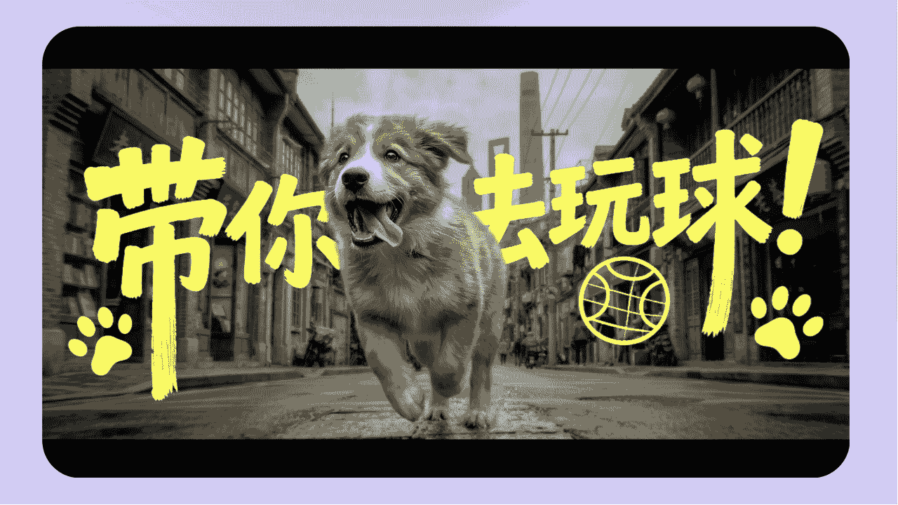

+   《[发现意图：AI 时代的用户体验设计](https://waytoagi.feishu.cn/wiki/FtYGwOMNJiIfy5k5m5QcWXKendc?from=from_copylink)》AI 改变的不仅是界面外观，而是用户角色本身 ——从"操作员（operator）"变成"监督员（supervisor）"。这使得 UX 从"命令式交互"彻底转向"意图委托式交互"。本文是 Jakob Nielsen （尼尔森诺曼集团创始人、UX 领域泰斗）写的关于 AI 时代用户体验设计的深度长文，核心是提出 "Intent by Discovery"（通过发现来明确意图） 作为 AI 时代 UX 的核心范式。

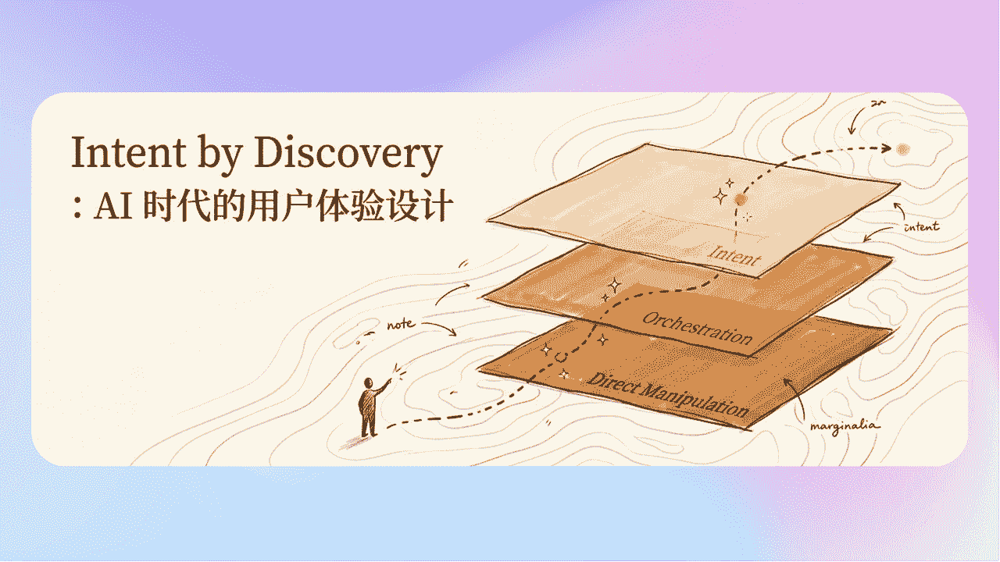

+   《[GPT Image 2 全量开放！100+案例，跟 Nano Banana 2 正面PK（附提示词）](https://waytoagi.feishu.cn/wiki/MhxZwJ742icTCXkGwE1cGC3RnSc?from=from_copylink)》GPT Image 2正式全量开放，打开ChatGPT就能用。小歪把能想到的场景全试了一遍，一口气整理了这篇可能是全网最全的Image 2提示词案例合集。合集涵盖写实摄影 、 游戏与娱乐场景、 UI 设计、海报设计与商业视觉、角色设计、知识可视化与信息图表、创意玩法、网页摘要与 知识图谱生成等多个大类，快来看看！

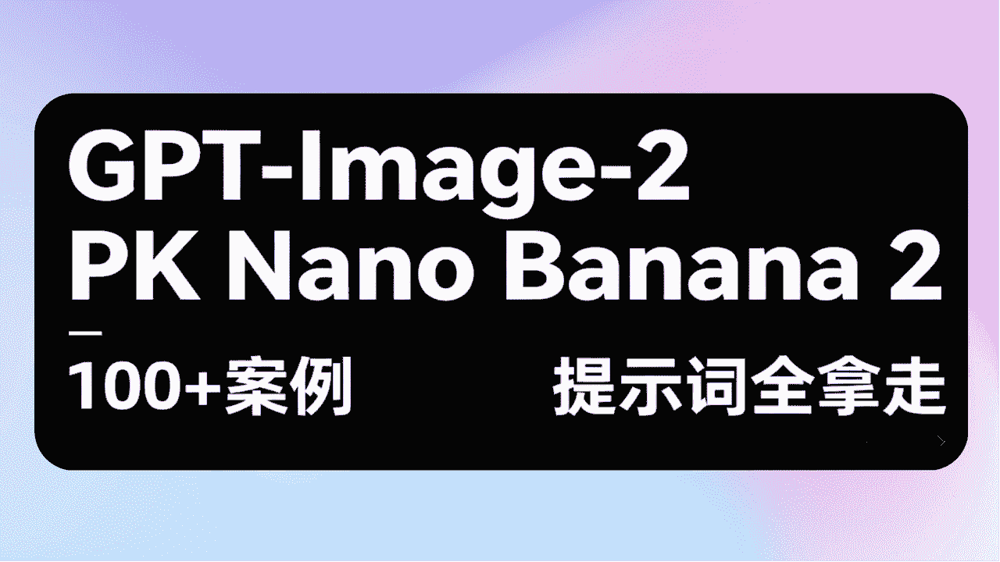

## 4 月 21 日

+   《[我逆向了Claude Design！免费开源！](https://waytoagi.feishu.cn/wiki/NF5uwRFuriAnpYkHMKTcERHpnbg?from=from_copylink)》花叔依托 Claude Design 精髓重构了工作流，打造了一个适配终端的设计 Skill。在终端一句话即可完成 PPT、可交互原型、动画等设计产出。还支持多风格并行生成，成本与效率远超传统工具。这篇文章讲三件事：为什么做这个skill、它能做什么（带一堆案例）、以及它和Claude Design的差异在哪里。

+   《[AI 编程三剑客：Spec-Kit、OpenSpec、Superpowers 深度对比与实战指南](https://waytoagi.feishu.cn/wiki/U69Twxw0miy8YokLpWacqYcInHh?from=from_copylink)》本文将深入介绍 GitHub 官方的 Spec-Kit、社区热门的 OpenSpec 以及跨平台方法论工具 Superpowers 三个 AI 编程辅助工具，从安装配置到实战使用，再到三者协同的最佳实践，带你全面掌握 AI 驱动的规范化开发新范式。

+   《[（可能全网最全/长的）Hermes Agent+K2.6 保姆教程 + 实战案例](https://waytoagi.feishu.cn/wiki/Bil6wRqJfiioswkyUFicgv4LnbU?from=from_copylink)》这篇超详细的Hermes部署教程，手把手带你用云主机+Kimi K2.6搭建高效AI Agent。从环境配置、一键安装、飞书机器人对接，到飞书 CLI 与 Kimi Code 陪跑 Agent 设置，轻松完成整套环境搭建。此外，作者还分享了多 Agent 创建、皮肤切换、全自动模式、记忆管理等实用技巧，快跟着一步步操作试试！

+   《[GPT-Image-2 全量上线，中文顶到爆，50+ Case 生图实测](https://waytoagi.feishu.cn/wiki/Vkv5wJzJuiRUsok0c6HcR2rInyd?from=from_copylink)》GPT-Image-2已经全量上线，在中文排版、复杂版式与长图文呈现上实现了跨越式升级。短短几句提示词，就能一键生成杂志封面、信息长图、复古海报、UI界面、古风印刷品等专业级内容，风格迁移精准、细节质感拉满。作者实测了五十张作品，覆盖实用设计与趣味创作，快来看看效果如何！

+   《[前 Google PM：从 PRD 到原型，Claude Code 正在重写 PM 工作流丨Aakash Gupta](https://waytoagi.feishu.cn/wiki/BEWpwdZZtitMKXksJYXcpHHOnNh?from=from_copylink)》Mahesh Yadav，一个做过 Microsoft、Amazon、Meta、Google 的产品经理。本期谈话他将带我们一起拆解下：PM 的价值到底会变大，还是会被边缘化？ 他没有在讲一套空中楼阁的方法论，而是在用自己从大厂到独立 Builder 的切换，解释 PM 为什么必须重新定义自己的工作边界。

## 4 月 20 日

+   《[最值得安装的20个Skills](https://waytoagi.feishu.cn/wiki/MX8KwirLMiBSTpkUm26cCldVn4e?from=from_copylink)》冷逸这篇文章精选了日常高频使用的20个实用Skill，专为Claude Code、Codex等AI Agent打造，省去你自行筛选测试的麻烦。安装方式特别简单，只需要复制指令或链接即可一键部署，上手零门槛。

+   《[从0开始，在国内用上Claude Code的终极保姆教程来了。](https://waytoagi.feishu.cn/wiki/XEJXwgpsFiTxk6kVmNPcNkXgnYe?from=from_copylink)》卡兹克这份Claude Code小白教程专为国内用户打造，无需魔法和海外账号即可上手，覆盖Mac与Windows双系统完整安装流程，还能通过CC Switch灵活接入GLM等国产模型。文章中详细讲解了启动方式、目录规范，还提供了精简实用的`CLAUDE.md`模板，可以帮你建立高效的AI协作约束。快来上手试试！

+   《[听说让Figma、Adobe股价大跌的Claude Design提示词泄露了，我深挖了7个提示词技巧给你们抄作业](https://waytoagi.feishu.cn/wiki/OC01ww09Kixf7AkgqxCcLbcTnyh?from=from_copylink)》小歪这篇文章深度拆解了Claude Design的系统提示词，提炼出7条高效Prompt核心法则，从专家角色精准定义、杜绝幻觉编造，到细化禁用项摆脱AI腔，再到引导AI反问、提供多维度方案与可调参数。搭配真实对比案例，可直接迁移到写作、设计等各类场景，大幅减少无效返工，降低沟通成本，让AI输出更贴合需求。

+   《[一文看全WaytoAGI@2050三日亮点，这些环节不容错过！  ](https://waytoagi.feishu.cn/wiki/I8uxwZ2CYiT7qSkOU6ZctbtwnCb?from=from_copylink)》WaytoAGI三周年联合2050大会，4.24-26在杭州云栖小镇举办线下聚会。硬核技术论坛、OPC实战分享、AI电影展与大型社区特展，更有深夜庆生会、星空畅谈与离谱村音乐会，线上好友线下相聚，沉浸式感受AI共创氛围。一起来见面吧！

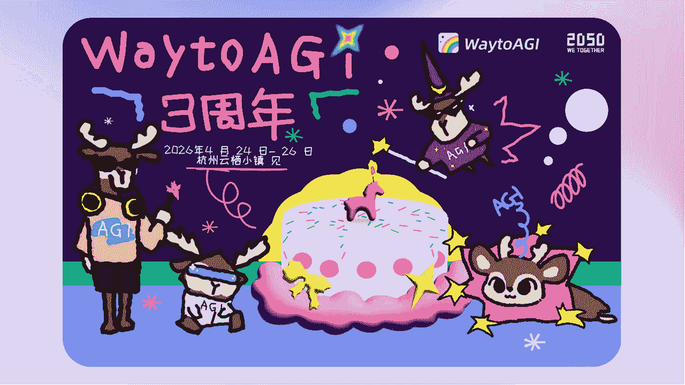

+   《[AI音乐周刊 W.A 024](https://waytoagi.feishu.cn/wiki/Yuxsw4jEZiEL3bkyZ6ccdLnAnnf?from=from_copylink)》本周AI音乐资讯聚焦技术革新与行业争议。英伟达开源AF-Next实现超长音频解析，多项工具升级音频分离、哼唱生歌与AI重混能力；Splice分成模式引发版权争议，伯克利AI课程遭受抗议。与此同时Spotify推进AI音乐标签，多篇论文夯实了多模态生成与理解技术。

+   《[Meta产品高管：旧版产品经理已死，取而代之的是AI-first建造者 | Lenny's Podcast](https://waytoagi.feishu.cn/wiki/Nh79wmWR9ivbbpk9AVXcN4H7nuh?from=from_copylink)》Nikhyl Singhal 曾在 Meta、Google、Credit Karma 做产品高管，也是 The Skip 社群的创始人，长期和一线产品负责人、创业者一起工作。这期最值得读的地方，不是再问一遍“AI 会不会替代 PM”，而是把岗位变化拆得很具体：哪些工作已经开始被吃掉，哪些能力正在被重新定价，为什么很多人明明很焦虑，却还没真正开始转向。

## 4 月 19 日

+   《[【译】关于 Claude Design 的一些想法和感受 · Sam Henri Gold](https://waytoagi.feishu.cn/wiki/TSgSwe3HSibLtlkRUr8cWp3Bn4f?from=from_copylink)》Claude Design依托原生代码结构，可以与开发很好地无缝协同，重构设计工作流。未来工具或许将分化为代码原生与纯创意探索两条路径，对设计师、产品团队而言，这不仅是工具更迭，更是效率与工作流的彻底升级！

+   《[大语言模型中的提示词缓存技术详解](https://waytoagi.feishu.cn/wiki/IXL0wgX6sivJegk9oJ3cyxUdn3b?from=from_copylink)》长时程Agent工作流中，固定的超长系统提示词在多轮对话里会被重复计算，会产生大量无价值token消耗。Prompt caching正是破解这一浪费的关键方案，能显著降低使用成本。但如果你想把它真正用好，就得先理解它在底层到底是怎么工作的，让我们来一起一探究竟！

+   《[4.13- 4.19｜本周 AI 论文精选](https://waytoagi.feishu.cn/wiki/IVMywh0nni420vkt7E5csxrmnoh?from=from_copylink)》本周AI论文精选汇聚十大前沿突破，直指Agent科研、长时程协作、产业评测等核心方向。从全自动AI科研团队高效攻克对齐难题，到文件驱动的长时程研究框架，再到贴合真实生产的Agent评测体系，同时覆盖高性能开源模型、记忆迁移、日志自动诊断等落地技术，清晰展现了AI Agent从实验室走向产业的关键进化，极具参考与落地价值。

+   《[Hermes Memory系统协议P链：让AI Agent永不遗忘的隐形纽带](https://waytoagi.feishu.cn/wiki/SuUEwKVnbiLoYWk2nqVc93gwnCc?from=from_copylink)》Hermes Agent独创的P链协议，打破了AI会话遗忘困境，让跨天、跨平台的连续协作成为现实。依托会话血缘链与全文检索，AI能完整追溯历史对话、自动沉淀经验技能，还能智能压缩上下文，高效又省Token。相比传统框架与RAG，AI从一次性工具升级为懂你的长期协作伙伴，大幅提升了复杂任务的执行效率。

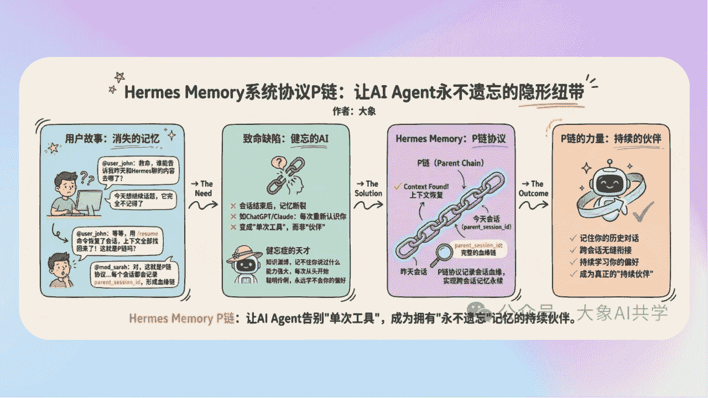

+   《[Profound CEO：你的品牌能不能被 Claude 想到，才是新的增长分水岭丨Sequoia Capital](https://waytoagi.feishu.cn/wiki/Om0zw1ts0iSHzqkwhJFcMkGTnTg?from=from_copylink)》如果你做的是 AI 产品、B2B 软件、增长或者产品策略，这期内容值得读，不是因为它在讲“营销技巧”，而是因为它讨论了一个更底层的变化：未来替你发现信息、比较产品、形成偏好的，越来越不是人，而是Agent。

+   《[万字讲透Agent Harness的十二大模块](https://waytoagi.feishu.cn/wiki/NFwWwzInUi7KT5kYTV4c1JmtnFg?from=from_copylink)》这篇文章将深度揭秘Anthropic、OpenAI、Perplexity和LangChain到底在捣鼓什么。 编排循环 (orchestration loop) 、 工具 (tools) 、 记忆 (memory) 、 上下文管理 (context management) ——凡是你能想到的、能把一个无状态的大语言模型 (LLM) 变成靠谱智能体 (agent) 的玩意儿，今天一次性说透。

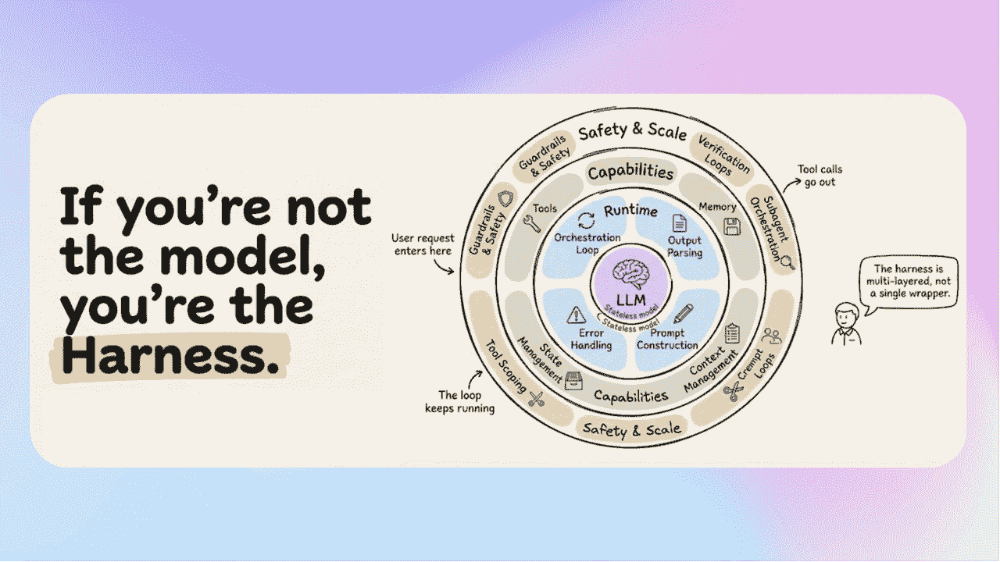

## 阅读更多

[4.4 历史更新](https://waytoagi.feishu.cn/wiki/FjiOwWp2giA7hRk6jjfcPioCnAc)

---

## 💬 飞书 & 🛰️交流群

### 说明：

1.  请填写下面问卷进群，群内会分享最新 AI 信息、社区活动；

1.  加入群后，欢迎大家积极分享，我们也会吸收进知识库，因为有你的参与才让知识库更加完善；

1.  飞书群内置 AI 智能机器人，可以回复任何与 AI 相关的问题，欢迎加入。

## 🏠加入WaytoAGI-填写后加入飞书/🛰️群

<https://waytoagi.feishu.cn/share/base/form/shrcnlIVMcuAn2jFHfJ2Bez7RWe?iframeFrom=docx&ccm_open=iframe>

---

## 🙏 友情推荐

1.  如果您对「飞书」这款效率工具感兴趣，或者您希望结交各行各业志同道合的朋友和他们交流企业/个人效率的提升，诚邀您访问「飞书官方社区——飞行社」

<https://www.feishu.cn/community?from=AGIknowledge>

1.  如需下载研究报告，我们[诚邀您加入知识星球](https://t.zsxq.com/18DnZxlrl)：

+   数百份涵盖 AI 各个方面的报告，并提供内容概要

+   自 2023 年上半年建立以来，保持长期活跃更新

+   扫码右侧二维码，加入知识星球

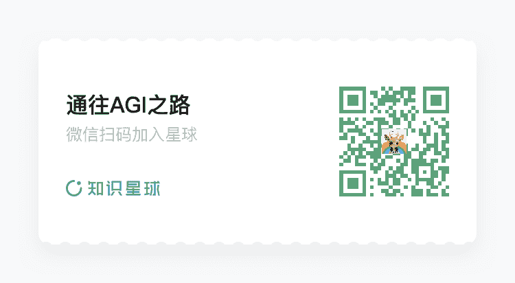

更多 [合作与咨询](https://waytoagi.feishu.cn/wiki/Wj77wBWjbi0yUAkyJWdc2TKFnmd)

# 👬 社区好朋友

[AIGC 周刊](https://quail.ink/op7418/)

歸臧整理的 AIGC 周刊

关注 AI 的朋友每周必读

[万能的小七姐](https://vxc3hj17dym.feishu.cn/wiki/RxnSw84QIiC63KkBrofc2altnuf?from=from_copylink)

连续创业者

Prompt 版块共建者

[硬地骇客](https://hardhacker.com/)

三位 10 年+创业者

[podwise 开发者](https://podwise.ai/)

[小互](https://weibo.com/u/1627825392)

「互联网的那点事」

🧣互联网观察家

ZHO

建筑师｜ComfyUI设计师

[野菩萨](https://www.xiaohongshu.com/user/profile/5513fe8ed39ea24fec6cf63b)

AIGC 社区野神殿创始人

[AI 艺术探索者](https://mp.weixin.qq.com/s/V7qEudwKzZy1-vqiKz3xDg)

赛博禅心

最新最快的 AI 资讯

作者大聪明

张蔚

华兴资本经理

架构和投资版块共建者

[向阳乔木](https://www.qiaomu.pro/)

热爱分享，永远好奇

AI 高质量社群组织者

汗青

产品经理｜AI设计师

[麦橘](https://www.xiaohongshu.com/user/profile/61d141f100000000210230d1)

麦乐园 MAILAND

𝐦𝐚𝐣𝐢𝐜𝐌𝐈𝐗模型的作者

[orange](https://twitter.com/oran_ge)

AI 领域产品经理

充满好奇心

[Web3 天空之城](https://space.bilibili.com/351754674)

推荐 B 站与🛰️👸号

高质量 AI 内容原创者

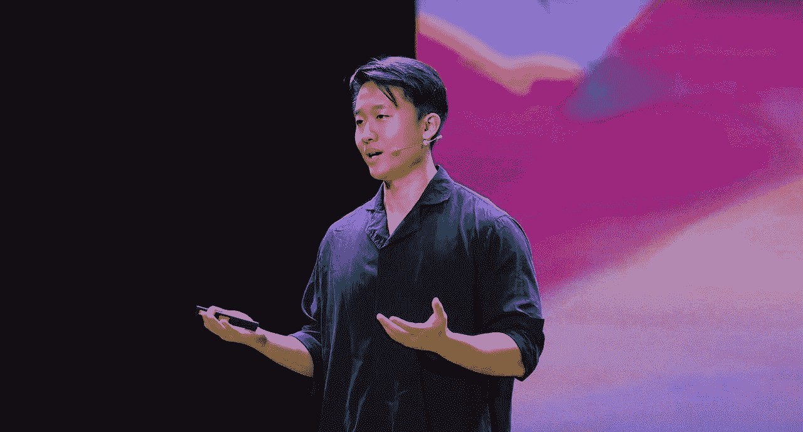

[Ragnar 瑞哥那](https://a135e91cro.feishu.cn/docx/JGWRdRlCNoa2yTxFSIMciotwnqe?from=from_copylink)

Base 上海 AI 商业社群

TEDx AI 演讲嘉宾

海辛

AI艺术家

[三思](https://www.xiaohongshu.com/user/profile/5cfd0e600000000016029764)

AI 数字艺术家

视觉设计师

[INDIGO TALK](https://www.xiaoyuzhoufm.com/podcast/62bbe7a66bad6a3c0c6222d3)

INDIGO 数字镜像播客

逻辑严谨、思考深入

[云中江树](http://feishu.langgpt.ai/)

AI 算法工程师

LangGPT 项目作者

陈财猫

Prompt Engineer

《进阶提示工程入门》

阿文

AI艺术家

[白马少年](https://mp.weixin.qq.com/s/UrMoEdntEX_Be3b5rhNPlw)

AI视觉设计师

Mr. 喜

ComfyUI设计师

汤团猪

ComfyUI设计师

[锐童学](https://waytoagi.feishu.cn/wiki/Tg24wLMX0iKwnik4prjcP6hKnVe)

AI艺术家

[唐百万](https://www.xiaohongshu.com/user/profile/5bb4de8459b9bf0001947966)

AI数字艺术家广告创意人

Snap

ComfyUI设计师

guahunyo

ComfyUI设计师

科林

ComfyUI开发设计师

OU椰🥥冬

ComfyUI设计师

🌱郭佑萌

ComfyUI设计师

Rui

ComfyUI设计师

trance

ComfyUI设计师

电子酒

AI春晚导演

---

## 😊 我应该从哪里开始？

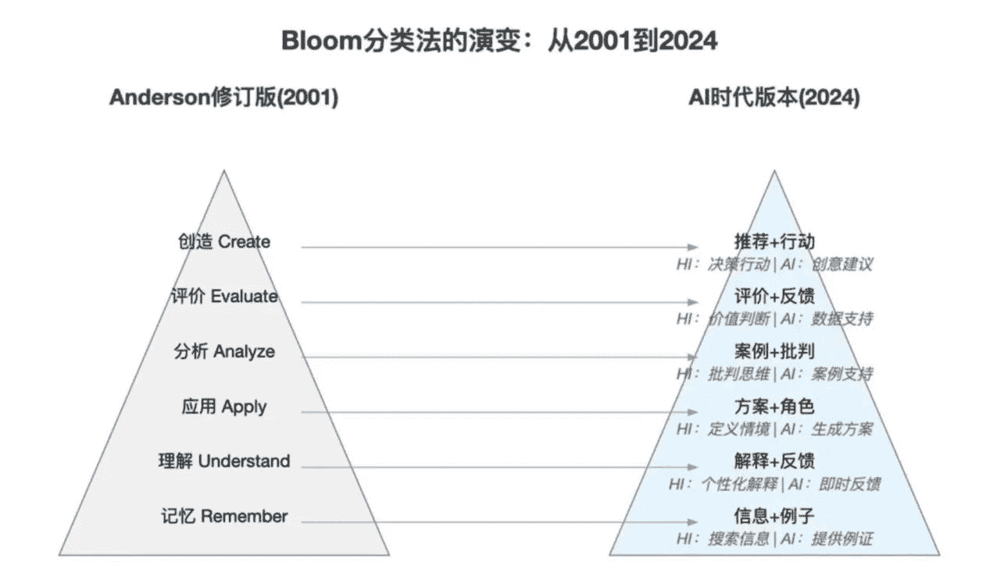

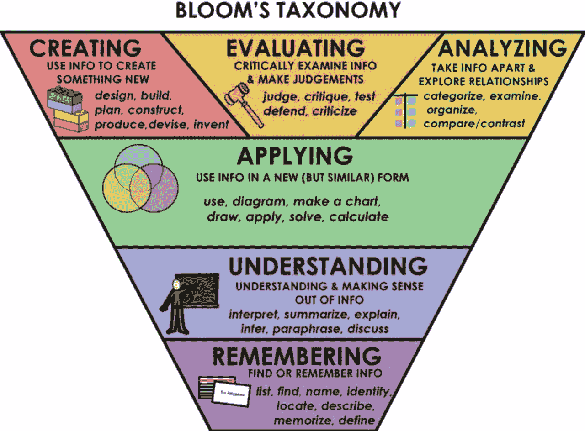

### 推荐布鲁姆分类法学习路径

1. **记忆**：先从[ AI 的历史](https://ywh1bkansf.feishu.cn/wiki/PFXnwBTsEiGwGGk2🐧FcdTWrnlb?table=tbl1tOC3ZKbrcHVn&view=vewTtypUZc)、[基本术语](https://ywh1bkansf.feishu.cn/wiki/PFXnwBTsEiGwGGk2🐧FcdTWrnlb?table=tbltvr7KExCt7Jpw&view=vewjxk9tDu)、[重要人物](https://ywh1bkansf.feishu.cn/wiki/PFXnwBTsEiGwGGk2🐧FcdTWrnlb?table=tblLtN12KuvP5reO&view=vewuvGBXhd)、[方法和原理](https://ywh1bkansf.feishu.cn/wiki/PFXnwBTsEiGwGGk2🐧FcdTWrnlb?table=tblolGx2mprs1EQz&view=vewx5ROYtl)等开始了解，看看[入门课程](https://waytoagi.feishu.cn/wiki/ZYtkwJQSJiLa5rkMF5scEN4Onhd?table=tblWqPFOvA24Jv6X&view=veweFm2l9w)

1. **理解**：进一步了解 AI 领域的[主要思想和概念](https://ywh1bkansf.feishu.cn/wiki/PFXnwBTsEiGwGGk2🐧FcdTWrnlb?table=tblC69kVi8xZMQ4B&view=vewFgR7hhS)，将[精选 AI 网站](https://ywh1bkansf.feishu.cn/wiki/BVmWwpSJGioFyJkfAI3crXWTnyb?table=tblrU3QwceYkyu5Y&view=vewhpVxSzR)和[ APP 产品](https://ywh1bkansf.feishu.cn/wiki/BVmWwpSJGioFyJkfAI3crXWTnyb?table=tblLFKWXaBNu2RC8&view=vewDRCDZJH)都试一试

1. **应用**：深入[了解 Prompt](https://ywh1bkansf.feishu.cn/wiki/Q5mXww4rriujFFkFQOzc8uIsnah?table=tbldSgFt2xNUDNAz&view=vewo2g2ktO)，选择适合自己的[ AI 对话](https://ywh1bkansf.feishu.cn/wiki/QddLw0teKi7nUCkDRIecskn3nuc)、[绘画](https://ywh1bkansf.feishu.cn/wiki/Q5ddwxfkMiVUZBkQXN7cgXf4nOb)和[语音](https://ywh1bkansf.feishu.cn/wiki/ZXPiw2OuLi2YsxkkmaLcPTyInrc)产品，每天都用它，并使用[它们来解决实际问题或提升效率](https://waytoagi.feishu.cn/wiki/A0Y0wpBOcig7HLkSFNcceTA6nwb)

1. **分析**：大量阅读[各类文章](https://ywh1bkansf.feishu.cn/wiki/YjJgwbKnriZBZ0kVn6Kc1gSKnsf?table=tblsQKR3a22uFqsp)、[视频](https://ywh1bkansf.feishu.cn/wiki/LEnvwwEy0iufT3k4kfVc8Ehenvf?table=tbllpoPWJn6MNOR6&view=vew68BlUHo)以及[行业报告](https://ywh1bkansf.feishu.cn/wiki/FnXcwGrwSimQxnkNo1kcJzPYn7f)，理解各知识之间的关系

1. **评价**：通过[各类课程](https://waytoagi.feishu.cn/wiki/ZYtkwJQSJiLa5rkMF5scEN4Onhd?table=tblWqPFOvA24Jv6X&view=veweFm2l9w)与[书籍](https://ywh1bkansf.feishu.cn/wiki/PFXnwBTsEiGwGGk2🐧FcdTWrnlb?table=tbl2sA7TLn8L4uYp&view=vewjfsOgyJ)更深入学习，判断信息的价值、提出自己的观点和论证

1. **创造**：积极参与[社区共创项目](https://waytoagi.feishu.cn/wiki/KexVwLKhYiHm7bk2IL9cym0WnTb)，创造你自己的新想法或产品

---

## 🧭 快速导航

### 0. 起点

💾 人[工智能简史 ](https://ywh1bkansf.feishu.cn/wiki/PFXnwBTsEiGwGGk2🐧FcdTWrnlb?table=tbl1tOC3ZKbrcHVn&view=vewTtypUZc)& A[I 绘画简史](https://ywh1bkansf.feishu.cn/wiki/PFXnwBTsEiGwGGk2🐧FcdTWrnlb?table=tblbBhy4ig3JTr5z&view=vewTtypUZc)

📝 10 篇从 0 到 1 的文章

🤔 1[0 篇深度文章](https://ywh1bkansf.feishu.cn/wiki/PFXnwBTsEiGwGGk2🐧FcdTWrnlb?table=tblC69kVi8xZMQ4B&view=vewFgR7hhS)

🧑‍🏫 10[ 个重要人物 &](https://ywh1bkansf.feishu.cn/wiki/PFXnwBTsEiGwGGk2🐧FcdTWrnlb?table=tblLtN12KuvP5reO&view=vewuvGBXhd) 10[0 位领军人物](https://waytoagi.feishu.cn/wiki/PFXnwBTsEiGwGGk2🐧FcdTWrnlb?table=tblPSIB8sJSwq8bb&view=vewuvGBXhd)

👄 言[之有物 | 金句引用](https://ywh1bkansf.feishu.cn/wiki/PFXnwBTsEiGwGGk2🐧FcdTWrnlb?table=tblnGZ55rkjJxQKJ&view=vewa05IP7l)

🗃 8[0+名词解释](https://ywh1bkansf.feishu.cn/wiki/PFXnwBTsEiGwGGk2🐧FcdTWrnlb?table=tbltvr7KExCt7Jpw&view=vewjxk9tDu)

📚 2[0 本 AI 中文书籍](https://ywh1bkansf.feishu.cn/wiki/PFXnwBTsEiGwGGk2🐧FcdTWrnlb?table=tbl2sA7TLn8L4uYp&view=vewjfsOgyJ)

📖 豆[瓣 9 分以上的英文书籍](https://ywh1bkansf.feishu.cn/wiki/PFXnwBTsEiGwGGk2🐧FcdTWrnlb?table=tblgNFDO4ySr9ks7&view=vewjfsOgyJ)

🎬 豆[瓣 8 分以上的 AI 电影](https://ywh1bkansf.feishu.cn/wiki/PFXnwBTsEiGwGGk2🐧FcdTWrnlb?table=tblB56vIgfZImxP2&view=vewUunvDn1)

🖼 一[图胜千言 | AI 好图分享 ](https://ywh1bkansf.feishu.cn/wiki/PFXnwBTsEiGwGGk2🐧FcdTWrnlb?table=tblyh76bHrCi4PXq&view=vewUunvDn1)

### 1. AI 入门系列

> 陆奇：未来，唯一有价值的是你有多大见解

🛣 A[I 学习路径推荐](https://ywh1bkansf.feishu.cn/wiki/RJofwtPcci6YMJkzBP2cRFFOnIR)

🗄 a16z 整理的 AI 典藏文章

💬 P[rompt 最佳实践](https://waytoagi.feishu.cn/wiki/NbqXwHXrkiYWKVkFTbmcwxQqntb)

🔥 G[PTs：构建你的 AI 助理](https://waytoagi.feishu.cn/wiki/IawKwd3IgiHbezkB1KrcAFPRnbf)

[💬 ChatGPT 入门](https://ywh1bkansf.feishu.cn/wiki/QddLw0teKi7nUCkDRIecskn3nuc)

[🧭 ChatGPT 官方指南](https://ywh1bkansf.feishu.cn/wiki/As6FwBSktiDMDGkTKOXcqq6snKc)

🎨 A[I 绘画入门 ](https://ywh1bkansf.feishu.cn/wiki/Q5ddwxfkMiVUZBkQXN7cgXf4nOb)& 必[须关注的博主](https://waytoagi.feishu.cn/wiki/NuRCwmGfyig1QWk4VNmcH0NcnUc)

🎵 A[I 语音与数字人初探](https://waytoagi.feishu.cn/wiki/IOO6wQKDKiMrmzk1oDxcGFpFnFh)

### 2. AI 精选系列

> 不要让 AI 代替你思考，而是让 AI 激发你思考

[🌐 AI 网站精选 ](https://ywh1bkansf.feishu.cn/wiki/BVmWwpSJGioFyJkfAI3crXWTnyb?table=tbl9F9lhTKPbNhRR&view=vew9VrzWWo)

📺 A[I 视频精选](https://ywh1bkansf.feishu.cn/wiki/LEnvwwEy0iufT3k4kfVc8Ehenvf?table=tbllpoPWJn6MNOR6&view=vew68BlUHo)

📻 A[I 播客精选](https://ywh1bkansf.feishu.cn/wiki/LEnvwwEy0iufT3k4kfVc8Ehenvf?table=tblj6NXbS3ftRrCM&view=vew1fNFZic)

⚖ [全球 AI 法规手册](https://waytoagi.feishu.cn/wiki/ZvMawDHnUik6TIk10HXccVpdnac)

📃 [AI 资讯与论文精选](https://waytoagi.feishu.cn/wiki/YjJgwbKnriZBZ0kVn6Kc1gSKnsf?table=tbltxLmczQ0fdHaN&view=vewuqMbDMU)

📔 [AI 研究报告精选](https://waytoagi.feishu.cn/wiki/WvhZwk16WiEnSvk8AcpcdZetnMe?table=ldxthSdnltXbtSvg)

[🎓 教程与学习手册精选](https://waytoagi.feishu.cn/wiki/ZYtkwJQSJiLa5rkMF5scEN4Onhd?table=tblenNiaJkoTiQDQ&view=vewZ12GaXz)

🛠 [资源与项目精选](https://waytoagi.feishu.cn/wiki/YjJgwbKnriZBZ0kVn6Kc1gSKnsf?table=tblMw78mOVBQs22X&view=vewU1XdpuK)

## 3. AI 应用与前沿

> Sam Altman：不要小打小闹，要干就干大事，满怀希望地去行动

🛠 AI 实际应用的案例（工作/学习/生活...)

🧰 [辅助学习工具精选](https://waytoagi.feishu.cn/wiki/FVGfwjMtriTDUvkwqvwcYisongh?table=tblp81WDObH3I20H&view=vewM2PB3Iu)

🤩 [小互每日观察动态](https://waytoagi.feishu.cn/wiki/T2fUwmHBSiHU6Ukq9Imcu7n7nMh)

🤹 [AI Agents 入门文章](https://waytoagi.feishu.cn/wiki/XGEzwjiJTiAr83kbHlgceRHxnwc?table=tbl3t7DVsBk7zOxV&view=vewBk3R2Jb) & [精选项目](https://waytoagi.feishu.cn/wiki/KdN2wM9fSiw6RBkTcyWcFrfJnOf?table=tblMk8RPhVaSzmSF&view=vewrtQbBai)

[🤖 AI](https://waytoagi.feishu.cn/wiki/XGEzwjiJTiAr83kbHlgceRHxnwc?table=tbl3t7DVsBk7zOxV&view=vewBk3R2Jb) 与 [机器人相关文章](https://waytoagi.feishu.cn/wiki/HvinwkBD3ii0rkkUazVcfaGqnZc?table=tblADfqTsdQoEpel&view=vewBQjDoAv)

💰 [中国 AI 生态投资地图](https://waytoagi.feishu.cn/wiki/ZcRRwwkXvia2TPk29PGcO5cEnkf)

---

## 周刊与兴趣小组

[WaytoAGI.com 网站](http://www.waytoagi.com)

内置知识库 AI 助手

[B 站｜Bilibili](https://space.bilibili.com/259768893)

以视频普及 AI 知识

[📕](https://www.xiaohongshu.com/user/profile/6457d2e4000000001f030dbe)

AI 消息及时传递

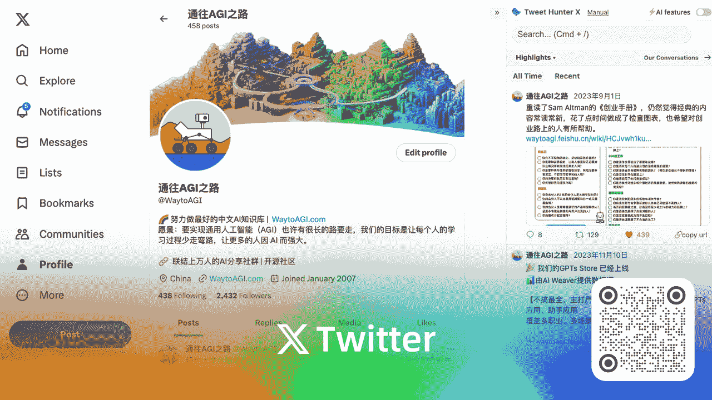

[X ｜ Twitter](https://twitter.com/WaytoAGI)

知识库精选内容同步

有小伙伴说：WaytoAGI 像个大学城，各个群就是兴趣社团，都是小伙伴们即兴发起的，也欢迎你来参与和发起。

<https://www.feishu.cn/community/articles/wiki?from=AGIknowledge>

---

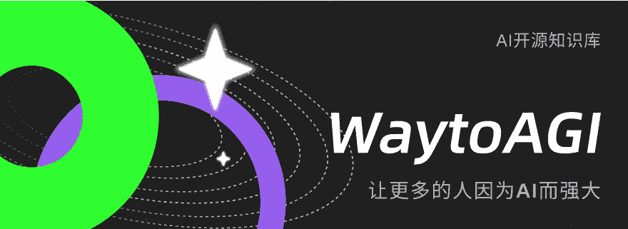

[🤖入门AI学习路径](https://waytoagi.feishu.cn/wiki/RJofwtPcci6YMJkzBP2cRFFOnIR)

[💬Prompt（提示词）](https://waytoagi.feishu.cn/wiki/Q5mXww4rriujFFkFQOzc8uIsnah?table=tbldSgFt2xNUDNAz&view=vewo2g2ktO)

🧠[AI Agents（智能体）](https://waytoagi.feishu.cn/wiki/GFS0wJB78izVBmk3LVgcCn2MnCh)

[🎨AI 绘画](https://waytoagi.feishu.cn/wiki/Q5ddwxfkMiVUZBkQXN7cgXf4nOb)

[🎬AI 视频](https://waytoagi.feishu.cn/wiki/SPXQwl5TXiau0mkKb1zcqHxVnEm)

[🎶AI 音乐](https://waytoagi.feishu.cn/wiki/P7N8wwy0tirs79klAgJc6FlCn0d)

[🎙️AI数字人+语音合成](https://waytoagi.feishu.cn/wiki/IOO6wQKDKiMrmzk1oDxcGFpFnFh)

[🏗️AI 3D](https://waytoagi.feishu.cn/wiki/TRJEwdbQEiJjvykq8nJc6juvn6g)

[🔄ComfyUI工作流](https://waytoagi.feishu.cn/wiki/AxZPwElC6iZ0aqk2hjOcI3Y9nFg)

[👩‍💻AI开发](https://waytoagi.feishu.cn/wiki/Pxj8wsMmOii7ZSkN0mYc8xdtnHb)

[📅社区共学日历](https://waytoagi.feishu.cn/wiki/UET1wIVi7i8DhSkriNBcIHEKnmc?table=tblHgpm6a5ric3KB&view=vewxxF51yJ)

[🐻社区共创项目](https://waytoagi.feishu.cn/wiki/KexVwLKhYiHm7bk2IL9cym0WnTb?table=tblHgpm6a5ric3KB&view=vewxxF51yJ)

## 愿景和目标

> 要实现通用人工智能（AGI）也许有很长的路要走，

> 我们的目标是让每个人的学习过程少走弯路，让更多的人因 AI 而强大。

### [🌈 去官网](https://www.waytoagi.com/zh)

### [📖 返回知识库](https://waytoagi.feishu.cn/wiki/QPe5w5g7UisbEkkow8XcDmOpn8e)
