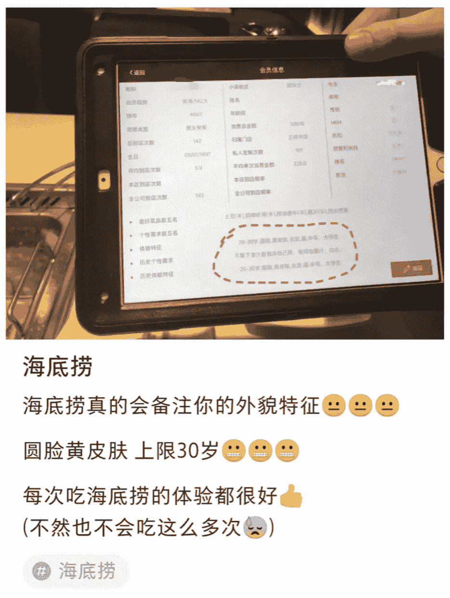

# 未来有竞争力的律师，都懂得满足客户的「情感诉求」

> 来源：[https://docs.feishu.cn/docx/HVutdLC4IoUqx2xGfnVcRTecnub](https://docs.feishu.cn/docx/HVutdLC4IoUqx2xGfnVcRTecnub)

---

著名商业顾问刘润，提出了一个关于魔力产品的基本逻辑：

魔力产品 = 产品功能 * 情感诉求。

这个公式看上去简单，其实还是需要一定的理解深度。

有魔力的产品，能创造情感共鸣，并把握市场方向。

比如说，🛰️就是一款有魔力的产品。🛰️十年，依然生机勃勃。

“产品”的定义很广，并不一定是实体产品。几乎每个人，都有自己的产品和消费者。

对律师来说，咨询就是你的“产品”，你的“消费者”当然就是你的客户。

你会发现，有的律所或者有的律师，他们提供的服务是有魔力的，客户都争相聘请他们，他们提供的服务，确实有过人之处。

但是，非常优秀 ≠ 有魔力。

它的核心，在于满足客户的情感诉求，在于创造无法割舍的情感共鸣。

下面详述。

---

**

**1.客户的隐性需求：情感诉求

客户都需要你帮他解决问题，魔力**产品公式里的“产品功能”，就是用来解决问题**的。

但其实客户需要的，不仅仅是这个问题被解决了，他还有另一层需要，那就是：

**这个问题它是如何被解决的？进一步说**，如何被被愉快地解决的？—— 这，就是情感诉求。

为什么会出现这个诉求？

因为移动互联网的普及，让每个人都**拥有了一个随时随地获取信**息的通道 —— 手机，人们已经养成了凡事先搜一下的习惯。

这个习惯是不可逆的。

因此，随着人们搜索习惯的养成，做好搜索对每家公司来说都至关重要。比如**近一年来，🛰️就在不断完善 A**pp 内的搜索系统。

搜索，已经**不再是传统搜索引擎的专属。

听到这里，**你可能会说：

你说的客户的情感诉求，不就是要解决信息不对称的问题吗？有什么新奇的？

其实不然。

在律师服务中，所谓的信息不对称的问题，本质上是要对冲边际交付时间长的问题。

律师提供的咨询服务，是典型的服务类产品，它最大的特点，就是“非实体”。

非实体的产品，意味着边际交付时间比较长。

什么意思？

实体产品，比如我们滑雪穿的雪服，我买了之后，上雪了就可以穿上，这个产品的边际交付时间很短。

但如果你的产品是非实体的，比如律师的咨询服务，你给客户提供了一个小时咨询，你的产品本身，就需要交付一个小时。

因为边际交付时间比较长，这就带来了所谓的信息不对称的问题。

但是，信息不对称只是表象，客户真正缺乏的是“安全感”。

这个安全感应该分两层来看：

首先，客户想知道：我的案子是如何被解决的？这其实就是现在常说的“信息不对称”。

客户有这个需求，本质上是信任的问题。它的核心在于，你是否能真正帮我解决问题。

客户选择和你合作，说明他在一定程度上认可你，你们之间，有一定的信任基础。但是，你能不能真的帮我做好这个案子，不好说。

你让我不用操心，我心理建设没到位啊。

又比如买衣服。

我想买一件户外冲锋衣，店员跟我疯狂安利这一件，但它防风吗？防水吗？控温吗？我看不到它的实际效果，我怎么会付费呢？

所以，很多户外品牌都会打上“Gore-tex”的标签，因为“Gore-tex”面料是一种黑科技，具有防水、透气和防风功能，突破一般防水面料不能透气的缺点，被誉为“世纪之布”。

进一步看，当你真正帮客户解决了问题，客户还想知道：这个问题是如何被愉快地解决的？

这就像你吃了一顿非常好吃的火锅，你肯定会去想，它为什么这么好吃？

是食材好吗？是锅底香吗？还是蘸料搭配的好？下次，我一定带我的朋友来尝尝。

这时，客户就可能从使用者，变成推荐者。

对律师服务来说，虽然交付时间相对较长，但我们其实更有机会去满足顾客的情感诉求。

---

**

**2.如何满足客户的情感诉**求？

从用户需求出发，服务****可以分为三个级别。

****第一个级别是功能级的**服**务；

第二是体验性**的服务；

第三是个性化的服务。

第一个级别你一定能做到，比如客户来咨询，那你给他解答几个法律问题，或者说起草一份合同，打赢一场官司，这都是功能。

第二个级别，体**验。

我举个简单的**例子帮你理解。

比如说，我有个朋友到北京来，说他想吃北京烤鸭。我说，好，我带你去大董南兴仓店，在那吃一顿饭。

那里坐落于最能代表北京特色的东城区，窗外是充满历史感的南兴仓，有人会专门为你摆好餐具，有50天和22天的“酥不腻”烤鸭，有精髓的蒜泥小料，还**有比烤鸭还出名的海参**。

这些都是“体验”。

“体验”就是在满足人的情感诉求。

对应到律师身上：

当你的客户来做一次咨询的时候，那么在他来之前，你有没有让他去读一些最基本的资料？读了最基本的资料，你们在现场就不必花过多的时间来做一些特别基础的沟通。

这属于体验。

这就要求你要做好自媒体，持续输出内容，并沉淀下可复用的物料。

当他给你一些资料的时候，你有没有充分考虑他的情感方面的保护，和他明确不对外传播，保护他的匿名性等等。

这属于体验。

需要你们面对面咨询的时候，你有没有考虑到他的隐私性。如果你是做婚姻家事的律师，你有个客户想离婚，而你又把她约到律所，那是不是看到的人会猜：她是约了一个离婚律师吗？看来婚姻状况不好呀。

这也是体验。

甚至有时你的客户想得到的不仅仅是一个答案，他想得到的是还有宽慰本身。

服务结束之后，有没有定期的回访，甚至在未来，你有了一些新的类似的经验，一些做法，一些新的尝试，有没有定期用邮件去发给他，这些都是很好的“体验”。

第三个级别，叫个性。

比如说我经常使用的得到App，里面有一门课叫《吴军·硅谷来信》，在每一节课的开头，都会写着：XXX（用户名），你好！

虽然我知道，这只是通过技术实现的结果，但这个时候，它给我提供的就是个性化服务。

又比如，快过年了，一到春节，我们就会收到很多祝福短信。其中有一条，你会觉得他就是专门为你写的。

这并不是说这几条短信的文采有多好，因为文采都是可以抄袭的。相反，他可能只是在短信的开头，加上了你的名字，然后把同样的短信，发给了很多人。

这个时候，他提供的也是个性化服务 —— 他在努力建立他的个人品牌。

事实上，这个方法在服务行业是通用的。

再比如，海底捞会记录每个用户信息，因为只有这样，在你下一次来吃火锅时，海底捞才能给你提供更好的服务。

当你满意了，下一次你还会来。

这也是为什么说：海底捞你学不会。

**

个性化服务是更高级别的体**验。

同样的道理来看下律师咨询服务。

首先，咨询本身就是提供个性化的服务，但是你还可以把个性化再做得用心一些。

比如说你在出具法律咨询意见书时，不是说：“单位没有跟你约定试用期，这时你能享受正式员工的待遇，否则，你可以通过协商、调解、仲裁、诉讼等方式解决”。

而是说：“黄某某，年关将至，建议你提前预约你的老板李某某的时间，一个小时左右，去你们楼下的那家某某咖啡厅，郑重地聊一下这件事情，以下是这次会谈的问题清单......”。

因为第一种情况，客户自己上网找资料也能得出同样的结论，只不过可能要多花点时间。

这时你交付客户的是“外包”，不是“咨询”。

总之，这一切都是为他专门定制的，这才叫做真正的个性化的服务。

---

最后的话

需求，是一切产品的源头。

有魔力的产品，是产品功能和情感诉求相乘的结果。

产品功能是理性的、参数化的“左脑需求”；情感诉求是感性的、易冲动的“右脑需求”。

把握好「情感诉求」，是一个非常重要、非常好用的工具，它不是只用在商业环境而已，把它放在职场、生活中，也同样适用。

在工作里，你可能经常忙得焦头烂额，但老板根本就看不到，还有可能因为做错某件事而被责骂。但如果你懂得设计体验，就会明白，你只要把 90% 的事做得一般般不出错，但关键的 10% 做得超好，老板会立刻夸你。

我们的人生就是在经历各种关键時刻，抓住关键时刻，体验也是可以设计的，建立峰值。