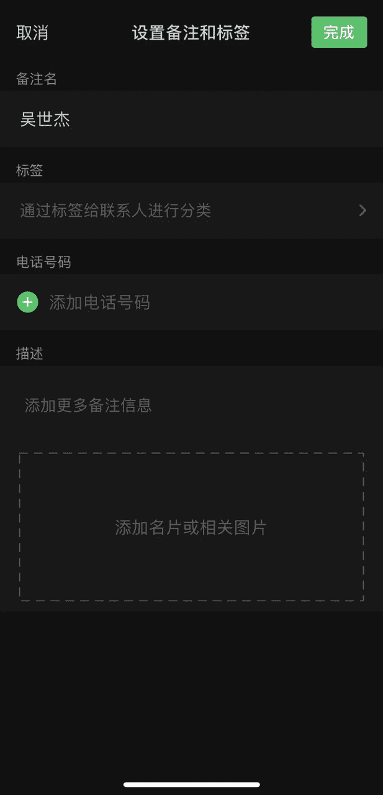

# 分享一个被忽视的客户来源

> 来源：[https://docs.feishu.cn/docx/SAOed1pa8o5YwNxyBoOcOprsnaf](https://docs.feishu.cn/docx/SAOed1pa8o5YwNxyBoOcOprsnaf)

---

每家公司、每个人都在寻求增长。

今天，市场仍然在追求注意力经济，仍然在追求外部流量**，但我想跟**大家分享一个被忽视的客户来源：🛰️好友。

和把目光向外看不同的是，这是一种关注已有客户/潜在客户的方式。通过努力保持已有客户的粘性，润物细无声地运营，然后在未来的某一天，潜在客户就会变成真正的客户。

以下，enjoy ：）

---

### **1.****“1000个铁杆粉丝”**

凯文·凯利在《技术元素》这本书中提出了著名的“1000个铁杆粉丝”理论，说的是：

**假**设你有1000个铁杆粉丝，每个粉丝每年在你身上消费100美元，那你每年就有10万美元的收益，一般足够活下去了。

后来，“1000个粉丝”就成了一个不成文的创业标准。一个新产品只有积累到了1000个用户，才算是站稳脚跟。

律师行业就完全反过来。

众所周知，律师行业是一个高客单价的生意。

你可能只有 10 个铁杆粉丝，每个粉丝每年在你身上消费 5 万元，那你每年就有 50 万的收入，这个水平也是不错的了。放到具体业务来看，就是做 10 家公司的常年法律顾问。

甚至，你可能只有 1 个铁杆粉丝，这个客户付一次费就够你活好几年的，这对于资本市场律师来说并不罕见。

但现实是，大部分律师接的案子都是比较小的，尤其是刚入行的小律师们，他们的收入结构更符合“1000个粉丝理论” —— 通过更多的中小客户，从而获得更多的收入。

注：关于律师怎么做营销，市面上有很多文章，今天不做具体讨论。

事实上，中国的律师们经过这几年有意识或无意识的营销动作，已经积累了一批客户或潜在客户，但由于律师这个行当长久以来的“专项服务”的作业模式，大部分客户只是一次性客户，很少会有复购。

如果我们对客户持续运营，其实是有机会刺激他持续付费的。

运营客户，首先要解决一个问题：**你的客户沉淀在哪里？**

毫无疑问，🛰️。

当然有些古典律师可能会说，我还在用手机通讯录、🐧等手机软件维系客情关系。

但现实是，🛰️作为一个 Push 中心，提供了众多 Push 机制帮助你运营客户，包括👸号、视频号、朋友圈等。

所以是🛰️，Absolutely.

换句话说，我们的🛰️好友，就是我们的潜在客户。

那这个潜在客户的基数有多少呢？

如果你自己运营了一个👸号/视频号，现在，来做一个简单的计算：

1.  点击「通讯录」Tab ，滑动至最底部的 # 位置，查看并记录你有多少「朋友及联系人」。记录这个数字 A 。

1.  然后，打开你自己的👸号/视频号，点击进入顶端👸号简介位置，查看有多少位朋友关注。记录这个数字 B 。

1.  粗略计算你的个人👸号/视频号在🛰️好友中的「品牌渗透率」= B / A * 100% 。

即：👸号/视频号个人品牌渗透率 = 关注人数 / 🛰️通讯录好友人数

我估计，超过 30% 的公号不会很多。

那这剩下的 70% 就是努力的空间，也就是所谓的“私域”。

与其望着锅里的，不如专心吃完碗里的。

如果你总是想触达陌生人，而连现有的🛰️好友都经营不好，那何谈其他营收、利润、溢价这些更远的事情呢？

---

### **2.****🛰️好友的「用户画像」**

看到这里，可能有的人会说：

🛰️好友也能成为客户？不可能吧。我的好友都是亲朋好友，怎么可能是客户呢？

比如我们读法学院的，🛰️好**友也是读法律的，凭什么我能服务他呀？

**非也。

这通常只是一个模糊的理解。你这么想，就感觉是了。

事实上，大多数人并没有很认真地对**自己的🛰️好友做过用户画像划分，甚至从来没想过去划**分。

什么是「用户画像」？

用户画像就是给用户“打标签”。具有相同标签或者属性的一群人，就是一类用户画像。

那什么叫「标签」？

按照国际惯例，我举个例子。

在🛰️的「通讯录」Tab 中，有一个功能叫「标签」。

作为对比，在 🐧 中，「联系人」Tab 下有两个平行的功能：「分组」和「通讯录」。

「标签」和「分组」的区别在于：「分组」通常只是对「通讯录」的一次分类，比如家人、朋友、老师等等，同属于「联系人」这个高一级的分类。

因此，标签、分组 / 通讯录、联系人的从属关系为：联系人 > 分组 / 通讯录 > 标签。

比如说，某某某（联系人），是我经常联系（通讯录）的一个朋友（分组），并且是我从小学开始就认识（标签）的朋友。

即「标签」是「通讯录」的进一步细分。

按照这个逻辑，你的某个🛰️好友可能是你的家人、朋友、老师，但他们也可能会遇到法律问题，并且可能变成你的客户。

那怎么对🛰️好友打标签呢？你可以点击好友头像对其设置备注和标签：

首先，“**标签”是可以直**接填写的，客户、家人、朋友，这个颗粒度的标签是 OK 的。因为标签库可以慢慢完善，你可以慢慢添加。

一开始，你可能只会想到“客户”这个标签，但后来你就可以加上“XX城市”、“XX行业”、“XX年龄”、“XX爱好”等更多维度。

当然，有些标签你无法直接归纳出来，那你就可以在“描述”中添加备注信息，比如你们第一次会面的会议记录，之后的每一次沟通都更新进去。

这样，当你这次服务结项之后，你就能纵观整个 case 的全部信息，其中就包括「用户画像」。然后，你就可以进行针对性的运营。

比如，服务结束之后，你可以定期开展回访。在未来，你有了一些新的类似的经验、一些做法、一些新的尝试，你也可以定期发给客户，创造更多的触点。

而这些可能的运营动作，都来源于最初那个微小的动作：划分用户画像。

---

### **3.****如何运营🛰️好友？**

当你划分完用户画像后，就可以进行针对性的运营了。

首先，完善你的定位：你能提供什么价值？

无论它是以哪种形式存在，是专业文章、视频（个人介绍）、图片（名片），还是聊天中的**一段文字，你都要尽量用简洁的语言把自**己介绍清楚 —— 其中尤为重要的是，在你名字后面跟着的第一句话是什么？它描述了你最想对外传达的东西，也就是你能提供的价值

张艺谋曾经说：“我要把自己迅速地工具化。工具化，你就会对别人有用。人有了用，你就会有空隙生存。”

对一家公司来说，所谓的“工具化”就是它的「愿景」、「使命」。

只有定位搞清楚了，客户才知道你有什么用，找你可以解决什么问题。这是第一性的。

关于如何定位，以下是一个可参考的例子：

> 什么是得到？下列一些说法，总有一款适合：

+   得到要建设一所全球领先的终身大学

+   得到是一个高效学习工具。

+   得到是一个高品质的知识引擎。

+   得到是终身学习者的俱乐部。

+   得到是用知识给用户赋能的。

+   得到上的产品是帮助用户节省时间的。

相比之下，像你的🛰️头像、个人签名这些问题，其实没那么重要。只要你有用，这些**问题都不是问题。

**毕竟你又不是搞颜值直播的。

第二点，主动获客。

如果你发现，你的🛰️好友大部分都不是你的潜在客户，那么你必须认真思考：

你的潜在人群是谁？他们在哪？

付**费的核心关键是：给有需求的人，提**供相匹配的产品和服务。

所以，如果你的🛰️好友大部分都不是你的潜在客户，那么一个很大的可能就是，他们确实不是你的潜在客户。

也就是说，你在一开始添加好友的时候，就没有获客意识。这就要求你：必须将主动获客放在第一优先级上。

具体来说，你需要建立和用户沟通的平台，如👸号、视频号、🛰️群等，增加用户对你的信任感，为其提供多样化的产品或服务。

第三点，创造价值，并把闭环动作做好。

在你所擅长和专业的领域，帮助别人答疑解惑，提供帮助，是塑造个人品牌特别好的方式，而且这本身也是在创造价值。

但这会面临一个选择问题：由于时间天花板所限，通常你只能选择一个内容生态去做，图文或者视频，否则你很可能一个都做不好。

内容也分短内容和深度内容，前者能够起到引流作用，后者能够帮你做好留存。但是，如果只做其中之一的话，没有形成服务闭环，那就极有可能导致客户流失。

比如，你通过短内容引来了很多客户，但客户觉得你讲的东西都很浅，那他可能浏览一会就取关了。又比如，如果你只做深度内容，可能连流量都没有。

顾此失彼，对个体来说很正常，每个选择都有利弊，但关键在于把闭环动作做好。

如果你选择优先做短内容引流，那你就得做好承接流量的准备。由于你没有深度内容，你可能需要在明显的地方留下你的联系方式，让客户能及时找到你。

但是，这个方式是直接从短内容跳转到人工对接，这中间必然会有需求不匹配的情况，一批流量进来，有效的可能就只有几个，这种情况必然存在。

即便你在中间设置一些门槛，比如让客户先买个9块9的课程，也不一定有效。客户是否愿意付费、能否因此顺畅地跳转到下一阶段，需要你投入大量成本去验证。

如果你选择优先做深度内容，那你就得接受早期流量很低的事实，能消费深度内容的用户就是很少。

但是，通过深度内容来的用户，粘性会非常高。因为你的定位非常清楚，你基于你的定位持续输出优质内容，这本身就是一种润物细无声的运营。