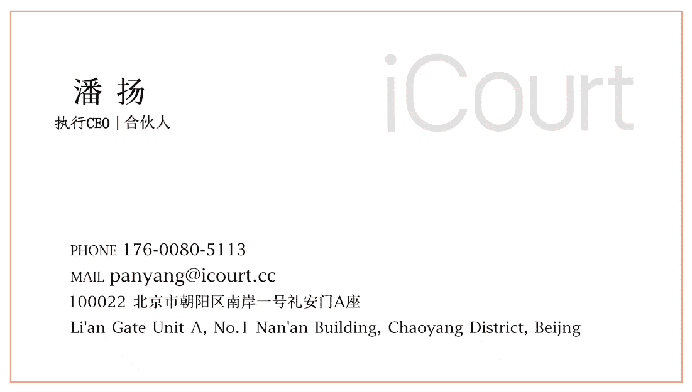
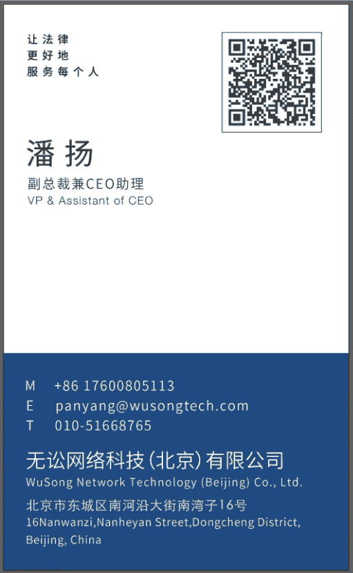
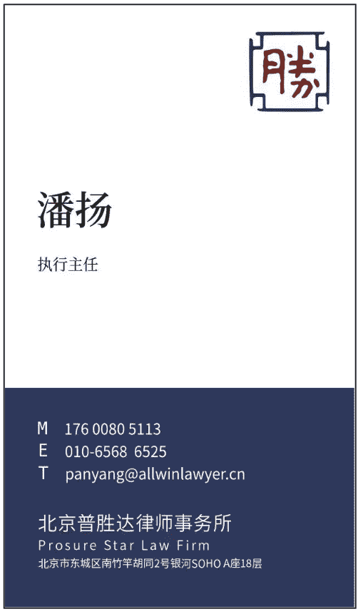
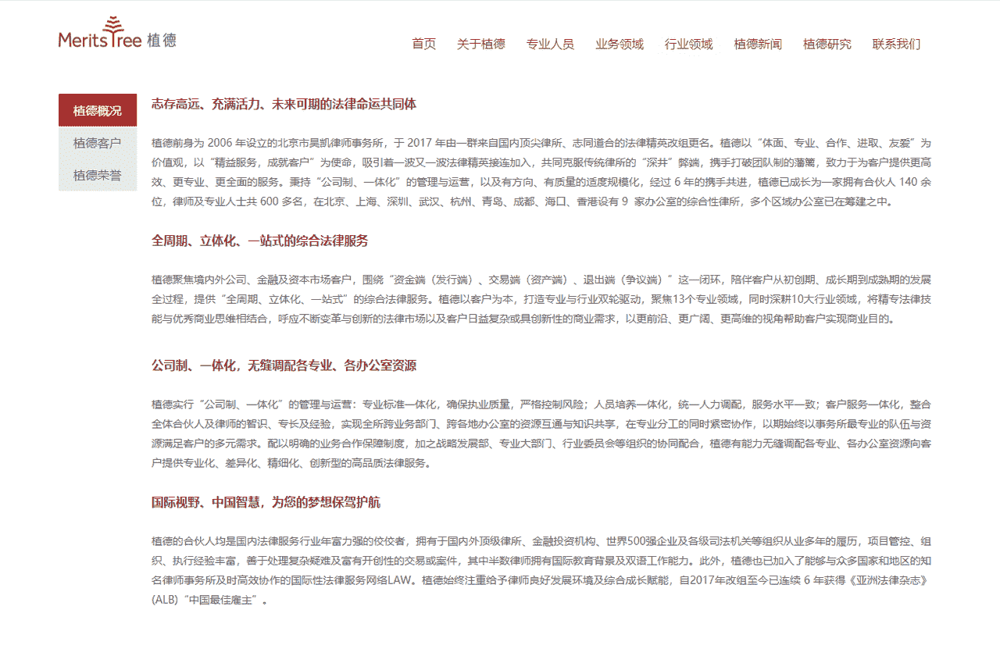

# 潘扬个人介绍

> 来源：[https://docs.feishu.cn/docx/E7HAdziNoo4gsaxPCT7ciDcin8d](https://docs.feishu.cn/docx/E7HAdziNoo4gsaxPCT7ciDcin8d)

---

# 一、基本信息

姓名：潘扬

工作单位：北京植德律师事务所

个人信息：

拥有多年法律行业创业背景，参与项目包括：律所管理系统、律师智能办案工具、法律大数据库、智能法律顾问、法律服务平台、数字化律所等。同时具备公司与律所的经营管理工作经验，在“法律+科技+互联网”和“律所数字化建设”方面有丰富的实践经历。

2020年之前，作为知名法律科技公司合伙人担任公司执行CEO，负责过公司管理及融资、区域市场开拓、律所咨询、国际游学与培训等业务，在一线走访过国内外上千家律所，与几万名律师建立过合作，积累了深厚的行业基础与认知。

2020年之后，与知名法律科技平台合作，牵头创办律师事务所，担任执行主任组建初创团队，从0到1搭建了律所的经营、管理和运营体系，通过对法律行业数字化的理解与律所管理的实践，打通了法律服务线上与线下的业务逻辑和场景，实现高速业务增长。

加入植德律师事务所之后，潘扬律师担任首席运营合伙人，聚焦律所的管理运营工作和数字化能力建设。

官网链接：https://www.meritsandtree.com/index/professional/detail?id=159

**过去经历过的故事：**

# 二、个人👸号

# 三、北京植德律师事务所介绍

官网链接：https://www.meritsandtree.com/index/about/about