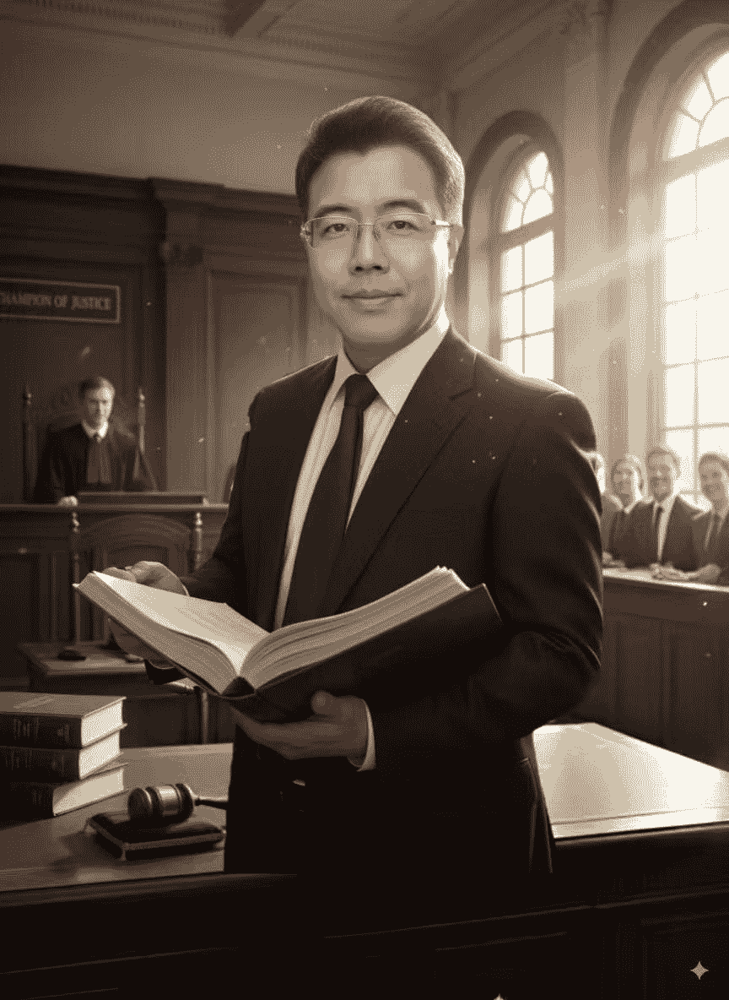

# 王杰文律师个人介绍

> 来源：[https://docs.feishu.cn/docx/D6CldAclsoDlq2x2JnDcOYZOnTe](https://docs.feishu.cn/docx/D6CldAclsoDlq2x2JnDcOYZOnTe)

---

王杰文律师是专注于人工智能与法律行业融合的资深法律人，当前执业于北京中银律师事务所。以下是综合最新信息的核心介绍：

一、专业背景与突破性成就

1.教育经历

· 本科毕业于华东政法大学，硕士就读于美国东北大学法学院（全球排名前30）。

· 首位登上美国法学院杂志的国际留学生（2024年报道）：因在哈佛与麻省理工合办的EDX公司法务部实习期间，深度参与在线教育法律需求研究而获此殊荣。

2.复合职业经历

· 兼具互联网创业背景（曾获融资）与法律实务经验，归国后加入北京中银律师事务所。

二、法律AI领域的核心贡献

1.技术实践

· 2025年成功部署本地化DeepSeek大模型，研发「本地知识库+离线文档处理」方案，显著降低AI部署成本。

· 开发永久免费的「AI律师助理」工具，覆盖民商事实体法及程序法问答，已积累4000+入库案例（2025年4月数据）。

2.行业赋能

· 创建国内首个法律AI视频号（已更新91期内容），主讲AI法律应用课程（温州律协、中银律所等）。

· 提出「人机协同」理念，推动动态法律知识图谱构建。

3.权威认可

· 2025年7月成为首批IMA认证律师（官方邀约制），持续优化法律AI工具体验。

· 受聘为广西东盟法商促进会特聘AI顾问（2025年5月），向东盟驻邕领事介绍中国法律AI进展。

三、用户关注的核心价值

· 免费工具普惠同行：AI律师助理坚持永久免费，帮助律师提升效率。

· 实战效果验证：2025年9月客户反馈显示，其通过AI深度辅助案件准备，实现精细化服务（如庭审策略优化）。

· 腾讯生态联动：作为腾讯系首个律师智能体开发者，推动法律AI在生态内的技术落地。

视频号：王杰文律师看AI

公众号：王杰文律师与你一起用AI

