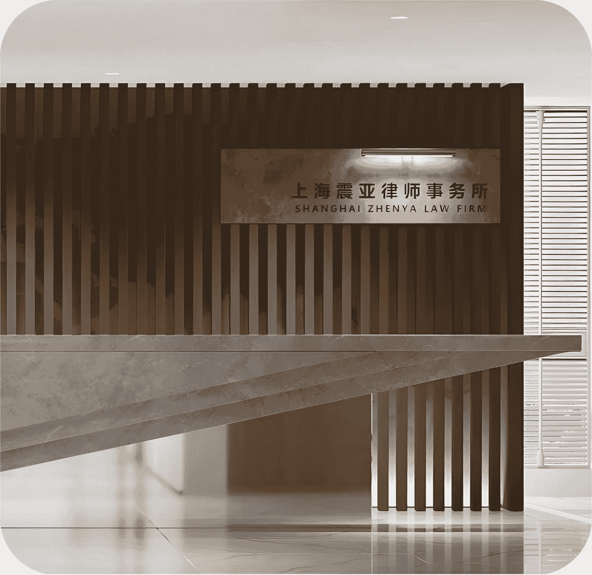
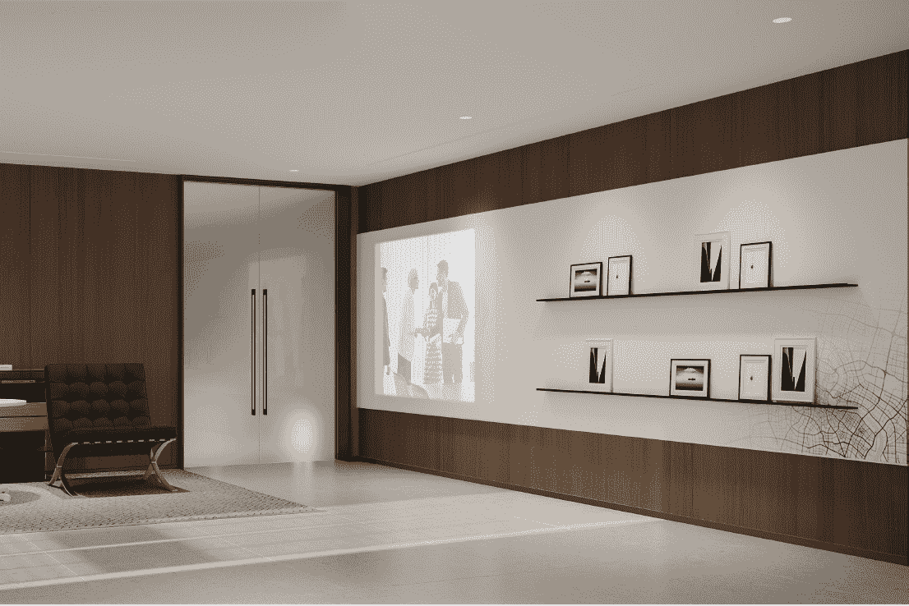
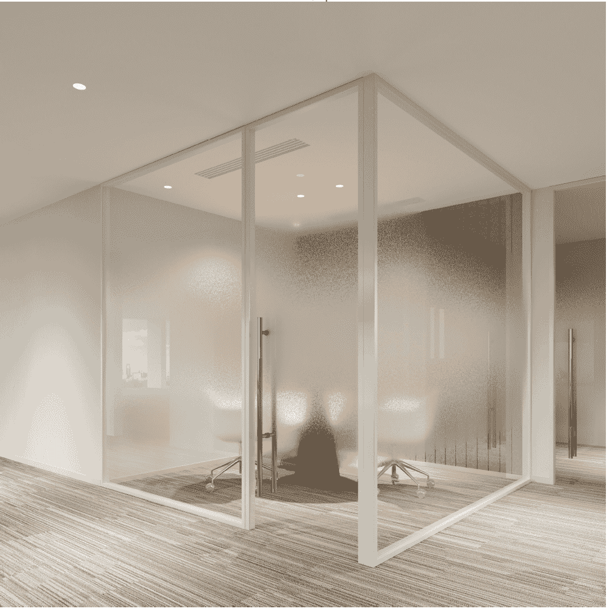
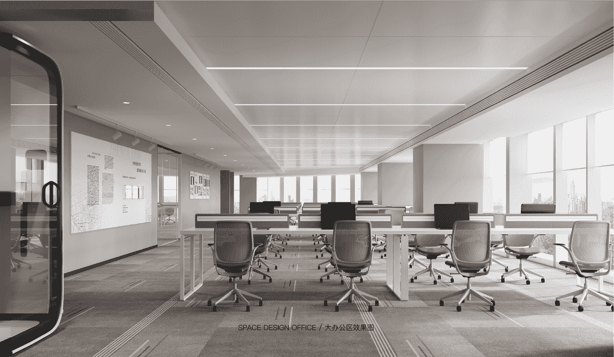
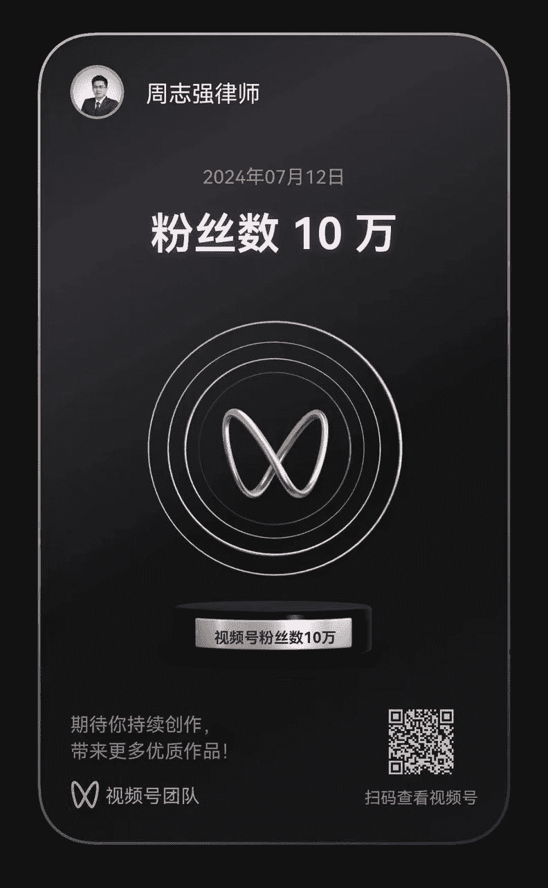
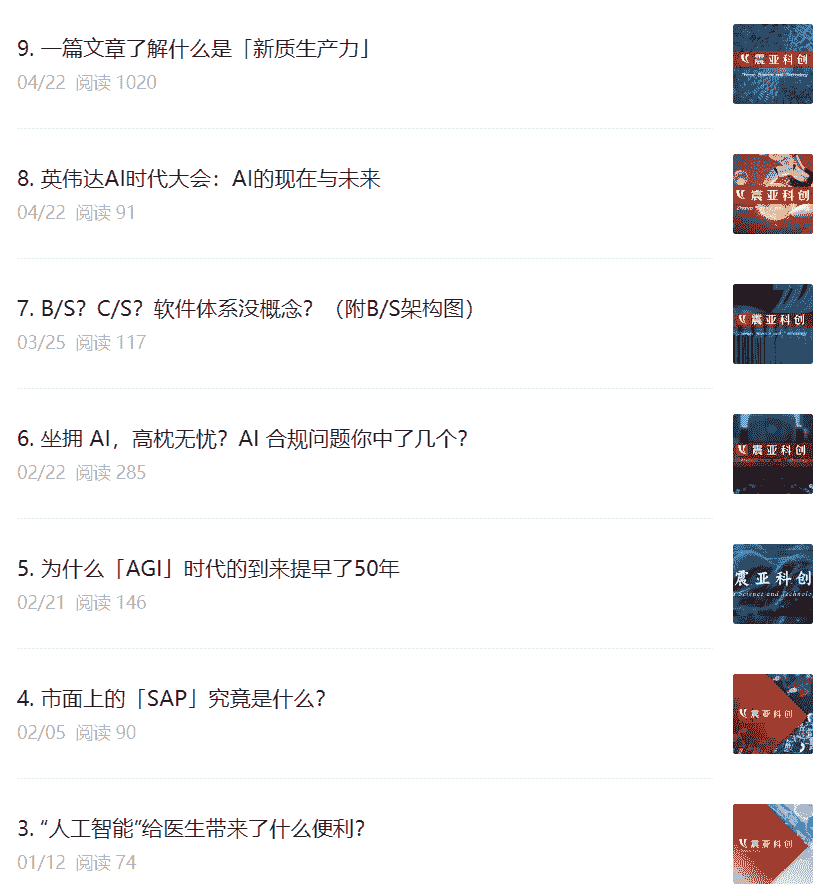
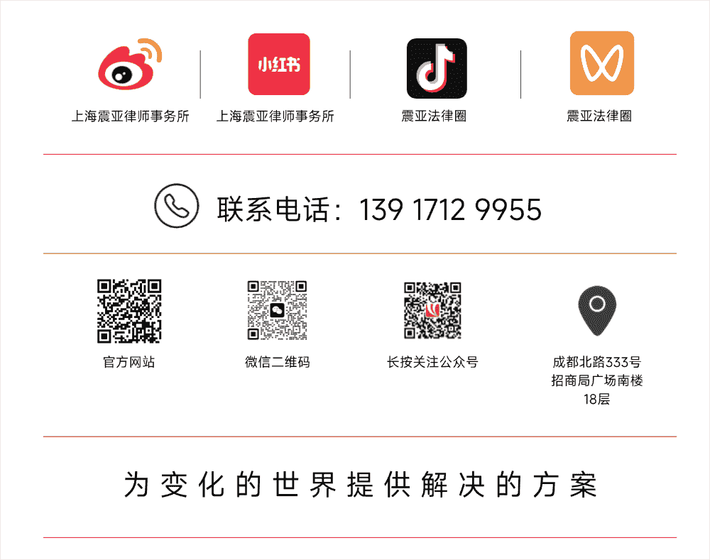

# 加入震亚-上海震亚律师事务所介绍

> 来源：[https://docs.feishu.cn/docx/O1vTd4Hjho6ea9xA123c1h4Znfd](https://docs.feishu.cn/docx/O1vTd4Hjho6ea9xA123c1h4Znfd)

> 更新于 20240716

# 关于震亚

---

您好，我们是上海震亚律师事务所（zhenyalaw.cn）。很高兴认识，自我介绍下：

+   震亚 2010 年建立，距今 15 年，办理案件 10000+ 件。

+   震亚由 100+ 位经验丰富的律师组成。律师平均执业年限 10+ 年，其中不乏 30 年以上丰富经验的资深律师。

📕震亚服务：婚姻家事、房地产与建筑工程、劳动人事、公司与并购、刑事诉讼、政府顾问、知识产权、民商纠纷等。

📑服务行业：政府部门、航空、车企、能源、保险、家具、房地产、金融投资、国际贸易、信息技术、科创、教育、娱乐等多个行业。

📍坐标：上海市静安区成都北路 333 号招商局广场南楼 18 层

☎️ 🛰️：ZhenyaLawyer

# **震亚发展**

---

<https://px6i9qvgd5t.feishu.cn/sync/C3D9dyxZVsEgO1bfvz3c6CNhnZg>

<https://px6i9qvgd5t.feishu.cn/sync/VIAgdb8ersiT6ZbGn3QcVp1JnPb>

<https://px6i9qvgd5t.feishu.cn/sync/BRc3dIwRnsi6zEbSz94cwAjsnzh>

<https://px6i9qvgd5t.feishu.cn/sync/EBTXdrtrXsfxI2bVlOScpU0rn4f>

# 震亚支持

<https://px6i9qvgd5t.feishu.cn/sync/XCOndOgxqszuYdb84zwcRjBnnne>

## 品质生活空间

## 行政支持平台

## 专业获客生态

### 新媒体

震亚融合新媒体开源与人工智能节流技术，提供创新法律服务机构。震亚致力于利用最前沿的科技手段，为法律服务领域带来革命性的变化。

**新媒体开源**：震亚拥抱新媒体的开放性，通过开源的平台和工具，促进知识的共享与传播。震亚法律专家团队与技术团队紧密合作，不断探索和开发新的法律服务模式，确保震亚的服务始终处于行业前沿。

+   **两个月**时间「周志强律师」视频号达成**十万粉丝**

+   **五个月**时间「律所长公主」全网**一万粉丝**

**AI 节流**：在人工智能的辅助下，实现了服务流程的智能化和自动化。AI 技术帮助震亚优化资源分配，提高工作效率，同时确保法律服务的精准性和个性化。

<https://px6i9qvgd5t.feishu.cn/sync/QOZKd1NQSs5FCRbrp1scLzOxnEc>

---

## **优质资源链接**

震亚致力于科技创新领域的法律服务，👸号特设「震亚科创」版块，专注于分享法律科技的最新动态和实际应用，紧跟科技发展的步伐，把握行业脉动。

在这里，您可以获取到最新的科技法律动态、知识产权保护策略、初创企业合规指导以及科技创新相关的政策解读。

震亚相信，通过专业服务，能够在科创浪潮中稳健前行，实现商业目标与法律合规的双赢。欢迎关注上海震亚律师事务所，与震亚一同探索科技与法律的交汇点。

> https://mp.weixin.qq.com/s/Z4oa1IqRSm-PMmSgZXUzvg

### **震亚科创**

# **关注震亚**

---

# 加入震亚

---

> 在震亚，我们寻找的不只是律师，更是志同道合的同行者。

> 这里，有自由发展的空间，有彼此成就的伙伴。

> 我们一起把专业做到极致，一同见证震亚的成长，成就彼此更远的未来。

**震亚积极招募以下人群：**

1.  在法律行业有丰富执业经验；

1.  青年律师且对法律行业抱有极大热情；

1.  极擅长与客户进行沟通，且了解法律行业客户特性；

1.  认可震亚「以新媒体+AI为手段，开源节流」战略理念并愿意投身其中的；

1.  对新媒体及 AI 本身有丰富实践经验的；

1.  对新媒体及 AI 虽无经验，但抱有极大热情，愿意投入时间/金钱实践的。

**震亚可以为你提供什么：**

1.  15 + 年律所背书；

1.  新媒体运营团队，每周一条短视频拍摄与剪辑；

1.  前沿的新媒体经验；

1.  优越的提成比例；

1.  便捷的行政流程；

1.  良好的办公环境；

1.  友善的同事氛围。

**震亚介绍及部分律师介绍：**[加入震亚-上海震亚律师事务所](https://px6i9qvgd5t.feishu.cn/wiki/L26AwfBDei8Fxjkif9NcRvBLnob)

如**有意加入震亚，请联系智库发起人**** **周鑫 (🛰️：Lawobsv)