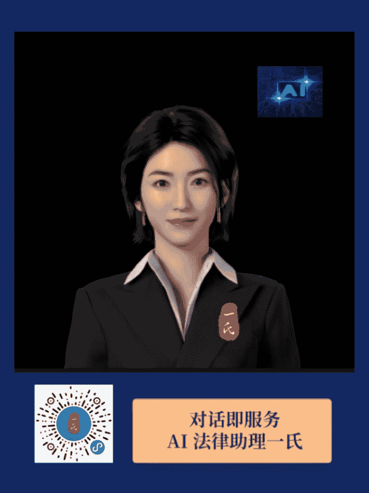

# 田莉律师个人介绍

> 来源：[https://docs.feishu.cn/docx/H8JSdaqWqo1Krjx5HACcjNMInde](https://docs.feishu.cn/docx/H8JSdaqWqo1Krjx5HACcjNMInde)

---

**田莉：**资深律师，AI 法律助理一氏的创造者，《法律行业人工智能服务能力评价方法》参编成员，热爱园艺的法律修真者。业务专长：公司治理、数据交易合规。

能给社区提供的资源：AI 法律助理一氏的共建、共享、共产计划正在酝酿中。

**AI 一氏：**是用新质生产力制造的、集生成式人工智能大脑、渠道运营系统和商城供应系统于一身的 AI 法律助理！

她，对外提供双向服务，致力于让法律服务从存量竞争，转变为增量开发：

1、作为律师分身，直接通过引导式双向多轮问答，为用户提供法律咨询；

2、作为助理，直接为律师效力，代替律师肉身下沉服务。

她，除了拥有全科通用能力以外，目前已经训练了民间借贷专项能力，即将上线公司决议专项能力，其他公司治理和数据合规能力，正在陆续扩展中。

光说不练假把式，一氏身手如何，试试便知：

